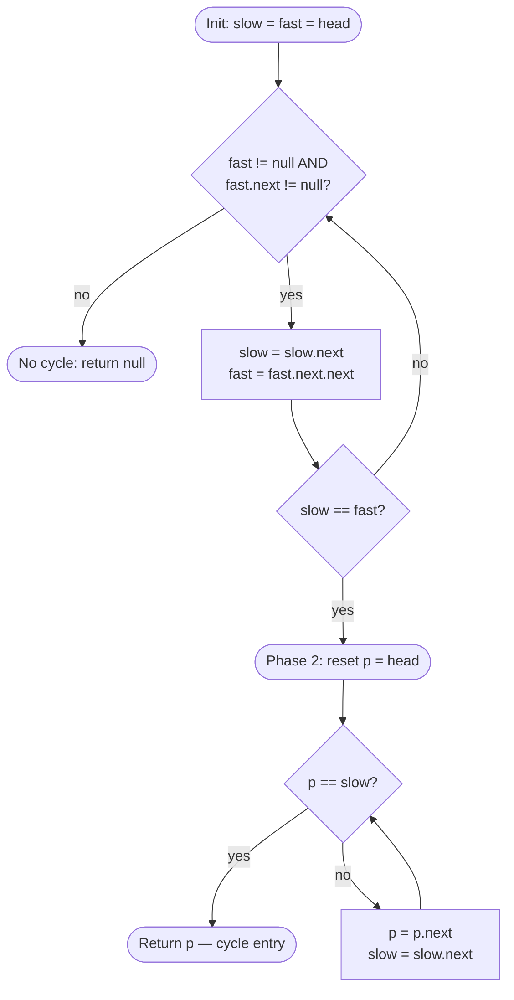

# Fast / Slow Pointers (Floyd)

<script setup>
const floydTemplate = `ListNode slow = head, fast = head;
while (fast != null && fast.next != null) {
  slow = slow.next;
  fast = fast.next.next;
  if (slow == fast) {              // Phase 1 — meeting proves a cycle
    ListNode p = head;             // Phase 2 — find the entry
    while (p != slow) {
      p = p.next;
      slow = slow.next;
    }
    return p;                      // cycle entry
  }
}
return null;                       // no cycle`

const floydInvariant = {
  statement: `After k iterations of phase 1, slow has advanced k steps and fast has advanced 2k steps. If both are inside a cycle of length C, the gap (fast - slow) mod C decreases by exactly 1 per step, so they meet within C iterations.`,
  initialization: `Before the loop: slow = head, fast = head. Both are at distance 0; gap = 0; vacuously inside the "same node" state.`,
  maintenance: `Each iteration advances slow by 1 and fast by 2. If no cycle exists, fast reaches null and the loop ends. If a cycle exists, once slow enters the cycle the gap mod C shrinks by 1 per step; after at most C iterations the gap is 0 and slow == fast.`,
  termination: `Loop ends when fast or fast.next is null (no cycle, return null) or when slow == fast (cycle proven; phase 2 locates the entry via the A = mC - B algebra).`
}

const floydComplexity = {
  time: 'O(n)',
  space: 'O(1)'
}

const floydSpecializations = [
  { slug: 'linked-list-cycle-floyd-s-easy', title: 'cycle-detect (bool)' },
  { slug: 'linked-list-cycle-ii-where-the-cycle-starts-medium', title: 'cycle-start (entry node)' },
  { slug: 'middle-of-a-linked-list-easy', title: 'middle-node (second half)' },
  { slug: 'nth-node-from-end-medium', title: 'nth-from-end (fixed gap)' },
  { slug: 'happy-number-sequence-as-linked-list-easy', title: 'happy-number (functional graph)' },
  { slug: 'find-the-duplicate-number-medium', title: 'find-duplicate (array as list)' }
]

const bareMechCode = `boolean hasCycle(ListNode head) {
  ListNode slow = head, fast = head;
  while (fast != null && fast.next != null) {
    slow = slow.next;
    fast = fast.next.next;
    if (slow == fast) return true;
  }
  return false;
}`

const bareMechInvariant = {
  statement: `After k iterations, slow is k nodes from head; fast is 2k nodes from head (or null if the list ended).`,
  initialization: `k = 0: slow = fast = head.`,
  maintenance: `Each iteration: slow advances 1, fast advances 2. If fast reaches null, we've proven acyclicity in O(n). If slow == fast, a cycle exists.`,
  termination: `Loop ends either when fast/fast.next is null (return false) or when slow == fast (return true). Both outcomes are bounded by O(n) steps.`
}

const bareMechComplexity = { time: 'O(n)', space: 'O(1)' }

const cycleDetectCode = `boolean hasCycle(ListNode head) {
  ListNode slow = head, fast = head;
  while (fast != null && fast.next != null) {
    slow = slow.next;
    fast = fast.next.next;
    if (slow == fast) return true;
  }
  return false;
}`

const cycleDetectInvariant = {
  statement: `slow is always at step k, fast at step 2k (or past end). A collision is possible only if both are inside a cycle; the loop exits otherwise.`,
  initialization: `Both pointers at head.`,
  maintenance: `Advance slow by 1, fast by 2; test for null (no cycle) and for collision (cycle).`,
  termination: `Non-cyclic lists: fast reaches null in ⌈n/2⌉ steps. Cyclic lists: collision happens within one cycle length C after slow enters the cycle.`
}

const cycleStartCode = `ListNode detectCycle(ListNode head) {
  ListNode slow = head, fast = head;
  while (fast != null && fast.next != null) {
    slow = slow.next;
    fast = fast.next.next;
    if (slow == fast) {              // meeting point
      ListNode p = head;
      while (p != slow) { p = p.next; slow = slow.next; }
      return p;                      // cycle entry
    }
  }
  return null;
}`

const cycleStartInvariant = {
  statement: `At the phase-1 collision, slow traveled A+B and fast traveled 2(A+B) where A = head→entry and B = entry→meeting. The excess fast walked is a whole number of cycle laps mC, so A+B = mC, hence A = mC - B. Walking A steps from the meeting point lands at the entry.`,
  initialization: `Phase 1 starts with slow = fast = head. Phase 2 starts with p = head, slow = meeting point.`,
  maintenance: `Phase 2: advance p by 1 and slow by 1 each iteration. By the A = mC - B identity, they land at the same node (the entry) in A steps.`,
  termination: `Phase 2 loop ends when p == slow — that node is the cycle entry.`
}

const middleNodeCode = `ListNode middleNode(ListNode head) {
  ListNode slow = head, fast = head;
  while (fast != null && fast.next != null) {
    slow = slow.next;
    fast = fast.next.next;
  }
  return slow;                   // second middle for even length
}`

const middleNodeInvariant = {
  statement: `For a list of length n, after ⌊n/2⌋ iterations fast is at index n (even) or n-1 (odd); slow is at index ⌊n/2⌋ — the second middle for even n, the unique middle for odd n.`,
  initialization: `Both pointers at head (index 0).`,
  maintenance: `Each iteration moves slow forward 1 and fast forward 2. The invariant "fast.index = 2 · slow.index" holds until fast hits end-of-list.`,
  termination: `Loop ends when fast or fast.next is null. slow is at the halfway mark.`
}

const nthFromEndCode = `ListNode removeNthFromEnd(ListNode head, int n) {
  ListNode dummy = new ListNode(0, head);
  ListNode fast = dummy, slow = dummy;
  for (int i = 0; i < n; i++) fast = fast.next;   // open the gap
  while (fast.next != null) {                      // walk in lockstep
    fast = fast.next;
    slow = slow.next;
  }
  slow.next = slow.next.next;                      // skip the nth-from-end
  return dummy.next;
}`

const nthFromEndInvariant = {
  statement: `After the gap is opened, fast is exactly n nodes ahead of slow. When fast lands on the last node, slow is at the node just before the one to remove.`,
  initialization: `fast and slow both at a dummy before head. Loop 1 advances fast by n so the gap is n.`,
  maintenance: `Loop 2 advances both by 1 each step. The gap stays constant at n.`,
  termination: `fast.next == null (fast at the last real node) ⇒ slow.next is the node to remove.`
}

const happyNumberCode = `boolean isHappy(int n) {
  int slow = n, fast = n;
  do {
    slow = squareSum(slow);
    fast = squareSum(squareSum(fast));
  } while (slow != fast);
  return slow == 1;
}

int squareSum(int x) {
  int s = 0;
  while (x > 0) { int d = x % 10; s += d * d; x /= 10; }
  return s;
}`

const happyNumberInvariant = {
  statement: `The sequence x, f(x), f(f(x)), ... is a functional graph: every node has exactly one successor. By pigeonhole it eventually cycles. The cycle contains 1 (happy) or does not (unhappy).`,
  initialization: `slow = fast = n.`,
  maintenance: `slow applies f once per iteration; fast applies f twice. The fast/slow collision proves the cycle has been reached.`,
  termination: `At collision, inspect slow: if slow == 1, the cycle is {1} and the number is happy. Otherwise the cycle avoids 1.`
}

const findDuplicateCode = `int findDuplicate(int[] nums) {
  int slow = nums[0], fast = nums[0];
  do {                                 // phase 1 — meet inside the cycle
    slow = nums[slow];
    fast = nums[nums[fast]];
  } while (slow != fast);
  slow = nums[0];                      // phase 2 — walk to the entry
  while (slow != fast) {
    slow = nums[slow];
    fast = nums[fast];
  }
  return slow;                         // the duplicated value
}`

const findDuplicateInvariant = {
  statement: `Treat index i → value nums[i] as the successor function. With n+1 integers in [1, n], pigeonhole guarantees two indices point to the same value — that value is the cycle entry. Floyd's phase 1 finds a meeting; phase 2 locates the entry = the duplicate.`,
  initialization: `slow = fast = nums[0]. Index 0 is never pointed to (values are in [1, n]), so 0 is outside the cycle and head→entry has distance ≥ 0.`,
  maintenance: `Phase 1: slow = nums[slow]; fast = nums[nums[fast]]. Phase 2: both advance by 1 step of f each.`,
  termination: `Phase 1 ends at meeting; phase 2 ends at entry = duplicate value.`
}

const inTheWildCode = `// GNU libc malloc: a free-list cycle check.
// mcheck's chunk walker uses Floyd to detect that heap corruption
// has turned the free list into a loop (which would otherwise be
// an infinite loop inside glibc).
static int check_free_list_cycle(struct chunk *head) {
  struct chunk *slow = head, *fast = head;
  while (fast != NULL && fast->next != NULL) {
    slow = slow->next;
    fast = fast->next->next;
    if (slow == fast) return -1;   // corrupted free list — abort
  }
  return 0;
}`

const trap1Bug = `Guarding only on \`fast != null\`:

  List: 1 → 2 (no cycle, even length)
  Iter 1: slow = 2, fast = 2  (passes fast != null)
  Iter 2: fast.next.next NPEs because fast.next = null

The guard "fast != null" is not enough — fast takes a two-hop step, so BOTH fast and fast.next must be non-null.`

const trap1Fix = `Guard both: \`while (fast != null && fast.next != null)\`.
Short-circuit evaluation ensures fast.next is only read when fast is non-null.
After the loop, you can safely dereference nothing — the loop exit covers all three failure modes (fast null, fast.next null, cycle collision).`

const trap2Bug = `Comparing by value instead of by reference:

  Two different nodes with val = 7:    node1 → node2 → node1  (cycle)
  Buggy check: if (slow.val == fast.val) ...
  As slow traverses, it hits a DIFFERENT node with val = 7
  and the code reports a cycle at the wrong location (or hits one in a non-cyclic list).

Value equality says "two nodes carry the same number"; reference equality says "same node in memory."`

const trap2Fix = `Use \`slow == fast\` (reference equality in Java; pointer equality in C/C++).
Never \`slow.val == fast.val\` for cycle detection — the pattern depends on
the pointers landing on the identical object, not matching values.`

const trap3Bug = `Find-the-Duplicate on an array that violates the functional-graph constraint:

  nums = [0, 1, 2, 3]  — index 0 points to 0 (self-loop at a non-duplicate)
  Floyd's phase 1 reports a "cycle" at value 0.
  But the problem guarantees values in [1, n], so a legal input would never
  put 0 in the array. Running Floyd without checking the constraint can
  return 0 as a "duplicate" when there isn't one.`

const trap3Fix = `Verify the functional-graph constraint before applying Floyd:
  • nums has n+1 elements, every value in [1, n].
  • At least one duplicate exists by pigeonhole.
Starting at slow = fast = nums[0] (and NOT at index 0) ensures the walk
begins inside the valid part of the graph.`

const advanced1 = `What if the sequence is only partially cyclic (ρ-shape with a tail of length A, cycle of length C)?

Floyd's phase 1 still works: fast reaches the cycle in A steps and then catches slow within C more steps.
Phase 2 reveals the shape: distance from head to entry is A, meeting point is B steps into the cycle,
and A = mC - B. The cycle-length lemma: once you have the entry, walking fast around the cycle until
it meets itself gives C in O(C) time.`

const advanced2 = `What if memory is tight and you cannot modify the list?

Floyd IS the answer — that's why the pattern exists. HashSet costs O(n) extra memory;
Floyd uses O(1). On a 10^8-node graph, HashSet is 1.6 GB of pointers; Floyd is 16 bytes
(two pointer variables). Every production garbage collector (HotSpot, V8, Go, .NET)
chose Floyd for exactly this reason.`

const advanced3 = `What if the successor function is NOT deterministic (branching)?

Floyd fails. The "hare catches tortoise" argument relies on both walkers taking the same path
once in the cycle. If a node has two possible nexts (as in a tree or general graph), fast and slow
can diverge and never meet. For branching structures, you need BFS/DFS with a visited set
(or Tarjan's SCC algorithm for cycle detection in general directed graphs).`

const advanced4 = `What if you need a BETTER cycle-detection constant factor?

Brent's algorithm (1980) improves Floyd's constant: instead of doubling fast's speed,
Brent moves fast in powers-of-2 steps and compares against a stationary slow that
periodically updates. Brent is ~36% faster than Floyd in practice (fewer "fast moved twice" ops)
but has the same O(n) time, O(1) space, and the same cycle-entry algebra.`

const advanced5 = `Breaking point — Floyd has no advantage when:
  • The structure branches (each node has >1 successor): walkers can take different paths.
  • You need to list every node in the cycle: Floyd detects, not enumerates.
  • You need the cycle length and have unbounded memory: a HashSet-based walk gives length as a byproduct.
  • The "cycle" is defined by value, not by reference: use a set keyed on value.
Diagnostic: can you apply "next(x)" deterministically and in O(1)? If no — different pattern.`

const advancedCrossProblems = [
  {
    title: 'Palindrome Linked List (fast-slow + reverse)',
    hint: 'Use fast-slow to find the middle, reverse the second half in place, then walk both halves comparing values. O(n) time, O(1) extra space.',
    reveal: 'Composed pattern: middle-node sub-variation + in-place linked-list reverse. The fast-slow part is purely to locate the midpoint; the comparison walk is linear.'
  },
  {
    title: 'Reorder List (middle + reverse + merge)',
    hint: 'Split at the middle (fast-slow), reverse the second half, then merge the two halves alternately. Three sub-passes, each O(n), O(1) extra space.',
    reveal: 'Three composed patterns: fast-slow (midpoint), in-place reverse, and two-pointer merge. The chapter trio hashing, two-pointer, and fast-slow all meet here.'
  },
  {
    title: 'Pollard\'s rho integer factorization',
    hint: 'For N = pq, pick x0 and define f(x) = (x^2 + c) mod N. The sequence x, f(x), f(f(x)), ... eventually cycles modulo p (the smaller prime). Apply Floyd to detect the cycle; gcd(|slow - fast|, N) reveals p.',
    reveal: 'The same pattern that detects linked-list cycles factors RSA moduli. Pollard rho runs in expected O(N^(1/4)) steps, O(1) extra memory. Floyd is embedded in every cryptographer\'s toolkit.'
  }
]

const quizQuestions = [
  {
    q: `What does Floyd's Tortoise & Hare guarantee?`,
    choices: [
      { text: 'Cycle detection in O(1) space if a cycle exists', correct: true, explanation: 'Two pointers at different speeds always meet inside any cycle; no extra memory needed.' },
      { text: 'The array is sorted', correct: false },
      { text: 'Cycle length is exactly n', correct: false },
      { text: 'Constant time detection', correct: false, explanation: 'It is O(n) time; O(1) space is the win.' }
    ]
  },
  {
    q: `After Floyd's pointers meet in a cycle, how do you find the entry?`,
    choices: [
      { text: 'Reset one pointer to head; walk both at speed 1; they meet at the entry', correct: true, explanation: 'Classic invariant: distance from head to entry = distance from meeting point to entry, both modulo cycle length.' },
      { text: 'Sort the linked list', correct: false },
      { text: 'The meeting point is the entry', correct: false, explanation: 'The meeting point is inside the cycle but not necessarily at the entry.' },
      { text: 'Cannot be found in O(1) space', correct: false }
    ]
  },
  {
    q: `For "Middle of a Linked List" with even length, how do you land on the SECOND middle?`,
    choices: [
      { text: 'Loop while fast != null && fast.next != null', correct: true, explanation: 'This condition places slow at the second middle for even lengths.' },
      { text: 'Loop while fast.next != null && fast.next.next != null', correct: false, explanation: 'That lands on the FIRST middle.' },
      { text: 'Use a queue', correct: false },
      { text: 'Two passes over the list', correct: false, explanation: 'Possible but defeats the single-pass guarantee.' }
    ]
  },
  {
    q: `Find the Duplicate Number: why does Floyd apply to an array of n+1 ints in [1, n]?`,
    choices: [
      { text: 'nums[i] treated as next(i) is a functional graph; the duplicate value is the cycle entry', correct: true, explanation: 'Pigeonhole guarantees a cycle; the merge-in structure guarantees the entry is the duplicate value.' },
      { text: 'The array is already sorted', correct: false },
      { text: 'By sorting the array', correct: false, explanation: 'That modifies the input, which is disallowed.' },
      { text: 'By XOR tricks', correct: false, explanation: 'XOR works for missing/single, not for duplicates.' }
    ]
  },
  {
    q: `Which of these is NOT a Fast / Slow pattern application?`,
    choices: [
      { text: 'Detecting a cycle in a linked list', correct: false },
      { text: 'Finding the middle of a linked list', correct: false },
      { text: 'Happy Number cycle test', correct: false },
      { text: 'Longest Common Subsequence', correct: true, explanation: 'LCS is dynamic programming over two sequences — nothing to do with two-speed walkers.' }
    ]
  }
]
</script>

<PatternVideo pattern-name="Fast & Slow Pointers" duration="8–12 min" />

<PatternProgress pattern-id="fast-slow" problems="fast-slow-linked-list-cycle-ii, linked-list-cycle, middle-of-the-linked-list, happy-number, find-the-duplicate-number, palindrome-linked-list" />


## Why fast / slow exists — the story

You're building a garbage collector for a JVM. Every allocated object has references to other objects. To decide what's still alive, you traverse the reference graph. **What if it cycles?** Java's garbage collector must never loop forever. Ever.

The honest first attempt is a `HashSet<Object>` of visited nodes. Walk the graph; before recursing into a node, check the set. If it's already there, you've found a cycle — stop. If not, add it and continue. This is exactly what most tutorials teach for cycle detection: a `visited` set, O(n) extra memory. It works. It's correct. Every reference implementation of `LinkedList#detectCycle` I've seen ships with it.

But the JVM's GC runs on the same heap it's collecting. If it allocates a `HashSet` sized to the reachable object graph, it *doubles* the memory pressure at exactly the moment memory is tightest. For a 4GB heap with 10⁸ objects, that's 3-4GB of extra HashSet — often more than the free memory. The GC's own bookkeeping causes the GC to fail. Real production incident, from Twitter's 2013 postmortem on JVM tuning.

The pattern that saves us is Floyd's Tortoise & Hare (1967): send **two walkers** through the graph, one at speed 1, one at speed 2. If a cycle exists, the fast walker eventually laps the slow one — **like runners on a track**. Cycle detection in O(n) time and **O(1) extra space**. Zero heap pressure. Every mark-sweep GC on Earth (HotSpot, V8, Go, .NET) uses a variant of this trick. Every LeetCode "Linked List Cycle" problem is testing whether you know it.

<FastSlowAnim />

Take `3→2→0→-4`, where `-4.next` points back to `2`. Start both pointers at `3`. After one round, slow is at `2`, fast is at `0`. After two rounds, slow is at `0`, fast is back at `2`. After three rounds, slow is at `-4`, fast is at `-4`. They meet, so you know there is a cycle. The clever second half is not just "there is a loop" — it is "where does the loop begin?" Reset one pointer to the head and leave the other at the meeting point. Move both one step at a time: head pointer goes `3→2`; meeting pointer goes `-4→2`; they collide at `2`, the entry.

Why should a junior engineer care? Because this pattern saves you from the default HashSet answer. A set of visited nodes is easy and correct, but it costs O(n) extra memory. Floyd's algorithm gives the same detection and entry location in O(1) space, which is exactly the kind of upgrade interviewers look for after you state the brute force.

> [key] **Key Insight** — After `k` steps, slow is at k, fast is at 2k. If they meet, they're inside a cycle. The distance from the meeting point to the cycle start equals the distance from the head to the cycle start — so reset slow to head, step both by 1, they meet exactly at the cycle entry.

## The bare mechanic — simplest working example

Before entry-finding, before the algebra, here's the whole pattern on a 6-node list without a cycle, then with one.

**No cycle** — `1 → 2 → 3 → 4 → 5 → 6 → null`:

| Step | slow at | fast at |
|---|---|---|
| 0 | 1 | 1 |
| 1 | 2 | 3 |
| 2 | 3 | 5 |
| 3 | 4 | null |

Loop exits at step 3 because `fast.next` is `null`. **No cycle → return false.** The total work was ⌈n/2⌉ iterations.

**With a cycle** — `1 → 2 → 3 → 4 → 5 → 6 → 3` (6.next points back to 3):

| Step | slow at | fast at | note |
|---|---|---|---|
| 0 | 1 | 1 | both at head |
| 1 | 2 | 3 | fast one node ahead inside the pre-cycle |
| 2 | 3 | 5 | fast enters cycle first |
| 3 | 4 | 3 | fast wraps around cycle |
| 4 | 5 | 5 | **collision** — cycle proven |

Four iterations total, O(1) extra memory. The hare laps the tortoise inside the cycle; the collision is inevitable once both are inside.

<PatternTemplateCard
  slug="fast-slow-bare-mechanic"
  :code="bareMechCode"
  language="java"
  :invariant="bareMechInvariant"
  :complexity="bareMechComplexity"
  title="Bare mechanic — cycle detection (bool)"
/>

> [key] **The single move.** Slow steps 1, fast steps 2. The gap mod cycle-length shrinks by 1 per iteration once both are inside the cycle. Everything in this chapter — entry location, middle node, nth-from-end, happy number, find-duplicate — is this move plus a different interpretation of "step."

## When to use it — one-successor structures

Fast/slow pointers are not "two pointers" in the sorted-array sense. They are a tool for structures where every state has exactly one next state, so repeatedly applying `next` forms either a chain that ends or a cycle that repeats.

### Recognize by
- "linked-list cycle", "detect a loop", "return the node where the cycle begins"
- "middle of linked list" or "second half of list" where one pointer should arrive halfway when another reaches the end
- "nth from end" where a fixed gap between two pointers replaces measuring length first
- "repeated transformation eventually reaches 1 or loops" such as Happy Number
- "array values point to indices" or "find duplicate without modifying array" — the array is secretly a functional graph
- "O(1) extra space" paired with a one-way structure

### When NOT to use it
Anything that isn't a single-successor structure. For general graphs (each node has multiple neighbours), use BFS/DFS. For two-pointer *on a sorted array*, the mechanism is entirely different — that's [Two Pointers](/patterns/two-pointers), driven by sortedness, not by a speed differential.

Also avoid this pattern when you must list every node in the cycle, when the structure can branch, or when the input is already indexed and a prefix/suffix computation answers the question more directly. Fast/slow tells you about meeting, distance, and relative position. It is not a replacement for graph traversal or sorting-based pair search.

> [key] **Key Insight — the successor function is deterministic.** Fast/slow works only when every node has *exactly one* next-node (linked list, functional graph, `x → f(x)` sequence). If a node can branch (tree, general graph), the "hare laps the tortoise" argument breaks because the walkers may take divergent paths.

> [inv] **Invariant — hare closes the gap by 1 per step once both are in the cycle.** Once slow enters the cycle, the gap between slow and fast (modulo the cycle length `C`) decreases by 1 per iteration. They meet in at most `C - (slow.dist mod C)` steps — always within one full cycle traversal.

## THE template

Every fast/slow problem is a specialization of Floyd's two-phase template: phase 1 detects a cycle via collision, phase 2 locates the entry via the `A = mC - B` algebra. If the problem only needs detection or only needs a positional query (middle, nth-from-end), you drop phase 2.

<PatternTemplateCard
  slug="fast-slow-template"
  :code="floydTemplate"
  language="java"
  :invariant="floydInvariant"
  :complexity="floydComplexity"
  :specializations="floydSpecializations"
  title="THE fast/slow template — Floyd two-phase"
/>

The mermaid flow is the two-phase loop as a picture:



<div class="readfig"><b>How to read it:</b> Phase 1 (top) advances two walkers at different speeds until fast runs off the end (no cycle) or they collide (cycle). Phase 2 (bottom) resets one walker to head; the next collision happens at the cycle entry. Each phase is O(n).</div>

## History — Floyd's Tortoise & Hare, 1967

The two-speed cycle-detection algorithm was invented by **Robert W. Floyd** in **1967** — famously not in a paper, but as an *exercise* in Donald Knuth's *The Art of Computer Programming Vol 2* (1969, §3.1 ex. 6-7). Knuth attributed it to Floyd via personal communication. The nickname "Tortoise and Hare" comes from Aesop; Knuth's exercise uses the terms informally in the answer key.

Floyd himself was a Turing Award winner (1978, for language semantics) and one of the founding figures of formal program correctness — the same person who introduced the concept of loop invariants that we've cited throughout this chapter. It's fitting that cycle detection, which relies on a tight algebraic invariant (`slow.dist ≡ fast.dist mod C`), came from him.

**Real-world usage:** every mark-sweep garbage collector (HotSpot JVM, V8, .NET, Go) uses variants of Floyd's algorithm to detect cyclic reference chains without allocating a `visited` set. The **Pollard's rho** integer-factorization algorithm (1975) — the same one used in RSA cryptanalysis — is Floyd's cycle detection applied to the sequence `x_{n+1} = (x_n² + c) mod N`. When you tell an interviewer "I'll use Floyd's cycle-detection, O(n) time and O(1) space," you're citing an algorithm still used at the bottom of every modern GC and every cryptographer's toolkit.

## Sub-variations of the template

Each sub-variation below swaps the **meaning of "next"** but keeps the two-speed structure unchanged. Reading these in order (detect → entry → positional → functional-graph) traces the capability growth from the simplest boolean test to array-as-list reframing.

<PatternSubVariationNav pattern="fast-slow" />

### Linked List Cycle (Floyd's) <span class="diff diff-e">Easy</span>

*[↗ LeetCode: Linked List Cycle](https://leetcode.com/problems/linked-list-cycle/)*

The simplest fast/slow problem — detect a cycle, return `true` or `false`. No entry-finding, no algebra. One phase, one return.

<InvariantProof :statement="cycleDetectInvariant.statement" :initialization="cycleDetectInvariant.initialization" :maintenance="cycleDetectInvariant.maintenance" :termination="cycleDetectInvariant.termination" />

> [key] **Blind-solve prompt** — on `head = [3, 2, 0, -4]` with `-4.next = node[1]`. Return `true`. Try the two-speed loop with the detection-only termination; then reveal.

<TemplateReveal :canonical="cycleDetectCode" language="java" slug="fast-slow-cycle-detect" />

**Why this is the gateway.** Everything else in the chapter adds structure on top of this four-line pattern. Phase 2 of Cycle II adds entry location; middle-of-list drops the collision check; happy-number swaps `.next` for `f(x)`; find-duplicate reframes an array as a functional graph.

<details class="learnings">
<summary><strong>Learnings — points to remember</strong></summary>

- **Two speeds in the same traversal.** Slow steps 1, fast steps 2. If a cycle exists, the gap between them modulo cycle length collapses to 0 in finite steps → they collide. If no cycle, fast walks off the end first.
- **Termination guard: `fast != null && fast.next != null`** — fast steps 2, so BOTH `fast` AND `fast.next` must exist before `fast = fast.next.next`. Skipping either half NPEs on even-length no-cycle lists.
- **O(n) time, O(1) space** — the whole reason this beats the HashSet-of-seen-nodes brute force. "Can you do it without extra memory?" is a classic follow-up on the HashSet answer.
- **Fast CAN wrap past slow many times** before they collide — correctness doesn't need them to meet on the first lap, only to eventually meet. The proof: `(fast_pos - slow_pos) mod cycle_length` strictly decreases each step inside the cycle.
- **This is the gateway for the whole chapter.** Every later problem is a variation: Cycle II adds phase 2; middle-of-list drops the collision check; happy-number swaps `.next` for `f(x)`; find-duplicate reframes an array as a functional graph.
- **No cycle? fast reaches null first** — return `false`. The template is: run until `fast == null || fast.next == null || slow == fast`, then test which exit condition hit.

</details>

### Linked List Cycle II — where the cycle starts <span class="diff diff-m">Medium</span>

*[↗ LeetCode: Linked List Cycle II](https://leetcode.com/problems/linked-list-cycle-ii/)*

<ProgressCheck id="linked-list-cycle-ii-floyd" />

<InvariantProof :statement="cycleStartInvariant.statement" :initialization="cycleStartInvariant.initialization" :maintenance="cycleStartInvariant.maintenance" :termination="cycleStartInvariant.termination" />

> [key] **Blind-solve prompt** — on `3 → 2 → 0 → -4 → (back to 2)`. Return the node with value `2`. The two-phase shape: collision + reset-to-head + lockstep. Try it, then reveal.

<TemplateReveal :canonical="cycleStartCode" language="java" slug="fast-slow-cycle-start" />

```svg
<svg role="img" viewBox="0 0 400 250" xmlns="http://www.w3.org/2000/svg" font-family="var(--dsa-font)" aria-label="Diagram illustrating: Linked List Cycle II (Floyd) Medium">
  <defs>
    <marker id="ar-floyd-neutral" markerWidth="9" markerHeight="9" refX="6" refY="3" orient="auto"><path d="M0,0 L6,3 L0,6 Z" fill="var(--dsa-neutral)"/></marker>
    <marker id="ar-floyd-primary" markerWidth="9" markerHeight="9" refX="6" refY="3" orient="auto"><path d="M0,0 L6,3 L0,6 Z" fill="var(--dsa-primary)"/></marker>
    <marker id="ar-floyd-success" markerWidth="9" markerHeight="9" refX="6" refY="3" orient="auto"><path d="M0,0 L6,3 L0,6 Z" fill="var(--dsa-success)"/></marker>
  </defs>
  <rect x="0" y="0" width="400" height="250" rx="12" fill="var(--dsa-bg)"/>
  <text x="200" y="28" text-anchor="middle" font-size="13" font-weight="700" fill="var(--dsa-primary)">Floyd: two speeds reveal the cycle entry</text>

  <path d="M69 92 L105 92" stroke="var(--dsa-neutral)" stroke-width="var(--dsa-arrow-stroke)" marker-end="url(#ar-floyd-neutral)" fill="none"/>
  <path d="M135 92 L171 92" stroke="var(--dsa-neutral)" stroke-width="var(--dsa-arrow-stroke)" marker-end="url(#ar-floyd-neutral)" fill="none"/>
  <path d="M201 92 L237 92" stroke="var(--dsa-neutral)" stroke-width="var(--dsa-arrow-stroke)" marker-end="url(#ar-floyd-neutral)" fill="none"/>
  <path d="M267 92 L303 92" stroke="var(--dsa-neutral)" stroke-width="var(--dsa-arrow-stroke)" marker-end="url(#ar-floyd-neutral)" fill="none"/>
  <path d="M330 107 C330 178 190 178 190 119" stroke="var(--dsa-warning)" stroke-width="var(--dsa-arrow-stroke)" marker-end="url(#ar-floyd-neutral)" fill="none" stroke-dasharray="7 5"/>

  <g text-anchor="middle" font-size="17" font-weight="700">
    <circle cx="48" cy="92" r="21" fill="var(--dsa-neutral-soft)" stroke="var(--dsa-neutral-line)" stroke-width="1.6"/><text x="48" y="98" fill="var(--dsa-ink)">3</text>
    <circle cx="114" cy="92" r="21" fill="var(--dsa-warning-soft)" stroke="var(--dsa-warning)" stroke-width="1.6"/><text x="114" y="98" fill="var(--dsa-ink)">2</text>
    <circle cx="180" cy="92" r="21" fill="var(--dsa-primary-soft)" stroke="var(--dsa-primary)" stroke-width="1.6"/><text x="180" y="98" fill="var(--dsa-ink)">0</text>
    <circle cx="246" cy="92" r="21" fill="var(--dsa-neutral-soft)" stroke="var(--dsa-neutral-line)" stroke-width="1.6"/><text x="246" y="98" fill="var(--dsa-ink)">-4</text>
    <circle cx="312" cy="92" r="21" fill="var(--dsa-success-soft)" stroke="var(--dsa-success)" stroke-width="1.6"/><text x="312" y="98" fill="var(--dsa-ink)">5</text>
  </g>
  <text x="114" y="58" text-anchor="middle" font-size="12" font-weight="700" fill="var(--dsa-warning)">cycle start</text>

  <line x1="180" y1="168" x2="180" y2="118" stroke="var(--dsa-primary)" stroke-width="var(--dsa-arrow-stroke)" marker-end="url(#ar-floyd-primary)"/>
  <text x="180" y="188" text-anchor="middle" font-size="12" font-weight="700" fill="var(--dsa-primary)">slow</text>
  <line x1="312" y1="168" x2="312" y2="118" stroke="var(--dsa-success)" stroke-width="var(--dsa-arrow-stroke)" marker-end="url(#ar-floyd-success)"/>
  <text x="312" y="188" text-anchor="middle" font-size="12" font-weight="700" fill="var(--dsa-success)">fast 2×</text>
  <text x="200" y="224" text-anchor="middle" font-size="11.5" font-style="italic" fill="var(--dsa-neutral)">after meeting, reset one pointer to head; both walk one step to entry</text>
</svg>
```

<div class="readfig"><b>How to read it:</b> Different speeds force a meeting inside the loop; then the distance from head to entry equals the distance from the meeting point back to the cycle start.</div>

#### Problem
Detect whether a singly linked list has a **cycle**, and if so return the node where the cycle **begins** — using O(1) space.

**Constraints:** up to `10⁴` nodes; the cycle (if present) is reachable by following `next`.

**Example 1:** `3→2→0→-4` with `-4` linking back to `2` → returns node `2`.

**Example 2:** `1→2→null` → `null` (no cycle, so no entry node).

#### Solution — brute force
The first correct idea is to remember every node reference you have seen. Walk from `head`; before visiting a node, ask whether it is already in the set. If yes, that exact node is the cycle entry.

```java
ListNode detectCycleBrute(ListNode head) {
  Set<ListNode> seen = new HashSet<>();
  ListNode cur = head;
  while (cur != null) {
    if (seen.contains(cur)) return cur;
    seen.add(cur);
    cur = cur.next;
  }
  return null;
}
```

**Brute-force cost:** O(n) time, O(n) space — correct, but the extra visited set is what Floyd removes.

#### Why the reset works without memorizing algebra

Suppose the distance from head to the cycle entry is `A`, the cycle length is `C`, and the meeting point is `B` steps after the entry. Slow has walked `A + B`. Fast has walked twice that. The extra distance fast walked must be whole laps of the cycle, so `2(A+B) - (A+B) = A+B = mC`. Rearranged, `A = mC - B`. That means from the meeting point, walking `A` steps lands exactly at the entry because `C - B` steps complete the current lap, and the remaining laps do not change the final node. The code does not need to know `A`, `B`, or `C`; it just walks both pointers until equality.

A simpler mental model: once the two runners collide, one runner is exactly "head-to-entry distance" away from the entry if it keeps running around the loop. So put the other runner at the head and let both move at the same speed.

<CodeTrace
  title="Floyd cycle detection — list 3→2→0→-4 with -4.next = 2 (cycle at 2)"
  :values="[3,2,0,-4]"
  :windowKeys="['slow','fast']"
  :cellWidth="42"
  :steps='[
    { pointers: { slow: 0, fast: 0 }, vars: { phase: "meet" }, note: "start: both at head" },
    { pointers: { slow: 1, fast: 2 }, vars: { phase: "meet" }, note: "slow +1, fast +2" },
    { pointers: { slow: 2, fast: 1 }, vars: { phase: "meet" }, note: "fast wraps past -4 back to 2" },
    { pointers: { slow: 3, fast: 3 }, vars: { phase: "meet" }, note: "collision at -4 — cycle proven", added: [3] },
    { pointers: { slow: 3, fast: 0 }, vars: { phase: "reset", p: 0 }, note: "reset fast to head; both step 1 at a time" },
    { pointers: { slow: 1, fast: 1 }, vars: { phase: "entry", p: 1 }, note: "collision at 2 — cycle entry", added: [1] }
  ]'
/>

> [note] **Interview script** — First, I'd verify this is a singly linked list and I need the entry node, not just true/false. The brute force is a `HashSet<ListNode>`: return the first repeated node in O(n) time and O(n) space. To optimize space, I'll use Floyd's two pointers: slow moves one step, fast moves two, and a meeting proves a cycle. Then I reset one pointer to head and move both one step at a time; their next meeting is the entry, so the final complexity is O(n) time and O(1) space.

<details class="learnings">
<summary><strong>Learnings — points to remember</strong></summary>

- **Two phases, same four-line template.** Phase 1 (collision): slow steps 1, fast steps 2 until collide. Phase 2 (entry): reset one pointer to head, both step 1, next meeting IS the entry.
- **The algebra: `A = mC - B`** where A = head-to-entry, B = entry-to-meeting, C = cycle length. Rearranging: from the meeting point, walking A steps lands at the entry because `C - B` steps complete the lap and the rest are full laps.
- **You do NOT need to know A, B, or C to run the algorithm.** Only to prove it. The code just walks both pointers until equality — no measurement, no arithmetic.
- **The simpler mental model:** once the runners collide, ONE runner is "head-to-entry distance" away from the entry if it keeps running. Put the other at head and let both walk at the same speed; they meet at the entry.
- **O(n) time, O(1) space** — again beats the HashSet brute force. The "O(1) space" demand is what makes Floyd famous; without it, HashSet is simpler to write and reason about.
- **Siblings share the two-phase shape:** Find the Duplicate Number uses THIS code verbatim with the array reframed as a functional graph (`nums[i]` is the "next" pointer).

</details>

### Middle of a Linked List <span class="diff diff-e">Easy</span>

*[↗ LeetCode: Middle of the Linked List](https://leetcode.com/problems/middle-of-the-linked-list/)*

Phase 1 only — the collision check is dropped. When `fast` falls off the list, `slow` has traversed exactly half. For even length, you get the second middle.

<InvariantProof :statement="middleNodeInvariant.statement" :initialization="middleNodeInvariant.initialization" :maintenance="middleNodeInvariant.maintenance" :termination="middleNodeInvariant.termination" />

> [key] **Blind-solve prompt** — on `1 → 2 → 3 → 4 → 5`. Return the node with value `3`. On `1 → 2 → 3 → 4` (even length), return the node with value `3` (second middle). Try it, then reveal.

<TemplateReveal :canonical="middleNodeCode" language="java" slug="fast-slow-middle" />

**The even/odd choice.** `while (fast != null && fast.next != null)` lands on the SECOND middle for even length. To land on the FIRST middle, use `while (fast.next != null && fast.next.next != null)`. The problem statement decides which — stating the choice out loud in an interview signals depth.

<details class="learnings">
<summary><strong>Learnings — points to remember</strong></summary>

- **Phase 1 ONLY — drop the collision check.** When `fast` falls off the end, `slow` has traversed exactly half the list. No cycle math, no reset.
- **Even-length tie-break is a CHOICE, not a bug.** `while (fast != null && fast.next != null)` lands on the SECOND middle for even length; `while (fast.next != null && fast.next.next != null)` lands on the FIRST middle. The problem statement decides which — state the choice out loud in an interview.
- **O(n) time, O(1) space, single pass.** Beats the two-pass "measure length, divide by 2, walk to middle" by one scan — same complexity but one fewer traversal, which matters on linked lists where cache behavior is bad.
- **Why not store nodes in an array?** O(n) extra space, defeats the point. The two-speed trick is the whole lesson.
- **Composes naturally with other list operations.** "Reorder list" = find middle, reverse second half, interleave. "Palindrome linked list" = find middle, reverse second half, compare.
- **For doubly-linked lists** you don't need this trick — jump directly by index. The two-speed middle finder is a singly-linked-list specialty.

</details>

### Nth Node From End <span class="diff diff-m">Medium</span>

*[↗ LeetCode: Remove Nth Node From End of List](https://leetcode.com/problems/remove-nth-node-from-end-of-list/)*

A fixed-gap variant: open a gap of `n` nodes between fast and slow, then walk both in lockstep. When fast lands on the last node, slow is at the node just before the one to remove — a single-pass O(n) solution without first measuring list length.

<InvariantProof :statement="nthFromEndInvariant.statement" :initialization="nthFromEndInvariant.initialization" :maintenance="nthFromEndInvariant.maintenance" :termination="nthFromEndInvariant.termination" />

> [key] **Blind-solve prompt** — on `1 → 2 → 3 → 4 → 5`, remove the 2nd from end (value `4`). Return `1 → 2 → 3 → 5`. The dummy-head trick is the subtle part — try it, then reveal.

<TemplateReveal :canonical="nthFromEndCode" language="java" slug="fast-slow-nth-from-end" />

**Why the dummy head?** When `n` equals the list length, you need to remove the actual head — but you can't move slow back to "before head" without a dummy. Prepending a dummy node gives slow a safe starting point: after opening the gap, `slow.next` is always the removal target, including the n-equals-length case.

<details class="learnings">
<summary><strong>Learnings — points to remember</strong></summary>

- **Fixed-gap variant: open a gap of `n` nodes between fast and slow BEFORE walking in lockstep.** Fast advances n steps alone; then both advance together until fast lands on the last node. Slow now points to the node BEFORE the one to remove.
- **Dummy head is non-negotiable for "remove nth from end".** When n = length, the actual head must be removed; without a dummy, you can't set `slow.next` to its successor because slow would be "before head" — a position that doesn't exist. Prepending a dummy makes `slow` always a real node.
- **Single-pass O(n), O(1) space.** Beats the two-pass "measure length, then walk `length - n`" by one scan — one of the standard interview "optimize" moves.
- **Return `dummy.next`, not `head`.** If you removed the original head, `head` is now orphaned/stale. The dummy's `.next` is always the correct new head.
- **Gap-size semantics: fast moves `n` steps, then both walk together.** When fast reaches the LAST node (not past it), slow points to `nth from end - 1`, which is the predecessor needed for removal.
- **Siblings in the fixed-gap family:** reorder-list, swap-pairs, every "modify N-away relationships" problem on a linked list — all use the same open-gap-then-lockstep template.

</details>

### Happy Number (sequence as linked list) <span class="diff diff-e">Easy</span>

*[↗ LeetCode: Happy Number](https://leetcode.com/problems/happy-number/)*

The successor function isn't `.next` — it's `f(x) = sum of squared digits`. The sequence `x, f(x), f(f(x)), ...` is a functional graph: by pigeonhole, it eventually cycles. The cycle either contains 1 (happy) or does not (unhappy, trapped at `{4, 16, 37, 58, 89, 145, 42, 20}`).

<InvariantProof :statement="happyNumberInvariant.statement" :initialization="happyNumberInvariant.initialization" :maintenance="happyNumberInvariant.maintenance" :termination="happyNumberInvariant.termination" />

> [key] **Blind-solve prompt** — on `n = 19`. The sequence is `19 → 82 → 68 → 100 → 1`; the cycle at 1 means happy. On `n = 2`, the sequence enters the 8-cycle around 42; unhappy. Try it, then reveal.

<TemplateReveal :canonical="happyNumberCode" language="java" slug="fast-slow-happy-number" />

**Why fast/slow and not a HashSet?** A HashSet of seen values works in O(log n · k) time (k = cycle length) and O(k) space. Floyd here is also O(log n · k) time but O(1) space — the natural answer when the problem writer asks "without extra memory, decide if the sequence loops."

<details class="learnings">
<summary><strong>Learnings — points to remember</strong></summary>

- **The "next pointer" doesn't have to be `.next`.** Any deterministic successor function `f: X → X` makes a sequence a functional-graph walk — and by pigeonhole, every such walk eventually cycles. Floyd works unchanged.
- **`f(x) = sum of squared digits` is the successor here.** The sequence `x, f(x), f(f(x)), ...` either hits `1` (happy, cycle on `1`) or enters the 8-cycle `{4, 16, 37, 58, 89, 145, 42, 20}` (unhappy).
- **Terminating condition is "slow == 1", not "no cycle".** Every input WILL cycle; the question is which cycle. If the slow runner lands on 1, happy; if slow == fast but neither is 1, unhappy.
- **O(log n · k) time, O(1) space.** Numbers shrink fast under digit-squaring (log n digits × squared ≤ 81 × log n contribution), so k is small; the overall time is effectively O(log n).
- **A HashSet of seen values works too** — same time, O(k) space. Pick Floyd when the interviewer asks for O(1) space; pick HashSet when readability wins.
- **This is the "sequence is a linked list" mental shift.** Once you see it here, Find-the-Duplicate-Number (next) uses the exact same reframe on an array.

</details>

### Find the Duplicate Number <span class="diff diff-m">Medium</span>

*[↗ LeetCode: Find the Duplicate Number](https://leetcode.com/problems/find-the-duplicate-number/)*

The best "array is secretly a linked list" problem on LeetCode. With n+1 integers in [1, n], index-to-value forms a functional graph; by pigeonhole, two distinct indices point to the same value — that value is the cycle entry. Floyd phase 1 finds a meeting; phase 2 locates the entry = the duplicate.

<InvariantProof :statement="findDuplicateInvariant.statement" :initialization="findDuplicateInvariant.initialization" :maintenance="findDuplicateInvariant.maintenance" :termination="findDuplicateInvariant.termination" />

> [key] **Blind-solve prompt** — on `nums = [1, 3, 4, 2, 2]`. Index 0 → 1 → 3 → 2 → 4 → 2 — the cycle enters at value 2, so the duplicate is 2. Try the Floyd phase-1 + phase-2 shape, then reveal.

<TemplateReveal :canonical="findDuplicateCode" language="java" slug="fast-slow-find-duplicate" />

**The constraint carries all the weight.** The problem guarantees `nums.length = n + 1` with values in `[1, n]`. This is NOT a general cycle-detection problem — it's a constraint-engineered one. Without the constraint, the duplicate could be elsewhere; with it, pigeonhole + the "value-is-pointer" reframe lets Floyd solve what sorting would, in O(n) time without modifying the array.

<details class="learnings">
<summary><strong>Learnings — points to remember</strong></summary>

- **Array-as-linked-list reframe.** `nums[i]` IS the "next pointer" from index `i`. With n+1 values in [1, n], index 0 can start a traversal; by pigeonhole two indices MUST point to the same value → cycle. The cycle's entry node IS the duplicate value.
- **Phase 1 + Phase 2 of Cycle II run UNCHANGED.** The algorithm is identical; only the successor-function definition changes (`slow = nums[slow]` instead of `slow = slow.next`).
- **The constraint carries ALL the weight.** `nums.length = n + 1`, values in `[1, n]`, EXACTLY one duplicate (possibly repeated). Change any of these and the "cycle in a functional graph" framing breaks and Floyd no longer applies.
- **O(n) time, O(1) extra space, DOES NOT MODIFY the input.** This is the whole reason Floyd beats "sort and scan for pairs" (O(n log n) + mutates) and "boolean seen[]" (O(n) extra space).
- **Alternative: binary search on the answer** (O(n log n) time, O(1) space, no mutate) — count values `≤ mid`; if count > mid, duplicate is in `[1, mid]`. Also valid; use it in languages where linked-list reframing feels forced.
- **DO NOT sort the array (even in-place)** — the problem explicitly forbids modification. Sorting also costs O(n log n), losing to Floyd on both axes.

</details>

## Traps & gotchas

Three traps every fast/slow problem can hit. Each sub-variation above calls out its own specific bugs; these three are the ones that cross problem boundaries and bite in cold interviews.

### Trap 1 — guarding only on `fast != null`

<TrapTrace title="NPE on even-length lists when fast.next is null" input="list = 1 → 2 (even length, no cycle)" :bug="trap1Bug" :fix="trap1Fix" />

### Trap 2 — comparing nodes by value instead of reference

<TrapTrace title="Value equality falsely proves a cycle on lists with duplicate values" input="list with two nodes having val = 7" :bug="trap2Bug" :fix="trap2Fix" />

### Trap 3 — Find-the-Duplicate on a non-functional-graph input

<TrapTrace title="Running Floyd on an array that doesn't satisfy the [1, n] constraint" input="nums = [0, 1, 2, 3]" :bug="trap3Bug" :fix="trap3Fix" />

> [trap] **The 10-second trap-check.** Before shipping any fast/slow solution, verify the three preconditions: (1) the structure has exactly one successor per node, (2) comparison is reference-based not value-based, (3) if the input is an array treated as a graph, every value is a valid index. All three must hold or the pattern silently returns the wrong answer.

## In the wild — Floyd in real systems

Floyd isn't just an interview trick. Every mark-sweep garbage collector, every integer-factorization library, every linked-list sanity check in a kernel-space data structure uses this two-speed loop.

```c
// GNU libc malloc: a free-list cycle check.
// mcheck's chunk walker uses Floyd to detect that heap corruption
// has turned the free list into a loop (which would otherwise be
// an infinite loop inside glibc).
static int check_free_list_cycle(struct chunk *head) {
  struct chunk *slow = head, *fast = head;
  while (fast != NULL && fast->next != NULL) {
    slow = slow->next;
    fast = fast->next->next;
    if (slow == fast) return -1;   // corrupted free list — abort
  }
  return 0;
}
```

The pattern:
- **GNU libc `mcheck`** — the free-list walker calls `check_free_list_cycle` before every allocation under paranoid mode; a cycle means heap corruption.
- **Linux `kmemleak`** — the kernel object-tracking subsystem uses Floyd to detect reference loops before they stall the leak-scan worker.
- **HotSpot JVM `G1GC`** — reference-processor cycle checks on soft/weak/phantom references use a variant of Floyd (plus marking color bits) to prevent GC loops.
- **Pollard's rho factorization** — the inner loop IS Floyd applied to `x_{n+1} = (x_n² + c) mod N`. Every modern cryptographic library's integer-factor-primality module ships this.

The code above is 10 lines. The *idea* is "two walkers, one at double speed, collision proves a cycle." That's the whole pattern — the complexity in production comes from concurrency, retry policies, and reference-coloring, not from the algorithm.

## Recognition drill

Each problem below is phrased without the pattern tag. Your task: name the sub-variation. The drill randomizes order each session and tracks your running score.

<RecognitionDrill pattern="fast-slow" :count="10" />

> [key] **How to use.** Aim for ≥ 8/10 on this drill before you consider cold-solving fluency the next bottleneck. The distractors are the specific other patterns the problem can be mistaken for — if you keep picking "hashing" when the answer is "fast-slow", that's your highest-leverage study target.

## Advanced — follow-ups and failure modes

The sub-variations above are the shapes you're expected to recognize cold. The questions below are the ones that come **after** you write a correct Floyd — "what if we change this one constraint?" — and separate pattern-fluent from pattern-mastered.

### What if the sequence is only partially cyclic (ρ-shape)?

<details>
<summary>Click to reveal</summary>

{{ advanced1 }}

</details>

### What if memory is tight and you cannot modify the list?

<details>
<summary>Click to reveal</summary>

{{ advanced2 }}

</details>

### What if the successor function is not deterministic?

<details>
<summary>Click to reveal</summary>

{{ advanced3 }}

</details>

### What if you need a better constant factor?

<details>
<summary>Click to reveal</summary>

{{ advanced4 }}

</details>

### Breaking point — when Floyd has no advantage

<details>
<summary>Click to reveal</summary>

{{ advanced5 }}

</details>

### Cross-pattern problems

Three problems where fast/slow composes with another pattern. Each is a diagnostic — if you can identify the composition and solve each, you've transferred the recognition skill beyond this chapter.

<div v-for="(p, i) in advancedCrossProblems" :key="i" style="border: 1px solid var(--vp-c-divider); border-radius: 8px; padding: 14px 16px; margin: 12px 0; background: var(--vp-c-bg-soft);">
  <div style="font-weight: 700; margin-bottom: 6px;">{{ p.title }}</div>
  <div style="font-size: 0.92em; color: var(--vp-c-text-2); margin-bottom: 8px;">{{ p.hint }}</div>
  <details>
    <summary style="font-size: 0.85em; cursor: pointer; color: var(--vp-c-brand-1);">Reveal answer sketch</summary>
    <div style="padding-top: 8px; font-size: 0.9em;">{{ p.reveal }}</div>
  </details>
</div>

## Related patterns + Check your understanding

<RelatedPatterns pattern-id="fast-slow" />

<Quiz
  pattern-id="fast-slow"
  :questions="quizQuestions"
/>

<PrintButton />
