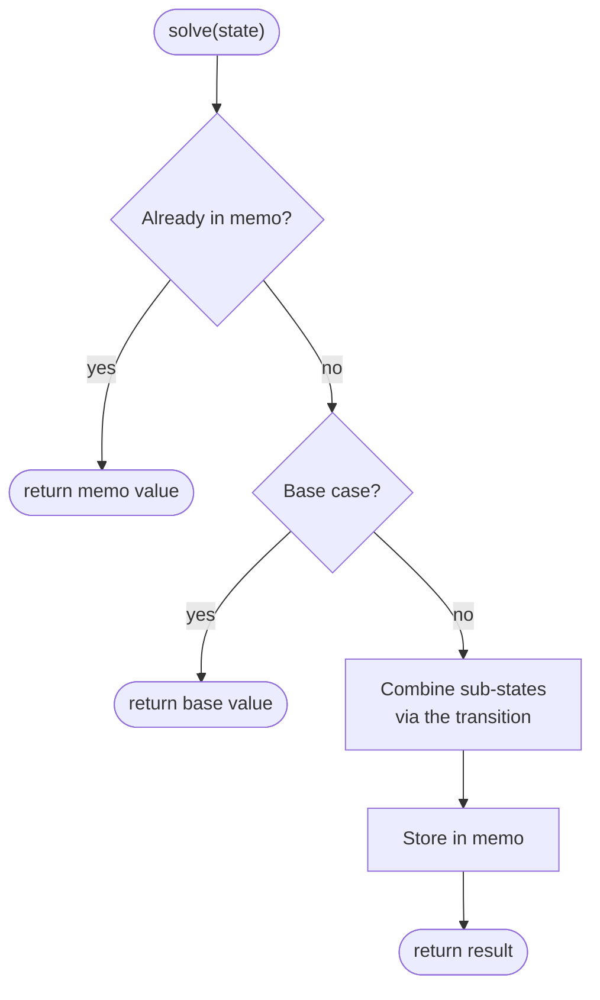

# Dynamic Programming


<PatternVideo pattern-name="Dynamic Programming" duration="8–12 min" />

<PatternProgress pattern-id="dp" problems="house-robber, climbing-stairs, house-robber-ii, delete-and-earn, min-cost-climbing-stairs, coin-change, coin-change-ii, longest-increasing-subsequence, longest-common-subsequence, edit-distance, longest-palindromic-subsequence, partition-equal-subset-sum, target-sum, unique-paths-ii, maximal-square, burst-balloons, regular-expression-matching, palindrome-partitioning-ii, best-time-to-buy-and-sell-stock-with-cooldown, best-time-to-buy-and-sell-stock-with-transaction-fee, best-time-to-buy-and-sell-stock-iv, partition-to-k-equal-sum-subsets, perfect-squares, maximum-sum-circular-subarray, dungeon-game, paint-house-ii, minimum-falling-path-sum, shortest-path-visiting-all-nodes, find-the-shortest-superstring, number-of-ways-to-wear-different-hats-to-each-other, last-stone-weight-ii, minimum-cost-to-merge-stones" />

<script setup>
const theTemplateCode = `// The DP skeleton: name the state, derive the transition, iterate in dependency order.
// Four decisions:
//   1. STATE      — what parameters identify a subproblem?       dp[s] = ?
//   2. TRANSITION — how does a state combine smaller states?    dp[s] = f(dp[<s])
//   3. BASE CASE  — the smallest states, answered directly.
//   4. ORDER      — iterate so every dependency is computed first.
//      (+ SPACE   — collapse dimensions the recurrence doesn't need.)

// Example: Fibonacci, O(n) time, O(1) space.
long fib(int n) {
    if (n < 2) return n;
    long prev = 0, curr = 1;              // dp[0] = 0, dp[1] = 1
    for (int i = 2; i <= n; i++) {
        long next = prev + curr;          // dp[i] = dp[i-1] + dp[i-2]
        prev = curr;
        curr = next;                      // SPACE collapse: only last 2 states matter
    }
    return curr;
}`

const theTemplateInvariant = {
  statement: `After iteration i, dp[0..i] holds the correct answer for every subproblem of size ≤ i. The recurrence only reads dp[<i], so by induction every value we compute is correct the moment we write it.`,
  initialization: `Base case(s) hand-set: dp[0], dp[1], or similar — "the smallest state answered directly". Pick the sentinel for "impossible" states carefully (Integer.MAX_VALUE / 2 to avoid overflow when adding, or amount + 1 for "fewer than any valid count").`,
  maintenance: `At step i, dp[i] = f(dp[<i]) where f is the recurrence. The invariant holds because the loop order guarantees dp[<i] is already written (bottom-up) or already memoized (top-down).`,
  termination: `The final answer is dp[target_state] — often dp[n], dp[n][m], or min/max over dp[*]. Space-optimizing by collapsing dimensions preserves this invariant on the LAST row/column.`
}

const theTemplateComplexity = {
  time: `O(states × transition_cost) — most DPs are O(n), O(n²), or O(n·k)`,
  space: `O(states), often collapsible to O(single row) or O(1) via rolling arrays`
}

const theTemplateSpecializations = [
  { slug: `fibonacci-bare-mechanic-easy`,                              title: `Fibonacci (easy)` },
  { slug: `1d-dp-climbing-stairs-house-robber-medium`,                 title: `1D DP (medium)` },
  { slug: `maximum-subarray-kadane-the-running-optimum-dp-medium`,     title: `Kadane (medium)` },
  { slug: `0-1-knapsack-subset-sum-family-medium`,                     title: `0/1 Knapsack (medium)` },
  { slug: `coin-change-unbounded-min-count-medium`,                    title: `Coin Change (medium)` },
  { slug: `grid-dp-unique-paths-minimum-path-sum-medium`,              title: `Grid DP (medium)` },
  { slug: `subsequence-dp-lis-lcs-edit-distance-hard`,                 title: `Subsequence DP (hard)` },
  { slug: `interval-dp-matrix-chain-burst-balloons-hard`,              title: `Interval DP (hard)` },
  { slug: `state-machine-dp-stock-trading-with-cooldown-medium`,       title: `State-Machine DP (medium)` },
  { slug: `bitmask-dp-travelling-salesman-assignment-medium`,          title: `Bitmask DP (medium)` },
  { slug: `tree-dp-house-robber-iii-medium`,                           title: `Tree DP (medium)` },
]

const theTemplateProblemShape = `Overlapping subproblems with optimal substructure. "Minimum/maximum X", "count number of ways", "longest/shortest subsequence/substring", "can we partition/cover" — the state captures what varies as you recurse; the transition combines smaller states.`

const fibCode = `// Fibonacci — THE bare mechanic of DP. Three implementations, same O(n) idea.

// (1) Memoized recursion (top-down) — closest to the mathematical definition.
long fibMemo(int n, long[] memo) {
    if (n < 2) return n;
    if (memo[n] != 0) return memo[n];
    return memo[n] = fibMemo(n - 1, memo) + fibMemo(n - 2, memo);
}
// Call: fibMemo(n, new long[n + 1]). O(n) time, O(n) space.

// (2) Bottom-up table (iterative) — one array, no recursion.
long fibTab(int n) {
    if (n < 2) return n;
    long[] dp = new long[n + 1];
    dp[0] = 0; dp[1] = 1;
    for (int i = 2; i <= n; i++) dp[i] = dp[i-1] + dp[i-2];
    return dp[n];
}
// O(n) time, O(n) space.

// (3) Rolling-pair (space-optimized) — the recurrence only reads the last 2 states.
long fib(int n) {
    if (n < 2) return n;
    long prev = 0, curr = 1;
    for (int i = 2; i <= n; i++) {
        long next = prev + curr;
        prev = curr;
        curr = next;
    }
    return curr;
}
// O(n) time, O(1) space. The space collapse is the AmortizedPanel insight below.`

const treeDPCode = `// Tree DP — subproblems indexed by subtree root.
// Canonical: House Robber III. Can't rob a node AND its direct children.
// For each node, dp returns a 2-tuple: {max if root is robbed, max if root is not}.

record Pair(int robbed, int skipped) {}

int rob(TreeNode root) {
    Pair result = dfs(root);
    return Math.max(result.robbed(), result.skipped());
}

Pair dfs(TreeNode node) {
    if (node == null) return new Pair(0, 0);
    Pair L = dfs(node.left);
    Pair R = dfs(node.right);

    // If I rob this node: children MUST be skipped.
    int robbed = node.val + L.skipped() + R.skipped();

    // If I skip this node: each child independently picks its max.
    int skipped = Math.max(L.robbed(), L.skipped())
                + Math.max(R.robbed(), R.skipped());

    return new Pair(robbed, skipped);
}
// O(n) time (visit each node once), O(h) stack = O(n) worst case.

// Pattern: tree DP returns a tuple per node encoding every "decision at this node".
// Variants: longest path in a tree (diameter), tree coloring, counting substructures.`

const amortizedExplanation = `For most 1D DPs the recurrence only reads the last K states (K = 1, 2, or a small constant). Rolling the storage from O(n) down to O(K) is the single most-common space optimization in DP.

**The derivation (amortized argument):**

- Total work: O(n) iterations, each O(1) → **O(n) total time**.
- Peak storage used per iteration: K cells (prev, curr, next for Fibonacci-style; one row for LCS-style).
- Amortized storage per iteration: **O(1)** (K is a problem-independent constant).

**When it works:** the recurrence \`dp[i] = f(dp[i-1], ..., dp[i-K])\` doesn't look further back than K. For 2D grid DP, you can collapse one dimension (the row OR the column, keeping the smaller) → O(min(m,n)) space.

**When it doesn't work:** the recurrence reads \`dp[i-1]\`, \`dp[j]\` for arbitrary \`j < i\` (e.g. LIS O(n²), where \`dp[i] = max over j<i of (dp[j] + 1 if a[j]<a[i])\`). The whole dp array must stay resident → no space collapse.

**Classic examples:**
- Fibonacci: O(n) → O(1) (keep 2 cells).
- House Robber: O(n) → O(1) (keep prev, curr).
- Climbing Stairs: O(n) → O(1).
- LCS: O(mn) → O(min(m,n)) (keep one row).
- 0/1 Knapsack by weight: O(nW) → O(W) (iterate items outer, weight inner RIGHT-TO-LEFT to avoid self-reads).
- Grid DP (Unique Paths, Min Path Sum): O(mn) → O(min(m,n)).

**Not amortized savings:** this is a straight O(n) → O(1) constant-factor improvement on space. Called "amortized" here because the amortized argument is the standard framing for rolling-storage proofs.`

const mastery5 = [
  {
    q: `What two preconditions must hold for a problem to be solvable by DP?`,
    choices: [
      { text: `Overlapping subproblems AND optimal substructure`, correct: true, explanation: `Overlapping = same subproblem recurs → memoize. Optimal substructure = optimal answer combines from optimal sub-answers → recurrence makes sense.` },
      { text: `Monotone objective + bounded answer range`, correct: false, explanation: `That's binary-search-on-answer.` },
      { text: `Sorted input + a safe local choice`, correct: false, explanation: `That's greedy.` },
      { text: `Exponential state space`, correct: false, explanation: `DP is useful when the state space is POLYNOMIAL, not exponential.` }
    ]
  },
  {
    q: `For 0/1 Knapsack with dp[w] = max value at capacity w, in what weight-loop order must you iterate to avoid double-counting an item?`,
    choices: [
      { text: `RIGHT-TO-LEFT: for (w = W; w >= weight[i]; w--) — reads dp[w - weight[i]] from the PREVIOUS item`, correct: true, explanation: `Left-to-right would read dp[w - weight[i]] AFTER this item has already been considered at that smaller weight, counting the item twice.` },
      { text: `LEFT-TO-RIGHT: for (w = weight[i]; w <= W; w++)`, correct: false, explanation: `That's correct for UNBOUNDED knapsack (unlimited reuse), WRONG for 0/1.` },
      { text: `Any order works`, correct: false, explanation: `False — the direction matters for 0/1.` },
      { text: `Sorted by weight`, correct: false, explanation: `Doesn't affect correctness.` }
    ]
  },
  {
    q: `For Coin Change (fewest coins to reach amount), what's the sentinel for "impossible"?`,
    choices: [
      { text: `amount + 1 — strictly larger than any valid count (max valid is amount, using all 1-coins)`, correct: true, explanation: `Avoids both overflow in dp[a-c]+1 AND confusion with 0 as "zero coins = valid answer for amount 0".` },
      { text: `Integer.MAX_VALUE`, correct: false, explanation: `Overflows when adding 1 in the transition.` },
      { text: `0`, correct: false, explanation: `Collides with the valid base case dp[0] = 0.` },
      { text: `-1`, correct: false, explanation: `Hard to compare with min() unless you special-case.` }
    ]
  },
  {
    q: `In Longest Increasing Subsequence with the O(n²) DP, dp[i] represents:`,
    choices: [
      { text: `Length of the LIS ENDING at index i (not necessarily including the last element overall)`, correct: true, explanation: `Final answer is max over all dp[i]. Ending AT i is the state detail that lets the recurrence read dp[j] for j<i with a[j]<a[i].` },
      { text: `Length of the LIS up to index i (anywhere, not forced to end at i)`, correct: false, explanation: `This state doesn't support the transition — you can't tell which smaller dp[j] values can extend.` },
      { text: `Length of the LIS strictly starting at i`, correct: false, explanation: `Needs reverse iteration; equivalent but less common.` },
      { text: `Count of elements less than a[i]`, correct: false }
    ]
  },
  {
    q: `For a 1D DP where dp[i] only depends on dp[i-1] and dp[i-2], what's the space optimization?`,
    choices: [
      { text: `Keep two variables (prev, curr) and roll them each iteration — O(1) space`, correct: true, explanation: `This is the Fibonacci / House Robber / Climbing Stairs rolling-pair pattern.` },
      { text: `Keep the full dp[] array — can't optimize`, correct: false, explanation: `You CAN optimize; the recurrence looks only 2 steps back.` },
      { text: `Convert to top-down with memoization`, correct: false, explanation: `Memo table is O(n), not better.` },
      { text: `Compress the state with bitmasks`, correct: false, explanation: `Doesn't apply — states aren't boolean.` }
    ]
  }
]

// Unique Paths — 3x4 grid demo for GridPathAnim
const uniquePathsDp = [
  [1, 1, 1, 1],
  [1, 2, 3, 4],
  [1, 3, 6, 10]
]
const uniquePathsFillOrder = {
  '0-0': 0, '0-1': 0, '0-2': 0, '0-3': 0,
  '1-0': 0, '2-0': 0,
  '1-1': 1, '1-2': 2, '1-3': 3,
  '2-1': 4, '2-2': 5, '2-3': 6
}
const uniquePathsSteps = [
  {
    cell: null,
    deps: [],
    formula: 'dp[0][*] = dp[*][0] = 1',
    description: 'Base cases: only one way to reach any cell on the top row or left column — walk straight.'
  },
  {
    cell: { r: 1, c: 1 },
    deps: [{ r: 0, c: 1 }, { r: 1, c: 0 }],
    formula: 'dp[1][1] = dp[0][1] + dp[1][0] = 1 + 1 = 2',
    description: 'A cell inherits path counts from its top neighbor and its left neighbor. Two ways reach (1,1).'
  },
  {
    cell: { r: 1, c: 2 },
    deps: [{ r: 0, c: 2 }, { r: 1, c: 1 }],
    formula: 'dp[1][2] = 1 + 2 = 3',
    description: 'The recurrence is purely additive — top + left — because every path through (1,2) came through one of those two cells.'
  },
  {
    cell: { r: 1, c: 3 },
    deps: [{ r: 0, c: 3 }, { r: 1, c: 2 }],
    formula: 'dp[1][3] = 1 + 3 = 4',
    description: 'Row 1 finished. Notice we only ever read already-filled cells — the dependency DAG has no cycles.'
  },
  {
    cell: { r: 2, c: 1 },
    deps: [{ r: 1, c: 1 }, { r: 2, c: 0 }],
    formula: 'dp[2][1] = 2 + 1 = 3',
    description: 'Row 2 starts. Each cell still only needs its two neighbors — this is why a rolling 1D array collapses the space to O(n).'
  },
  {
    cell: { r: 2, c: 2 },
    deps: [{ r: 1, c: 2 }, { r: 2, c: 1 }],
    formula: 'dp[2][2] = 3 + 3 = 6',
    description: 'The counts grow quickly — the number of monotone lattice paths is a binomial coefficient.'
  },
  {
    cell: { r: 2, c: 3 },
    deps: [{ r: 1, c: 3 }, { r: 2, c: 2 }],
    formula: 'dp[2][3] = 4 + 6 = 10',
    description: 'Answer: 10 unique paths from top-left to bottom-right on a 3x4 grid. In closed form: C(5,2) = 10.'
  }
]
const uniquePathsPath = [
  { r: 0, c: 0 }, { r: 0, c: 1 }, { r: 1, c: 1 }, { r: 1, c: 2 }, { r: 2, c: 2 }, { r: 2, c: 3 }
]

// Edit Distance — "cat" → "car" demo for DpTableAnim
const editDistanceXChars = ['', 'c', 'a', 't']
const editDistanceYChars = ['', 'c', 'a', 'r']
const editDistanceDp = [
  [0, 1, 2, 3],
  [1, 0, 1, 2],
  [2, 1, 0, 1],
  [3, 2, 1, 1]
]
const editDistanceFillOrder = {
  '1-1': 1, '2-1': 2, '3-1': 3,
  '1-2': 4, '2-2': 5, '3-2': 6,
  '1-3': 7, '2-3': 8, '3-3': 9
}
const editDistanceMatchCells = ['1-1', '2-2']
const editDistanceSteps = [
  {
    revealBase: true,
    revealOrder: 0,
    cell: null,
    deps: [],
    formula: 'dp[0][j] = j, dp[i][0] = i',
    result: 'base cases',
    description: 'Transforming empty to a length-k target takes k inserts; transforming length-k to empty takes k deletes. The empty row/column holds those lengths.'
  },
  {
    revealBase: true,
    revealOrder: 1,
    cell: { i: 1, j: 1 },
    deps: [{ i: 0, j: 0 }],
    formula: 'c == c, so dp[1][1] = dp[0][0] = 0',
    result: 'match',
    description: 'On a character match the transition is free: copy the diagonal. The green cell marks a no-op in the alignment.'
  },
  {
    revealBase: true,
    revealOrder: 3,
    cell: { i: 3, j: 1 },
    deps: [{ i: 2, j: 0 }, { i: 2, j: 1 }, { i: 3, j: 0 }],
    formula: 't ≠ c, so dp[3][1] = 1 + min(dp[2][0], dp[2][1], dp[3][0]) = 1 + min(2, 1, 3) = 2',
    result: 'mismatch — pick best of three',
    description: 'On a mismatch each cell reads three neighbors: diagonal (replace), top (insert), left (delete). The 1+min captures the single-edit cost.'
  },
  {
    revealBase: true,
    revealOrder: 5,
    cell: { i: 2, j: 2 },
    deps: [{ i: 1, j: 1 }],
    formula: 'a == a, so dp[2][2] = dp[1][1] = 0',
    result: 'second match',
    description: 'Another match: the diagonal carries forward. Match cells along the diagonal are the "aligned" portion of the two strings.'
  },
  {
    revealBase: true,
    revealOrder: 9,
    cell: { i: 3, j: 3 },
    deps: [{ i: 2, j: 2 }, { i: 2, j: 3 }, { i: 3, j: 2 }],
    formula: 't ≠ r, so dp[3][3] = 1 + min(dp[2][2], dp[2][3], dp[3][2]) = 1 + min(0, 1, 1) = 1',
    result: 'answer: 1',
    description: 'The dp table bottoms out at dp[3][3] = 1 — one substitution (t → r) transforms "cat" into "car".'
  }
]

// Fibonacci — 1D rolling demo for DpArrayAnim
const fibDp = [0, 1, 1, 2, 3, 5, 8, 13]
const fibLabels = [0, 1, 2, 3, 4, 5, 6, 7]
const fibFillOrder = { '0': 0, '1': 0, '2': 1, '3': 2, '4': 3, '5': 4, '6': 5, '7': 6 }
const fibSteps = [
  {
    revealOrder: 0,
    cell: null,
    deps: [],
    formula: 'dp[0] = 0, dp[1] = 1',
    description: 'Base cases hand-set. Fibonacci is defined by its two smallest states — every other state is a sum of two previous ones.'
  },
  {
    revealOrder: 1,
    cell: 2,
    deps: [0, 1],
    formula: 'dp[2] = dp[1] + dp[0] = 1 + 0 = 1',
    description: 'The recurrence reads exactly two cells to the left. The DAG of dependencies has width 2, which is why Fibonacci collapses to O(1) space with a rolling pair.'
  },
  {
    revealOrder: 3,
    cell: 4,
    deps: [2, 3],
    formula: 'dp[4] = dp[3] + dp[2] = 2 + 1 = 3',
    description: 'Each new state reuses the two freshly-computed cells. Nothing further left is read — the "window" of needed state is width 2 forever.'
  },
  {
    revealOrder: 6,
    cell: 7,
    deps: [5, 6],
    formula: 'dp[7] = dp[6] + dp[5] = 8 + 5 = 13',
    result: 'answer: 13',
    description: 'fib(7) = 13. The animation is iterative DP; the top-down memoized version builds the same values but demand-driven.'
  }
]

// House Robber — DpArrayAnim with nums=[2,7,9,3,1]
const houseRobberDp = [2, 7, 11, 11, 12]
const houseRobberLabels = [2, 7, 9, 3, 1]
const houseRobberFillOrder = { '0': 0, '1': 0, '2': 1, '3': 2, '4': 3 }
const houseRobberSteps = [
  {
    revealOrder: 0,
    cell: null,
    deps: [],
    formula: 'dp[0] = 2, dp[1] = max(2, 7) = 7',
    description: 'Houses are shown as values along the top. Base cases: with one house take it; with two, take the larger.'
  },
  {
    revealOrder: 1,
    cell: 2,
    deps: [0, 1],
    formula: 'dp[2] = max(dp[1] = 7, dp[0] + 9 = 11) = 11',
    result: 'rob house 2',
    description: 'Each house asks: skip me (keep dp[i-1]) or take me plus the best up to i-2. Here taking wins — 2 + 9 beats 7.'
  },
  {
    revealOrder: 2,
    cell: 3,
    deps: [1, 2],
    formula: 'dp[3] = max(dp[2] = 11, dp[1] + 3 = 10) = 11',
    result: 'skip house 3',
    description: 'Skipping wins — the running best (11) is larger than the 10 you would get by robbing house 3.'
  },
  {
    revealOrder: 3,
    cell: 4,
    deps: [2, 3],
    formula: 'dp[4] = max(dp[3] = 11, dp[2] + 1 = 12) = 12',
    result: 'answer: 12',
    description: 'Robbing house 4 wins: dp[2] + 1 = 12 beats 11. Robbery route: houses 0, 2, 4 → values 2 + 9 + 1 = 12.'
  }
]

// Kadane — DpArrayAnim with nums=[-2,1,-3,4,-1,2]
const kadaneDp = [-2, 1, -2, 4, 3, 5]
const kadaneLabels = [-2, 1, -3, 4, -1, 2]
const kadaneFillOrder = { '0': 0, '1': 1, '2': 2, '3': 3, '4': 4, '5': 5 }
const kadaneHighlights = [5]
const kadaneSteps = [
  {
    revealOrder: 0,
    cell: 0,
    deps: [],
    formula: 'dp[0] = nums[0] = -2',
    description: 'dp[i] = best contiguous-subarray sum ENDING at i. Base: dp[0] is just nums[0], there is nowhere else to end.'
  },
  {
    revealOrder: 1,
    cell: 1,
    deps: [0],
    formula: 'dp[1] = max(nums[1] = 1, dp[0] + 1 = -1) = 1',
    result: 'restart',
    description: 'The one-cell dependency: "extend or restart?" Here restart wins — carrying a -2 running sum hurts more than starting fresh.'
  },
  {
    revealOrder: 3,
    cell: 3,
    deps: [2],
    formula: 'dp[3] = max(nums[3] = 4, dp[2] + 4 = 2) = 4',
    result: 'restart',
    description: 'Another restart. Any time nums[i] alone beats dp[i-1] + nums[i], the running sum is a liability — drop it.'
  },
  {
    revealOrder: 5,
    cell: 5,
    deps: [4],
    formula: 'dp[5] = max(nums[5] = 2, dp[4] + 2 = 5) = 5',
    result: 'answer: 5',
    description: 'Final extend step. Max subarray sum = max(dp[*]) = 5, achieved by the subarray [4, -1, 2] ending at index 5.'
  }
]

// 0/1 Knapsack — DpTableAnim with items=[(w=1,v=1),(w=2,v=3)], capacity=3
const knapsackXChars = ['', 'i₁', 'i₂']
const knapsackYChars = ['', '1', '2', '3']
const knapsackDp = [
  [0, 0, 0, 0],
  [0, 1, 1, 1],
  [0, 1, 3, 4]
]
const knapsackFillOrder = {
  '1-1': 1, '1-2': 2, '1-3': 3,
  '2-1': 4, '2-2': 5, '2-3': 6
}
const knapsackSteps = [
  {
    revealBase: true,
    revealOrder: 0,
    cell: null,
    deps: [],
    formula: 'dp[0][*] = dp[*][0] = 0',
    result: 'base',
    description: 'Row/column axes: items considered (across) and capacity remaining (down). With no items or no capacity the best value is 0.'
  },
  {
    revealBase: true,
    revealOrder: 1,
    cell: { i: 1, j: 1 },
    deps: [{ i: 0, j: 0 }, { i: 0, j: 1 }],
    formula: 'item₁ (w=1, v=1), cap=1: max(skip=dp[0][1]=0, take=dp[0][0]+1=1) = 1',
    result: 'take item 1',
    description: 'Each cell is a binary choice: skip (read directly above) or take (read above-and-left by weight, add value). Here taking wins.'
  },
  {
    revealBase: true,
    revealOrder: 3,
    cell: { i: 1, j: 3 },
    deps: [{ i: 0, j: 3 }],
    formula: 'cap=3 still only one item of value 1 available: dp[1][3] = 1',
    description: 'Row 1 is uniform — a single item of value 1 caps the max value at 1 no matter the capacity.'
  },
  {
    revealBase: true,
    revealOrder: 4,
    cell: { i: 2, j: 1 },
    deps: [{ i: 1, j: 1 }],
    formula: 'item₂ (w=2) exceeds cap=1 → skip: dp[2][1] = dp[1][1] = 1',
    description: 'When the current item does not fit, the only read is "skip" — directly above.'
  },
  {
    revealBase: true,
    revealOrder: 5,
    cell: { i: 2, j: 2 },
    deps: [{ i: 1, j: 2 }, { i: 1, j: 0 }],
    formula: 'cap=2: max(skip=1, take=dp[1][0]+3=3) = 3',
    result: 'take item 2',
    description: 'With cap=2 item 2 fits — the "take" branch jumps left by its weight and adds its value.'
  },
  {
    revealBase: true,
    revealOrder: 6,
    cell: { i: 2, j: 3 },
    deps: [{ i: 1, j: 3 }, { i: 1, j: 1 }],
    formula: 'cap=3: max(skip=1, take=dp[1][1]+3=4) = 4',
    result: 'answer: 4',
    description: 'Final cell. Taking item 2 (uses 2 of 3 capacity) plus item 1 (uses the last 1) totals 4. The dependency pattern is "skip-above or take-left-by-weight".'
  }
]

// Coin Change — DpArrayAnim with coins=[1,2,5], amount=7
const coinChangeDp = [0, 1, 1, 2, 2, 1, 2, 2]
const coinChangeLabels = [0, 1, 2, 3, 4, 5, 6, 7]
const coinChangeFillOrder = { '0': 0, '1': 1, '2': 2, '3': 3, '4': 4, '5': 5, '6': 6, '7': 7 }
const coinChangeHighlights = [7]
// Stock with Cooldown — two DpArrayAnim: hold and sold
const stockPrices = [1, 2, 3, 0, 2]
const stockHoldDp = [-1, -1, -1, 1, 1]
const stockSoldDp = [0, 1, 2, 2, 3]
const stockFillOrder = { '0': 0, '1': 1, '2': 2, '3': 3, '4': 4 }
const stockHoldSteps = [
  {
    revealOrder: 0,
    cell: 0,
    deps: [],
    formula: 'hold[0] = −prices[0] = −1',
    description: 'Base: on day 0 the only way to "hold" is to buy, so hold[0] = −p[0]. Negative because our cash balance drops.'
  },
  {
    revealOrder: 1,
    cell: 1,
    deps: [0],
    formula: 'hold[1] = max(hold[0] = −1, sold[−1] − 2 = −2) = −1',
    description: 'Keep holding yesterday\'s share (hold[i−1]) vs buy today after a cooldown (sold[i−2] − p[i]). Keeping wins.'
  },
  {
    revealOrder: 3,
    cell: 3,
    deps: [1, 2],
    formula: 'hold[3] = max(hold[2] = −1, sold[1] − 0 = 1) = 1',
    result: 'buy on day 3',
    description: 'Big jump: on day 3 prices dropped to 0, and sold[1] = 1 (we sold on day 1). Buying today after the cooldown gives hold[3] = 1.'
  },
  {
    revealOrder: 4,
    cell: 4,
    deps: [2, 3],
    formula: 'hold[4] = max(hold[3] = 1, sold[2] − 2 = 0) = 1',
    description: 'Keep yesterday\'s hold — buying today at price 2 after sold[2]=2 would net 0, worse than our current 1.'
  }
]
const stockSoldSteps = [
  {
    revealOrder: 0,
    cell: 0,
    deps: [],
    formula: 'sold[0] = 0',
    description: 'Base: nothing has been bought-and-sold yet, so no profit. sold[0] = 0 for every input.'
  },
  {
    revealOrder: 1,
    cell: 1,
    deps: [0],
    formula: 'sold[1] = max(sold[0] = 0, hold[0] + p[1] = −1 + 2 = 1) = 1',
    result: 'sell on day 1',
    description: 'Sell today earns hold[i−1] + p[i] = 1 (bought at 1, sold at 2). That beats "stay in sold with yesterday\'s 0".'
  },
  {
    revealOrder: 2,
    cell: 2,
    deps: [1],
    formula: 'sold[2] = max(sold[1] = 1, hold[1] + p[2] = −1 + 3 = 2) = 2',
    description: 'Selling today (bought at 1, selling at 3) beats resting with yesterday\'s profit.'
  },
  {
    revealOrder: 4,
    cell: 4,
    deps: [3],
    formula: 'sold[4] = max(sold[3] = 2, hold[3] + p[4] = 1 + 2 = 3) = 3',
    result: 'answer: 3',
    description: 'Sell today: bought on day 3 at 0 (hold[3] = 1), selling at 2 → profit = 3. Max profit = sold[4] = 3.'
  }
]

// Matrix Chain Multiplication — IntervalDpAnim with dims=[2,3,2,4]
const matrixChainLabels = ['M₀', 'M₁', 'M₂']
const matrixChainDp = [
  [0, 12, 28],
  [0, 0, 24],
  [0, 0, 0]
]
const matrixChainFillOrder = {
  '0-0': 0, '1-1': 0, '2-2': 0,
  '0-1': 1,
  '1-2': 2,
  '0-2': 3
}
const matrixChainSteps = [
  {
    revealOrder: 0,
    cell: null,
    formula: 'dp[i][i] = 0 — a single matrix has no multiplications',
    description: 'Base cases sit on the main diagonal. The axes are l (left endpoint) and r (right endpoint); only cells with l ≤ r are used.'
  },
  {
    revealOrder: 1,
    cell: { l: 0, r: 1 },
    splits: [{ k: 0, left: { l: 0, r: 0 }, right: { l: 1, r: 1 }, cost: '0 + 0 + 2·3·2 = 12' }],
    formula: 'dp[0][1] = dp[0][0] + dp[1][1] + p₀·p₁·p₂',
    result: 'min = 12',
    description: 'Length-2 interval: only one split point (k=0). Multiplying M₀ (2×3) by M₁ (3×2) costs 2·3·2 = 12 scalar multiplications.'
  },
  {
    revealOrder: 2,
    cell: { l: 1, r: 2 },
    splits: [{ k: 1, left: { l: 1, r: 1 }, right: { l: 2, r: 2 }, cost: '0 + 0 + 3·2·4 = 24' }],
    formula: 'dp[1][2] = dp[1][1] + dp[2][2] + p₁·p₂·p₃',
    result: 'min = 24',
    description: 'The other length-2 interval. Multiplying M₁ (3×2) by M₂ (2×4) costs 3·2·4 = 24.'
  },
  {
    revealOrder: 3,
    cell: { l: 0, r: 2 },
    splits: [
      { k: 0, left: { l: 0, r: 0 }, right: { l: 1, r: 2 }, cost: '0 + 24 + 2·3·4 = 48' },
      { k: 1, left: { l: 0, r: 1 }, right: { l: 2, r: 2 }, cost: '12 + 0 + 2·2·4 = 28' }
    ],
    formula: 'dp[0][2] = min over k ∈ {0, 1}',
    result: 'min = 28 (at k=1)',
    description: 'Length-3 interval has TWO split points. Picking k=1 — i.e. compute M₁·M₂ first — costs 28 vs 48 for k=0. The parenthesization matters.'
  }
]

const coinChangeSteps = [
  {
    revealOrder: 0,
    cell: null,
    deps: [],
    formula: 'dp[0] = 0 (zero coins make amount 0)',
    description: 'dp[a] = minimum coins to make amount a. The only base case: making amount 0 needs 0 coins.'
  },
  {
    revealOrder: 1,
    cell: 1,
    deps: [0],
    formula: 'dp[1] = 1 + dp[1 − 1] = 1 + dp[0] = 1',
    description: 'Only coin 1 fits. dp[a] = 1 + min(dp[a−coin]) over coins that fit — one coin plus the best way to make the remainder.'
  },
  {
    revealOrder: 2,
    cell: 2,
    deps: [0, 1],
    formula: 'dp[2] = 1 + min(dp[1], dp[0]) = 1 + 0 = 1',
    description: 'Two coins fit (1 and 2). Using one coin-2 beats using two coin-1s — min over the arcs picks the best.'
  },
  {
    revealOrder: 3,
    cell: 3,
    deps: [1, 2],
    formula: 'dp[3] = 1 + min(dp[2], dp[1]) = 1 + 1 = 2',
    description: 'Two options: a 1-coin on top of dp[2], or a 2-coin on top of dp[1]. Both give 2.'
  },
  {
    revealOrder: 5,
    cell: 5,
    deps: [0, 3, 4],
    formula: 'dp[5] = 1 + min(dp[4], dp[3], dp[0]) = 1 + 0 = 1',
    description: 'The coin-5 arc jumps all the way to dp[0] — it reaches amount 5 in a single coin, beating any multi-coin combination.'
  },
  {
    revealOrder: 7,
    cell: 7,
    deps: [2, 5, 6],
    formula: 'dp[7] = 1 + min(dp[6], dp[5], dp[2]) = 1 + 1 = 2',
    result: 'answer: 2',
    description: 'Amount 7 in 2 coins: a 5 and a 2. The three arcs are the three coin denominations, each reading dp at (amount − coin).'
  }
]
</script>


## Why dynamic programming exists — the story

You're solving Fibonacci for `n = 40`. You write the elegant recursive solution: `fib(n) = fib(n-1) + fib(n-2)`. It's beautiful. It compiles. You run it — and it takes **17 seconds**.

Why? Look at what `fib(40)` computes: `fib(40) = fib(39) + fib(38)`. `fib(39) = fib(38) + fib(37)`. Now `fib(38)` gets computed **twice** — once directly, once via `fib(39)`. `fib(37)` gets computed **three** times. `fib(2)` gets computed roughly `10⁸` times. The recursion is a beautifully-drawn tree where the same subproblems repeat exponentially. Fibonacci with plain recursion is O(2^n) — for `n = 60` it takes **over a year**.

The obvious fix — the one every mathematician yells at their screen watching this — is: **write down the answer once you compute it.** Compute `fib(2)` and store it. When another branch asks for `fib(2)`, look it up instead of re-computing. Fibonacci collapses from 2^n to n. Seventeen seconds to nanoseconds.

That's the entire idea of dynamic programming: **recursion whose subproblems overlap gets fast when you memoize the answers.** Two conditions have to hold for it to apply: (1) **overlapping subproblems** — the same smaller question recurs many times, and (2) **optimal substructure** — the best answer combines from the best sub-answers.

DP shows up everywhere in interviews: Coin Change, Longest Common Subsequence, Edit Distance, Longest Increasing Subsequence, Knapsack, Buy-and-Sell-Stock, Palindrome Partitioning, Word Break, Burst Balloons. Half of the LeetCode Hard problems are DP variants. What makes DP feel intimidating isn't the technique — it's the **modeling**: naming the right subproblem, defining the right state. Every DP problem you've ever gotten stuck on was a state-definition failure disguised as an algorithm failure.

## The core idea — name the state, cache the answer

<DpFillAnim />

Every DP problem you'll ever see reduces to four decisions:

```text
1. STATE        what parameters uniquely identify a subproblem?  dp[...] = ?
2. TRANSITION   how does a state combine smaller states?         dp[i] = f(dp[<i])
3. BASE CASE    the smallest states, answered directly.
4. ORDER        iterate so every dependency is computed first (or memoize top-down).
   (+ SPACE     collapse dimensions the recurrence doesn't need.)
```

Get **state** right, and everything else falls into place. Get state wrong, and no amount of optimization saves you.

**The state-definition workflow (memorize this):**

1. **Ask "what varies as I recurse?"** — that's the state.
2. **Ask "what does dp[state] represent?"** — write it as an English sentence, e.g., *"dp[i] = the length of the longest increasing subsequence ending at index i"*.
3. **Derive the transition** — for each way to reach state `s`, express `dp[s]` in terms of smaller states.
4. **Identify the base case** — the smallest state(s), answered without recursion.
5. **Pick an iteration order** so dependencies are ready when needed.

Half of your DP interview time should be state-definition talk, on paper, before any code.

## When to use it — recognition signals

The problem statement usually contains one of these:

- **"Minimum / maximum X"** — often DP. Minimum edit distance, maximum path sum, minimum coins.
- **"Count the number of ways"** — usually DP. Number of ways to climb stairs, number of paths in a grid.
- **"Longest / shortest X subsequence / substring"** — LCS, LIS, longest palindromic subsequence.
- **"Can we partition / cover / express X"** — subset sum, coin change, word break.
- **Decision at each step affects future steps** — buy-and-sell-stock (must hold before you can sell), house robber (can't rob adjacent).
- **The recursion tree has overlapping subproblems** — a naive recursive solution TLE's; memoization or tabulation makes it fit.
- **The state space is polynomial** — number of subproblems is `O(n)`, `O(n²)`, or `O(n·k)`, not `O(2^n)`. If subproblems are exponential, DP with bitmask sometimes helps (bitmask DP is a distinct subpattern).

Trigger phrases: *"maximum sum", "minimum cost", "count ways", "longest / shortest", "return true if possible", "you can make choices at each step, what's the best..."*

## THE template — state → transition → base case → order

<PatternTemplateCard
  slug="dp"
  title="Dynamic Programming"
  language="java"
  :code="theTemplateCode"
  :invariant="theTemplateInvariant"
  :complexity="theTemplateComplexity"
  :specializations="theTemplateSpecializations"
  :problemShape="theTemplateProblemShape"
>
  <template #amortized>

<AmortizedPanel
  method="aggregate"
  bound="O(1) space for 1D rolling pair · O(min(m,n)) for 2D rolling row"
  statement="Space collapse for recurrences that look back only a constant number of states"
>

{{ amortizedExplanation }}

</AmortizedPanel>

  </template>
</PatternTemplateCard>

<InvariantProof
  :statement="theTemplateInvariant.statement"
  :initialization="theTemplateInvariant.initialization"
  :maintenance="theTemplateInvariant.maintenance"
  :termination="theTemplateInvariant.termination"
/>

### The four DP archetypes

Each sub-variation below is a specialization of one of these. Learning them is 80% of the pattern.

| Archetype | State shape | Example |
|---|---|---|
| **1D linear** | `dp[i]` indexed by position/count | Fibonacci, Climbing Stairs, House Robber, Kadane |
| **2D on sequences** | `dp[i][j]` indexed by two sequence prefixes | LCS, Edit Distance, Interleaving String |
| **DP on decisions** | `dp[state][option]` | Buy/Sell Stock with cooldown, Coin Change |
| **Interval DP** | `dp[lo][hi]` indexed by subarray endpoints | Matrix Chain, Burst Balloons, Palindrome Partitioning |

Plus three specialized dimensions:
- **Grid DP** — `dp[r][c]` on a 2D grid (Unique Paths, Min Path Sum, Dungeon Game).
- **Tree DP** — `dp[node]` is a tuple per subtree root (House Robber III, Tree Diameter).
- **Bitmask DP** — `dp[mask][last]` where mask indicates which items are used (TSP, Hamiltonian Path).

## When the mechanic breaks — three failure modes

<TrapTrace
  title="The state is too small"
  bug="You define dp[i] = 'max profit at day i' for Buy/Sell Stock with Cooldown. The interviewer's test case fails: dp[5] expects a different value depending on whether you hold stock at day 4 or not — information you discarded. State is missing a 'holding' dimension."
  fix="Before coding, enumerate every variable the subproblem depends on. If two subproblems that reach the same dp[i] can produce different downstream decisions, add a dimension: dp[i][holding] or dp[i][k_transactions_left]. Rule of thumb: when the recurrence can't be derived without 'knowing' something besides dp[i-1], that something is a missing state."
/>

<TrapTrace
  title="Iteration order breaks dependencies"
  bug="For 0/1 Knapsack with dp[w] = max value at capacity w, inner loop LEFT-TO-RIGHT reads dp[w - weight[i]] AFTER this iteration has already updated it with item i → item counted twice → wrong answer. Classic 0/1-vs-unbounded confusion."
  fix="Draw the dependency arrows on paper. For 0/1 Knapsack: inner loop RIGHT-TO-LEFT (reads from previous-item dp[w - weight[i]]). For unbounded: left-to-right is correct (deliberately reuses current-item dp[w - weight[i]]). For 2D DP that reads dp[i-1][j-1], dp[i-1][j], dp[i][j-1]: iterate i and j both forward."
/>

<TrapTrace
  title="Integer overflow and the wrong sentinel"
  bug="Two interchangeable sins: (1) 'count number of ways' DP uses int, hits 2^31 at a 30×30 grid, silently returns negative. (2) Coin Change initializes dp[] to Integer.MAX_VALUE; the transition dp[a-c] + 1 overflows for impossible states, flips negative, suddenly looks like a GREAT path."
  fix="(1) For 'count' problems, use long OR take modulo per problem statement (usually 10^9 + 7). (2) For 'min count' problems, use amount + 1 as the sentinel (strictly larger than any valid count — amount coins of value 1 — and safe against +1 overflow). Alternative: Integer.MAX_VALUE / 2 to leave headroom for arithmetic."
/>

## History — Bellman, 1952, and the hostile boss

Dynamic programming was invented by **Richard Bellman** at RAND Corporation in 1952. He needed a term to describe his work on multi-stage decision optimization. His problem was political: his boss, Charles Wilson (US Secretary of Defense), *"had a pathological fear and hatred of the word 'research'"*. Bellman later wrote:

> *"I thought dynamic programming was a good name. It was something not even a Congressman could object to. So I used it as an umbrella for my activities."*

That's a real quote from Bellman's 1984 autobiography *Eye of the Hurricane*. The technique had nothing to do with programming (in the software sense) and nothing to do with dynamics (in the physics sense). Bellman literally invented a name that would slip past a boss allergic to the word "research." Half of computer science's most-used technique exists under a linguistically defensive shield.

Bellman also formalized the **principle of optimality**: *"An optimal policy has the property that whatever the initial state and initial decision are, the remaining decisions must constitute an optimal policy with regard to the state resulting from the first decision."* That's the mathematical statement of "optimal substructure" — the second precondition for DP.

Modern DP applications range from **Viterbi's algorithm** (1967, used in every phone modem and speech-recognition engine ever built) to **CYK parsing** (context-free-grammar recognition) to **dynamic time warping** (Netflix video encoding, audio alignment). Every autocomplete engine and every spell-checker on Earth is Levenshtein distance — pure edit-distance DP.

## Sub-variations of the template

<PatternSubVariationNav pattern="dp" />

### Fibonacci (bare mechanic) <span class="diff diff-e">Easy</span>

*[↗ LeetCode: Fibonacci Number](https://leetcode.com/problems/fibonacci-number/)*

The ur-DP. Three implementations (memo, tabulation, rolling-pair) at O(n) time; the rolling-pair variant is O(1) space — the amortized panel above explains why.

> [key] Compute fib(n) in O(n) time, O(1) space.

<TemplateReveal
  slug="fibonacci"
  language="java"
  :canonical="fibCode"
/>

> [inv] **Invariant** — At iteration `i`, `(prev, curr)` holds `(fib(i-1), fib(i))`. The recurrence `next = prev + curr` writes `fib(i+1)`; the shift `prev = curr; curr = next` restores the invariant for the next step.

<DpArrayAnim
  title="Fibonacci: dp[i] = dp[i-1] + dp[i-2]"
  :length="8"
  :dp="fibDp"
  :labels="fibLabels"
  :fillOrder="fibFillOrder"
  :baseCells="[0, 1]"
  :steps="fibSteps"
/>

**Why Fibonacci is the entry point to every DP topic:**
1. **State** — a single index `i`.
2. **Transition** — one line: `dp[i] = dp[i-1] + dp[i-2]`.
3. **Base case** — `dp[0] = 0, dp[1] = 1`.
4. **Order** — forward.
5. **Space collapse** — the recurrence only reads the last 2 states → O(1) rolling pair.

Every other DP in this chapter adds complexity to one of these five decisions. Grid DP adds a 2D state. Interval DP changes the iteration order. Bitmask DP changes what "state" means. But the skeleton stays.

**Complexity ladder:**

| Approach | Time | Space |
|---|---|---|
| Naive recursion | O(2^n) | O(n) stack — one year at n=60 |
| Memoized recursion | O(n) | O(n) + O(n) stack |
| Bottom-up tabulation | O(n) | O(n) |
| **Rolling pair** | **O(n)** | **O(1)** |
| Matrix exponentiation | O(log n) | O(1) | — for competitive-programming scale (fib n = 10^18) |

### Canonical Coin Change — the 3-approach ladder

(Historical reference — the Coin Change sub-variation H3 below is the active walkthrough.)

<details>
<summary><strong>Expand: brute-force recursion → memoization → bottom-up tabulation</strong></summary>

**Problem** ([↗ LeetCode](https://leetcode.com/problems/coin-change/)): You have unlimited coins of denominations `coins = [1, 2, 5]`. Return the **fewest number of coins** needed to make amount `n`. If it's not possible, return -1.

#### Approach 1 — Brute-force recursion

Try every coin at every step.

```java
int minCoinsBrute(int[] coins, int n) {
    if (n == 0) return 0;
    if (n < 0)  return -1;
    int best = Integer.MAX_VALUE;
    for (int c : coins) {
        int sub = minCoinsBrute(coins, n - c);
        if (sub >= 0) best = Math.min(best, sub + 1);
    }
    return best == Integer.MAX_VALUE ? -1 : best;
}
```

**Complexity:** O(k^n) where k = number of coins. For `n = 30`, k = 3 → exponential blowup. TLE for `n > 25`.

### Approach 2 — Top-down memoization

Add a cache. Each subproblem is computed once.

```java
Integer[] memo;
int minCoins(int[] coins, int n) {
    memo = new Integer[n + 1];
    return dfs(coins, n);
}
int dfs(int[] coins, int n) {
    if (n == 0) return 0;
    if (n < 0)  return -1;
    if (memo[n] != null) return memo[n];
    int best = Integer.MAX_VALUE;
    for (int c : coins) {
        int sub = dfs(coins, n - c);
        if (sub >= 0) best = Math.min(best, sub + 1);
    }
    return memo[n] = (best == Integer.MAX_VALUE ? -1 : best);
}
```

**Complexity:** O(n · k), O(n) space + O(n) recursion stack.

### Approach 3 — Bottom-up tabulation (the interview answer)

Fill an array from `dp[0]` up to `dp[n]`.

```java
int coinChange(int[] coins, int amount) {
    int[] dp = new int[amount + 1];
    Arrays.fill(dp, amount + 1);              // sentinel for "impossible"
    dp[0] = 0;
    for (int a = 1; a <= amount; a++)
        for (int c : coins)
            if (c <= a) dp[a] = Math.min(dp[a], dp[a - c] + 1);
    return dp[amount] > amount ? -1 : dp[amount];
}
```

**Complexity:** O(n · k) time, O(n) space.
**Why bottom-up:** no recursion overhead, better cache behavior, no risk of stack overflow.

**Interview commentary:**
- *"Brute-force recursion is O(k^n) — too slow."*
- *"Notice `minCoins(n-1)` and `minCoins(n-2)` both call `minCoins(n-6)` — overlapping subproblems, that's the DP signal."*
- *"State: `dp[a] = fewest coins to reach amount a`. Transition: `dp[a] = 1 + min over c of dp[a-c]`."*
- *"Base: `dp[0] = 0`. Iterate a from 1 to n."*
- *"O(n·k) time, O(n) space. Sentinel `amount + 1` marks impossible."*

### Complexity ladder

| Approach | Time | Space | When |
|---|---|---|---|
| Brute-force recursion | O(k^n) | O(n) stack | Reference only |
| Top-down memoization | O(n·k) | O(n) + O(n) stack | If iterating up is unnatural |
| **Bottom-up tabulation** | **O(n·k)** | **O(n)** | **Interview default** |

</details>

**Grokking arc:** The motivating problem is recursion that asks the same smaller question again and again. Brute force branches over choices. **Can we do better?** Name the repeated state, cache or tabulate it once, then choose an order where dependencies are already known.

DP is what you use when brute-force recursion keeps solving the *same* smaller problem over and over — you compute each little answer once, write it down, and reuse it. Two conditions have to hold for it to apply: **overlapping subproblems** (the same smaller question keeps recurring) and **optimal substructure** (a best overall answer is assembled from best sub-answers). The scary part is really just bookkeeping, and it always comes down to the same four decisions:

```text
1. STATE        what parameters uniquely identify a subproblem?  dp[...] = ?
2. TRANSITION   how does a state combine smaller states?         dp[i] = f(dp[<i])
3. BASE CASE    the smallest states, answered directly.
4. ORDER        iterate so every dependency is computed first (or memoize top-down).
   (+ SPACE     collapse dimensions the recurrence doesn't need.)
```


<div class="figcap">Top-down DP — memoization turns an exponential recursion into O(#states) by returning cached results.</div>
<div class="readfig"><b>How to read it:</b> This is ordinary recursion with one addition: a cache. Before doing any work for a state, we check the memo — if we've solved this exact subproblem before, we return the stored answer instantly. Otherwise we handle the base case or combine smaller states, then *store* the result before returning. Because each distinct state is computed only once, an otherwise exponential tree of repeated calls collapses to work proportional to the number of states.</div>

> [note] **Video walkthrough coming soon** — a 5-10 minute Loom will be embedded here once recorded. If you'd like to be notified, [subscribe on GitHub](https://github.com/abhisinghal/dsa-master-reference/subscription).

> [key] **Key Insight** — Design the **state** first and get it right: it must capture *everything* that distinguishes futures. If two situations with the same state can lead to different optimal continuations, the state is missing a dimension. Everything else (transition, order) follows mechanically.

> [inv] **Invariant** — A DP value is final once written; this requires an acyclic dependency graph among states. If states depend cyclically, DP order is impossible — rethink the state or use a different method.

**Top-down vs bottom-up** — memoized recursion mirrors the recurrence directly and computes only reachable states (great for sparse/irregular spaces); tabulation removes call overhead and enables rolling-array space cuts. Prefer whichever makes the transition clearest, then optimize.

<DpFillAnim />

### Recognize by
- "how many ways / min-max cost / can I reach" over discrete choices
- overlapping subproblems — the naive recursion re-solves f(n−1), f(n−2) exponentially
- families: 1D DP · knapsack · grid · subsequence (LIS/LCS/edit distance) · interval DP · state-machine · tree DP · bitmask DP

### When NOT to use it
Subproblems don't repeat — pure recursion is fine. Also skip when a **greedy** local choice is provably safe (simpler, same complexity). If state count blows up beyond ~10⁷, DP is too slow — look for structural insights or Kadane-style running-aggregate tricks.

---

### 1D DP — Climbing Stairs & House Robber <span class="diff diff-m">Medium</span>

*[↗ LeetCode: House Robber](https://leetcode.com/problems/house-robber/)*

<ProgressCheck id="1d-dp-climbing-stairs-amp-house-robber" />

```svg
<svg role="img" viewBox="0 0 400 250" xmlns="http://www.w3.org/2000/svg" aria-label="Diagram illustrating: 1D DP — Climbing Stairs &amp; House Robber Medium">
  <rect x="0" y="0" width="400" height="250" rx="12" fill="var(--dsa-bg)"/>
  <text x="200" y="24" text-anchor="middle" font-family="var(--dsa-font)" font-size="13" font-weight="700" fill="var(--dsa-primary)">House Robber: choose take vs skip</text>
  <g font-family="var(--dsa-font)" text-anchor="middle">
    <text x="28" y="79" font-size="12" font-weight="700" fill="var(--dsa-neutral)">nums</text>
    <text x="28" y="149" font-size="12" font-weight="700" fill="var(--dsa-neutral)">dp</text>
    <g font-size="17" font-weight="700" fill="var(--dsa-ink)">
      <rect x="52" y="52" width="44" height="44" rx="7" fill="var(--dsa-neutral-soft)" stroke="var(--dsa-neutral-line)" stroke-width="1.6"/><text x="74" y="80">2</text>
      <rect x="104" y="52" width="44" height="44" rx="7" fill="var(--dsa-neutral-soft)" stroke="var(--dsa-neutral-line)" stroke-width="1.6"/><text x="126" y="80">7</text>
      <rect x="156" y="52" width="44" height="44" rx="7" fill="var(--dsa-success-soft)" stroke="var(--dsa-success)" stroke-width="1.6"/><text x="178" y="80">9</text>
      <rect x="208" y="52" width="44" height="44" rx="7" fill="var(--dsa-neutral-soft)" stroke="var(--dsa-neutral-line)" stroke-width="1.6"/><text x="230" y="80">3</text>
      <rect x="260" y="52" width="44" height="44" rx="7" fill="var(--dsa-success-soft)" stroke="var(--dsa-success)" stroke-width="1.6"/><text x="282" y="80">1</text>
      <rect x="52" y="122" width="44" height="44" rx="7" fill="var(--dsa-neutral-soft)" stroke="var(--dsa-neutral-line)" stroke-width="1.6"/><text x="74" y="150">2</text>
      <rect x="104" y="122" width="44" height="44" rx="7" fill="var(--dsa-neutral-soft)" stroke="var(--dsa-neutral-line)" stroke-width="1.6"/><text x="126" y="150">7</text>
      <rect x="156" y="122" width="44" height="44" rx="7" fill="var(--dsa-neutral-soft)" stroke="var(--dsa-neutral-line)" stroke-width="1.6"/><text x="178" y="150">11</text>
      <rect x="208" y="122" width="44" height="44" rx="7" fill="var(--dsa-neutral-soft)" stroke="var(--dsa-neutral-line)" stroke-width="1.6"/><text x="230" y="150">11</text>
      <rect x="260" y="122" width="44" height="44" rx="7" fill="var(--dsa-primary-soft)" stroke="var(--dsa-primary)" stroke-width="1.6"/><text x="282" y="150">12</text>
    </g>
    <g font-size="11" fill="var(--dsa-neutral)">
      <text x="74" y="110">0</text><text x="126" y="110">1</text><text x="178" y="110">2</text><text x="230" y="110">3</text><text x="282" y="110">4</text>
    </g>
  </g>
  <path d="M178,98 C196,113 248,112 266,125" fill="none" stroke="var(--dsa-success)" stroke-width="var(--dsa-arrow-stroke)" stroke-dasharray="5 4"/>
  <path d="M230,166 C246,184 272,184 282,168" fill="none" stroke="var(--dsa-primary)" stroke-width="var(--dsa-arrow-stroke)"/>
  <text x="200" y="205" text-anchor="middle" font-family="var(--dsa-font)" font-size="12" font-weight="700" fill="var(--dsa-primary)">dp[i] = max(dp[i-1], dp[i-2] + nums[i])</text>
  <text x="200" y="225" text-anchor="middle" font-family="var(--dsa-font)" font-size="11.5" font-style="italic" fill="var(--dsa-neutral)">rob 2 + 9 + 1 ⇒ best = 12</text>
</svg>
```

<div class="readfig"><b>How to read it:</b> take or skip; look 2 back.</div>

<DpArrayAnim
  title="House Robber: dp[i] = max(dp[i−1], dp[i−2] + nums[i])"
  :length="5"
  :dp="houseRobberDp"
  :labels="houseRobberLabels"
  :fillOrder="houseRobberFillOrder"
  :baseCells="[0, 1]"
  :steps="houseRobberSteps"
/>

### Problem
Rob houses in a line to maximize loot, but you **can't rob two adjacent** houses.

**Constraints:** `1 ≤ n ≤ 100`; values `0…400`.

**Example 1:** `[2,7,9,3,1]` → `12` (rob 2, 9, 1).

<ExamplePreview compact :input="['2', '7', '9', '3', '1']" :output="['12']" />

**Example 2:** `[1,2,3,1]` → `4` (rob 1 and 3).

<ExamplePreview compact :input="['1', '2', '3', '1']" :output="['4']" />

### Solution — brute force
Brute force recursion branches at each house: either skip it or rob it and jump over the adjacent house. That explores overlapping choices repeatedly, giving O(2ⁿ) time and O(n) recursion depth. The optimized DP stores the best answer up to each position, then collapses the recurrence to two rolling values because only `i-1` and `i-2` are needed.

**Brute-force sketch:**

```text
solve(i):
    if i >= n: return 0
    return max(solve(i + 1), a[i] + solve(i + 2))
```

**Baseline complexity:** O(2ⁿ) time and O(n) recursion depth without memoization.

### Solution — optimized
The optimized solution keeps the original Java intact and explains the pattern that removes the brute-force bottleneck.

#### Pattern
`dp[i]` depends on a constant window of earlier states; collapse to O(1) variables.

> [key] **Key Insight** — *House Robber*: at each house choose rob (`val + dp[i-2]`) or skip (`dp[i-1]`). The state is "best loot considering houses `0..i`"; the non-adjacency constraint is exactly why `dp[i-2]` (not `dp[i-1]`) feeds the rob branch.

#### Java
```java
int rob(int[] a) {
    int prev2 = 0, prev1 = 0;                 // dp[i-2], dp[i-1]
    for (int x : a) {
        int cur = Math.max(prev1, prev2 + x); // skip vs rob
        prev2 = prev1; prev1 = cur;
    }
    return prev1;
}
```

> [note] **Trace it** — House Robber on `[2,7,9,3,1]`. At each house, `dp[i] = max(skip = dp[i-1], rob = dp[i-2]+val)`. Best non-adjacent pick is `2+9+1 = 12`.

<CodeTrace
  title="House Robber — nums=[2,7,9,3,1]"
  :values="[2,7,9,3,1]"
  :windowKeys="['i']"
  :cellWidth="40"
  :steps='[
    { pointers: { i: 0 }, vars: { prev2: 0, prev1: 2, choice: "rob" }, note: "dp[0] = max(0, 0+2) = 2", added: [0] },
    { pointers: { i: 1 }, vars: { prev2: 2, prev1: 7, choice: "rob" }, note: "dp[1] = max(2, 0+7) = 7", added: [1] },
    { pointers: { i: 2 }, vars: { prev2: 7, prev1: 11, choice: "rob" }, note: "dp[2] = max(7, 2+9) = 11", added: [2] },
    { pointers: { i: 3 }, vars: { prev2: 11, prev1: 11, choice: "skip" }, note: "dp[3] = max(11, 7+3) = 11 — skip wins" },
    { pointers: { i: 4 }, vars: { prev2: 11, prev1: 12, choice: "rob" }, note: "dp[4] = max(11, 11+1) = 12 — final", added: [4] }
  ]'
/>

Time O(n) · Space O(1).

> [note] **Interview script** — "I first confirm adjacent houses cannot both be robbed and values are nonnegative. I start with brute force pick-or-skip recursion, which is O(2ⁿ) time and O(n) stack space. I optimize with `dp[i] = max(dp[i-1], dp[i-2] + value)` and roll it to O(n) time and O(1) space."


> [pat] **Pattern Connection** — The shared idea is **"at each position, pick or skip, where picking forbids the neighbour."** Recognize the family whenever a choice excludes its immediate neighbour: *Climbing Stairs* (`dp[i]=dp[i-1]+dp[i-2]`), *Min Cost Climbing Stairs*, *Delete and Earn* (bucket equal values → this becomes House Robber over value counts), *House Robber II* (circular → run the same 1-D DP twice, once excluding the first house, once the last, and take the max). Spotting "adjacent choices conflict" instantly gives you the `dp[i-2]` transition.

> [trap] **Common Trap** — Missing a base case. *Example:* `nums=[5]` for House Robber. If `dp[i-2]` is unseeded (e.g. `dp[-1]`), the transition breaks. Seed `prev1 = a[0]`, `prev2 = 0` — the single-house answer is `a[0]`.

<CodeTrace
  title="Trap — House Robber base case: nums=[5]"
  :values="[5]"
  :windowKeys="['i']"
  :cellWidth="52"
  :steps='[
    { pointers: { i: 0 }, vars: { prev2: "UNSEEDED", prev1: "UNSEEDED" }, note: "BUG: dp[i-2] = dp[-2] undefined → NPE or 0" },
    { pointers: { i: 0 }, vars: { cur: "max(0, 0+5)=5", "but transition broken": "" }, note: "BUG: for single-house case, answer may return 0 or crash" },
    { pointers: { i: 0 }, vars: { prev2: 0, prev1: 5 }, note: "FIX: seed prev1=a[0]=5, prev2=0 → cur=max(5,0+5)=5", added: [0] }
  ]'
/>

#### Same pattern, new tweaks
| Variation | The one thing that changes | Time |
|---|---|---|
| [Climbing Stairs](https://leetcode.com/problems/climbing-stairs/) | `dp[i] = dp[i-1] + dp[i-2]` (count ways, no conflict) | — |
| [House Robber II](https://leetcode.com/problems/house-robber-ii/) | houses in a circle → run the linear DP twice (exclude first, exclude last) and take the max | — |
| [Delete and Earn](https://leetcode.com/problems/delete-and-earn/) | bucket the array by value, then it's House Robber over `value × count` | — |
| [Min Cost Climbing Stairs / Paint Fence](https://leetcode.com/problems/min-cost-climbing-stairs/) | the same 1-D recurrence with a per-step cost or an adjacency constraint | — |

### Time Complexity
O(n): one pass over houses, constant work per house.

### Space Complexity
O(1): only `prev2`, `prev1`, and `cur` are kept.

### Learning notes
- Why `prev2 = 0, prev1 = 0`? — before any house, the best loot from the previous two positions is zero.
- Why `Math.max(prev1, prev2 + x)`? — the only legal choices are skip this house or rob it with the best answer two houses back.
- Why update `prev2 = prev1` before `prev1 = cur`? — the rolling variables shift one position after each house.
- Why no full `dp[]` array? — the recurrence needs only the two previous states.
- Why `return prev1`? — after the last update, it represents the best loot through all houses.

### Maximum Subarray (Kadane) <span class="diff diff-m">Medium</span>

*[↗ LeetCode: Maximum Subarray](https://leetcode.com/problems/maximum-subarray/)*

### Try it yourself

Edit the Java code below and click **▶ Run tests** to check it against real examples. Powered by [Judge0](https://ce.judge0.com); your code auto-saves in your browser.

<JavaRunner problemSlug="maximum-subarray" :tests='[{ input: "9\n-2 1 -3 4 -1 2 1 -5 4", expected: "6" }, { input: "1\n1", expected: "1" }]' />
 — **Medium**

<ProgressCheck id="maximum-subarray-kadane-the-running-optimum-dp" />

```svg
<svg role="img" viewBox="0 0 720 260" xmlns="http://www.w3.org/2000/svg" aria-label="Diagram illustrating: Try it yourself">
  <rect x="0" y="0" width="720" height="260" rx="12" fill="var(--dsa-bg)"/>
  <text x="360" y="24" text-anchor="middle" font-family="var(--dsa-font)" font-size="13" font-weight="700" fill="var(--dsa-primary)">Kadane keeps best ending here, then global best</text>
  <g font-family="var(--dsa-font)" text-anchor="middle">
    <text x="52" y="72" font-size="12" font-weight="700" fill="var(--dsa-neutral)">a[i]</text>
    <text x="52" y="136" font-size="12" font-weight="700" fill="var(--dsa-neutral)">current</text>
    <text x="52" y="200" font-size="12" font-weight="700" fill="var(--dsa-neutral)">best</text>
    <g font-size="15" font-weight="700" fill="var(--dsa-ink)">
      <rect x="86" y="44" width="44" height="44" rx="7" fill="var(--dsa-neutral-soft)" stroke="var(--dsa-neutral-line)" stroke-width="1.6"/><text x="108" y="72">-2</text>
      <rect x="138" y="44" width="44" height="44" rx="7" fill="var(--dsa-neutral-soft)" stroke="var(--dsa-neutral-line)" stroke-width="1.6"/><text x="160" y="72">1</text>
      <rect x="190" y="44" width="44" height="44" rx="7" fill="var(--dsa-neutral-soft)" stroke="var(--dsa-neutral-line)" stroke-width="1.6"/><text x="212" y="72">-3</text>
      <rect x="242" y="44" width="44" height="44" rx="7" fill="var(--dsa-success-soft)" stroke="var(--dsa-success)" stroke-width="1.6"/><text x="264" y="72">4</text>
      <rect x="294" y="44" width="44" height="44" rx="7" fill="var(--dsa-success-soft)" stroke="var(--dsa-success)" stroke-width="1.6"/><text x="316" y="72">-1</text>
      <rect x="346" y="44" width="44" height="44" rx="7" fill="var(--dsa-success-soft)" stroke="var(--dsa-success)" stroke-width="1.6"/><text x="368" y="72">2</text>
      <rect x="398" y="44" width="44" height="44" rx="7" fill="var(--dsa-primary-soft)" stroke="var(--dsa-primary)" stroke-width="1.6"/><text x="420" y="72">1</text>
      <rect x="450" y="44" width="44" height="44" rx="7" fill="var(--dsa-neutral-soft)" stroke="var(--dsa-neutral-line)" stroke-width="1.6"/><text x="472" y="72">-5</text>
      <rect x="502" y="44" width="44" height="44" rx="7" fill="var(--dsa-neutral-soft)" stroke="var(--dsa-neutral-line)" stroke-width="1.6"/><text x="524" y="72">4</text>

      <rect x="86" y="108" width="44" height="44" rx="7" fill="var(--dsa-neutral-soft)" stroke="var(--dsa-neutral-line)" stroke-width="1.6"/><text x="108" y="136">-2</text>
      <rect x="138" y="108" width="44" height="44" rx="7" fill="var(--dsa-neutral-soft)" stroke="var(--dsa-neutral-line)" stroke-width="1.6"/><text x="160" y="136">1</text>
      <rect x="190" y="108" width="44" height="44" rx="7" fill="var(--dsa-neutral-soft)" stroke="var(--dsa-neutral-line)" stroke-width="1.6"/><text x="212" y="136">-2</text>
      <rect x="242" y="108" width="44" height="44" rx="7" fill="var(--dsa-success-soft)" stroke="var(--dsa-success)" stroke-width="1.6"/><text x="264" y="136">4</text>
      <rect x="294" y="108" width="44" height="44" rx="7" fill="var(--dsa-success-soft)" stroke="var(--dsa-success)" stroke-width="1.6"/><text x="316" y="136">3</text>
      <rect x="346" y="108" width="44" height="44" rx="7" fill="var(--dsa-success-soft)" stroke="var(--dsa-success)" stroke-width="1.6"/><text x="368" y="136">5</text>
      <rect x="398" y="108" width="44" height="44" rx="7" fill="var(--dsa-primary-soft)" stroke="var(--dsa-primary)" stroke-width="1.6"/><text x="420" y="136">6</text>
      <rect x="450" y="108" width="44" height="44" rx="7" fill="var(--dsa-neutral-soft)" stroke="var(--dsa-neutral-line)" stroke-width="1.6"/><text x="472" y="136">1</text>
      <rect x="502" y="108" width="44" height="44" rx="7" fill="var(--dsa-neutral-soft)" stroke="var(--dsa-neutral-line)" stroke-width="1.6"/><text x="524" y="136">5</text>

      <rect x="86" y="172" width="44" height="44" rx="7" fill="var(--dsa-neutral-soft)" stroke="var(--dsa-neutral-line)" stroke-width="1.6"/><text x="108" y="200">-2</text>
      <rect x="138" y="172" width="44" height="44" rx="7" fill="var(--dsa-warning-soft)" stroke="var(--dsa-warning)" stroke-width="1.6"/><text x="160" y="200">1</text>
      <rect x="190" y="172" width="44" height="44" rx="7" fill="var(--dsa-neutral-soft)" stroke="var(--dsa-neutral-line)" stroke-width="1.6"/><text x="212" y="200">1</text>
      <rect x="242" y="172" width="44" height="44" rx="7" fill="var(--dsa-warning-soft)" stroke="var(--dsa-warning)" stroke-width="1.6"/><text x="264" y="200">4</text>
      <rect x="294" y="172" width="44" height="44" rx="7" fill="var(--dsa-neutral-soft)" stroke="var(--dsa-neutral-line)" stroke-width="1.6"/><text x="316" y="200">4</text>
      <rect x="346" y="172" width="44" height="44" rx="7" fill="var(--dsa-warning-soft)" stroke="var(--dsa-warning)" stroke-width="1.6"/><text x="368" y="200">5</text>
      <rect x="398" y="172" width="44" height="44" rx="7" fill="var(--dsa-primary-soft)" stroke="var(--dsa-primary)" stroke-width="1.6"/><text x="420" y="200">6</text>
      <rect x="450" y="172" width="44" height="44" rx="7" fill="var(--dsa-neutral-soft)" stroke="var(--dsa-neutral-line)" stroke-width="1.6"/><text x="472" y="200">6</text>
      <rect x="502" y="172" width="44" height="44" rx="7" fill="var(--dsa-neutral-soft)" stroke="var(--dsa-neutral-line)" stroke-width="1.6"/><text x="524" y="200">6</text>
    </g>
  </g>
  <rect x="578" y="98" width="94" height="58" rx="10" fill="var(--dsa-primary-soft)" stroke="var(--dsa-primary)" stroke-width="2.4"/>
  <text x="625" y="122" text-anchor="middle" font-family="var(--dsa-font)" font-size="12" font-weight="700" fill="var(--dsa-primary)">peak badge</text>
  <text x="625" y="144" text-anchor="middle" font-family="var(--dsa-font)" font-size="20" font-weight="700" fill="var(--dsa-ink)">6</text>
  <text x="360" y="240" text-anchor="middle" font-family="var(--dsa-font)" font-size="11.5" font-style="italic" fill="var(--dsa-neutral)">current = max(a[i], current + a[i]); best tracks global peak.</text>
</svg>
```

<div class="readfig"><b>How to read it:</b> current = max(a[i], current + a[i]); best tracks global peak.</div>

<DpArrayAnim
  title="Kadane: dp[i] = max(nums[i], dp[i−1] + nums[i])"
  :length="6"
  :dp="kadaneDp"
  :labels="kadaneLabels"
  :fillOrder="kadaneFillOrder"
  :baseCells="[0]"
  :highlightCells="kadaneHighlights"
  :steps="kadaneSteps"
/>

### Problem
Find the contiguous subarray with the **largest sum** and return that sum (the array can contain negatives).

**Constraints:** `1 ≤ n ≤ 10⁵`; values `−10⁴…10⁴`; at least one element (the answer is never "empty").

**Example 1:** `[-2,1,-3,4,-1,2,1,-5,4]` → `6` (the subarray `[4,-1,2,1]`).

<ExamplePreview compact :input="['-2', '1', '-3', '4', '-1', '2', '1', '-5', '4']" :output="['6']" />

**Example 2:** `[5,4,-1,7,8]` → `23` (the whole array).

<ExamplePreview compact :input="['5', '4', '-1', '7', '8']" :output="['23']" />

### Solution — brute force
Brute force checks every subarray sum and keeps the maximum. Recomputing each sum directly is O(n³); carrying a running sum for each start improves the baseline to O(n²) time and O(1) space, still too slow for `10⁵`. Kadane's optimization realizes the only state needed is the best subarray ending at the current index, so a negative prefix is dropped immediately.

**Brute-force sketch:**

```text
best = -∞
for start in 0..n-1:
    sum = 0
    for end in start..n-1:
        sum += a[end]; best = max(best, sum)
```

**Baseline complexity:** O(n²) with running sums, O(1) extra space.

### Solution — optimized
The optimized solution keeps the original Java intact and explains the pattern that removes the brute-force bottleneck.

#### Pattern
1-D DP where the state is "best subarray **ending at `i`**." This is the archetype of *running-optimum* — the single most reused DP shape.

> [key] **Key Insight** — Let `best[i]` = max sum of a subarray ending exactly at `i`. Either extend the previous run or start fresh at `i`: `best[i] = max(a[i], best[i-1] + a[i])`. You start fresh precisely when the prefix so far is negative — carrying it could only hurt. Track the global max over all `best[i]`.

> [inv] **Invariant** — `cur` always equals the maximum sum of a subarray that *ends at the current index*; `best` is the max of all `cur` seen so far.

#### Java
```java
int maxSubArray(int[] a) {
    int cur = a[0], best = a[0];
    for (int i = 1; i < a.length; i++) {
        cur = Math.max(a[i], cur + a[i]);   // extend the run, or restart at a[i]
        best = Math.max(best, cur);
    }
    return best;
}
```

> [note] **Trace it** — `[-2,1,-3,4,-1,2,1,-5,4]`. `cur` walks `-2,1,-2,4,3,5,6,1,5`; the running `best` climbs to **6** at the `[4,-1,2,1]` window. The restart happens at index 3 because the prefix sum had gone negative (`-2`).

<CodeTrace
  title="Kadane (Maximum Subarray) — nums=[-2,1,-3,4,-1,2,1,-5,4]"
  :values="[-2,1,-3,4,-1,2,1,-5,4]"
  :windowKeys="['i']"
  :cellWidth="32"
  :steps='[
    { pointers: { i: 0 }, vars: { cur: -2, best: -2 }, note: "seed: cur=nums[0]" },
    { pointers: { i: 1 }, vars: { cur: 1, best: 1 }, note: "1 alone beats -2+1 — restart" },
    { pointers: { i: 2 }, vars: { cur: -2, best: 1 }, note: "1 + -3 = -2. best unchanged" },
    { pointers: { i: 3 }, vars: { cur: 4, best: 4 }, note: "prefix negative — restart with 4", added: [3] },
    { pointers: { i: 4 }, vars: { cur: 3, best: 4 }, note: "4 + -1 = 3" },
    { pointers: { i: 5 }, vars: { cur: 5, best: 5 }, note: "3 + 2 = 5" },
    { pointers: { i: 6 }, vars: { cur: 6, best: 6 }, note: "5 + 1 = 6 — new peak", added: [6] },
    { pointers: { i: 7 }, vars: { cur: 1, best: 6 }, note: "6 + -5 = 1" },
    { pointers: { i: 8 }, vars: { cur: 5, best: 6 }, note: "1 + 4 = 5. final best = 6" }
  ]'
/>

#### Same pattern, new tweaks
| Variation | The one thing that changes | Time |
|---|---|---|
| [Maximum Subarray](https://leetcode.com/problems/maximum-subarray/) | max **sum**, restart when prefix < 0 | O(n) |
| [Maximum Product Subarray](https://leetcode.com/problems/maximum-product-subarray/) | carry running **max and min** (a negative swaps them) | O(n) |
| [Maximum Sum Circular Subarray](https://leetcode.com/problems/maximum-sum-circular-subarray/) | answer = max(normal Kadane, total − **min**-subarray) | O(n) |
| [Best Time to Buy and Sell Stock](https://leetcode.com/problems/best-time-to-buy-and-sell-stock/) | Kadane on the difference array (track min-so-far) | O(n) |

> [note] **Interview script** — "I first confirm the subarray must be non-empty and contiguous, even if all numbers are negative. I start with brute force by evaluating all subarrays, which is O(n²) time with running sums and O(1) space. I optimize with Kadane's running best-ending-here state, giving O(n) time and O(1) space."

> [trap] **Common Trap** — Initializing `best = 0`. On an all-negative array like `[-3,-1,-2]` that wrongly returns `0`; seed both `cur` and `best` from `a[0]` so a single (least-negative) element can win.

> [pat] **Pattern Connection** — "Drop a prefix that can only hurt" is the same reset used by *Gas Station* (restart the tank when it dips below 0) and by the shrink step of a sliding window. The **product** variant (*Maximum Product Subarray*) must track **both** a running max and min, because a negative flips them.

### Time Complexity
Time O(n) · Space O(1).


O(n): each element updates the best-ending-here state once.


### Space Complexity
O(1): only `cur` and `best` are stored.

### Learning notes
- Why seed from `a[0]`? — the answer must be non-empty, so all-negative arrays cannot default to zero.
- Why `cur = Math.max(a[i], cur + a[i])`? — either extend the previous subarray or restart at the current value.
- Why can a negative prefix be dropped? — adding it to any future suffix only lowers that suffix sum.
- Why update `best` after `cur`? — the best subarray may end at the current index.
- Why no window shrink loop? — validity is not monotone; this is a DP choice to extend or restart.

### 0/1 Knapsack & Subset-Sum <span class="diff diff-m">Medium</span>

*[↗ LeetCode: Partition Equal Subset Sum](https://leetcode.com/problems/partition-equal-subset-sum/)*

<ProgressCheck id="0-1-knapsack-amp-subset-sum-family" />

### Problem
Can the array be split into **two subsets with equal sum**?

**Constraints:** `1 ≤ n ≤ 200`; values `1…100`.

**Example 1:** `[1,5,11,5]` → `true` (`11 = 5+5+1`).

<ExamplePreview compact :input="['1', '5', '11', '5']" :output="['true']" />

**Example 2:** `[1,2,3,5]` → `false` because total is 11 (odd).

<ExamplePreview compact :input="['1', '2', '3', '5']" :output="['false']" />

<DpTableAnim
  title="0/1 Knapsack: items (w=1,v=1) and (w=2,v=3), capacity 3"
  :xChars="knapsackXChars"
  :yChars="knapsackYChars"
  :dp="knapsackDp"
  :fillOrder="knapsackFillOrder"
  :steps="knapsackSteps"
  compareLabel="choice"
  :showCompare="false"
/>

> [key] **Two reads per cell.** Each state asks "skip me" (read dp[i−1][cap] directly above) vs "take me" (read dp[i−1][cap − weightᵢ] + valueᵢ, i.e. the row above shifted left by this item's weight). The 0/1 part is that each item appears in exactly one row — unbounded knapsack re-reads the SAME row for "take me" to allow repeats.

### Solution — brute force
Brute force chooses include or exclude for every number, then checks whether any selected subset reaches the target sum. That is O(2ⁿ) time and O(n) recursion space, and it repeats equivalent partial sums many times. The optimized boolean knapsack DP records which sums are reachable after each item; iterating capacities downward enforces the 0/1 rule that each item is used at most once.

**Brute-force sketch:**

```text
dfs(i, sum):
    if sum == target: return true
    if i == n or sum > target: return false
    return dfs(i+1, sum) or dfs(i+1, sum+nums[i])
```

**Baseline complexity:** O(2ⁿ) time and O(n) recursion depth.

### Solution — optimized
The optimized solution keeps the original Java intact and explains the pattern that removes the brute-force bottleneck.

#### Pattern
`dp[w]` = best value achievable with capacity `w`. Each item is used at most once → iterate capacity **descending** so an item can't be reused within the same pass.

> [key] **Key Insight** — The iteration direction encodes the constraint. **0/1** (each item once): capacity loop **downward**. **Unbounded** (unlimited copies): capacity loop **upward** (a fresh update may reuse the item just added).

#### Java (Partition Equal Subset Sum — boolean knapsack)
```java
boolean canPartition(int[] nums) {
    int sum = 0; for (int x : nums) sum += x;
    if ((sum & 1) == 1) return false;
    int target = sum / 2;
    boolean[] dp = new boolean[target + 1];
    dp[0] = true;                              // empty subset reaches 0
    for (int x : nums)
        for (int w = target; w >= x; w--)      // DOWNWARD => each item once
            dp[w] |= dp[w - x];
    return dp[target];
}
```

> [note] **Trace it** — Partition Equal Subset Sum on `[1,5,11,5]` (total 22 → target 11). A boolean `dp[w]` "is sum w reachable?" turns true at 11 via `5+5+1` → **true**, the set splits evenly.

<CodeTrace
  title="Partition Equal Subset Sum — nums=[1,5,11,5], target=11"
  :values="[1,5,11,5]"
  :windowKeys="['i']"
  :cellWidth="46"
  :steps='[
    { pointers: { i: 0 }, vars: { dp: "{0}", pick: 1 }, note: "consider 1 → dp{0,1}", added: [0] },
    { pointers: { i: 1 }, vars: { dp: "{0,1,5,6}", pick: 5 }, note: "consider 5 → adds 5 and 6", added: [1] },
    { pointers: { i: 2 }, vars: { dp: "{0,1,5,6,11,...}", pick: 11 }, note: "consider 11 → adds 11. TARGET HIT", added: [2] },
    { pointers: { i: 3 }, vars: { dp: "{0,1,5,6,10,11,...}", pick: 5 }, note: "consider 5 → many more (also 5+5+1=11). answer: true" }
  ]'
/>

#### Same pattern, new tweaks
The `dp[w] |= dp[w-item]` skeleton answers many "can we hit a total?" questions:

| Variation | The one thing that changes | Time |
|---|---|---|
| [Partition Equal Subset Sum](https://leetcode.com/problems/partition-equal-subset-sum/) | target = `sum/2`; the boolean knapsack asks if it's reachable | — |
| [Target Sum](https://leetcode.com/problems/target-sum/) | assigning ± signs reduces to "subset summing to `(sum+target)/2`" → count instead of boolean | — |
| [Last Stone Weight II](https://leetcode.com/problems/last-stone-weight-ii/) | minimize `|sum − 2·subset|` — subset-sum closest to `sum/2` | — |
| [Coin Change (min coins)](https://leetcode.com/problems/coin-change/) | unbounded items → loop capacity **upward**, take `min(dp[w], dp[w-coin]+1)` | — |

> [note] **Interview script** — "I first confirm each number can be used at most once and an odd total sum makes partition impossible. I start with brute force subset enumeration, which is O(2ⁿ) time and O(n) space. I optimize with boolean knapsack over target sum, iterating capacities downward, for O(n·target) time and O(target) space."

> [trap] **Common Trap** — Wrong capacity direction. *Example:* items=`[1]`, cap=2, 0/1 knapsack. Iterating capacity **ascending** lets `dp[2] = dp[1] + val`, using item 0 twice (illegal). Iterate **descending** for 0/1; ascending only for unbounded.

<CodeTrace
  title="Trap — Knapsack ascending capacity double-picks item: item=[1,val=5], cap=2"
  :values="[0,5,10]"
  :windowKeys="['w']"
  :cellWidth="46"
  :steps='[
    { pointers: { w: 1 }, vars: { direction: "ascending", "dp[1]": 5 }, note: "pick item 0 once", added: [1] },
    { pointers: { w: 2 }, vars: { "dp[2] = dp[1]+val": "5+5=10" }, note: "BUG: uses item 0 AGAIN → illegal in 0/1 knapsack", added: [2] },
    { pointers: { w: 2 }, vars: { direction: "descending", "dp[2] = dp[1]+val": "0+5=5" }, note: "FIX: descending → dp[1] not yet updated with item 0 → uses only once", added: [1] }
  ]'
/>

> [pat] **Pattern Connection** — *Target Sum* (assign ±) reduces to subset-sum; *Coin Change* (min coins, unbounded) and *Coin Change II* (count ways, unbounded) use the upward loop; *Last Stone Weight II* is subset-sum minimizing the gap.

### Time Complexity
Time O(n·target) · Space O(target).


O(n·target): every item scans possible sums up to half the total.


### Space Complexity
O(target): one boolean row of reachable sums.

### Learning notes
- Why return false when `(sum & 1) == 1`? — an odd total cannot split into two equal integer sums.
- Why `target = sum / 2`? — finding one subset of half the total proves the remaining numbers form the other half.
- Why `dp[0] = true`? — the empty subset always reaches sum zero and seeds all later transitions.
- Why iterate `w` downward? — each number may be used at most once; downward order prevents reusing it in the same item pass.
- Why `dp[w] |= dp[w - x]`? — sum `w` is reachable if it was already reachable or if `w-x` was reachable before this item.

### Coin Change <span class="diff diff-m">Medium</span>

*[↗ LeetCode: Coin Change](https://leetcode.com/problems/coin-change/)*

### Try it yourself

Edit the Java code below and click **▶ Run tests** to check it against real examples. Powered by [Judge0](https://ce.judge0.com); your code auto-saves in your browser.

<JavaRunner problemSlug="coin-change" :tests='[{ input: "3\n1 2 5\n11", expected: "3" }, { input: "1\n2\n3", expected: "-1" }]' />


<ProgressCheck id="coin-change-unbounded-min-count" />

```svg
<svg role="img" viewBox="0 0 720 260" xmlns="http://www.w3.org/2000/svg" aria-label="Diagram illustrating: Try it yourself">
  <defs>
    <marker id="coin-ar" markerWidth="9" markerHeight="9" refX="6" refY="3" orient="auto">
      <path d="M0,0 L6,3 L0,6 Z" fill="var(--dsa-primary)"/>
    </marker>
  </defs>
  <rect x="0" y="0" width="720" height="260" rx="12" fill="var(--dsa-bg)"/>
  <text x="360" y="24" text-anchor="middle" font-family="var(--dsa-font)" font-size="13" font-weight="700" fill="var(--dsa-primary)">amount = 11, coins = [1,2,5]</text>
  <g font-family="var(--dsa-font)" text-anchor="middle">
    <g font-size="11" fill="var(--dsa-neutral)">
      <text x="50" y="88">i</text><text x="90" y="88">0</text><text x="134" y="88">1</text><text x="178" y="88">2</text><text x="222" y="88">3</text><text x="266" y="88">4</text><text x="310" y="88">5</text><text x="354" y="88">6</text><text x="398" y="88">7</text><text x="442" y="88">8</text><text x="486" y="88">9</text><text x="530" y="88">10</text><text x="574" y="88">11</text>
    </g>
    <text x="50" y="122" font-size="12" font-weight="700" fill="var(--dsa-neutral)">dp</text>
    <g font-size="15" font-weight="700" fill="var(--dsa-ink)">
      <rect x="68" y="98" width="44" height="44" rx="7" fill="var(--dsa-success-soft)" stroke="var(--dsa-success)" stroke-width="1.6"/><text x="90" y="126">0</text>
      <rect x="112" y="98" width="44" height="44" rx="7" fill="var(--dsa-neutral-soft)" stroke="var(--dsa-neutral-line)" stroke-width="1.6"/><text x="134" y="126">1</text>
      <rect x="156" y="98" width="44" height="44" rx="7" fill="var(--dsa-neutral-soft)" stroke="var(--dsa-neutral-line)" stroke-width="1.6"/><text x="178" y="126">1</text>
      <rect x="200" y="98" width="44" height="44" rx="7" fill="var(--dsa-neutral-soft)" stroke="var(--dsa-neutral-line)" stroke-width="1.6"/><text x="222" y="126">2</text>
      <rect x="244" y="98" width="44" height="44" rx="7" fill="var(--dsa-neutral-soft)" stroke="var(--dsa-neutral-line)" stroke-width="1.6"/><text x="266" y="126">2</text>
      <rect x="288" y="98" width="44" height="44" rx="7" fill="var(--dsa-neutral-soft)" stroke="var(--dsa-neutral-line)" stroke-width="1.6"/><text x="310" y="126">1</text>
      <rect x="332" y="98" width="44" height="44" rx="7" fill="var(--dsa-info-soft)" stroke="var(--dsa-info)" stroke-width="1.6"/><text x="354" y="126">2</text>
      <rect x="376" y="98" width="44" height="44" rx="7" fill="var(--dsa-neutral-soft)" stroke="var(--dsa-neutral-line)" stroke-width="1.6"/><text x="398" y="126">2</text>
      <rect x="420" y="98" width="44" height="44" rx="7" fill="var(--dsa-neutral-soft)" stroke="var(--dsa-neutral-line)" stroke-width="1.6"/><text x="442" y="126">3</text>
      <rect x="464" y="98" width="44" height="44" rx="7" fill="var(--dsa-warning-soft)" stroke="var(--dsa-warning)" stroke-width="1.6"/><text x="486" y="126">3</text>
      <rect x="508" y="98" width="44" height="44" rx="7" fill="var(--dsa-success-soft)" stroke="var(--dsa-success)" stroke-width="1.6"/><text x="530" y="126">2</text>
      <rect x="552" y="98" width="44" height="44" rx="7" fill="var(--dsa-primary-soft)" stroke="var(--dsa-primary)" stroke-width="1.6"/><text x="574" y="126">3</text>
    </g>
  </g>
  <g stroke="var(--dsa-primary)" stroke-width="var(--dsa-arrow-stroke)" fill="none" marker-end="url(#coin-ar)">
    <path d="M530,146 C542,168 558,168 570,146"/>
    <path d="M486,146 C510,188 550,186 570,146"/>
    <path d="M354,146 C420,216 540,206 570,146"/>
  </g>
  <g font-family="var(--dsa-font)" font-size="11" font-weight="700" text-anchor="middle">
    <text x="530" y="164" fill="var(--dsa-success)">coin 1</text>
    <text x="486" y="184" fill="var(--dsa-warning)">coin 2</text>
    <text x="354" y="214" fill="var(--dsa-info)">coin 5</text>
  </g>
  <rect x="610" y="88" width="92" height="74" rx="10" fill="var(--dsa-primary-soft)" stroke="var(--dsa-primary)" stroke-width="2.4"/>
  <text x="656" y="113" text-anchor="middle" font-family="var(--dsa-font)" font-size="12" font-weight="700" fill="var(--dsa-primary)">dp[11]</text>
  <text x="656" y="137" text-anchor="middle" font-family="var(--dsa-font)" font-size="11.5" fill="var(--dsa-ink)">min(10,9,6)+1</text>
  <text x="360" y="238" text-anchor="middle" font-family="var(--dsa-font)" font-size="11.5" font-style="italic" fill="var(--dsa-neutral)">dp[0] seeds every reusable coin transition.</text>
</svg>
```

<div class="readfig"><b>How to read it:</b> coins outer prevents double-counting; O(coins·amount).</div>

<DpArrayAnim
  title="Coin Change: dp[a] = 1 + min(dp[a − coin]) for each coin ≤ a"
  :length="8"
  :dp="coinChangeDp"
  :labels="coinChangeLabels"
  :fillOrder="coinChangeFillOrder"
  :baseCells="[0]"
  :highlightCells="coinChangeHighlights"
  :steps="coinChangeSteps"
/>

### Problem
Given coin denominations (each reusable) and an amount, return the **fewest coins** that make the amount, or -1 if impossible.

**Constraints:** `1 ≤ #coins ≤ 12`; `amount ≤ 10⁴`.

**Example 1:** `coins = [1,2,5], amount = 11` → `3` (`5+5+1`).

<ExamplePreview compact :input="['1', '2', '5', '|', '11']" :output="['3']" />

**Example 2:** `coins=[2], amount=3` → `-1`.

<ExamplePreview compact :input="['2', '|', '3']" :output="['-1']" />

### Solution — brute force
Brute force recursively tries every coin as the next pick until the remaining amount is zero or negative. Because the same remaining amounts recur through many orders, the search is exponential in the amount without memoization. The optimized DP treats each amount as a state, fills smaller amounts first, and uses each coin transition to compute the fewest coins for the current amount.

**Brute-force sketch:**

```text
solve(remain):
    if remain == 0: return 0
    if remain < 0: return infinity
    return 1 + min(solve(remain - coin) for each coin)
```

**Baseline complexity:** Exponential without memoization because the same remaining amounts repeat.

### Solution — optimized
The optimized solution keeps the original Java intact and explains the pattern that removes the brute-force bottleneck.

#### Pattern
`dp[a]` = fewest coins to make amount `a`; transition tries every coin.

> [inv] **Invariant** — `dp[a]` is optimal once all smaller amounts are; the upward loop over amounts guarantees `dp[a-coin]` is final before use.

#### Java
```java
int coinChange(int[] coins, int amount) {
    int[] dp = new int[amount + 1];
    Arrays.fill(dp, amount + 1);              // sentinel "infinity"
    dp[0] = 0;
    for (int a = 1; a <= amount; a++)
        for (int c : coins)
            if (c <= a) dp[a] = Math.min(dp[a], dp[a - c] + 1);
    return dp[amount] > amount ? -1 : dp[amount];
}
```

> [note] **Trace it** — coins `[1,2,5], amount=11`. Building up, `dp[11] = 1 + min(dp[10], dp[9], dp[6]) = 3` (that's `5+5+1`).

<CodeTrace
  title="Coin Change bottom-up — coins=[1,2,5], amount=11 (dp array indexed 0..11)"
  :values="[0,1,1,2,2,1,2,2,3,3,2,3]"
  :windowKeys="['w']"
  :cellWidth="30"
  :steps='[
    { pointers: { w: 1 }, vars: { dp: "min(inf, dp[0]+1)=1", picked: "coin 1" }, note: "1 = 1", added: [1] },
    { pointers: { w: 5 }, vars: { dp: "min(dp[4]+1, dp[3]+1, dp[0]+1)=1", picked: "coin 5" }, note: "5 = 5", added: [5] },
    { pointers: { w: 6 }, vars: { dp: "min(dp[5]+1, dp[4]+1, dp[1]+1)=2", picked: "5+1" }, note: "6 = 5+1" },
    { pointers: { w: 10 }, vars: { dp: "min(dp[9]+1, dp[8]+1, dp[5]+1)=2", picked: "5+5" }, note: "10 = 5+5", added: [10] },
    { pointers: { w: 11 }, vars: { dp: "min(dp[10]+1, dp[9]+1, dp[6]+1)=3", picked: "5+5+1" }, note: "11 = 5+5+1 — final answer 3", added: [11] }
  ]'
/>

Time O(amount·coins) · Space O(amount).

> [note] **Interview script** — "I first confirm coins are reusable and I need the minimum number of coins, not the number of combinations. I start with brute force recursion over coin choices, which is exponential because the same remaining amounts repeat. I optimize with `dp[amount]` over all smaller amounts, giving O(amount·coins) time and O(amount) space."


> [trap] **Common Trap** — Sentinel overflow. *Example:* if `dp[i-c] = Integer.MAX_VALUE` and you compute `dp[i-c]+1`, you wrap to `Integer.MIN_VALUE` — looks like the smallest answer. Use `amount+1` as the sentinel: bigger than any real answer, safe to add 1.

<CodeTrace
  title="Trap — Coin Change sentinel overflow"
  :values="[0,1,2]"
  :windowKeys="['w']"
  :cellWidth="52"
  :steps='[
    { pointers: { w: 5 }, vars: { "dp[5]": "MAX_VALUE" }, note: "state unreachable → sentinel MAX_VALUE" },
    { pointers: { w: 6 }, vars: { "dp[5]+1": "MIN_VALUE (wraps)" }, note: "BUG: MAX_VALUE + 1 wraps to MIN_VALUE — min() picks it as best!" },
    { pointers: { w: 6 }, vars: { "sentinel = amount+1": 12, "dp+1": "safe" }, note: "FIX: sentinel amount+1 stays gt any real answer. no overflow" }
  ]'
/>

> [pat] **Pattern Connection** — *Coin Change II* swaps the loop nesting (coins outer, amount inner) to count **combinations** not permutations — loop order controls whether order matters. *Perfect Squares* is Coin Change with square "coins".

#### Same pattern, new tweaks
The unbounded-knapsack recurrence `dp[a] = f(dp[a − coin])` bends to several questions just by changing what `dp` stores and how you loop:

| Variation | The one thing that changes | Time |
|---|---|---|
| [Coin Change II (count ways)](https://leetcode.com/problems/coin-change-ii/) | `dp[a] += dp[a−coin]`, with **coins in the outer loop** so each combination is counted once (order ignored) | — |
| [Combination Sum IV (count ordered sequences)](https://leetcode.com/problems/combination-sum-iv/) | same additive DP but with **amount in the outer loop**, so `1+2` and `2+1` count separately | — |
| [Perfect Squares](https://leetcode.com/problems/perfect-squares/) | the "coins" are the square numbers `1, 4, 9, 16, …`; minimize the count | — |
| **Minimum Cost / Number of ways with limits** | bound the copies per coin → it becomes bounded knapsack (loop capacity downward) | — |

### Time Complexity
O(amount · numberOfCoins): every amount tries every coin.

### Space Complexity
O(amount): one array stores the best answer for each amount.

### Learning notes
- Why `Arrays.fill(dp, amount + 1)`? — `amount+1` is a safe infinity bigger than any real coin count.
- Why `dp[0] = 0`? — zero coins are needed to make amount zero, and it seeds all reachable amounts.
- Why loop amounts upward? — `dp[a - c]` must already represent the best smaller amount.
- Why guard `if (c <= a)`? — negative indexes are invalid and a too-large coin cannot help this amount.
- Why return `-1` when `dp[amount] > amount`? — the sentinel survived, so no combination reached the amount.

### Grid DP — Unique Paths & Min Path Sum <span class="diff diff-m">Medium</span>

*[↗ LeetCode: Unique Paths](https://leetcode.com/problems/unique-paths/)*

<ProgressCheck id="grid-dp-unique-paths-amp-minimum-path-sum" />

### Problem
Count the paths from the top-left to the bottom-right of an `m×n` grid, moving only **right or down**.

**Constraints:** `1 ≤ m, n ≤ 100`.

**Example 1:** `m = 3, n = 7` → `28`.

<ExamplePreview compact :input="['3, n = 7']" :output="['28']" />

**Example 2:** `grid=[[1,2,3],[4,5,6]]` minimum path sum → `12` (`1→2→3→6`).

<GridPathAnim
  title="Unique Paths on a 3×4 grid"
  :rows="3"
  :cols="4"
  :dp="uniquePathsDp"
  :fillOrder="uniquePathsFillOrder"
  :steps="uniquePathsSteps"
  :pathTrace="uniquePathsPath"
/>

> [key] **The grid-DP shape.** Every cell depends only on its top and left neighbors. That gives you both the fill order (row-major works) and the space collapse (one 1D row is enough — overwrite in place from left to right). Min Path Sum is the same recurrence with `min(top, left) + grid[r][c]` instead of `top + left`.

### Solution — brute force
Brute force enumerates every path from the top-left to the bottom-right, branching right or down at each cell. The number of paths is exponential in path length, about O(2^(R+C)) before considering pruning, and recursion uses O(R+C) stack space. The optimized DP observes that each cell depends only on the top and left neighbors, so a rolling row computes all cells once.

**Brute-force sketch:**

```text
dfs(r,c):
    if outside grid: return infinity
    if at goal: return grid[r][c]
    return grid[r][c] + min(dfs(r+1,c), dfs(r,c+1))
```

**Baseline complexity:** Exponential in R+C without memoization; O(R+C) recursion depth.

### Solution — optimized
The optimized solution keeps the original Java intact and explains the pattern that removes the brute-force bottleneck.

#### Pattern
`dp[r][c]` from top and left neighbors; a single rolling row suffices.

> [key] **Key Insight** — Each cell's answer combines the cell above and to the left. Because a row depends only on itself (left) and the previous row (above), one 1D array updated left-to-right captures both.

#### Java (Minimum Path Sum, rolling row)
```java
int minPathSum(int[][] grid) {
    int C = grid[0].length;
    int[] dp = new int[C];
    dp[0] = grid[0][0];
    for (int c = 1; c < C; c++) dp[c] = dp[c-1] + grid[0][c];   // first row
    for (int r = 1; r < grid.length; r++) {
        dp[0] += grid[r][0];                                     // first column
        for (int c = 1; c < C; c++)
            dp[c] = grid[r][c] + Math.min(dp[c], dp[c-1]);       // above=dp[c], left=dp[c-1]
    }
    return dp[C-1];
}
```

> [note] **Trace it** — Unique Paths on a 3×7 grid. Each cell sums the paths from above and from the left; the bottom-right accumulates to **28** distinct paths.

<CodeTrace
  title="Unique Paths — 3×7 grid, bottom-right cell"
  :values="[1,1,1,1,1,1,1]"
  :windowKeys="['i']"
  :cellWidth="34"
  :steps='[
    { pointers: { i: 0 }, vars: { row: "top", dp: "[1,1,1,1,1,1,1]" }, note: "top row: 1 path each" },
    { pointers: { i: 0 }, vars: { row: "middle", dp: "[1,2,3,4,5,6,7]" }, note: "middle row: cumulative" },
    { pointers: { i: 0 }, vars: { row: "bottom", dp: "[1,3,6,10,15,21,28]" }, note: "bottom row: dp[i] = dp[i-1] + prev-row[i]. answer=28", added: [6] }
  ]'
/>

#### Same pattern, new tweaks
`dp[r][c]` built from `dp[r-1][c]` and `dp[r][c-1]` — only the combine changes:

| Variation | The one thing that changes | Time |
|---|---|---|
| [Unique Paths / Unique Paths II](https://leetcode.com/problems/unique-paths-ii/) | **add** the two neighbours to count paths (obstacles set the cell to 0) | — |
| [Minimum Path Sum / Minimum Falling Path Sum](https://leetcode.com/problems/minimum-falling-path-sum/) | **min** of the neighbours plus the cell | — |
| [Maximal Square](https://leetcode.com/problems/maximal-square/) | `dp = min(up, left, up-left) + 1` for the largest all-ones square | — |
| [Dungeon Game](https://leetcode.com/problems/dungeon-game/) | fill the grid **backwards** from the goal, because required health propagates in reverse | — |

> [note] **Interview script** — "I first confirm movement is restricted to right and down, so each cell only depends on earlier cells. I start with brute force by enumerating all paths, which is exponential in R+C and uses O(R+C) stack space. I optimize with grid DP from top and left, using a rolling row for O(R·C) time and O(C) space."

> [pat] **Pattern Connection** — *Unique Paths* (count), *Unique Paths II* (obstacles → 0), *Minimum Falling Path Sum*, *Maximal Square* (min of three neighbors + 1), *Dungeon Game* (DP **backwards** from the princess because health constraints propagate in reverse).

> [trap] **Common Trap** — Rolling-row overwritten in wrong order. *Example:* grid `[[1,2],[3,4]]`. When collapsing to one row, if you overwrite `dp[j]` before reading it for `dp[j+1]`, you lose the top-neighbour value. For sum-min, update `dp[j] = grid[i][j] + min(dp[j], dp[j-1])` left-to-right; for right-to-left transitions iterate the opposite way.

<TrapTrace title="Rolling-row overwritten in wrong order" input="[[1,2],[3,4]]" bug="grid '[[1,2],[3,4]]'. When collapsing to one row, if you overwrite 'dp[j]' before reading it for 'dp[j+1]', you lose the top-neighbour value. For sum-min, update 'dp[j] = grid[i][j] + min(dp[j], dp[j-1])' left-to-right; for right-to-left transitions iterate the opposite way." fix="See the guidance in the trap description and the code snippet." />

### Time Complexity
Time O(R·C) · Space O(C).


O(R·C): each cell is computed once.


### Space Complexity
O(C): the rolling row stores one value per column.

### Learning notes
- Why initialize `dp[0] = grid[0][0]`? — the start cell is the only cost/path seed.
- Why prefill the first row? — those cells can only be reached from the left.
- Why update `dp[0] += grid[r][0]` for each row? — the first column can only be reached from above.
- Why is `dp[c]` the above value? — before overwriting it, it still holds the previous row's answer for this column.
- Why is `dp[c-1]` the left value? — left-to-right iteration has already updated it for the current row.

### Subsequence DP — LIS, LCS, Edit Distance <span class="diff diff-h">Hard</span>

*[↗ LeetCode: Edit Distance](https://leetcode.com/problems/edit-distance/)*

<ProgressCheck id="subsequence-dp-lis-lcs-edit-distance" />

### Problem
Find the **minimum edits** (insert, delete, or replace one character) to turn word `A` into word `B`. (LIS and LCS are close cousins of this alignment DP.)

**Constraints:** `0 ≤ |A|, |B| ≤ 500`.

**Example 1:** `"horse" → "ros"` → `3`.

**Example 2:** `"intention" → "execution"` edit distance → `5`.

These three are the archetypes of "align/select over one or two sequences."

<DpTableAnim
  title="Edit distance: cat → car"
  :xChars="editDistanceXChars"
  :yChars="editDistanceYChars"
  :dp="editDistanceDp"
  :fillOrder="editDistanceFillOrder"
  :matchCells="editDistanceMatchCells"
  :steps="editDistanceSteps"
  compareLabel="chars"
/>

> [key] **Same shape, different combiner.** The 2D-prefix table and the diagonal/top/left dependency are shared across LCS, Edit Distance, and most sequence-alignment DPs. What changes is the per-cell choice: *max* on match (LCS), *copy diagonal* on match else *1+min* (Edit Distance), *keep-or-extend* (LIS over `tails`).

### Solution — brute force
Brute force for sequence problems enumerates choices or alignments: all subsequences for LIS/LCS, or all edit-operation paths for edit distance. That becomes exponential because the same prefix pairs are reconsidered repeatedly. The optimized approaches name the right state — `dp[i][j]` for two-prefix alignment, or `tails` plus binary search for LIS — so each subproblem or length boundary is handled once.

**Brute-force sketch:**

```text
for LIS: enumerate every subsequence
for edit distance: recursively try insert, delete, replace at each mismatch
for LCS: recursively include/skip characters
```

**Baseline complexity:** Exponential without memoization; O(n) or O(m+n) recursion depth depending on the variant.

### Solution — optimized
The optimized solution keeps the original Java intact and explains the pattern that removes the brute-force bottleneck.

#### Longest Increasing Subsequence
`dp[i]` = LIS ending at `i` (O(n²)); or patience sorting with binary search for **O(n log n)**.

> [key] **Key Insight** — The O(n log n) LIS keeps `tails[k]` = smallest possible tail of an increasing subsequence of length `k+1`. Binary-search the position to extend or replace. `tails` is not the LIS itself but its length is correct.

#### Java (LIS O(n log n))
```java
int lengthOfLIS(int[] a) {
    List<Integer> tails = new ArrayList<>();
    for (int x : a) {
        int lo = 0, hi = tails.size();
        while (lo < hi) {                     // lower_bound
            int mid = (lo + hi) >>> 1;
            if (tails.get(mid) < x) lo = mid + 1; else hi = mid;
        }
        if (lo == tails.size()) tails.add(x);
        else tails.set(lo, x);                // replace to keep tails minimal
    }
    return tails.size();
}
```

> [note] **Trace it** — `[10,9,2,5,3,7,101,18]`. The `tails` array evolves so its length tracks the LIS `2,3,7,101` → **4**.

<CodeTrace
  title="LIS (Patience) — nums=[10,9,2,5,3,7,101,18]"
  :values="[10,9,2,5,3,7,101,18]"
  :windowKeys="['i']"
  :cellWidth="34"
  :steps='[
    { pointers: { i: 0 }, vars: { tails: "[10]", len: 1 }, note: "seed" },
    { pointers: { i: 1 }, vars: { tails: "[9]", len: 1 }, note: "9 lt 10 → replace" },
    { pointers: { i: 2 }, vars: { tails: "[2]", len: 1 }, note: "2 lt 9 → replace" },
    { pointers: { i: 3 }, vars: { tails: "[2,5]", len: 2 }, note: "5 gt 2 → append", added: [2,3] },
    { pointers: { i: 4 }, vars: { tails: "[2,3]", len: 2 }, note: "3 lt 5 → replace at pos 1" },
    { pointers: { i: 5 }, vars: { tails: "[2,3,7]", len: 3 }, note: "7 gt 3 → append", added: [2,4,5] },
    { pointers: { i: 6 }, vars: { tails: "[2,3,7,101]", len: 4 }, note: "101 gt 7 → append", added: [2,4,5,6] },
    { pointers: { i: 7 }, vars: { tails: "[2,3,7,18]", len: 4 }, note: "18 lt 101 → replace. answer 4" }
  ]'
/>

#### Longest Common Subsequence
`dp[i][j]` over prefixes: if `a[i-1]==b[j-1]` then `1+dp[i-1][j-1]`, else `max(dp[i-1][j], dp[i][j-1])`.

#### Edit Distance
`dp[i][j]` = ops to turn `a[0..i)` into `b[0..j)`: match → carry `dp[i-1][j-1]`; else `1 + min(insert dp[i][j-1], delete dp[i-1][j], replace dp[i-1][j-1])`.

#### Java (Edit Distance)
```java
int minDistance(String a, String b) {
    int m = a.length(), n = b.length();
    int[][] dp = new int[m+1][n+1];
    for (int i = 0; i <= m; i++) dp[i][0] = i;    // delete all
    for (int j = 0; j <= n; j++) dp[0][j] = j;    // insert all
    for (int i = 1; i <= m; i++)
        for (int j = 1; j <= n; j++)
            dp[i][j] = (a.charAt(i-1) == b.charAt(j-1))
                ? dp[i-1][j-1]
                : 1 + Math.min(dp[i-1][j-1], Math.min(dp[i-1][j], dp[i][j-1]));
    return dp[m][n];
}
```

#### Same pattern, new tweaks
The two-string `dp[i][j]` grid (match → diagonal, else combine neighbours) covers a lot:

| Variation | The one thing that changes | Time |
|---|---|---|
| [Longest Common Subsequence](https://leetcode.com/problems/longest-common-subsequence/) | match → `dp[i-1][j-1]+1`, else `max(dp[i-1][j], dp[i][j-1])` | — |
| [Edit Distance](https://leetcode.com/problems/edit-distance/) | mismatch costs `1 + min(insert, delete, replace)` | — |
| [Longest Increasing Subsequence](https://leetcode.com/problems/longest-increasing-subsequence/) | single sequence → patience sorting with binary search for | O(n log n) |
| [Longest Palindromic Subsequence](https://leetcode.com/problems/longest-palindromic-subsequence/) | LCS of `s` and `reverse(s)` | — |
| [Regex / Wildcard Matching](https://leetcode.com/problems/regular-expression-matching/) | the same grid, with `*` allowing "skip" or "repeat" transitions | — |

> [note] **Interview script** — "I first confirm whether the problem is a single-sequence increasing subsequence or a two-sequence alignment. I start with brute force by enumerating subsequences or edit paths, which is exponential. I optimize with `dp[i][j]` for LCS/Edit in O(mn) time and rolling space, or LIS tails in O(n log n) time."

> [trap] **Common Trap** — Strict vs non-decreasing LIS. *Example:* `[1,3,3,5]`. Strict LIS = 3 (`1,3,5`); non-decreasing = 4. `Collections.binarySearch` returning the insertion point for `3` differs by one between strict (replace at first `≥`) and non-strict (replace at first `>`). Confirm the requirement.

<TrapTrace title="Strict vs non-decreasing LIS" input="[1,3,3,5]" bug="'[1,3,3,5]'. Strict LIS = 3 ('1,3,5'); non-decreasing = 4. 'Collections.binarySearch' returning the insertion point for '3' differs by one between strict (replace at first '≥') and non-strict (replace at first 'gt')" fix="Confirm the requirement." />

> [pat] **Pattern Connection** — This grid recurrence spans *Distinct Subsequences*, *Longest Palindromic Subsequence* (LCS of `s` and reverse `s`), *Regex/Wildcard Matching*, and *Shortest Common Supersequence*.

### Time Complexity
LCS/Edit: O(mn) time, O(min(m,n)) space with a rolling row.


LIS optimized: O(n log n). LCS/Edit Distance: O(mn).


### Space Complexity
LIS optimized: O(n) for `tails`. LCS/Edit: O(mn), reducible to O(min(m,n)) with rolling rows.

### Learning notes
- Why `tails[k]` stores the smallest tail? — a smaller tail leaves more room to extend future increasing subsequences.
- Why binary-search lower_bound? — for strict LIS, the first tail `>= x` is the length slot `x` can improve.
- Why replace instead of append when `lo < tails.size()`? — the LIS length is unchanged, but future extension becomes easier.
- Why `dp[i][0] = i` in edit distance? — converting a prefix to empty requires deleting every character.
- Why use diagonal on matching characters? — equal last characters need no edit, so the answer is the smaller prefix pair.

### Interval DP — Matrix Chain / Burst Balloons <span class="diff diff-h">Hard</span>

*[↗ LeetCode: Burst Balloons](https://leetcode.com/problems/burst-balloons/)*

<ProgressCheck id="interval-dp-matrix-chain-burst-balloons" />

### Problem
Bursting balloon `i` earns `nums[left]·nums[i]·nums[right]` (its current neighbours). Maximize the total coins from bursting all balloons.

**Constraints:** `1 ≤ n ≤ 300`; values `0…100`.

**Example 1:** `[3,1,5,8]` → `167`.

<ExamplePreview compact :input="['3', '1', '5', '8']" :output="['167']" />

**Example 2:** `[1,5]` → `10` (burst 1 then 5 with boundary 1s gives 5 + 5).

<ExamplePreview compact :input="['1', '5']" :output="['10']" />

<IntervalDpAnim
  title="Matrix Chain: dims=[2,3,2,4] — three matrices M₀, M₁, M₂"
  :n="3"
  :labels="matrixChainLabels"
  :dp="matrixChainDp"
  :fillOrder="matrixChainFillOrder"
  :steps="matrixChainSteps"
/>

> [key] **Why intervals, not prefixes.** The 1D DPs above iterate left-to-right because each state depends only on *previous* states. Interval DP's state is a *range* [l, r], and the split k partitions it into two sub-ranges that must both be solved first. That's why fill order is by increasing length (all intervals of length 1, then length 2, …) and the table is triangular, not rectangular. Burst Balloons uses the same shape but with a trickier recurrence (choose which balloon to burst *last*, so the boundary nums stay fixed).

### Solution — brute force
Brute force tries every possible order of operations, such as every balloon bursting order or every parenthesization of a matrix product. That is exponential because choosing the first action changes the neighboring context and creates many repeated intervals. The optimized interval DP flips the thinking: choose the last action inside an interval, combine already-solved left and right subintervals, and iterate by increasing length.

**Brute-force sketch:**

```text
try every balloon as the first burst
recursively solve the remaining changing neighbour problem for each order
```

**Baseline complexity:** Exponential over operation orders.

### Solution — optimized
The optimized solution keeps the original Java intact and explains the pattern that removes the brute-force bottleneck.

#### Pattern
`dp[i][j]` over a subarray, choosing a split/last-action point `k` inside; iterate by **increasing interval length** so sub-intervals are ready.

> [key] **Key Insight** — When the cost of combining depends on which element is handled **last** (not first), think interval DP: `dp[i][j] = min/max over k of dp[i][k-1] + cost(k) + dp[k+1][j]`. *Burst Balloons* is the exemplar — fix `k` as the **last** balloon burst in `(i,j)` so its neighbors are the boundaries.

#### Java (Burst Balloons core)
```java
int maxCoins(int[] nums) {
    int n = nums.length;
    int[] a = new int[n + 2];
    a[0] = a[n + 1] = 1;
    for (int i = 0; i < n; i++) a[i + 1] = nums[i];
    int[][] dp = new int[n + 2][n + 2];
    for (int len = 1; len <= n; len++)
        for (int i = 1; i + len - 1 <= n; i++) {
            int j = i + len - 1;
            for (int k = i; k <= j; k++)              // k = last balloon burst in [i,j]
                dp[i][j] = Math.max(dp[i][j],
                    dp[i][k-1] + a[i-1]*a[k]*a[j+1] + dp[k+1][j]);
        }
    return dp[1][n];
}
```

> [note] **Trace it** — Burst Balloons `[3,1,5,8]`. Deciding which balloon in `[i,j]` bursts **last** (so its neighbours are the interval's borders) and solving shorter intervals first yields max coins **167**.

<CodeTrace
  title="Burst Balloons — nums=[1,3,1,5,8,1] (padded with 1s)"
  :values="[1,3,1,5,8,1]"
  :windowKeys="['i','j']"
  :cellWidth="42"
  :steps='[
    { pointers: { i: 1, j: 1, k: 1 }, vars: { dp: "dp[1][1]=3", coins: 3 }, note: "single balloon [3]: 1·3·1=3" },
    { pointers: { i: 2, j: 2, k: 2 }, vars: { dp: "dp[2][2]=15", coins: 15 }, note: "single [1]: 3·1·5=15" },
    { pointers: { i: 3, j: 3, k: 3 }, vars: { dp: "dp[3][3]=40", coins: 40 }, note: "single [5]: 1·5·8=40" },
    { pointers: { i: 1, j: 3, k: 2 }, vars: { dp: "dp[1][3]=159", coins: 159 }, note: "burst 1 last in [3,1,5]: dp[1][1]+dp[3][3]+3·1·8 = 159" },
    { pointers: { i: 1, j: 4, k: 3 }, vars: { dp: "dp[1][4]=167" }, note: "final: burst 5 last, dp[1][2]+dp[4][4]+3·8·1 = 167", added: [1,2,3,4] }
  ]'
/>

#### Same pattern, new tweaks
`dp[i][j]` over a range, split on the **last** action `k`, iterated by increasing length:

| Variation | The one thing that changes | Time |
|---|---|---|
| [Matrix Chain Multiplication](https://leetcode.com/problems/burst-balloons/) | `k` is the last multiplication point; cost combines the two sub-products | — |
| [Burst Balloons](https://leetcode.com/problems/burst-balloons/) | fix `k` as the **last** balloon burst in `(i,j)` so its neighbours are the boundaries | — |
| [Minimum Cost to Merge Stones](https://leetcode.com/problems/minimum-cost-to-merge-stones/) | merge in groups of `k`; the split respects `(len-1) % (k-1)` | — |
| [Palindrome Partitioning II](https://leetcode.com/problems/palindrome-partitioning-ii/) | min cuts via an interval palindrome table | — |

> [note] **Interview script** — "I first confirm the score of an action depends on its current interval boundaries, not just the original index. I start with brute force by enumerating all operation orders, which is exponential. I optimize with interval DP over `dp[i][j]`, trying each last action `k`, for O(n³) time and O(n²) space."

> [pat] **Pattern Connection** — Interval DP covers *Matrix Chain Multiplication*, *Minimum Cost to Merge Stones*, *Palindrome Partitioning II*, and *Strange Printer*. The "iterate by length" order is the shared mechanic.

> [trap] **Common Trap** — Iterating the outer loop over `l` (left endpoint) first. *Example:* Burst Balloons with `nums=[3,1,5,8]`. Outer over left leaves smaller intervals unsolved when you need them. Iterate over **length** first (smallest → largest), so any subinterval is already computed when you need it.

<CodeTrace
  title="Trap — Interval DP wrong loop order: Burst Balloons"
  :values="[3,1,5,8]"
  :windowKeys="['l','r']"
  :cellWidth="46"
  :steps='[
    { pointers: { l: 1, r: 3 }, vars: { need: "dp[2][3]", state: "UNCOMPUTED" }, note: "BUG: outer over l → compute dp[1][3] needs dp[2][3] not yet computed" },
    { pointers: { l: 1, r: 3 }, vars: { "outer over len=1": "dp[2][2],dp[3][3] done", "then len=2": "dp[1][2],dp[2][3]" }, note: "FIX: outer over LENGTH → all subintervals ready. dp[1][3] computes cleanly" }
  ]'
/>

### Time Complexity
Time O(n³) · Space O(n²).


O(n³): O(n²) intervals and O(n) choices of last balloon per interval.


### Space Complexity
O(n²): the table stores every interval answer.

### Learning notes
- Why add boundary `1`s? — balloons outside the array behave as fixed neighbours of value 1.
- Why choose `k` as the last balloon? — then its neighbours are stable interval boundaries `i-1` and `j+1`.
- Why iterate `len` from small to large? — both subintervals around `k` must be solved before the parent interval.
- Why use `dp[i][k-1] + ... + dp[k+1][j]`? — the last burst splits the interval into independent left and right subproblems.
- Why `Math.max`? — this variant maximizes coins; matrix-chain variants often use `Math.min`.

### State-Machine DP — Stock trading with cooldown <span class="diff diff-m">Medium</span>

*[↗ LeetCode: Best Time to Buy and Sell Stock with Cooldown](https://leetcode.com/problems/best-time-to-buy-and-sell-stock-with-cooldown/)*

<ProgressCheck id="state-machine-dp-stock-trading-with-cooldown" />

### Problem
Maximize profit over many buy/sell transactions, but after selling you must **cool down one day** before buying again.

**Constraints:** `1 ≤ n ≤ 5000`; prices `0…1000`.

**Example 1:** `[1,2,3,0,2]` → `3` (buy 1, sell 3, cooldown, buy 0, sell 2).

<ExamplePreview compact :input="['1', '2', '3', '0', '2']" :output="['3']" />

**Example 2:** `[1]` → `0` because no sell can follow a buy.

<ExamplePreview compact :input="['1']" :output="['0']" />

> [key] **Two parallel arrays, each a state.** State-machine DPs track one 1D array per state. For stock-with-cooldown there are two: `hold[i]` = best profit if we own a share after day i, and `sold[i]` = best profit if we don't. The arrays *read each other* each step, which is the "machine" in state-machine.

**hold[i] — owning a share today**

<DpArrayAnim
  title="hold[i] = max(hold[i−1], sold[i−2] − prices[i])"
  :length="5"
  :dp="stockHoldDp"
  :labels="stockPrices"
  :fillOrder="stockFillOrder"
  :baseCells="[0]"
  :steps="stockHoldSteps"
/>

**sold[i] — not owning a share today**

<DpArrayAnim
  title="sold[i] = max(sold[i−1], hold[i−1] + prices[i])"
  :length="5"
  :dp="stockSoldDp"
  :labels="stockPrices"
  :fillOrder="stockFillOrder"
  :baseCells="[0]"
  :highlightCells="[4]"
  :steps="stockSoldSteps"
/>

> [note] **Why the lookback of 2 on `hold`.** The cooldown rule says you must skip one day after selling before buying. So "buy today" reads `sold[i−2]`, not `sold[i−1]`. Remove the `−2` and you have the no-cooldown variant.

### Solution — brute force
Brute force recursion considers every legal action each day: buy, sell, rest, or cool down depending on the previous action. That creates an exponential decision tree and repeatedly revisits the same `(day, mode)` situations. The optimized state-machine DP keeps the best profit for each mode after each price, then rolls the states because only the previous day matters.

**Brute-force sketch:**

```text
dfs(day, mode):
    try each legal action today (buy, sell, rest, cooldown)
    recurse to day + 1 with the resulting mode
```

**Baseline complexity:** Exponential without memoization; O(n) recursion depth.

### Solution — optimized
The optimized solution keeps the original Java intact and explains the pattern that removes the brute-force bottleneck.

#### Pattern
Model each day as a set of states (holding / sold / rested) with transitions; carry the max value per state.

> [key] **Key Insight** — When actions have modes and legal transitions between them, make the *mode* part of the state. *Best Time to Buy/Sell with Cooldown*: `hold`, `sold` (just sold, must cool down), `rest`. Transitions encode the cooldown rule directly.

#### Java
```java
int maxProfit(int[] prices) {
    int hold = Integer.MIN_VALUE, sold = 0, rest = 0;
    for (int p : prices) {
        int prevSold = sold;
        sold = hold + p;                       // sell today
        hold = Math.max(hold, rest - p);       // keep holding or buy from rest
        rest = Math.max(rest, prevSold);       // stay resting or cool down after selling
    }
    return Math.max(sold, rest);
}
```

> [note] **Trace it** — prices `[1,2,3,0,2]` with a 1-day cooldown after selling. The best route buys at 1, sells at 3, cools down, buys at 0, sells at 2 → profit **3**, tracked as the max `sold`-state value on the last day.

<CodeTrace
  title="Best Time to Buy/Sell with Cooldown — prices=[1,2,3,0,2]"
  :values="[1,2,3,0,2]"
  :windowKeys="['i']"
  :cellWidth="42"
  :steps='[
    { pointers: { i: 0 }, vars: { held: -1, sold: 0, rest: 0 }, note: "day 0: buy at 1 → held=-1" },
    { pointers: { i: 1 }, vars: { held: -1, sold: 1, rest: 0 }, note: "day 1: sell → sold=+1" },
    { pointers: { i: 2 }, vars: { held: -1, sold: 2, rest: 1 }, note: "day 2: could sell higher, sold=2, or rest" },
    { pointers: { i: 3 }, vars: { held: 1, sold: 2, rest: 2 }, note: "day 3: buy at 0 after cooldown → held=1", added: [3] },
    { pointers: { i: 4 }, vars: { held: 1, sold: 3, rest: 2 }, note: "day 4: sell → sold=1+2=3. answer 3", added: [4] }
  ]'
/>

#### Same pattern, new tweaks
Make the current *mode* part of the state; transitions encode the rules:

| Variation | The one thing that changes | Time |
|---|---|---|
| [Best Time to Buy/Sell with Cooldown](https://leetcode.com/problems/best-time-to-buy-and-sell-stock-with-cooldown/) | states `hold / sold / rest`; selling forces a rest day | — |
| [Best Time with Transaction Fee](https://leetcode.com/problems/best-time-to-buy-and-sell-stock-with-transaction-fee/) | subtract the fee on each sell transition | — |
| [Best Time with at most k Transactions](https://leetcode.com/problems/best-time-to-buy-and-sell-stock-iv/) | add a transaction-count dimension to the state | — |
| [Paint House I/II](https://leetcode.com/problems/paint-house-ii/) | the state is the last colour used; the transition forbids repeating it | — |

> [note] **Interview script** — "I first confirm after selling I must wait one day before buying again. I start with brute force over daily buy/sell/rest decisions, which is exponential without memoization. I optimize by making `hold`, `sold`, and `rest` states and rolling them daily, giving O(n) time and O(1) space."

> [pat] **Pattern Connection** — State machines cover the whole *Best Time to Buy and Sell Stock* series (k transactions → add a transaction-count dimension) and *Paint House* (state = last color used).

> [trap] **Common Trap** — Not enumerating all states. *Example:* stock with cooldown. Two states (hold, not-hold) miss the cooldown day — the not-hold state must split into "just sold" and "free." Miss the split and cooldown gets ignored.

<TrapTrace title="Not enumerating all states" input="" bug="stock with cooldown. Two states (hold, not-hold) miss the cooldown day — the not-hold state must split into 'just sold' and 'free.' Miss the split and cooldown gets ignored." fix="See the guidance in the trap description and the code snippet." />

### Time Complexity
Time O(n) · Space O(1).


O(n): each day updates a constant number of states.


### Space Complexity
O(1): only `hold`, `sold`, `rest`, and `prevSold` are kept.

### Learning notes
- Why initialize `hold = Integer.MIN_VALUE`? — before buying, holding stock is impossible and should never win accidentally.
- Why save `prevSold`? — today's `rest` can come from yesterday's sold state, not the just-updated one.
- Why `sold = hold + p`? — selling today is only legal if you were holding before today.
- Why `hold = Math.max(hold, rest - p)`? — you either keep holding or buy only from a free/rest state.
- Why return `Math.max(sold, rest)`? — ending while holding stock leaves unrealized profit, so only not-holding states count.

### Tree DP — House Robber III <span class="diff diff-m">Medium</span>

*[↗ LeetCode: House Robber III](https://leetcode.com/problems/house-robber-iii/)*

#### Problem
Houses arranged in a **binary tree**. The thief can't rob both a parent and its direct children (silent-alarm constraint). Return the maximum money.

#### The move — one state tuple per subtree

For each node, DP returns `(robbed, skipped)`:
- `robbed` = max if THIS node is robbed → children MUST be skipped.
- `skipped` = max if THIS node is skipped → each child independently picks its best.

The parent combines children by rule above. Post-order traversal gives the natural bottom-up iteration.

> [key] Max money a thief can rob from a tree of houses, no parent and child both robbed.

```svg
<svg role="img" viewBox="0 0 720 360" xmlns="http://www.w3.org/2000/svg" aria-label="Diagram illustrating: House Robber III — tree DP, post-order fill, (rob, notRob) pairs at each node">
  <rect x="0" y="0" width="720" height="360" rx="12" fill="var(--dsa-bg)"/>
  <text x="360" y="24" text-anchor="middle" font-family="var(--dsa-font)" font-size="13" font-weight="700" fill="var(--dsa-primary)">Tree DP — post-order (rob, notRob) at each node; answer = max at root</text>
  <g font-family="var(--dsa-font)" stroke="var(--dsa-neutral-line)" stroke-width="1.6">
    <line x1="300" y1="92" x2="200" y2="162"/>
    <line x1="300" y1="92" x2="420" y2="162"/>
    <line x1="200" y1="186" x2="260" y2="252"/>
    <line x1="420" y1="186" x2="480" y2="252"/>
  </g>
  <g font-family="var(--dsa-font)" text-anchor="middle">
    <g>
      <circle cx="300" cy="76" r="26" fill="var(--dsa-primary-soft)" stroke="var(--dsa-primary)" stroke-width="2"/>
      <text x="300" y="83" font-size="18" font-weight="800" fill="var(--dsa-primary)">3</text>
      <text x="300" y="48" font-size="12" font-weight="700" fill="var(--dsa-ink)">root</text>
      <text x="300" y="130" font-size="12" font-weight="700" fill="var(--dsa-ink)">(rob=7, notRob=6)</text>
    </g>
    <g>
      <circle cx="200" cy="176" r="24" fill="var(--dsa-bg)" stroke="var(--dsa-neutral-line)" stroke-width="1.6"/>
      <text x="200" y="183" font-size="17" font-weight="800" fill="var(--dsa-ink)">2</text>
      <text x="200" y="226" font-size="12" font-weight="700" fill="var(--dsa-ink)">(rob=2, notRob=3)</text>
    </g>
    <g>
      <circle cx="420" cy="176" r="24" fill="var(--dsa-bg)" stroke="var(--dsa-neutral-line)" stroke-width="1.6"/>
      <text x="420" y="183" font-size="17" font-weight="800" fill="var(--dsa-ink)">3</text>
      <text x="420" y="226" font-size="12" font-weight="700" fill="var(--dsa-ink)">(rob=3, notRob=1)</text>
    </g>
    <g>
      <circle cx="260" cy="266" r="22" fill="var(--dsa-success-soft)" stroke="var(--dsa-success)" stroke-width="1.6"/>
      <text x="260" y="273" font-size="16" font-weight="800" fill="var(--dsa-success)">3</text>
      <text x="260" y="314" font-size="12" font-weight="700" fill="var(--dsa-ink)">(rob=3, notRob=0)</text>
      <text x="260" y="334" font-size="11" font-style="italic" fill="var(--dsa-neutral)">leaf</text>
    </g>
    <g>
      <circle cx="480" cy="266" r="22" fill="var(--dsa-success-soft)" stroke="var(--dsa-success)" stroke-width="1.6"/>
      <text x="480" y="273" font-size="16" font-weight="800" fill="var(--dsa-success)">1</text>
      <text x="480" y="314" font-size="12" font-weight="700" fill="var(--dsa-ink)">(rob=1, notRob=0)</text>
      <text x="480" y="334" font-size="11" font-style="italic" fill="var(--dsa-neutral)">leaf</text>
    </g>
    <text x="620" y="196" font-size="12" font-weight="700" fill="var(--dsa-neutral)">answer = max(7, 6) = 7</text>
  </g>
</svg>
```

| Node (val) | Visit order (post-order) | `rob` | `notRob` | Reasoning |
|---|---|---|---|---|
| left leaf (3) | 1 | 3 | 0 | leaf: rob = val, notRob = 0 |
| left node (2) | 2 | 2 + 0 = **2** | max(3, 0) = **3** | child must be skipped if we rob here; otherwise child picks best |
| right leaf (1) | 3 | 1 | 0 | leaf |
| right node (3) | 4 | 3 + 0 = **3** | max(1, 0) = **1** | same combiner |
| root (3) | 5 | 3 + 3 + 1 = **7** | max(2, 3) + max(3, 1) = 3 + 3 = **6** | rob root → each child's notRob; skip root → each child's best |

The fill order is post-order because each node needs **both** children's `(rob, notRob)` resolved before it computes its own. One pass over the tree, O(n). No table — the state lives on the recursion stack.

<TemplateReveal
  slug="tree-dp"
  language="java"
  :canonical="treeDPCode"
/>

> [inv] **Invariant** — At each `dfs(node)` call, the returned `Pair(robbed, skipped)` represents the optimal choice **assuming the subtree rooted at node is considered in isolation**. Parent combines them without re-examining grandchildren.

**Complexity:** O(n) time (visit each node once), O(h) stack = O(n) worst case.

**Variations with the same shape (tuple-per-subtree DP):**
- [Binary Tree Cameras](https://leetcode.com/problems/binary-tree-cameras/) — state: `{need_camera, has_camera, covered}`. More states, same idea.
- [Diameter of Binary Tree](https://leetcode.com/problems/diameter-of-binary-tree/) — return `max_depth`; also track global `diameter`.
- [Longest Univalue Path](https://leetcode.com/problems/longest-univalue-path/) — return `longest_from_here_matching_parent`; track global answer.

**Related — Digit DP (brief pointer):** count numbers ≤ N with a property by DPing over digit positions with a `tight` flag (prefix equals N's prefix) and carried state. State: `(pos, tight, ...)`. See LeetCode Discuss for the pattern — it's specialized enough to live outside this chapter.

### Bitmask DP — TSP / assignment <span class="diff diff-m">Medium</span>
*[↗ LeetCode: Partition to K Equal Sum Subsets](https://leetcode.com/problems/partition-to-k-equal-sum-subsets/)*

### Problem
Can the array be partitioned into **`k` subsets that all have equal sum**?

**Constraints:** `1 ≤ k ≤ n ≤ 16`; values `≥ 1`.

**Example 1:** `[4,3,2,3,5,2,1], k = 4` → `true` (each subset sums to 5).

<ExamplePreview compact :input="['4', '3', '2', '3', '5', '2', '1', '|', '4']" :output="['true']" />

**Example 2:** `n=1` cost matrix `[[0]]` → route cost `0`.

<ExamplePreview compact :input="['1']" :output="['[[0]]']" />

> [key] **State: (mask, endpoint).** Reading the DP table in two axes isn't quite right for bitmask — the "x-axis" is the set of visited nodes (ordered by popcount so smaller subsets fill first), and the "y-axis" is the current endpoint. Each cell reads cells with ONE fewer bit set.

```svg
<svg role="img" viewBox="0 0 760 300" xmlns="http://www.w3.org/2000/svg" aria-label="Diagram illustrating: Bitmask DP for 3-city TSP — dp[mask][last]">
  <rect x="0" y="0" width="760" height="300" rx="12" fill="var(--dsa-bg)"/>
  <text x="380" y="24" text-anchor="middle" font-family="var(--dsa-font)" font-size="13" font-weight="700" fill="var(--dsa-primary)">dp[mask][last] — TSP with 3 cities starting at 0</text>
  <g font-family="var(--dsa-font)" text-anchor="middle">
    <g font-size="12" font-weight="700" fill="var(--dsa-neutral)">
      <text x="60" y="70">last ↓</text>
      <text x="180" y="70">{0}</text>
      <text x="300" y="70">{0,1}</text>
      <text x="420" y="70">{0,2}</text>
      <text x="560" y="70">{0,1,2}</text>
      <text x="690" y="70">popcount</text>
    </g>
    <g font-size="15" font-weight="800" fill="var(--dsa-ink)">
      <text x="60" y="112">0</text>
      <text x="60" y="162">1</text>
      <text x="60" y="212">2</text>
    </g>
    <g font-family="var(--dsa-font)" font-size="14" font-weight="700">
      <rect x="140" y="88" width="80" height="38" rx="7" fill="var(--dsa-success-soft)" stroke="var(--dsa-success)" stroke-width="1.6"/><text x="180" y="113" text-anchor="middle" fill="var(--dsa-success)">0</text>
      <rect x="260" y="138" width="80" height="38" rx="7" fill="var(--dsa-bg)" stroke="var(--dsa-neutral-line)" stroke-width="1.6"/><text x="300" y="163" text-anchor="middle" fill="var(--dsa-ink)">2</text>
      <rect x="380" y="188" width="80" height="38" rx="7" fill="var(--dsa-bg)" stroke="var(--dsa-neutral-line)" stroke-width="1.6"/><text x="420" y="213" text-anchor="middle" fill="var(--dsa-ink)">9</text>
      <rect x="500" y="138" width="120" height="38" rx="7" fill="var(--dsa-primary-soft)" stroke="var(--dsa-primary)" stroke-width="2"/><text x="560" y="163" text-anchor="middle" fill="var(--dsa-primary)">15</text>
      <rect x="500" y="188" width="120" height="38" rx="7" fill="var(--dsa-primary-soft)" stroke="var(--dsa-primary)" stroke-width="2"/><text x="560" y="213" text-anchor="middle" fill="var(--dsa-primary)">8</text>
    </g>
    <g font-size="11" font-weight="700" fill="var(--dsa-neutral)">
      <text x="690" y="113">1</text>
      <text x="690" y="163">2</text>
      <text x="690" y="213">2</text>
      <text x="690" y="153" transform="translate(0,15)">↓</text>
      <text x="690" y="206">3</text>
    </g>
    <text x="380" y="263" text-anchor="middle" font-size="11.5" font-style="italic" fill="var(--dsa-neutral)">
      Cost matrix: cost[0][1]=2, cost[0][2]=9, cost[1][2]=6. Answer = min(15+2, 8+9) = 17.
    </text>
  </g>
</svg>
```

| mask | last | dp value | Recurrence read |
|---|---|---|---|
| `{0}` | 0 | **0** | base: path of length 1 at city 0 |
| `{0,1}` | 1 | **2** | dp[{0}][0] + cost[0][1] = 0 + 2 |
| `{0,2}` | 2 | **9** | dp[{0}][0] + cost[0][2] = 0 + 9 |
| `{0,1,2}` | 1 | **15** | dp[{0,2}][2] + cost[2][1] = 9 + 6 |
| `{0,1,2}` | 2 | **8** | dp[{0,1}][1] + cost[1][2] = 2 + 6 |

Each row reads cells with **one fewer bit** set. That's the fill order: by popcount of `mask`. For n=3 the DAG has 4 layers (popcount 1 → 2 → 3), 2ⁿ · n = 24 cells but only ~2ⁿ⁻¹ · n ≈ 12 reachable from city 0. The savings over O(n!) permutations grow quickly — at n=15, 2¹⁵·15 ≈ 500k vs 15! ≈ 10¹².

### Solution — brute force
Brute force tries every order of visiting or assigning the `n` items, which is O(n!) time for TSP-style problems and O(n) path space. That is quickly impossible even around `n = 15`. The optimized bitmask DP replaces permutation history with a mask of used items plus the current endpoint, so each subset/endpoint state is solved once and extended by one unused bit.

**Brute-force sketch:**

```text
try every ordering/permutation of nodes or assignments
compute the path/assignment cost and keep the best
```

**Baseline complexity:** O(n!) time and O(n) path space for TSP-style orderings.

### Solution — optimized
The optimized solution keeps the original Java intact and explains the pattern that removes the brute-force bottleneck.

#### Pattern
State `dp[mask][i]` = best over visiting the set `mask`, currently at node `i`. Feasible only for `n ≲ 20` (2ⁿ masks).

> [key] **Key Insight** — When `n ≤ 20` and the problem is "visit/assign every element exactly once with order-dependent cost," the subset of used elements is a bitmask state. Transitions add one unused bit at a time.

#### Java (TSP shortest Hamiltonian path core)
```java
int tsp(int[][] cost) {
    int n = cost.length, FULL = (1 << n) - 1;
    int[][] dp = new int[1 << n][n];
    for (int[] row : dp) Arrays.fill(row, Integer.MAX_VALUE / 2);
    dp[1][0] = 0;                              // start at node 0, only it visited
    for (int mask = 1; mask <= FULL; mask++)
        for (int u = 0; u < n; u++) {
            if ((mask & (1 << u)) == 0 || dp[mask][u] >= Integer.MAX_VALUE/2) continue;
            for (int v = 0; v < n; v++)
                if ((mask & (1 << v)) == 0)
                    dp[mask | (1<<v)][v] = Math.min(dp[mask|(1<<v)][v], dp[mask][u] + cost[u][v]);
        }
    int best = Integer.MAX_VALUE;
    for (int u = 0; u < n; u++) best = Math.min(best, dp[FULL][u]);
    return best;
}
```

> [note] **Trace it** — TSP over 4 cities. `mask=0111` at city 2 means "cities 0,1,2 visited, now at 2"; extending to city 3 sets `mask=1111`. The bitmask *is* the visited-set, so each subset is solved once.

<CodeTrace
  title="TSP Bitmask DP — 4 cities, mask represents visited set"
  :values="[0,1,2,3]"
  :windowKeys="['at']"
  :cellWidth="42"
  :steps='[
    { pointers: { at: 0 }, vars: { mask: "0001", cost: 0 }, note: "start at city 0", added: [0] },
    { pointers: { at: 1 }, vars: { mask: "0011", cost: "d(0,1)" }, note: "extend → city 1", added: [0,1] },
    { pointers: { at: 2 }, vars: { mask: "0111", cost: "d(0,1)+d(1,2)" }, note: "extend → city 2", added: [0,1,2] },
    { pointers: { at: 3 }, vars: { mask: "1111", cost: "sum + d(2,3)" }, note: "all visited → close cycle to 0", added: [0,1,2,3] }
  ]'
/>

#### Same pattern, new tweaks
Encode "which elements are used" as the bits of an integer (only viable for `n ≲ 20`):

| Variation | The one thing that changes | Time |
|---|---|---|
| [Travelling Salesman](https://leetcode.com/problems/find-the-shortest-superstring/) | `dp[mask][i]` = cheapest route visiting `mask`, ending at `i` | — |
| [Partition to K Equal Sum Subsets](https://leetcode.com/problems/partition-to-k-equal-sum-subsets/) | track the used-element mask plus the current bucket's remaining capacity | — |
| [Shortest Path Visiting All Nodes](https://leetcode.com/problems/shortest-path-visiting-all-nodes/) | BFS over `(node, mask)` states — shortest walk covering every node | — |
| [Number of Ways to Assign (hats/jobs)](https://leetcode.com/problems/number-of-ways-to-wear-different-hats-to-each-other/) | iterate the mask of assigned people, adding one compatible assignment at a time | — |

> [note] **Interview script** — "I first confirm `n` is small enough, usually at most about 20, to make subset states feasible. I start with brute force over all visit orders, which is O(n!) time and O(n) space. I optimize with `dp[mask][i]` transitions that add one unused item, giving O(2ⁿ·n²) time and O(2ⁿ·n) space."

> [pat] **Pattern Connection** — Bitmask DP covers *Partition to K Equal Sum Subsets*, *Shortest Path Visiting All Nodes* (BFS over `(node,mask)`), and job-assignment problems. The `n ≤ 20` constraint is the loudest possible hint.

> [trap] **Common Trap** — `n` too large. *Example:* `n=25` → `2²⁵ = 33M` masks × 25 = 800M ops, borderline. Bitmask DP scales as `O(n · 2ⁿ)`, so it caps at n≈20–22. Above that, name the alternative (branch-and-bound, DP with subset-sum precompute).

<TrapTrace title="'n' too large" input="n=25" bug="'n=25' → '2²⁵ = 33M' masks × 25 = 800M ops, borderline. Bitmask DP scales as 'O(n · 2ⁿ)', so it caps at n≈20–22. Above that, name the alternative (branch-and-bound, DP with subset-sum precompute)." fix="See the guidance in the trap description and the code snippet." />

### Time Complexity
Time O(2ⁿ·n²) · Space O(2ⁿ·n).


O(2ⁿ·n²): each mask/end-node state tries each next node.


### Space Complexity
O(2ⁿ·n): one value for every visited-set mask and ending node.

### Learning notes
- Why `FULL = (1 << n) - 1`? — it is the mask with every node marked visited.
- Why fill with `Integer.MAX_VALUE / 2`? — it is a safe infinity that avoids overflow when adding a cost.
- Why `dp[1][0] = 0`? — the sample route starts at node 0 with only node 0 visited.
- Why test `(mask & (1 << u)) == 0`? — you can only be at `u` if `u` is already in the visited set.
- Why set `mask | (1 << v)`? — adding node `v` creates the next visited-set state.

### DP recognition summary — pick the right archetype in 30 seconds

| Family | State | Transition tell | Space collapse? |
|---|---|---|---|
| 1D linear | `dp[i]` | depends on `dp[i-1], dp[i-2]` | O(1) rolling pair |
| Knapsack | `dp[w]` | pick/skip; loop direction = reuse rule | O(W) |
| Grid | `dp[r][c]` | from up/left (or reverse) | O(min(m,n)) |
| Subsequence | `dp[i][j]` | match → diagonal; else max of neighbors | O(min(m,n)) |
| Interval | `dp[i][j]` | split on last/first action `k`; length order | NO (random access) |
| State machine | `dp[i][state]` | legal mode transitions | O(#states) rolling |
| Tree | tuple per node | combine children at parent | O(h) stack |
| Bitmask | `dp[mask][i]` | add one unused bit; `n ≤ 20` | NO (random mask access) |

> [inv] **Invariant (debugging DP)** — If answers are wrong, verify in order: (1) does the state capture all future-relevant info? (2) are base cases seeded? (3) does the iteration order compute dependencies first? Most bugs are (1) or (3).

## In the wild — Levenshtein distance in git diff & SQLite's `likelihood()`

**git's `diff` command** uses a variant of the Myers' O((N+M)·D) diff algorithm, which is **edit-distance DP with a space optimization**. The classical Wagner-Fischer edit-distance is O(mn); Myers reformulates as "find the shortest edit script" and runs in O((N+M)·D) where D is the number of edits — fast when files are mostly the same (D ≪ N+M).

```c
/* diff/xdiff/xdiffi.c — Myers' O(ND) algorithm (highly paraphrased) */
int xdl_do_diff(mmfile_t *mf1, mmfile_t *mf2, xdfenv_t *xe) {
    /* d = number of edits; k = diagonal offset; furthest_x[k, d] = DP state.
       At each d, extend each diagonal as far as possible along matching lines.
       First d where furthest_x covers both file lengths = minimum edit distance.
       The classical Levenshtein DP skeleton — minimum ops to transform one string to another —
       applied to lines of text instead of characters. */
    for (d = 0; d <= xdf_max_d; d++) {
        for (k = -d; k <= d; k += 2) {
            x = (k == -d || (k != d && furthest_x[k-1] < furthest_x[k+1]))
                ? furthest_x[k+1]            /* DOWN: delete from left file */
                : furthest_x[k-1] + 1;       /* RIGHT: insert from right file */
            y = x - k;
            /* snake: extend diagonally while lines match (no edit cost) */
            while (x < n1 && y < n2 && match(line1[x], line2[y])) { x++; y++; }
            furthest_x[k] = x;
            if (x >= n1 && y >= n2) return d;    /* reached both file ends */
        }
    }
}
```

**SQLite's `likelihood(X, Y)` function** uses a DP-based cost estimator for query planning: how likely is this filter to match? The planner precomputes `cost[filter_combination]` with memoization — classic top-down DP over subsets of filters, with the "subset DP over bitmask" variant from this chapter.

**Other production DP:**
1. **Netflix's video encoding** uses dynamic time warping (DTW) — O(mn) DP on time series — to align scenes against a reference encoding.
2. **Chrome's autocorrect** is Levenshtein edit distance with a cost matrix that weights adjacent-key swaps less than arbitrary substitutions.
3. **Compiler register allocation** uses interval graph coloring; the DP variant handles short programs where graph-coloring heuristics are overkill.
4. **TensorFlow's `tf.nn.ctc_loss`** (speech recognition) computes alignment probabilities via forward-backward DP on a lattice of states.
5. **CPython's `difflib.SequenceMatcher`** uses Ratcliff-Obershelp, a divide-and-conquer variant of LCS DP.

## When NOT to use it

- **Greedy works** — if a local best choice leads to a global best, greedy is O(n) or O(n log n) and much simpler. Fractional knapsack is greedy; 0/1 knapsack is DP.
- **Number of subproblems is exponential** — pure DP doesn't help. Consider bitmask DP for small n, or a different algorithm entirely.
- **The problem is decidable in constant time** — closed-form formulas beat DP asymptotically.
- **The answer is a graph reachability or shortest path in an unweighted graph** — BFS is simpler and faster than DP over states.
- **State transitions depend on future information** — DP works only when subproblems form a DAG. If dependencies cycle, need SCC decomposition first or a different approach.
- **You have huge state (memory > 1 GB)** — even O(n²) at n = 10⁵ is 10¹⁰ entries — infeasible. Reformulate with a smaller state or use divide-and-conquer optimization.

## Recognition drill

<RecognitionDrill pattern="dp" :count="10" />

## Advanced — follow-ups and failure modes

<details>
<summary><strong>What if the state space is too big to tabulate?</strong></summary>

Three paths:
- **Memoize with a sparse map** (`HashMap<Long, Integer>` keyed by encoded state). Only populate reachable states — often ≪ full state space.
- **Compress the state** — e.g. Bitmask DP works only for `n ≤ 20` because `2^n` fits in memory. For `n = 30` you'd need `2^30 = 10^9` cells — infeasible.
- **Reformulate** — some DPs have hidden monotone structure that lets you use binary search or SMAWK matrix search for O(n log n) instead of O(n²). See "Divide and Conquer DP Optimization" on cp-algorithms.
</details>

<details>
<summary><strong>What if the input is online (one element at a time)?</strong></summary>

**Online DP** maintains the DP table incrementally. For 1D DPs this is straightforward — process each new element in O(1) using the existing dp[]. For 2D DPs it's harder: adding a new row requires updating every column.

Example: online LIS with `TreeMap` — each new element binary-searches the "patience sort" array in O(log n). Total O(n log n), same as offline LIS.
</details>

<details>
<summary><strong>What if you need the DP's actual solution path, not just the cost?</strong></summary>

**Parent pointers** — alongside `dp[i]`, store `parent[i]` = which transition reached this state. After computing, walk `parent[target]` back to `parent[base]` to reconstruct.

For LCS: `parent[i][j] ∈ {diagonal, up, left}`. For Coin Change: `parent[a]` = which coin was last added. Memory doubles; cost pointer path is the reconstructed solution.

For bitmask DP (TSP): parent-tracking adds a `prev` array of size `2^n × n` — same memory as `dp`.
</details>

<details>
<summary><strong>What if some transitions have a cost that depends on the whole prefix?</strong></summary>

**Convex hull trick (CHT)** or **Li Chao tree** — when `dp[i] = min over j < i of (dp[j] + cost(j, i))` and `cost` is linear in `i`, the transition becomes O(log n) via maintaining lines. Reduces O(n²) to O(n log n).

Example: *Longest Palindromic Subsequence* has `dp[i][j]` cost O(1), so CHT doesn't apply. But *Divide Chocolate / Minimum Cost to Merge Stones* with weighted intervals has non-constant cost — SMAWK or Knuth's optimization reduces O(n³) to O(n²).

Deep rabbit hole — don't go there in an interview; just mention "this looks like CHT/Knuth territory for competitive programming."
</details>

<details>
<summary><strong>What if the problem wants ALL optimal solutions, not just one?</strong></summary>

**DP + path enumeration:**
1. Compute dp[] normally.
2. From `dp[target]`, recursively enumerate every predecessor `j` with `dp[j] + cost(j, target) == dp[target]`.
3. Each path is one optimal solution.

Memory: O(#solutions × solution_length). Can blow up — in LCS of two identical strings, there are 2^n optimal paths.
</details>

### Breaking point

DP **stops being optimal** when:
- The state space is super-polynomial (2^n for n > 25) — switch to approximations or specialized algorithms.
- Transitions require solving another hard subproblem — DP wrapping another NP-hard problem doesn't rescue you.
- The problem has a closed-form solution — Fibonacci via Binet's formula is O(1); don't DP.
- The subproblem graph has cycles — reformulate as SCC or shortest-path.
- Memory doesn't fit — even O(n²) at n = 10⁵ is 10^10 cells; need rolling arrays or a different algorithm.

### Three cross-pattern problems

- [Russian Doll Envelopes (354)](https://leetcode.com/problems/russian-doll-envelopes/) — looks like 2D DP; is actually LIS after sorting (one-dimensional).
- [Maximal Rectangle (85)](https://leetcode.com/problems/maximal-rectangle/) — DP on rows + Largest Rectangle in Histogram (monotonic stack); bridges DP with the stack pattern.
- [Longest Palindromic Substring (5)](https://leetcode.com/problems/longest-palindromic-substring/) — classical O(n²) DP; Manacher's algorithm beats it at O(n) but is specialized.

---

## Check your understanding

<Quiz pattern-id="dp" :questions="mastery5" />

<PrintButton />

<RelatedPatterns pattern-id="dp" />
