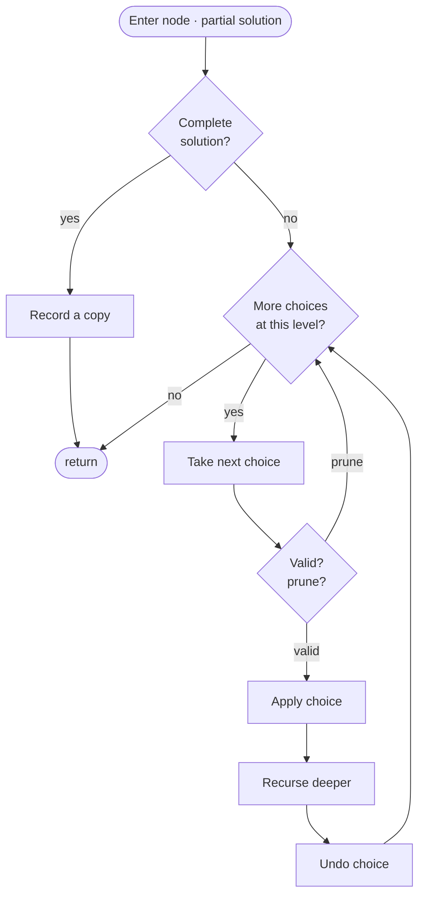

# Recursion &amp; Backtracking


<PatternVideo pattern-name="Backtracking" duration="8–12 min" />

<PatternProgress pattern-id="backtracking" problems="n-queens, permutations, permutations-ii, subsets-ii, combination-sum-ii, combination-sum-iii, combination-sum-iv, letter-combinations-of-a-phone-number, palindrome-partitioning, n-queens-ii, sudoku-solver, valid-sudoku, beautiful-arrangement, unique-paths-iii, robot-room-cleaner, next-permutation, letter-case-permutation" />

<script setup>
const theTemplateCode = `// The backtracking skeleton: choose → recurse → un-choose.
void solve(State path, Options remaining) {
    if (isSolution(path)) {
        record(path);                        // snapshot — never store the mutable live object
        return;
    }
    for (Choice c : remaining) {
        if (!respectsConstraint(c, path)) continue;   // PRUNE — kills whole subtree
        choose(c, path);                     // mutate shared state
        solve(path, remaining.without(c));
        unchoose(c, path);                   // restore BEFORE next sibling
    }
}

// The engineering is in the PRUNE and the UNCHOOSE.
// Prune early = exponential → polynomial on real inputs.
// Forget to unchoose = silent corruption at the next sibling.`

const theTemplateInvariant = {
  statement: `At every recursion entry, path represents a prefix of a candidate solution that satisfies all constraints so far. When path reaches "solution shape" (full length / full board / target hit), we record a snapshot. Mutate-and-undo lets a SINGLE shared path walk the entire tree in O(1) per level instead of O(n) copies.`,
  initialization: `path is empty (no choices committed). remaining is the full option set. isSolution(empty) is true only for trivial problems; usually false.`,
  maintenance: `For each choice c that passes the constraint check: choose(c) mutates path to a valid longer prefix. The recursive call extends to depth+1 under this invariant. unchoose(c) restores path to exactly its pre-choose state before the next sibling.`,
  termination: `The option set strictly shrinks (for subsets/permutations) or the depth is bounded (for N-Queens, Sudoku). Each path either reaches a solution (recorded) or hits a constraint (pruned). Total leaves ≤ product of branching factors; depth bounds the stack.`
}

const theTemplateComplexity = {
  time: `O(branching^depth · work per leaf) — pruning drops the constant drastically but not the asymptotic`,
  space: `O(depth) recursion stack + O(solutions × solution-size) output`
}

const theTemplateSpecializations = [
  { slug: `subsets-medium`,                  title: `Subsets (medium)` },
  { slug: `combinations-medium`,             title: `Combinations (medium)` },
  { slug: `permutations-used-medium`,        title: `Permutations (used[]) (medium)` },
  { slug: `permutations-swap-medium`,        title: `Permutations (swap) (medium)` },
  { slug: `combination-sum-medium`,          title: `Combination Sum (medium)` },
  { slug: `n-queens-hard`,                   title: `N-Queens (hard)` },
  { slug: `word-search-medium`,              title: `Word Search (medium)` },
  { slug: `letter-combinations-medium`,      title: `Letter Combinations (medium)` },
]

const theTemplateProblemShape = `Enumerate / find / count all valid X in an exponential search space, where a partial choice can be proven invalid before completing — so pruning avoids whole subtrees. Depth is small (≤ 20 practical); mutation on a shared path lets each level cost O(1).`

const subsetsCode = `// Subsets — the bare mechanic. Each element has 2 choices (skip / take).
List&lt;List&lt;Integer&gt;&gt; subsets(int[] a) {
    List&lt;List&lt;Integer&gt;&gt; res = new ArrayList&lt;&gt;();
    dfs(a, 0, new ArrayList&lt;&gt;(), res);
    return res;
}

void dfs(int[] a, int i, List&lt;Integer&gt; path, List&lt;List&lt;Integer&gt;&gt; res) {
    if (i == a.length) {
        res.add(new ArrayList&lt;&gt;(path));      // SNAPSHOT, not a reference
        return;
    }
    // choice 1: skip a[i]
    dfs(a, i + 1, path, res);
    // choice 2: take a[i]
    path.add(a[i]);
    dfs(a, i + 1, path, res);
    path.remove(path.size() - 1);            // UN-CHOOSE
}`

const permutationsSwapCode = `// Permutations via in-place swap — no used[] array needed.
// Idea: positions 0..i-1 are "fixed to some value"; try each remaining value at position i.
List&lt;List&lt;Integer&gt;&gt; permute(int[] a) {
    List&lt;List&lt;Integer&gt;&gt; res = new ArrayList&lt;&gt;();
    dfs(a, 0, res);
    return res;
}

void dfs(int[] a, int i, List&lt;List&lt;Integer&gt;&gt; res) {
    if (i == a.length) {
        List&lt;Integer&gt; p = new ArrayList&lt;&gt;();
        for (int x : a) p.add(x);
        res.add(p);
        return;
    }
    for (int j = i; j &lt; a.length; j++) {
        swap(a, i, j);                       // choose: a[j] goes to position i
        dfs(a, i + 1, res);
        swap(a, i, j);                       // un-choose: restore order
    }
}

void swap(int[] a, int x, int y) { int t = a[x]; a[x] = a[y]; a[y] = t; }`

const letterCombinationsCode = `// Phone-pad letter combinations — classic k-nested-loop problem unrolled by backtracking.
static final String[] PAD = {
    "", "", "abc", "def", "ghi", "jkl", "mno", "pqrs", "tuv", "wxyz"
};

List&lt;String&gt; letterCombinations(String digits) {
    List&lt;String&gt; res = new ArrayList&lt;&gt;();
    if (digits.isEmpty()) return res;
    dfs(digits, 0, new StringBuilder(), res);
    return res;
}

void dfs(String digits, int i, StringBuilder path, List&lt;String&gt; res) {
    if (i == digits.length()) {
        res.add(path.toString());
        return;
    }
    String letters = PAD[digits.charAt(i) - '0'];
    for (char c : letters.toCharArray()) {
        path.append(c);                      // choose
        dfs(digits, i + 1, path, res);
        path.deleteCharAt(path.length() - 1);// un-choose
    }
}`

const mastery5 = [
  {
    q: `In the choose-recurse-unchoose template, why must you ALWAYS un-choose, even when the recursive call returns immediately?`,
    choices: [
      { text: `The next sibling in the for loop must see the exact pre-choose state`, correct: true, explanation: `A single shared path walks the whole tree. Forgetting to un-choose corrupts every subsequent sibling in the current level AND every sibling at higher levels during their later-sibling scans.` },
      { text: `Only when you plan to try another sibling`, correct: false, explanation: `Even single-sibling levels get bitten — the parent's siblings still need the restored state.` },
      { text: `Java's GC requires it`, correct: false, explanation: `GC doesn't care; mutation of state is the problem.` },
      { text: `Only when the path is a List<T>`, correct: false }
    ]
  },
  {
    q: `For Subsets with input [1,2,3], the choose-or-skip template emits results in what order?`,
    choices: [
      { text: `[], [3], [2], [2,3], [1], [1,3], [1,2], [1,2,3] (skip visited first at each level)`, correct: true, explanation: `The "skip" branch is explored before "take" in the code, so the leftmost leaf is the all-skip empty set.` },
      { text: `[1], [1,2], [1,2,3], [1,3], [2], [2,3], [3], []`, correct: false, explanation: `That's the index-based combination template, not the choose-or-skip.` },
      { text: `[], [1], [2], [3], [1,2], [1,3], [2,3], [1,2,3]`, correct: false, explanation: `That's grouped by size (BFS layer order).` },
      { text: `Random`, correct: false }
    ]
  },
  {
    q: `For Permutations II with input [1,1,2], what's the standard duplicate-handling trick?`,
    choices: [
      { text: `Sort the input, then in the loop skip if (i > start && a[i] == a[i-1] && !used[i-1])`, correct: true, explanation: `The !used[i-1] guard allows the equal pair to form a permutation when both are being placed, but blocks the second starting a new branch with the same character the first did.` },
      { text: `Use a HashSet<List<Integer>> to deduplicate at the end`, correct: false, explanation: `Correct but wastes work generating duplicates in the first place.` },
      { text: `Return any permutation that passes an is_canonical check`, correct: false },
      { text: `No fix — duplicates are allowed`, correct: false }
    ]
  },
  {
    q: `For Sudoku solver, which constraint order gives the fastest pruning?`,
    choices: [
      { text: `Row, column, box — the cheapest check that fails most often first`, correct: true, explanation: `Row check fails ~90% of the time on random partial solutions. Box check fails less often; running it last avoids wasted work.` },
      { text: `Box, column, row — larger constraints first`, correct: false, explanation: `Box is the LEAST discriminating; running it first makes you discover failure late.` },
      { text: `Order doesn't matter — all three are O(1)`, correct: false, explanation: `Asymptotic is the same; constant factor from order matters a lot on exponential searches.` },
      { text: `Alphabetically`, correct: false }
    ]
  },
  {
    q: `Why is Dancing Links (Knuth, 2000) the state-of-the-art for exact-cover problems like Sudoku?`,
    choices: [
      { text: `It represents the constraint matrix as a doubly-linked list of rows and columns, so un-choose is truly O(1)`, correct: true, explanation: `Removing a row/column from the DL structure takes two pointer updates; restoring it uses the same two pointers in reverse (lazy restore).` },
      { text: `It uses SAT solvers`, correct: false, explanation: `DLX is a direct backtracking algorithm, not a SAT reduction.` },
      { text: `It parallelizes to all CPU cores`, correct: false, explanation: `The algorithm is single-threaded; parallel versions exist but aren't the state of the art.` },
      { text: `It solves in polynomial time`, correct: false, explanation: `Exact cover is NP-complete; DLX is just a very fast exponential.` }
    ]
  }
]
</script>


## Why backtracking exists — the story

You're placing 8 chess queens on an 8×8 board so no two attack each other. There are `⁶⁴C₈ ≈ 4·10⁹` ways to pick 8 squares. The brute force is: try every combination, check each for validity. On a modern laptop, that's about **a minute** of pure enumeration.

That's not the real problem though. The real problem is: **almost every combination is trivially invalid.** If you put the first queen at `(0,0)` and the second at `(1,0)`, the "same column" conflict is *already broken* — you don't need to place queens 3, 4, 5, 6, 7, 8 to know this branch is dead. Yet naive brute force cheerfully enumerates all `⁶²C₆ ≈ 4·10⁷` follow-up placements before concluding "invalid." Wasteful.

Backtracking is the fix: **the moment a partial choice is provably invalid, abandon it.** Build the solution incrementally, one queen at a time, and check the constraint at each step. When a placement conflicts, **backtrack** — undo the last move, try the next option, keep going. When you exhaust all options for a level, roll back further. For N-Queens, this prunes the search from `⁶⁴C₈ ≈ 4·10⁹` down to about `2·10⁶` explored placements — **2,000× faster** for one line of pruning logic.

The insight generalizes: any problem where the answer is *a valid arrangement / combination / permutation, chosen from a huge space* can be tackled with backtracking. Sudoku Solver, Word Search, Combination Sum, Palindrome Partitioning, Generate Parentheses — they all follow the same **choose → recurse → un-choose** template. The engineering challenge isn't the recursion; it's designing the pruning check to fire *early*, before you waste time exploring a doomed subtree.

Get pruning right and backtracking solves exponential-search problems in milliseconds. Get pruning wrong and your recursion times out on the first hard input.

## The core idea — choose, recurse, un-choose (and prune ruthlessly)

<BacktrackingAnim />

The template is invariant across problems. What changes is (a) the **choice set** at each level, (b) the **constraint/prune**, and (c) what makes a node a **complete solution**.


```
solve(path, remaining_options):
    if path is a complete solution:
        record path
        return
    for each choice in remaining_options:
        if choice violates constraint given path:
            continue                 // <-- pruning: the whole subtree is skipped
        choose(choice)               // mutate shared state
        solve(path + [choice], remaining_options - {choice})
        un-choose(choice)            // restore state before trying next sibling
```


The mutation-and-undo is what lets a **single shared** `path` list (or board, or bitmask) walk the entire tree. Copying at each recursive call is O(n) per level → O(n · leaves) total; mutating is O(1) per level → O(depth · leaves).

## When to use it — recognition signals

Backtracking fits when the problem asks for:

- **Enumerate all valid X** — all subsets, all permutations, all placements, all partitions. Subsets, Subsets II, Permutations, Combination Sum.
- **Find any valid X** — one arrangement that satisfies constraints. Sudoku Solver, N-Queens (return first solution), Word Search.
- **Count valid X without listing them** — sometimes DP is better, but for small `n` backtracking with pruning is simpler.
- **The search space is exponential but heavily prunable** — the constraint fires early. If pruning is impossible, backtracking degenerates to full brute force.
- **State is naturally recursive** — a board with one queen placed is a smaller version of the original problem.
- **Depth is small (≤ 20)** — because O(k^d) explodes fast. For depth &gt; 25, DP or state-space search is usually needed.

Trigger phrases: *"all combinations", "return all solutions", "count arrangements", "generate all", "find any", "place N objects such that..."*

## THE template — choose, recurse, un-choose

<PatternTemplateCard
  slug="backtracking"
  title="Backtracking"
  language="java"
  :code="theTemplateCode"
  :invariant="theTemplateInvariant"
  :complexity="theTemplateComplexity"
  :specializations="theTemplateSpecializations"
  :problemShape="theTemplateProblemShape"
/>

<InvariantProof
  :statement="theTemplateInvariant.statement"
  :initialization="theTemplateInvariant.initialization"
  :maintenance="theTemplateInvariant.maintenance"
  :termination="theTemplateInvariant.termination"
/>

### Pruning is where the asymptotics live

Backtracking without pruning IS brute force — same `O(branching^depth)`. The pruning check is the entire algorithmic contribution. Put the **cheapest check that fails most often first**: for Sudoku, row before column before 3×3 box. For N-Queens, bitmask union before explicit coordinate scans. For Word Search, grid-bounds before letter match before visited-cell check.

### Complexity reference

| Template | Time | Space | Best use |
|---|---|---|---|
| **Subsets** (choose-or-skip) | O(n · 2ⁿ) | O(n) recursion | All subsets of small sets |
| **Permutations** (used[]) | O(n · n!) | O(n) recursion | All arrangements |
| **Combinations** (start-index) | O(k · C(n,k)) | O(k) recursion | Pick k from n |
| **Constraint search** (bitmask) | pruned exponential | O(depth) | Sudoku, N-Queens |
| **Grid DFS** (visited bitmap) | O(mn · 4^L) | O(L) stack | Word Search |

## When the mechanic breaks — three failure modes

<TrapTrace
  title="Forgetting to un-choose (silent state corruption)"
  bug="You call dfs(path.add(x), ...) and let the recursive call modify path, but forget path.remove(size-1) after. The next sibling sees a path that still contains x — now its 'is-this-a-valid-prefix' check passes with corrupted data. Symptom: duplicates in output, or incorrectly-shaped solutions. No crash — just wrong answers."
  fix="For every mutation before the recursive call, write its exact inverse right after. Rule of thumb: path.add(x) → dfs(...) → path.remove(size-1); used[i] = true → dfs(...) → used[i] = false; board[r][c] = 'Q' → dfs(...) → board[r][c] = '.'. If the mutation is on a shared state, the inverse MUST run or the next sibling will see garbage."
/>

<TrapTrace
  title="Storing a reference to the mutable path instead of a snapshot"
  bug="You write res.add(path) when path is a valid solution. path is a mutable List; res now holds a reference to it. Subsequent mutations (even in later siblings) corrupt the stored solution. Classic symptom: res.toString() shows every entry equal to the LAST path visited by the recursion."
  fix="Always snapshot at the leaf: res.add(new ArrayList<>(path)). For char[] or int[] boards, snapshot with Arrays.copyOf(). For StringBuilder paths, path.toString() returns a String (immutable), so that's safe. Cost is O(solution-size) per leaf — unavoidable; the output IS O(solutions × solution-size)."
/>

<TrapTrace
  title="Duplicate output on inputs like [1,1,2] without the duplicate-skip trick"
  bug="With Permutations II input [1,1,2], the naive loop emits [1,1,2] twice (once per starting '1'), [1,2,1] twice, [2,1,1] twice. Six outputs where only three are distinct. The exact same bug surfaces in Subsets II, Combination Sum II, and any 'enumerate without duplicates' problem."
  fix="Sort the input first. Then in the sibling loop, skip duplicates: if (i > start && a[i] == a[i-1]) continue; (for Subsets II / Combination Sum II start-index templates). For Permutations II with used[]: if (i > 0 && a[i] == a[i-1] && !used[i-1]) continue; — the !used[i-1] guard allows an equal pair to BOTH be placed, but blocks the second starting a new branch with the same character."
/>

## History — Golomb-Baumert, 1965

Backtracking was formalized as a general search technique by **Solomon Golomb and Leonard Baumert** in their 1965 paper *"Backtrack Programming."* They gave the exact template — choose, recurse, un-choose — and analyzed pruning heuristics. Golomb was famous for his work on Golomb rulers (perfectly-different-length rulers), and the pattern grew out of his search for optimal designs.

Donald Knuth extended the technique in **Dancing Links (2000)**, an elegant doubly-linked-list representation of the constraint graph that makes un-choose truly O(1). Knuth's Algorithm X (using Dancing Links) is still the state-of-the-art for exact cover problems like Sudoku, Pentomino tiling, and set-partitioning problems in operations research.

**Prolog** (1972) is essentially a language whose entire execution model is backtracking. Every SQL query planner uses backtracking at the query-tree exploration stage. Modern SAT solvers use **DPLL** (Davis-Putnam-Logemann-Loveland, 1962) — which is backtracking with clever pruning heuristics.

## Sub-variations of the template

<PatternSubVariationNav pattern="backtracking" />

### Subsets <span class="diff diff-m">Medium</span>

*[↗ LeetCode: Subsets](https://leetcode.com/problems/subsets/)*

The bare mechanic. Each element has two choices (skip / take) — the recursion tree is a complete binary tree of depth n with 2^n leaves, each a distinct subset.

<Callout kind="key">

Enumerate all 2^n subsets of a set of distinct integers.

</Callout>

<TemplateReveal
  slug="subsets"
  language="java"
  :canonical="subsetsCode"
/>

**Why choose-or-skip beats the start-index template for Subsets?** Both give O(n · 2^n). The choose-or-skip tree has a fixed shape (full binary tree); the start-index tree has shrinking branching factor. Readability tie; pick the one your interviewer prefers.

**Complexity:** O(n · 2^n) time (2^n subsets × n to copy each), O(n) recursion depth + O(n · 2^n) output.

**Classic variations:**
- [Subsets II](https://leetcode.com/problems/subsets-ii/) — input has duplicates; apply the duplicate-skip trick (sort, then `if (i > start && a[i] == a[i-1]) continue;`).
- [Palindrome Partitioning](https://leetcode.com/problems/palindrome-partitioning/) — same choose-or-skip shape, but the "choice" is a prefix palindrome.

### N-Queens canonical walkthrough

The Canonical problem walkthrough stays below (N-Queens Hard) — jump via the chip row above.

&lt;!-- (canonical N-Queens prose follows the H3 structure below as the N-Queens Hard sub-variation. The 3-approach ladder (brute → row-by-row → bitmask) has been consolidated into that H3.) --&gt;

<details>
<summary><strong>Historical: the 3-approach ladder for N-Queens (brute → row → bitmask)</strong></summary>

**Problem** ([↗ LeetCode](https://leetcode.com/problems/n-queens/)): Place `n` queens on an `n × n` chessboard such that no two queens attack each other (no shared row, column, or diagonal). Return all distinct board configurations.

### Approach 1 — Brute force (enumerate all placements)

Try every way to pick `n` squares from `n²` and check if it's a valid arrangement.


```java
// pseudocode; too slow to write in Java for real n
// enumerate C(n², n) subsets, check each
```


**Complexity:** For n = 8, `C(64, 8) ≈ 4·10⁹`. About a minute of CPU. Unusable at n = 12.

### Approach 2 — Backtrack row by row

Place one queen per row, checking column/diagonal conflicts against already-placed queens.


```java
List<List<String>> solveNQueens(int n) {
    List<List<String>> res = new ArrayList<>();
    int[] queens = new int[n];               // queens[r] = column of queen in row r
    dfs(0, n, queens, res);
    return res;
}

void dfs(int row, int n, int[] queens, List<List<String>> res) {
    if (row == n) { res.add(build(queens, n)); return; }
    for (int col = 0; col < n; col++) {
        if (isSafe(queens, row, col)) {
            queens[row] = col;                // choose
            dfs(row + 1, n, queens, res);      // recurse
            // no explicit un-choose needed: next iteration overwrites queens[row]
        }
    }
}

boolean isSafe(int[] queens, int row, int col) {
    for (int r = 0; r < row; r++) {
        if (queens[r] == col) return false;                     // same column
        if (Math.abs(queens[r] - col) == Math.abs(r - row)) return false;   // same diagonal
    }
    return true;
}
```


**Complexity:** For n = 8, explores ~2000 nodes. For n = 12, ~10⁶ nodes. Runs in milliseconds.

### Approach 3 — Bitmask constraint tracking

Represent occupied columns, diagonals, and anti-diagonals as `int` bitmasks. Available slots per row = `~(cols | diag | anti)`. Ultra-fast because `isSafe` becomes a single AND operation.


```java
int total = 0;
void dfs(int n, int row, int cols, int diag, int anti) {
    if (row == n) { total++; return; }
    int free = ((1 << n) - 1) & ~(cols | diag | anti);
    while (free != 0) {
        int pick = free & -free;
        dfs(n, row + 1, cols | pick, (diag | pick) << 1, (anti | pick) >> 1);
        free ^= pick;
    }
}
```


**Complexity:** Same asymptotic, but a constant-factor speedup of 5-10× because bit operations replace the linear `isSafe` scan.

### Complexity ladder

| Approach | Time | Space | When |
|---|---|---|---|
| Brute force | O(C(n², n)) | O(n) | Never in practice |
| **Row-by-row backtracking** | **pruned exponential** | **O(n)** | **Interview default** |
| Bitmask backtracking | pruned exponential (5-10× faster) | O(n) | Contest / follow-up |

</details>

---

**Grokking arc:** The motivating problem is generating all valid choices without state bleeding between siblings. Brute force tries every branch. **Can we do better?** We still explore an exponential tree, but we prune impossible branches early and use `choose → recurse → undo` so one shared path/board stays correct.

Backtracking is how you say *"try everything — but be smart about it."* Picture a tree of decisions: at each step you pick an option, dive deeper, and when you come back up you **undo** that pick before trying the next one — leaving the world exactly as you found it. That undo is the whole trick; it's what lets a single piece of code walk every combination, permutation, or board layout without them bleeding into each other. Left unchecked this is exponential, so the real skill is **pruning**: the instant a partial choice can't possibly lead to a valid answer, you abandon that branch instead of exploring it all the way down.


```text
                      []                     Subsets of [1,2,3]
        ┌──────────────┼──────────────┐
       [1]            [2]            [3]
     ┌──┴──┐         ┌─┘
   [1,2] [1,3]     [2,3]
     │
  [1,2,3]
```


<Callout kind="key" title="Key Insight">

The template is invariant across problems: `choose → recurse → un-choose`. What changes is (a) the **choice set** at each level, (b) the **constraint/prune**, and (c) what makes a node a **complete solution**.

</Callout>


<div class="svg-figure">
<svg preserveAspectRatio="xMidYMid meet" role="img" viewBox="0 0 720 260" xmlns="http://www.w3.org/2000/svg" font-family="Segoe UI, Arial, sans-serif" aria-label="subsets of [1,2,3]: include / exclude each element">
  <defs>
    <marker id="bt-ar-grn" markerWidth="8" markerHeight="8" refX="5" refY="3" orient="auto"><path d="M0,0 L6,3 L0,6 Z" fill="var(--dsa-success)"/></marker>
    <marker id="bt-ar-red" markerWidth="8" markerHeight="8" refX="5" refY="3" orient="auto"><path d="M0,0 L6,3 L0,6 Z" fill="var(--dsa-danger)"/></marker>
    <marker id="bt-ar-mute" markerWidth="8" markerHeight="8" refX="5" refY="3" orient="auto"><path d="M0,0 L6,3 L0,6 Z" fill="var(--dsa-neutral)"/></marker>
    <filter id="bt-s1" x="-10%" y="-10%" width="120%" height="140%"><feDropShadow dx="0" dy="1.2" stdDeviation="1.2" flood-color="var(--dsa-neutral)" flood-opacity="0.5"/></filter>
  </defs>
  <rect x="0" y="0" width="720" height="260" fill="var(--dsa-bg)"/>
  <text x="360" y="22" text-anchor="middle" font-size="13" font-weight="700" fill="var(--dsa-ink)">subsets of [1,2,3]: include / exclude each element</text>
  <g stroke-width="1.6" fill="none">
    <line x1="360" y1="50" x2="220" y2="82" stroke="var(--dsa-success)" marker-end="url(#bt-ar-grn)"/><line x1="360" y1="50" x2="500" y2="82" stroke="var(--dsa-neutral)" marker-end="url(#bt-ar-mute)"/>
    <line x1="220" y1="104" x2="130" y2="132" stroke="var(--dsa-success)" marker-end="url(#bt-ar-grn)"/><line x1="220" y1="104" x2="288" y2="132" stroke="var(--dsa-neutral)" marker-end="url(#bt-ar-mute)"/>
    <line x1="500" y1="104" x2="432" y2="132" stroke="var(--dsa-success)" marker-end="url(#bt-ar-grn)"/><line x1="500" y1="104" x2="590" y2="132" stroke="var(--dsa-neutral)" marker-end="url(#bt-ar-mute)"/>
    <line x1="130" y1="154" x2="74" y2="188" stroke="var(--dsa-success)" marker-end="url(#bt-ar-grn)"/><line x1="130" y1="154" x2="130" y2="188" stroke="var(--dsa-neutral)" marker-end="url(#bt-ar-mute)"/>
    <line x1="288" y1="154" x2="250" y2="188" stroke="var(--dsa-success)" marker-end="url(#bt-ar-grn)"/><line x1="288" y1="154" x2="306" y2="188" stroke="var(--dsa-neutral)" marker-end="url(#bt-ar-mute)"/>
    <line x1="432" y1="154" x2="414" y2="188" stroke="var(--dsa-success)" marker-end="url(#bt-ar-grn)"/><line x1="432" y1="154" x2="470" y2="188" stroke="var(--dsa-neutral)" marker-end="url(#bt-ar-mute)"/>
    <line x1="590" y1="154" x2="590" y2="188" stroke="var(--dsa-success)" marker-end="url(#bt-ar-grn)"/><line x1="590" y1="154" x2="646" y2="188" stroke="var(--dsa-neutral)" marker-end="url(#bt-ar-mute)"/>
  </g>
  <g font-size="11" font-weight="700" text-anchor="middle">
    <text x="286" y="69" fill="var(--dsa-success)">include 1</text><text x="435" y="69" fill="var(--dsa-neutral)">exclude 1</text>
    <text x="172" y="121" fill="var(--dsa-success)">include 2</text><text x="255" y="121" fill="var(--dsa-neutral)">exclude 2</text>
    <text x="466" y="121" fill="var(--dsa-success)">include 2</text><text x="548" y="121" fill="var(--dsa-neutral)">exclude 2</text>
  </g>
  <path d="M72,212 C85,230 124,224 130,206 C132,184 128,168 127,154 C152,151 206,130 219,104 C262,90 335,69 359,51" fill="none" stroke="var(--dsa-danger)" stroke-width="2" stroke-dasharray="6 4" marker-end="url(#bt-ar-red)"/>
  <text x="152" y="235" font-size="11" font-weight="700" fill="var(--dsa-danger)">dashed = un-choose while backing up</text>
  <g filter="url(#bt-s1)" text-anchor="middle" font-weight="700">
    <rect x="334" y="30" width="52" height="28" rx="7" fill="var(--dsa-primary-soft)" stroke="var(--dsa-primary)"/><text x="360" y="49" font-size="12" fill="var(--dsa-ink)">[]</text>
    <rect x="194" y="82" width="52" height="28" rx="7" fill="var(--dsa-success-soft)" stroke="var(--dsa-success)"/><text x="220" y="101" font-size="12" fill="var(--dsa-ink)">[1]</text>
    <rect x="474" y="82" width="52" height="28" rx="7" fill="var(--dsa-neutral-soft)" stroke="var(--dsa-neutral-line)"/><text x="500" y="101" font-size="12" fill="var(--dsa-ink)">[]</text>
    <rect x="97" y="132" width="66" height="28" rx="7" fill="var(--dsa-success-soft)" stroke="var(--dsa-success)"/><text x="130" y="151" font-size="11" fill="var(--dsa-ink)">[1,2]</text>
    <rect x="262" y="132" width="52" height="28" rx="7" fill="var(--dsa-neutral-soft)" stroke="var(--dsa-neutral-line)"/><text x="288" y="151" font-size="11" fill="var(--dsa-ink)">[1]</text>
    <rect x="406" y="132" width="52" height="28" rx="7" fill="var(--dsa-success-soft)" stroke="var(--dsa-success)"/><text x="432" y="151" font-size="11" fill="var(--dsa-ink)">[2]</text>
    <rect x="564" y="132" width="52" height="28" rx="7" fill="var(--dsa-neutral-soft)" stroke="var(--dsa-neutral-line)"/><text x="590" y="151" font-size="11" fill="var(--dsa-ink)">[]</text>
    <rect x="35" y="188" width="78" height="28" rx="7" fill="var(--dsa-success-soft)" stroke="var(--dsa-success)"/><text x="74" y="207" font-size="11" fill="var(--dsa-ink)">[1,2,3]</text>
    <rect x="98" y="188" width="64" height="28" rx="7" fill="var(--dsa-neutral-soft)" stroke="var(--dsa-neutral-line)"/><text x="130" y="207" font-size="11" fill="var(--dsa-ink)">[1,2]</text>
    <rect x="216" y="188" width="68" height="28" rx="7" fill="var(--dsa-success-soft)" stroke="var(--dsa-success)"/><text x="250" y="207" font-size="11" fill="var(--dsa-ink)">[1,3]</text>
    <rect x="280" y="188" width="52" height="28" rx="7" fill="var(--dsa-neutral-soft)" stroke="var(--dsa-neutral-line)"/><text x="306" y="207" font-size="11" fill="var(--dsa-ink)">[1]</text>
    <rect x="377" y="188" width="74" height="28" rx="7" fill="var(--dsa-success-soft)" stroke="var(--dsa-success)"/><text x="414" y="207" font-size="11" fill="var(--dsa-ink)">[2,3]</text>
    <rect x="444" y="188" width="52" height="28" rx="7" fill="var(--dsa-neutral-soft)" stroke="var(--dsa-neutral-line)"/><text x="470" y="207" font-size="11" fill="var(--dsa-ink)">[2]</text>
    <rect x="564" y="188" width="52" height="28" rx="7" fill="var(--dsa-success-soft)" stroke="var(--dsa-success)"/><text x="590" y="207" font-size="11" fill="var(--dsa-ink)">[3]</text>
    <rect x="620" y="188" width="52" height="28" rx="7" fill="var(--dsa-neutral-soft)" stroke="var(--dsa-neutral-line)"/><text x="646" y="207" font-size="11" fill="var(--dsa-ink)">[]</text>
  </g>
  <text x="586" y="235" text-anchor="middle" font-size="11" font-weight="700" fill="var(--dsa-neutral)">8 leaves = 2³ subsets</text>
</svg>
</div>


<div class="readfig"><b>How to read it:</b> Each level decides whether to include or exclude the next number. A root-to-leaf path is one subset, so three binary choices produce <b>2³ = 8</b> leaves. The dashed red path shows backtracking: after recording <code>[1,2,3]</code>, the algorithm un-chooses <b>3</b>, then backs up to try the sibling branches without stale state.</div>





<div class="figcap">Backtracking control flow — choose / recurse / undo, pruning invalid branches before descending.</div>
<div class="readfig"><b>How to read it:</b> This is a depth-first walk through all the choices. At each node you ask "is this a complete answer?" — if so, record a copy and back out. Otherwise you try the next available choice: skip it if it's invalid (that's the pruning), otherwise apply it, recurse deeper, and — crucially — *undo* it when you return so the next sibling starts from a clean slate. The loop back to "more choices?" is you trying each option in turn; the deep chain is you committing to one and exploring it fully.</div>

<Callout kind="note" title="Video walkthrough coming soon">

a 5-10 minute Loom will be embedded here once recorded. If you'd like to be notified, [subscribe on GitHub](https://github.com/abhisinghal/dsa-master-reference/subscription).

</Callout>

<Callout kind="inv" title="Invariant">

On entry and exit of each recursive call the shared state (`path`, board, `used[]`) is identical; every mutation is paired with its undo. Violating this is the #1 backtracking bug.

</Callout>

### Recognize by
- "enumerate all" — subsets, permutations, combinations, N-Queens boards
- constraint satisfaction — Sudoku, word search on a grid, expression evaluation
- n ≤ ~15 (2ⁿ ≤ 32 K) so exponential search is affordable with pruning


<BacktrackingAnim />

<details class="learnings">
<summary><strong>Learnings — points to remember</strong></summary>

- **The start-index template**: `dfs(start)` with a loop `for i from start to n-1` → recurse with `i+1`. This is the mechanism that guarantees combinations (not permutations): once you move past index `i`, you never come back.
- **Record on entry, not on leaf**: for subsets, `result.add(new ArrayList(path))` is called at every recursion entry — every prefix of the DFS tree is a subset. For problems where only full-length paths count (permutations), record at `path.size() == n`.
- **Pass-by-reference discipline**: always `new ArrayList<>(path)` when recording. Appending the live `path` to `result` and then mutating it will corrupt the stored subset.
- **The three enumeration shapes**: subsets (every DFS node is a hit, start-index template), combinations (fixed-size subsets, same template with early return at `path.size() == k`), permutations (used[] or swap).
- **2^n time, n space**: every subset has a unique path from root; depth is n; total nodes is 2^n. Each node does O(n) copy work → O(n·2^n).
- **Siblings: Combinations (fixed k, same template), Combination Sum (reuse via `i` not `i+1`), Partition Equal Subset Sum (subsets + boolean DP).**

</details>

### When NOT to use it
You want *one* answer, not all — a pruned DFS or DP is faster than enumerating every branch. Also skip when the state space is polynomial (n·k tuples) and DP fits — an exponential search is unnecessary.

---

### Combinations <span class="diff diff-m">Medium</span>

*[↗ LeetCode: Subsets](https://leetcode.com/problems/subsets/)*

<ProgressCheck id="subsets-amp-combinations-the-start-index-template" />


<div class="svg-figure">
<svg preserveAspectRatio="xMidYMid meet" role="img" viewBox="0 0 720 260" xmlns="http://www.w3.org/2000/svg" aria-label="Diagram illustrating: Subsets &amp; Combinations (the start-index template) Medium">
  <defs>
    <marker id="subsets-ar" markerWidth="9" markerHeight="9" refX="6" refY="3" orient="auto">
      <path d="M0,0 L6,3 L0,6 Z" fill="var(--dsa-primary)"/>
    </marker>
  </defs>
  <rect x="0" y="0" width="720" height="260" rx="12" fill="var(--dsa-bg)"/>
  <text x="360" y="24" text-anchor="middle" font-family="var(--dsa-font)" font-size="13" font-weight="700" fill="var(--dsa-primary)">start-index DFS records every node once</text>
  <g stroke="var(--dsa-primary)" stroke-width="var(--dsa-arrow-stroke)" fill="none" marker-end="url(#subsets-ar)">
    <line x1="360" y1="68" x2="192" y2="112"/><line x1="360" y1="68" x2="360" y2="112"/><line x1="360" y1="68" x2="528" y2="112"/>
    <line x1="192" y1="156" x2="116" y2="190"/><line x1="192" y1="156" x2="260" y2="190"/>
    <line x1="116" y1="234" x2="116" y2="236"/>
    <line x1="116" y1="156" x2="116" y2="190"/>
    <line x1="360" y1="156" x2="360" y2="190"/>
  </g>
  <g font-family="var(--dsa-font)" text-anchor="middle">
    <g font-size="11" font-weight="700" fill="var(--dsa-neutral)">
      <text x="278" y="86">choose 1</text><text x="374" y="98">choose 2</text><text x="462" y="86">choose 3</text>
      <text x="146" y="176">choose 2</text><text x="234" y="176">choose 3</text><text x="374" y="176">choose 3</text>
    </g>
    <g font-size="11" font-weight="700" fill="var(--dsa-ink)">
      <rect x="338" y="38" width="44" height="44" rx="7" fill="var(--dsa-primary-soft)" stroke="var(--dsa-primary)" stroke-width="1.6"/><text x="360" y="57">1</text><text x="360" y="73">∅</text>
      <rect x="170" y="112" width="44" height="44" rx="7" fill="var(--dsa-success-soft)" stroke="var(--dsa-success)" stroke-width="1.6"/><text x="192" y="131">2</text><text x="192" y="147">{1}</text>
      <rect x="338" y="112" width="44" height="44" rx="7" fill="var(--dsa-neutral-soft)" stroke="var(--dsa-neutral-line)" stroke-width="1.6"/><text x="360" y="131">6</text><text x="360" y="147">{2}</text>
      <rect x="506" y="112" width="44" height="44" rx="7" fill="var(--dsa-neutral-soft)" stroke="var(--dsa-neutral-line)" stroke-width="1.6"/><text x="528" y="131">8</text><text x="528" y="147">{3}</text>
      <rect x="94" y="190" width="44" height="44" rx="7" fill="var(--dsa-success-soft)" stroke="var(--dsa-success)" stroke-width="1.6"/><text x="116" y="209">3</text><text x="116" y="225">{1,2}</text>
      <rect x="238" y="190" width="44" height="44" rx="7" fill="var(--dsa-neutral-soft)" stroke="var(--dsa-neutral-line)" stroke-width="1.6"/><text x="260" y="209">5</text><text x="260" y="225">{1,3}</text>
      <rect x="338" y="190" width="44" height="44" rx="7" fill="var(--dsa-neutral-soft)" stroke="var(--dsa-neutral-line)" stroke-width="1.6"/><text x="360" y="209">7</text><text x="360" y="225">{2,3}</text>
      <rect x="94" y="102" width="44" height="44" rx="7" fill="var(--dsa-success-soft)" stroke="var(--dsa-success)" stroke-width="1.6" opacity="0.9"/>
      <text x="116" y="119">4</text><text x="116" y="135">{1,2,3}</text>
    </g>
  </g>
</svg>
</div>


<div class="readfig"><b>How to read it:</b> start-index prevents duplicates; every path = one subset.</div>

### Problem
Return **all subsets** (the power set) of a set of distinct integers, in any order.

**Constraints:** `1 ≤ n ≤ 10`; values distinct; there are `2ⁿ` subsets.

**Example 1:** `[1,2,3]` → `[[],[1],[2],[3],[1,2],[1,3],[2,3],[1,2,3]]`.

**Example 2:** `[0]` → `[[],[0]]`.

<ExamplePreview compact :input="['0']" :output="['[[],[0]]']" />

### Solution — brute force
Brute force is the full include/exclude decision tree: for each element, choose to take it or skip it, then record the subset at the leaf. That is already O(n·2ⁿ) time and O(n) recursion space, which matches the output-size lower bound. The optimized template is not asymptotically faster; it organizes the search with a `start` index so combinations appear once and duplicate permutations never get generated.

**Brute-force sketch:**


```text
dfs(i, path):
    if i == n: record copy(path); return
    dfs(i + 1, path)          // skip
    path.add(a[i]); dfs(i + 1, path); path.remove(last)  // take/undo
```


**Baseline complexity:** O(n·2ⁿ) time and O(n) recursion space, plus output.

### Solution — optimized
The optimized solution keeps the original Java intact and explains the pattern that removes the brute-force bottleneck.

#### Pattern
Use a `start` index so each element is considered once in order — this prevents permutations of the same set.

#### Java


```java
List<List<Integer>> subsets(int[] a) {
    List<List<Integer>> res = new ArrayList<>();
    dfs(a, 0, new ArrayList<>(), res);
    return res;
}
void dfs(int[] a, int start, List<Integer> path, List<List<Integer>> res) {
    res.add(new ArrayList<>(path));          // every node is a valid subset
    for (int i = start; i < a.length; i++) {
        path.add(a[i]);                      // choose
        dfs(a, i + 1, path, res);            // explore (i+1: no reuse)
        path.remove(path.size() - 1);        // un-choose
    }
}
```


<Callout kind="note" title="Trace it">

`[1,2,3]`. Advancing `start` builds `[]→[1]→[1,2]→[1,2,3]→[1,3]→[2]…` — all **8** subsets, each set once (never `[2,1]` as a duplicate of `[1,2]`).

</Callout>

<CodeTrace
  title="Subsets — nums=[1,2,3], DFS with start index"
  :values="[1,2,3]"
  :windowKeys="['start']"
  :cellWidth="42"
  :steps='[
    { pointers: { start: 0 }, vars: { current: "[]", found: 1 }, note: "record empty set" },
    { pointers: { start: 1 }, vars: { current: "[1]", found: 2 }, note: "pick 1", added: [0] },
    { pointers: { start: 2 }, vars: { current: "[1,2]", found: 3 }, note: "pick 2", added: [0,1] },
    { pointers: { start: 3 }, vars: { current: "[1,2,3]", found: 4 }, note: "pick 3", added: [0,1,2] },
    { pointers: { start: 3 }, vars: { current: "[1,3]", found: 5 }, note: "backtrack, skip 2, pick 3", added: [0,2] },
    { pointers: { start: 2 }, vars: { current: "[2]", found: 6 }, note: "new branch from idx 1", added: [1] },
    { pointers: { start: 3 }, vars: { current: "[2,3]", found: 7 }, note: "pick 3", added: [1,2] },
    { pointers: { start: 3 }, vars: { current: "[3]", found: 8 }, note: "final: 3 alone. total 8", added: [2] }
  ]'
/>

#### Same pattern, new tweaks
The choose → recurse → undo loop stays fixed; what changes is the choice set and the "done" test:

| Variation | The one thing that changes | Time |
|---|---|---|
| [Subsets II (with duplicates)](https://leetcode.com/problems/subsets-ii/) | sort first, then skip equal siblings (`i > start && a[i] == a[i-1]`) so you don't emit the same subset twice | — |
| [Combination Sum / Combination Sum II](https://leetcode.com/problems/combination-sum-ii/) | carry a remaining-target budget; allow reuse by recursing with the same `i` (unbounded) or forbid it with `i+1` (each item once) | — |
| [Permutations](https://leetcode.com/problems/permutations/) | order matters, so drop the `start` index and instead track a `used[]` array, scanning all positions each level | — |
| [Palindrome Partitioning](https://leetcode.com/problems/palindrome-partitioning/) | a "choice" is a prefix that happens to be a palindrome; recurse on the rest | — |

<Callout kind="note" title="Interview script">

"I first confirm the input values are distinct and output order does not matter. I start with brute force include/exclude recursion, which is O(n·2ⁿ) time because the output itself has 2ⁿ subsets. I optimize the presentation with a `start` index and backtracking, preserving O(n·2ⁿ) time while avoiding duplicate orderings."

</Callout>

<Callout kind="trap" title="Common Trap">

Forgetting to un-choose. *Example:* generating subsets of `[1,2]`. If you `add(1)` and recurse but don't `remove(1)`, the sibling branch `[2]` starts with path `[1]` and you emit `[1,2]` twice. `remove(path.size()-1)` is the whole discipline.

</Callout>

<CodeTrace
  title="Trap — Backtracking without un-choose: subsets of [1,2]"
  :values="[1,2]"
  :windowKeys="['idx']"
  :cellWidth="52"
  :steps='[
    { pointers: { idx: 0 }, vars: { path: "[1]" }, note: "add(1), recurse", added: [0] },
    { pointers: { idx: 1 }, vars: { path: "[1,2]" }, note: "add(2), emit [1,2]", added: [0,1] },
    { pointers: { idx: 1 }, vars: { path: "[1,2]" }, note: "BUG: return without remove(2). back at outer scope, path still [1,2]" },
    { pointers: { idx: 1 }, vars: { path: "[1,2]" }, note: "BUG: sibling branch (skip 1, pick 2) emits [1,2] AGAIN. duplicate!" },
    { pointers: { idx: 1 }, vars: { path: "[1]" }, note: "FIX: remove(path.size()-1) after recurse. sibling starts clean → emits [2]" }
  ]'
/>

<Callout kind="pat" title="Pattern Connection">

`start` = "consider items left-to-right, no repeats" — the backbone of *Combination Sum*, *Palindrome Partitioning*, and subset-sum enumeration. **Dedup with duplicates:** sort, then `if (i > start && a[i]==a[i-1]) continue;`.

</Callout>

### Time Complexity
Subsets: O(n·2ⁿ). Combinations C(n,k): O(k·C(n,k)).


O(n·2ⁿ): there are 2ⁿ subsets and copying each subset can cost O(n).


### Space Complexity
O(n) recursion/path space excluding output; O(n·2ⁿ) including the returned subsets.

<details class="learnings">
<summary><strong>Learnings — points to remember</strong></summary>

- Why `res.add(new ArrayList<>(path))`? — it snapshots the current subset; storing `path` itself would mutate every recorded answer later.
- Why pass `start`? — it enforces left-to-right choices so `[1,2]` appears once and `[2,1]` is never generated as a duplicate.
- Why recurse with `i + 1`? — subsets do not reuse the same element after choosing it.
- Why `path.remove(path.size() - 1)`? — it undoes the last choice so the next sibling starts from the previous state.
- Why record at every node? — every partial path is already a valid subset, not only the leaves.

</details>

### Permutations (used[]) <span class="diff diff-m">Medium</span>

*[↗ LeetCode: Permutations](https://leetcode.com/problems/permutations/)*

<ProgressCheck id="permutations-the-used-template" />

### Problem
Return **all orderings** (permutations) of a list of distinct integers.

**Constraints:** `1 ≤ n ≤ 6`; values distinct; there are `n!` permutations.

**Example 1:** `[1,2,3]` → the 6 orderings `123, 132, 213, 231, 312, 321`.

**Example 2:** `[1,2]` → `[[1,2],[2,1]]`.

### Solution — brute force
Brute force builds every ordering by placing each remaining number in the next slot. There are `n!` leaves and copying each permutation costs O(n), so the unavoidable output cost is O(n·n!) with O(n) recursion state. The optimized template is mainly about clean state management: `used[]` tells which values are already in the path, and the undo step restores the state for the next sibling.

**Brute-force sketch:**


```text
dfs(path):
    if path.size() == n: record copy(path); return
    for each index i:
        if not used[i]: choose i, recurse, undo i
```


**Baseline complexity:** O(n·n!) time and O(n) recursion/used-array space, plus output.

### Solution — optimized
The optimized solution keeps the original Java intact and explains the pattern that removes the brute-force bottleneck.

#### Pattern
No `start` index — every unused element is a candidate at every position; track membership with `used[]`.

#### Java


```java
List<List<Integer>> permute(int[] a) {
    List<List<Integer>> res = new ArrayList<>();
    dfs(a, new boolean[a.length], new ArrayList<>(), res);
    return res;
}
void dfs(int[] a, boolean[] used, List<Integer> path, List<List<Integer>> res) {
    if (path.size() == a.length) { res.add(new ArrayList<>(path)); return; }
    for (int i = 0; i < a.length; i++) {
        if (used[i]) continue;
        used[i] = true; path.add(a[i]);
        dfs(a, used, path, res);
        path.remove(path.size() - 1); used[i] = false;
    }
}
```


<Callout kind="note" title="Trace it">

`[1,2,3]`. Position 0 tries each of 1/2/3; with 1 fixed, position 1 tries 2 then 3 → `123,132,213,231,312,321` — all **6** orderings.

</Callout>

<CodeTrace
  title="Permutations — nums=[1,2,3], swap-in-place"
  :values="[1,2,3]"
  :windowKeys="['pos']"
  :cellWidth="42"
  :steps='[
    { pointers: { pos: 0 }, vars: { current: "[1,2,3]" }, note: "pos 0: try 1 in slot 0", added: [0] },
    { pointers: { pos: 1 }, vars: { current: "[1,2,3]" }, note: "pos 1: swap 2 → emit 123", added: [0,1,2] },
    { pointers: { pos: 1 }, vars: { current: "[1,3,2]" }, note: "swap 3 → emit 132", added: [0,1,2] },
    { pointers: { pos: 0 }, vars: { current: "[2,1,3]" }, note: "pos 0: swap 2 → emit 213", added: [0,1,2] },
    { pointers: { pos: 0 }, vars: { current: "[2,3,1]" }, note: "→ emit 231", added: [0,1,2] },
    { pointers: { pos: 0 }, vars: { current: "[3,2,1]" }, note: "pos 0: swap 3 → emit 312, 321", added: [0,1,2] }
  ]'
/>

#### Same pattern, new tweaks
No `start` index — every unused element is a candidate at every position:

| Variation | The one thing that changes | Time |
|---|---|---|
| [Permutations II (with duplicates)](https://leetcode.com/problems/permutations-ii/) | sort, then skip `i>0 && a[i]==a[i-1] && !used[i-1]` to avoid duplicate orderings | — |
| [Letter Case Permutation](https://leetcode.com/problems/letter-case-permutation/) | at each letter, branch into lower/upper case | — |
| [Next Permutation](https://leetcode.com/problems/next-permutation/) | in-place — find the pivot, swap with its next-larger suffix element, reverse the suffix | — |
| [Beautiful Arrangement](https://leetcode.com/problems/beautiful-arrangement/) | place numbers `1..n` where position `i` must divide (or be divided by) the value | — |

<Callout kind="note" title="Interview script">

"I first confirm all numbers are distinct and every ordering must be returned. I start with brute force by trying every unused number at every position, which is O(n·n!) time and O(n) recursion space. I optimize the implementation with a `used[]` array and choose/recurse/unchoose discipline, which keeps the same output-bound complexity without corrupting sibling branches."

</Callout>

<Callout kind="key" title="Key Insight">

**Combinations vs permutations = `start` vs `used[]`.** Order-insensitive → `start`. Order-sensitive → `used[]`. For unique permutations of a multiset: sort and skip `i>0 && a[i]==a[i-1] && !used[i-1]`.

</Callout>

<Callout kind="inv" title="Invariant">

`path` is always a valid partial permutation and `used[]` marks exactly its members; on return both are restored, so siblings explore a clean slate.

</Callout>

<Callout kind="trap" title="Common Trap">

Duplicates without sort-and-skip. *Example:* `nums=[1,1,2]` without `if (i>0 && a[i]==a[i-1] && !used[i-1]) continue;` — you emit `[1,1,2]` twice (once for each `1` picked first). Sort + the `used[i-1]` guard eliminates the twin.

</Callout>

<TrapTrace title="Duplicates without sort-and-skip" input="nums=[1,1,2]" bug="'nums=[1,1,2]' without 'if (igt0 && a[i]==a[i-1] && !used[i-1]) continue;' — you emit '[1,1,2]' twice (once for each '1' picked first)" fix="Sort + the 'used[i-1]' guard eliminates the twin." />

<Callout kind="pat" title="Pattern Connection">

`used[]` generalizes to N-Queens (column/diagonal occupancy) and Sudoku (row/col/box occupancy) — all "place items respecting constraints."

</Callout>

### Time Complexity
O(n·n!).


O(n·n!): n! permutations, O(n) to copy each completed ordering.


### Space Complexity
O(n) recursion/path/used-array space excluding output; O(n·n!) including output.

<details class="learnings">
<summary><strong>Learnings — points to remember</strong></summary>

- Why no `start` index? — order matters, so every unused element can be chosen at every position.
- Why `if (used[i]) continue`? — it prevents the same array element from appearing twice in one permutation.
- Why set `used[i] = true` before recursion? — the deeper level must see that this value is already in the path.
- Why remove then set `used[i] = false`? — both shared structures must be restored for the next candidate.
- Why copy `path` only when full length? — only complete orderings are valid permutations.

</details>

### Permutations (swap) <span class="diff diff-m">Medium</span>

*[↗ LeetCode: Permutations (companion template)](https://leetcode.com/problems/permutations/)*

The same problem, different template. Instead of a `used[]` flag array, swap positions in place: at depth `i`, every array element from `i..n-1` is a candidate for position `i`.

<Callout kind="key">

Enumerate all n! permutations by in-place position swaps.

</Callout>

<TemplateReveal
  slug="permutations-swap"
  language="java"
  :canonical="permutationsSwapCode"
/>

<Callout kind="inv" title="Invariant">

Before each `dfs(i, ...)` call, positions `0..i-1` have been assigned values; positions `i..n-1` form a (reordered) multiset of unused values. The swap mutation keeps this invariant because any permutation of `i..n-1` is still a reordering of the unused values.

</Callout>

**swap vs. used[] — pick which?**

| Dimension | `used[]` template | swap template |
|---|---|---|
| Memory | O(n) extra for the used array | O(1) extra; mutates input |
| Duplicate skip | easy — `if (i > 0 && a[i] == a[i-1] && !used[i-1]) continue` | tricky — swap breaks the sorted order, standard duplicate-skip fails. Needs a hashset at each level. |
| Mutating input | input preserved | input permuted (restored by un-swap) |
| Preferred for | **Permutations II** (handles duplicates cleanly) | **Permutations I** (minimal memory) |

**Complexity:** Same as used[] — O(n · n!) time, O(n) recursion.

<details class="learnings">
<summary><strong>Learnings — points to remember</strong></summary>

- **The swap trick**: at depth `i`, swap `a[i]` with each `a[j]` for `j = i..n-1`, recurse to depth `i+1`, swap back. The subarray `a[i..n-1]` always holds the unused values (in some order).
- **O(1) auxiliary space** vs. O(n) for `used[]` — but input is mutated during the search (restored by the un-swap on backtrack).
- **Duplicate handling is tricky**: swap breaks sorted order, so the standard "skip equal adjacent unused" trick fails. Need a `HashSet<Integer>` per recursion level: skip values already placed at this position.
- **Record at the leaf**, not every node: full permutations are leaves (depth == n), so `if (i == n) result.add(...)` only. The DFS tree has exactly n! leaves.
- **Prefer `used[]` for Permutations II** (duplicates), prefer swap for Permutations I (minimal memory). Both are O(n·n!) time.
- **Siblings: Next Permutation (iterative, no backtracking — just a well-known 3-step swap), Permutation Sequence (direct k-th permutation via factorial division — no enumeration).**

</details>

### Combination Sum <span class="diff diff-m">Medium</span>

*[↗ LeetCode: Combination Sum](https://leetcode.com/problems/combination-sum/)*

<ProgressCheck id="combination-sum-reuse-amp-pruning" />

### Problem
Return all **combinations** of the candidates that sum to `target`; each candidate may be **reused unlimited** times. No duplicate combinations.

**Constraints:** `1 ≤ candidates ≤ 30`, distinct, each `≥ 1`; `target ≤ 40`.

**Example 1:** `candidates = [2,3,6,7], target = 7` → `[[2,2,3],[7]]`.

**Example 2:** `candidates=[2,3,5], target=8` → `[[2,2,2,2],[2,3,3],[3,5]]`.

### Solution — brute force
Brute force tries every candidate at every step, subtracting it from the remaining target until the sum hits zero or goes negative. Without ordering, it generates the same combination in many permutations and may explore a large exponential tree. The optimized backtracking sorts candidates, carries a `start` index to enforce nondecreasing combinations, recurses with the same index for reuse, and breaks as soon as a candidate exceeds the remaining target.

**Brute-force sketch:**


```text
dfs(remain):
    if remain == 0: record
    if remain < 0: stop
    for each candidate: choose it and recurse on remain - candidate
```


**Baseline complexity:** Exponential in target/min-candidate; O(target/minCandidate) recursion depth.

### Solution — optimized
The optimized solution keeps the original Java intact and explains the pattern that removes the brute-force bottleneck.

#### Pattern
Unlimited reuse → recurse with the same `i`; prune when the remaining target goes negative.

#### Java


```java
List<List<Integer>> combinationSum(int[] cand, int target) {
    Arrays.sort(cand);                        // enables the break-prune
    List<List<Integer>> res = new ArrayList<>();
    dfs(cand, 0, target, new ArrayList<>(), res);
    return res;
}
void dfs(int[] c, int start, int remain, List<Integer> path, List<List<Integer>> res) {
    if (remain == 0) { res.add(new ArrayList<>(path)); return; }
    for (int i = start; i < c.length; i++) {
        if (c[i] > remain) break;             // sorted: no later candidate fits either
        path.add(c[i]);
        dfs(c, i, remain - c[i], path, res);  // i (not i+1): reuse allowed
        path.remove(path.size() - 1);
    }
}
```


<Callout kind="note" title="Trace it">

`candidates=[2,3,6,7], target=7`. Reusing 2 gives `2+2+3`; 7 alone also works → `[[2,2,3],[7]]`. Branches where the remainder drops below 0 are cut immediately.

</Callout>

<CodeTrace
  title="Combination Sum — candidates=[2,3,6,7], target=7"
  :values="[2,3,6,7]"
  :windowKeys="['idx']"
  :cellWidth="42"
  :steps='[
    { pointers: { idx: 0 }, vars: { path: "[2]", remain: 5 }, note: "pick 2 (reuse allowed)", added: [0] },
    { pointers: { idx: 0 }, vars: { path: "[2,2]", remain: 3 }, note: "pick 2 again", added: [0] },
    { pointers: { idx: 0 }, vars: { path: "[2,2,2]", remain: 1 }, note: "remain=1 → all further ≥ 2 fail" },
    { pointers: { idx: 1 }, vars: { path: "[2,2,3]", remain: 0 }, note: "add 3 → SOLUTION [2,2,3]", added: [0,1] },
    { pointers: { idx: 3 }, vars: { path: "[7]", remain: 0 }, note: "later: pick 7 alone → SOLUTION [7]", added: [3] }
  ]'
/>

#### Same pattern, new tweaks
| Variation | The one thing that changes | Time |
|---|---|---|
| [Combination Sum II](https://leetcode.com/problems/combination-sum-ii/) | each number used once → recurse with `i+1`, and skip equal siblings to avoid duplicate combos | — |
| [Combination Sum III](https://leetcode.com/problems/combination-sum-iii/) | exactly `k` numbers drawn from `1..9` summing to `n` | — |
| [Palindrome Partitioning](https://leetcode.com/problems/palindrome-partitioning/) | a "choice" is a prefix that is a palindrome; recurse on the rest | — |
| [Combination Sum IV](https://leetcode.com/problems/combination-sum-iv/) | it *counts ordered* ways → drop backtracking for a 1-D DP (`dp[t] += dp[t-num]`) | — |

<Callout kind="note" title="Interview script">

"I first confirm candidates are distinct and each candidate may be reused unlimited times. I start with brute force by trying all candidate sequences until the remaining target is zero or negative, which is exponential. I optimize by sorting, using `start` to avoid duplicate orders, and pruning when a candidate is too large, keeping exponential worst-case time but much less search."

</Callout>

<Callout kind="trap" title="Common Trap">

Passing `i+1` when reuse is allowed. *Example:* `candidates=[2,3]`, `target=6`. You need `[2,2,2]` and `[3,3]`, which requires re-picking the same index. Recurse with `i` (not `i+1`) — otherwise you only get `[3,3]`.

</Callout>

<CodeTrace
  title="Trap — Combination Sum no-reuse when reuse needed: candidates=[2,3], target=6"
  :values="[2,3]"
  :windowKeys="['idx']"
  :cellWidth="52"
  :steps='[
    { pointers: { idx: 0 }, vars: { path: "[2]", remain: 4 }, note: "pick 2, recurse", added: [0] },
    { pointers: { idx: 1 }, vars: { path: "[2]", remain: 4 }, note: "BUG: recurse(i+1=1) → can only pick 3+ from now" },
    { pointers: { idx: 1 }, vars: { path: "[2,3]", remain: 1 }, note: "BUG: cannot reach exact 6 with 2,3,3+ from here → [2,2,2] missed", removed: [0] },
    { pointers: { idx: 0 }, vars: { path: "[2,2]", remain: 2 }, note: "FIX: recurse(i not i+1) → can pick 2 again", added: [0] },
    { pointers: { idx: 0 }, vars: { path: "[2,2,2]", remain: 0 }, note: "FIX: SOLUTION found", added: [0] }
  ]'
/>

<Callout kind="pat" title="Pattern Connection">

Sorted-input + `break` when the choice overshoots is the universal backtracking prune; it converts many TLE solutions into passing ones.

</Callout>

### Time Complexity
Exponential in target/min-candidate; pruning dominates practical cost.


Exponential in the number of feasible candidate choices; sorting/pruning reduces practical branches but not worst-case exponential output/search.


### Space Complexity
O(target/minCandidate) recursion/path space excluding output.

<details class="learnings">
<summary><strong>Learnings — points to remember</strong></summary>

- Why `Arrays.sort(cand)`? — sorted order makes the later `break` prune valid; once one value is too large, all later values are too large.
- Why `if (c[i] > remain) break`? — it stops an entire suffix of impossible choices instead of just skipping one.
- Why recurse with `i`? — the same candidate may be reused unlimited times.
- Why still use `start`? — it keeps combinations nondecreasing so `[2,3,2]` is not duplicated separately from `[2,2,3]`.
- Why copy `path` at `remain == 0`? — the current list is exactly one valid combination and must be frozen before backtracking.

</details>

### N-Queens <span class="diff diff-h">Hard</span>

*[↗ LeetCode: N-Queens](https://leetcode.com/problems/n-queens/)*

<ProgressCheck id="n-queens-constraint-occupancy" />


<div class="svg-figure">
<svg preserveAspectRatio="xMidYMid meet" role="img" viewBox="0 0 400 250" xmlns="http://www.w3.org/2000/svg" aria-label="Diagram illustrating: N-Queens (constraint occupancy) Hard">
  <rect x="0" y="0" width="400" height="250" rx="12" fill="var(--dsa-bg)"/>
  <text x="200" y="24" text-anchor="middle" font-family="var(--dsa-font)" font-size="13" font-weight="700" fill="var(--dsa-primary)">one queen blocks row, column, and diagonals</text>
  <g font-family="var(--dsa-font)" text-anchor="middle" font-size="17" font-weight="700">
    <rect x="42" y="48" width="44" height="44" rx="7" fill="var(--dsa-warning-soft)" stroke="var(--dsa-warning)" stroke-width="1.6"/><text x="64" y="76" fill="var(--dsa-ink)">×</text>
    <rect x="86" y="48" width="44" height="44" rx="7" fill="var(--dsa-primary-soft)" stroke="var(--dsa-primary)" stroke-width="1.6"/><text x="108" y="76" fill="var(--dsa-primary)">♛</text>
    <rect x="130" y="48" width="44" height="44" rx="7" fill="var(--dsa-warning-soft)" stroke="var(--dsa-warning)" stroke-width="1.6"/><text x="152" y="76" fill="var(--dsa-ink)">×</text>
    <rect x="174" y="48" width="44" height="44" rx="7" fill="var(--dsa-warning-soft)" stroke="var(--dsa-warning)" stroke-width="1.6"/><text x="196" y="76" fill="var(--dsa-ink)">×</text>
    <rect x="42" y="92" width="44" height="44" rx="7" fill="var(--dsa-danger-soft)" stroke="var(--dsa-danger)" stroke-width="1.6" stroke-dasharray="5 3"/><text x="64" y="120" fill="var(--dsa-ink)">×</text>
    <rect x="86" y="92" width="44" height="44" rx="7" fill="var(--dsa-warning-soft)" stroke="var(--dsa-warning)" stroke-width="1.6"/><text x="108" y="120" fill="var(--dsa-ink)">×</text>
    <rect x="130" y="92" width="44" height="44" rx="7" fill="var(--dsa-danger-soft)" stroke="var(--dsa-danger)" stroke-width="1.6" stroke-dasharray="5 3"/><text x="152" y="120" fill="var(--dsa-ink)">×</text>
    <rect x="174" y="92" width="44" height="44" rx="7" fill="var(--dsa-neutral-soft)" stroke="var(--dsa-neutral-line)" stroke-width="1.6"/>
    <rect x="42" y="136" width="44" height="44" rx="7" fill="var(--dsa-neutral-soft)" stroke="var(--dsa-neutral-line)" stroke-width="1.6"/>
    <rect x="86" y="136" width="44" height="44" rx="7" fill="var(--dsa-warning-soft)" stroke="var(--dsa-warning)" stroke-width="1.6"/><text x="108" y="164" fill="var(--dsa-ink)">×</text>
    <rect x="130" y="136" width="44" height="44" rx="7" fill="var(--dsa-neutral-soft)" stroke="var(--dsa-neutral-line)" stroke-width="1.6"/>
    <rect x="174" y="136" width="44" height="44" rx="7" fill="var(--dsa-danger-soft)" stroke="var(--dsa-danger)" stroke-width="1.6" stroke-dasharray="5 3"/><text x="196" y="164" fill="var(--dsa-ink)">×</text>
    <rect x="42" y="180" width="44" height="44" rx="7" fill="var(--dsa-neutral-soft)" stroke="var(--dsa-neutral-line)" stroke-width="1.6"/>
    <rect x="86" y="180" width="44" height="44" rx="7" fill="var(--dsa-warning-soft)" stroke="var(--dsa-warning)" stroke-width="1.6"/><text x="108" y="208" fill="var(--dsa-ink)">×</text>
    <rect x="130" y="180" width="44" height="44" rx="7" fill="var(--dsa-neutral-soft)" stroke="var(--dsa-neutral-line)" stroke-width="1.6"/>
    <rect x="174" y="180" width="44" height="44" rx="7" fill="var(--dsa-neutral-soft)" stroke="var(--dsa-neutral-line)" stroke-width="1.6"/>
  </g>
  <g font-family="var(--dsa-font)" font-size="12" font-weight="700">
    <text x="248" y="76" fill="var(--dsa-warning)">row / column set</text>
    <text x="248" y="104" fill="var(--dsa-danger)">diag sets: r-c, r+c</text>
    <text x="248" y="144" fill="var(--dsa-neutral)">empty cells remain candidates</text>
  </g>
</svg>
</div>


<div class="readfig"><b>How to read it:</b> 3 hashsets track threatened col &amp; 2 diagonals for O(1) placement check.</div>

### Problem
Place `n` queens on an `n×n` board so that **none attack** another (no shared row, column, or diagonal). Return all valid boards.

**Constraints:** `1 ≤ n ≤ 9`.

**Example 1:** `n = 4` → `2` distinct solutions.

<ExamplePreview compact :input="['4']" :output="['2']" />

**Example 2:** `n = 1` → one board: `["Q"]`.

### Solution — brute force
Brute force places queens on arbitrary cells and checks every completed board for row, column, and diagonal conflicts. Choosing `n` squares from `n²` and validating them is enormous, and even row-by-row placement is O(n!) before pruning. The optimized backtracking commits to one queen per row and uses column plus diagonal occupancy arrays so each proposed placement is checked in O(1) before descending.

**Brute-force sketch:**


```text
try placing queens row by row or over all cells
when n queens are placed, scan the board for row/column/diagonal conflicts
```


**Baseline complexity:** At least O(n!) row-wise and much worse if choosing arbitrary cells; validation adds extra board scans.

### Solution — optimized
The optimized solution keeps the original Java intact and explains the pattern that removes the brute-force bottleneck.

#### Pattern
Place one queen per row; track occupied columns and both diagonals with sets/booleans for O(1) validity.

<Callout kind="key" title="Key Insight">

Cells on the same ↘ diagonal share `row−col` (constant, offset to stay non-negative); same ↙ diagonal share `row+col`. Three boolean arrays make each placement check O(1).

</Callout>

<Callout kind="inv" title="Invariant">

At row `r`, all rows `< r` hold exactly one non-attacking queen; the occupancy arrays reflect precisely those placements.

</Callout>

#### Steps
1. Represent the board as a `queens[N]` array where `queens[row] = col`.
2. Maintain three bit-sets: `cols`, `antiDiag` (keyed by `row - col + N`), `mainDiag` (keyed by `row + col`).
3. Recurse row by row. For each `col`, if all three bitsets say the cell is free, place and recurse.
4. On return, un-set the three bits (backtrack).
5. When `row == N`, translate `queens[]` into the string board and record it.
6. O(N!) time — the branching factor shrinks fast due to the three constraints.

#### Java


```java
int totalNQueens(int n) {
    return dfs(0, n, new boolean[n], new boolean[2*n], new boolean[2*n]);
}
int dfs(int r, int n, boolean[] col, boolean[] diag, boolean[] anti) {
    if (r == n) return 1;
    int count = 0;
    for (int c = 0; c < n; c++) {
        int d = r - c + n, a = r + c;
        if (col[c] || diag[d] || anti[a]) continue;         // attacked
        col[c] = diag[d] = anti[a] = true;                  // place
        count += dfs(r + 1, n, col, diag, anti);
        col[c] = diag[d] = anti[a] = false;                 // remove
    }
    return count;
}
```


<Callout kind="note" title="Trace it">

`n=4`. Row-by-row placement backtracks past dead ends and finds exactly **2** valid boards (e.g. queens at columns `1,3,0,2`).

</Callout>

<CodeTrace
  title="N-Queens (n=4) — columns of placed queens per row"
  :values="[0,1,2,3]"
  :windowKeys="['row']"
  :cellWidth="42"
  :steps='[
    { pointers: { row: 0, col: 0 }, vars: { queens: "[0]", conflict: "no" }, note: "row 0 → col 0" },
    { pointers: { row: 1, col: 2 }, vars: { queens: "[0,2]", conflict: "no" }, note: "row 1 → col 2" },
    { pointers: { row: 2 }, vars: { queens: "[0,2,?]", conflict: "all cols attacked" }, note: "dead-end. backtrack" },
    { pointers: { row: 1, col: 3 }, vars: { queens: "[0,3]", conflict: "no" }, note: "try col 3" },
    { pointers: { row: 2, col: 1 }, vars: { queens: "[0,3,1]", conflict: "no" }, note: "row 2 → col 1" },
    { pointers: { row: 3 }, vars: { queens: "[0,3,1,?]", conflict: "yes" }, note: "backtrack, restart from row 0 col 1" },
    { pointers: { row: 3, col: 2 }, vars: { queens: "[1,3,0,2]", conflict: "no" }, note: "SOLUTION! second: [2,0,3,1]", added: [0,1,2,3] }
  ]'
/>

#### Common Mistakes
- **Wrong diagonal keys**: anti-diagonal `row - col` (offset by `N` for non-negative), main diagonal `row + col`. Swapping them rejects valid boards.
- **Placing before checking**: check all three occupancy bits *first*, then place.
- **Forgetting to undo** any of the three bits on return.
- **Copying the board on every step** — mutate in place, snapshot only on success.

<Callout kind="pat" title="Pattern Connection">

Constraint occupancy arrays reappear in Sudoku (9 rows/cols/boxes) and *Word Search* (a `visited` grid). The diagonal-index trick generalizes any "same-diagonal" 2D constraint.

</Callout>

#### Same pattern, new tweaks
"Place items one slot at a time, using O(1) occupancy sets to reject conflicts" scales up:

| Variation | The one thing that changes | Time |
|---|---|---|
| [N-Queens II](https://leetcode.com/problems/n-queens-ii/) | just *count* the valid placements instead of listing boards | — |
| [Sudoku Solver](https://leetcode.com/problems/sudoku-solver/) | three occupancy sets (row, column, 3×3 box); place a digit, recurse, undo | — |
| [Valid Sudoku](https://leetcode.com/problems/valid-sudoku/) | no search at all — only check the occupancy sets for conflicts | — |
| [Letter Combinations of a Phone Number](https://leetcode.com/problems/letter-combinations-of-a-phone-number/) | the "constraint" is just the digit→letters map; place one letter per position | — |

<Callout kind="note" title="Interview script">

"I first confirm one queen is needed per row and no two queens may share a column or diagonal. I start with brute force by trying board placements and checking conflicts, which is exponential and roughly O(n!) once row-by-row. I optimize with row-wise backtracking plus column and diagonal occupancy arrays, keeping exponential O(n!) search but O(1) conflict checks."

</Callout>

<Callout kind="trap" title="Common Trap">

Wrong diagonal keys. *Example:* queens at `(0,0)` and `(1,1)` — same anti-diagonal (`row-col = 0`). Use **two** bitsets keyed by `row-col` (anti) and `row+col` (main). Swapping them rejects valid boards.

</Callout>

<TrapTrace title="Wrong diagonal keys" input="(0,0)" bug="queens at '(0,0)' and '(1,1)' — same anti-diagonal ('row-col = 0')" fix="Use **two** bitsets keyed by 'row-col' (anti) and 'row+col' (main). Swapping them rejects valid boards." />

### Time Complexity
O(n!) with heavy pruning.


O(n!) with heavy pruning from one queen per row and O(1) occupancy checks.


### Space Complexity
O(n) for columns and O(2n) for each diagonal array, plus O(n) recursion stack.

<details class="learnings">
<summary><strong>Learnings — points to remember</strong></summary>

- Why recurse by row `r`? — one queen per row is mandatory, so the search only chooses a column for each row.
- Why `d = r - c + n`? — all cells on one diagonal share `row-col`; the `+ n` offset avoids negative indexes.
- Why `a = r + c`? — the other diagonal is identified by the constant sum of row and column.
- Why check `col[c] || diag[d] || anti[a]` before placing? — a queen attacks along exactly those three occupancy dimensions.
- Why clear all three booleans after recursion? — leaving any one set falsely blocks sibling placements.

</details>

### Word Search <span class="diff diff-m">Medium</span>

*[↗ LeetCode: Word Search](https://leetcode.com/problems/word-search/)*

<ProgressCheck id="word-search-grid-backtracking" />

### Problem
Given a grid of letters, decide whether a `word` can be spelled by walking through **adjacent** cells (up/down/left/right), never reusing a cell.

**Constraints:** grid up to ~`6×6`, word length ≤ 15 (backtracking with pruning).

**Example 1:** grid `[[A,B,C],[S,F,C],[A,D,E]]`, word `"ABCCED"` → `true`.

**Example 2:** Same grid, word `"SEE"` → `true` via adjacent `S→E→E`.

<ExamplePreview compact :input="['S', 'E', 'E']" :output="['true']" />

### Solution — brute force
Brute force starts a DFS from every cell and explores all four directions for each next character, tracking visited cells so no cell is reused. The worst case is O(R·C·4^L) time with O(L) path state, because many prefixes can match before failing. The optimized version is still backtracking, but it prunes immediately on character mismatch and marks the board in place to avoid an extra visited matrix.

**Brute-force sketch:**


```text
for every cell:
    explore all 4-direction paths of length L
    reject only when the built string differs or a cell repeats
```


**Baseline complexity:** O(R·C·4^L) time and O(L) path/visited space in the worst case.

### Solution — optimized
The optimized solution keeps the original Java intact and explains the pattern that removes the brute-force bottleneck.

#### Pattern
DFS from each cell, matching the word char by char; mark visited, recurse in 4 directions, unmark.

<Callout kind="key" title="Key Insight">

Mutate the grid in place (`board[r][c] = '#'`) to mark visited, then restore on return — an O(1)-space visited set. Prune the moment the current char mismatches.

</Callout>

#### Java


```java
boolean exist(char[][] b, String word) {
    for (int r = 0; r < b.length; r++)
        for (int c = 0; c < b[0].length; c++)
            if (dfs(b, r, c, word, 0)) return true;
    return false;
}
boolean dfs(char[][] b, int r, int c, String w, int k) {
    if (k == w.length()) return true;
    if (r < 0 || c < 0 || r >= b.length || c >= b[0].length || b[r][c] != w.charAt(k))
        return false;
    char tmp = b[r][c]; b[r][c] = '#';                       // mark visited
    boolean found = dfs(b, r+1, c, w, k+1) || dfs(b, r-1, c, w, k+1)
                 || dfs(b, r, c+1, w, k+1) || dfs(b, r, c-1, w, k+1);
    b[r][c] = tmp;                                           // restore
    return found;
}
```


<Callout kind="note" title="Trace it">

grid `[[A,B,C],[S,F,C],[A,D,E]]`, word `"ABCCED"`. DFS traces `A(0,0)→B→C→C(1,2)→E→D` through adjacent cells → **found**; the unmark step frees cells for other start points.

</Callout>

<CodeTrace
  title="Word Search — grid 3x3, target ABCCED"
  :values="['A','B','C','C','C','E','D']"
  :windowKeys="['idx']"
  :cellWidth="42"
  :steps='[
    { pointers: { idx: 0, "r,c": 0 }, vars: { char: "A", visited: "{0,0}" }, note: "start at (0,0)=A. mark visited", added: [0] },
    { pointers: { idx: 1, "r,c": 0 }, vars: { char: "B", visited: "{(0,0),(0,1)}" }, note: "→ right to (0,1)=B", added: [1] },
    { pointers: { idx: 2, "r,c": 0 }, vars: { char: "C", visited: "{(0,0),(0,1),(0,2)}" }, note: "→ right to (0,2)=C", added: [2] },
    { pointers: { idx: 3, "r,c": 0 }, vars: { char: "C", visited: "{(0,2),(1,2)}" }, note: "→ down to (1,2)=C. word[3]=C ✓", added: [3] },
    { pointers: { idx: 4, "r,c": 0 }, vars: { char: "E", visited: "+(2,2)" }, note: "→ down to (2,2)=E", added: [4] },
    { pointers: { idx: 5, "r,c": 0 }, vars: { char: "D", visited: "+(2,1)" }, note: "→ left to (2,1)=D. word[5]=D ✓ — FOUND", added: [5] }
  ]'
/>

#### Same pattern, new tweaks
| Variation | The one thing that changes | Time |
|---|---|---|
| [Word Search II](https://leetcode.com/problems/word-search-ii/) | many target words → back the grid DFS with a **Trie** so all words are pruned at once | — |
| [Number of Islands](https://leetcode.com/problems/number-of-islands/) | no target string — just flood each land component and mark it visited | — |
| [Unique Paths III](https://leetcode.com/problems/unique-paths-iii/) | backtrack across the grid, requiring you visit *every* empty cell exactly once | — |
| [Robot Room Cleaner](https://leetcode.com/problems/robot-room-cleaner/) | same visited-set DFS, but you only know relative moves (turn/forward) | — |

<Callout kind="note" title="Interview script">

"I first confirm movement is four-directional and a cell cannot be reused within one path. I start with brute force DFS from each cell over all possible paths, which is O(R·C·4^L) time and O(L) space. I optimize by pruning mismatches immediately and marking visited cells in place, keeping the same worst-case time but using O(1) extra grid space besides recursion."

</Callout>

<Callout kind="trap" title="Common Trap">

Not restoring the cell on the way back up. *Example:* board `[[A,B],[C,D]]` searching `"AB"`. If you mark `A` visited via `#` but forget to restore it after the recursive call, a sibling path can't reuse `A`. Overwrite → recurse → restore.

</Callout>

<CodeTrace
  title="Trap — Word Search no restore: grid=[[A,B],[C,D]], word=&quot;AB&quot;"
  :values="['A','B','C','D']"
  :windowKeys="['idx']"
  :cellWidth="46"
  :steps='[
    { pointers: { idx: 0 }, vars: { grid: "[[#,B],[C,D]]" }, note: "mark A→# and recurse", added: [0] },
    { pointers: { idx: 1 }, vars: { path: "AB", found: true }, note: "found. return true" },
    { pointers: { idx: 0 }, vars: { grid: "[[#,B],[C,D]]" }, note: "BUG: return without restoring A. any sibling search starting later cannot use A" },
    { pointers: { idx: 0 }, vars: { grid: "[[A,B],[C,D]]" }, note: "FIX: restore A after recurse → grid ready for other starts", added: [0] }
  ]'
/>

<Callout kind="pat" title="Pattern Connection">

In-place visited marking is the memory-lean cousin of a `boolean[][] visited`; the Trie-backed variant is a canonical "combine two data structures" staff question.

</Callout>

### Time Complexity
O(R·C·4^L), L = word length.


O(R·C·4^L): each starting cell can branch up to four ways for L characters, with pruning on mismatches.


### Space Complexity
O(L) recursion stack; O(1) extra visited storage because the board is marked in place.

<details class="learnings">
<summary><strong>Learnings — points to remember</strong></summary>

- Why check `k == w.length()` first? — matching all characters means success before looking for another cell.
- Why reject bounds and char mismatch together? — no deeper path can repair an invalid cell or wrong character.
- Why store `tmp` before writing `#`? — the original letter is needed to restore the board after the recursive branch.
- Why use `#`? — it marks the cell as visited without allocating a separate `visited` matrix.
- Why restore `b[r][c] = tmp`? — other starting cells and sibling branches must see the untouched board.

</details>

### Letter Combinations <span class="diff diff-m">Medium</span>

*[↗ LeetCode: Letter Combinations of a Phone Number](https://leetcode.com/problems/letter-combinations-of-a-phone-number/)*

#### Problem
Given a string of digits 2–9, return all letter combinations the digits could spell on a phone keypad (`2→"abc"`, `3→"def"`, ..., `9→"wxyz"`).

**Example:** digits `"23"` → `["ad","ae","af","bd","be","bf","cd","ce","cf"]`.

#### Why this is backtracking (not just nested loops)

For `k` digits with max 4 letters per digit, there are up to `4^k` combinations. For `k = 4`, that's `256` — fine with 4 nested loops. For `k = 10`, that's `10^6` — nested loops become unmanageable to code generically. Backtracking generalizes nested loops to runtime-determined depth.

<Callout kind="key">

Enumerate all letter strings a digit sequence could spell on a phone keypad.

</Callout>

<TemplateReveal
  slug="letter-combinations"
  language="java"
  :canonical="letterCombinationsCode"
/>

<Callout kind="inv" title="Invariant">

At recursion depth `i`, path holds exactly one letter choice per digit in `digits[0..i-1]`. The length-`i` prefix is one combination's prefix; the full length-`digits.length()` strings are the leaves.

</Callout>

**Why StringBuilder, not String?** `path + c` would allocate a new String each level — O(k) per level × 4 per depth = O(k · 4^k) allocations. `StringBuilder.append` is amortized O(1); only the final `path.toString()` at each leaf allocates — total allocations drop to O(4^k).

**Complexity:** O(k · 4^k) time, O(k) recursion depth + O(4^k · k) output.

**Classic companion:** [Generate Parentheses](https://leetcode.com/problems/generate-parentheses/) — same shape; "choice" is `(` or `)` with pruning (open ≤ n, close ≤ open).

<details class="learnings">
<summary><strong>Learnings — points to remember</strong></summary>

- **The branching factor is runtime-determined** — 3 or 4 per digit depending on `2–9`. Nested loops can't express this; backtracking generalizes nested loops to arbitrary depth.
- **StringBuilder, not String concatenation**: `path + c` allocates a new String each step (O(k·4^k) allocations). `sb.append(c)` / `sb.deleteCharAt(sb.length()-1)` is O(1) amortized; only the leaf `sb.toString()` allocates.
- **Precompute the digit→letters map once** — a `String[]` of length 10 (indices 2..9 populated) keeps the inner loop a direct array lookup, not a switch or HashMap.
- **Edge case: empty input** → return `[]`, not `[""]`. LeetCode's test treats "no digits" as "no combinations"; be explicit about this base case.
- **Shape generalizes to**: cartesian product of per-position choice sets. Generate Parentheses is the same shape with pruning; Restore IP Addresses is the same shape with per-segment validation.
- **Complexity**: O(k · 4^k) time (k = digit count, 4 = max letters per digit). Output alone is Θ(k · 4^k) so you can't do better.

</details>

## In the wild — PostgreSQL join-order search

PostgreSQL's query planner uses **bounded backtracking** to pick the join order for queries with many tables. For `n ≤ 12` tables, it does an exhaustive dynamic-programming search; for larger `n`, it switches to the **GEQO** (Genetic Query Optimizer) heuristic — but the exhaustive mode is pure backtracking with pruning on current best cost:


```c
/* src/backend/optimizer/path/joinrels.c (highly paraphrased) */
RelOptInfo *make_rels_by_joins(PlannerInfo *root, int level, List **joinrels) {
    /* "level" is depth: how many tables have been joined so far.
       The search tree branches on which next relation to join. */
    foreach (lc, joinrels[level - 1]) {
        RelOptInfo *old_rel = (RelOptInfo *) lfirst(lc);

        foreach (othercell, joinrels[1]) {
            RelOptInfo *new_rel = (RelOptInfo *) lfirst(othercell);
            if (!bms_overlap(old_rel->relids, new_rel->relids)) {
                /* PRUNE: if estimated cost of this join path exceeds the
                   current best plan cost, skip the whole subtree. */
                RelOptInfo *joined = make_join_rel(root, old_rel, new_rel);
                if (joined && joined->cheapest_total_path->total_cost > root->best_cost)
                    continue;    /* back out — explore sibling instead */

                /* RECURSE deeper: joining one more table at level+1. */
                add_to_level(joinrels[level], joined);
            }
        }
    }
}
```


**Why this is "bounded backtracking":** the choose-recurse-unchoose pattern is here (join `old_rel` with `new_rel`, recurse to level+1, implicitly "unchoose" by trying another `new_rel` in the loop). The `best_cost` bound is the pruning oracle — any subtree whose current partial-join cost already exceeds the best complete plan is dead. For `n = 12` tables, this prunes ~99% of the `12! = 479M` naive orderings down to a few hundred thousand actually explored.

**Other production backtracking:**
1. **Prolog execution (SWI-Prolog, SICStus)** — every rule unification is a choice point; failed unification triggers un-choose and the next clause is tried. The entire language IS backtracking.
2. **DPLL / CDCL SAT solvers (MiniSat, Glucose)** — modern SAT uses backtracking with learned-clause pruning. Powers formal verification tools and symbolic execution engines.
3. **GHC's type-class resolution** — Haskell's type inference backtracks over instance-head unification candidates when multiple instances match.
4. **Z3 theorem prover** — backtracking on model assignments with theory propagation; underpins Microsoft's static analyzers and Facebook's Infer.

## When NOT to use it

Backtracking's cost is exponential, so the question is always: does the problem's structure amortize that cost? Here's where it doesn't.

- **The problem is decidable in polynomial time** — if there's a direct formula (e.g., "n-th Catalan number") or a greedy solution, don't reach for backtracking. Faster and simpler.
- **The state space has overlapping subproblems** — DP with memoization amortizes work; pure backtracking retreads the same subtree many times. Coin Change is a classic DP problem, not a backtracking one.
- **Depth is large (n &gt; 25) and no strong pruning exists** — 2^25 = 33M, tractable. 2^40 = 10¹² — impossible. If pruning removes only a constant fraction, exponential is exponential.
- **The interviewer says "output the number of solutions modulo p"** — that's almost always DP, not backtracking. Backtracking enumerates individually; you don't want to enumerate 10¹⁰ solutions.
- **The problem wants an *optimal* subset, not all valid ones** — branch-and-bound (backtracking with pruning by objective-function bound) is one option, but often DP or ILP is cleaner.
- **You need to solve millions of small instances** — recursion has function-call overhead. For very short depths, iterative bitmask enumeration is 5-10× faster.

### Visual 1: overlapping subproblems — pure backtracking retreads the same subtree

Coin Change (how many ways to make amount) looks like backtracking but has massive subtree overlap:


```text
   coins = [1, 2],  amount = 4,  count distinct ways

   Pure backtracking recursion tree:
                        f(4)
                 ┌──────┴──────┐
              f(3,c=1)      f(2,c=2)
             ┌───┴───┐     ┌───┴───┐
          f(2,1)   f(1,2) f(1,2) f(0,2)
          ┌─┴─┐     ...    ...     ...
        f(1,1) f(0,2)        ← f(1,2) appears HERE
           ...                ← and ALSO HERE
                              ← and under f(2,2) too

   Count of f(1,2) evaluations in the raw tree: 3+  (growing with amount)
   Count of f(2,1), f(2,2) similarly repeated.

   With memoization: each f(a, c_idx) computed EXACTLY ONCE.
     total unique subproblems: amount × #coins = 4 × 2 = 8
     DP cost: O(amount × #coins)
   Without memo: exponential in amount, since every state is recomputed
     at every path that reaches it.
```


The structural signal: the recursion's state is `(remaining, index_into_coins)`, and multiple paths can reach the same state. If the state space is polynomial but the paths through it are exponential, you want DP. The warning: if your backtracking has a `memo` or you find yourself writing `return cache.get(state)`, you're already doing DP — just use a table.

### Visual 2: no pruning + depth &gt; 25 → combinatorial explosion

Subsets of `[0..n-1]` with no constraints: pruning can't help because every subset is valid:


```text
   n = 20:   2²⁰ = 1,048,576 subsets    1 ms   ok
   n = 25:   2²⁵ = 33,554,432 subsets   30 ms  getting slow
   n = 30:   2³⁰ = 10⁹ subsets          30 sec  very slow
   n = 40:   2⁴⁰ = 10¹² subsets         hours   impossible
   n = 50:   2⁵⁰ = 10¹⁵ subsets         days    forget it
   n = 100:  2¹⁰⁰ subsets               universe-age

   The "pruning hope" fails here because there is no constraint to prune on.
   Every branch is a valid subset; cutting a branch loses an answer.
```


Pruning only helps if there's a feasibility test that eliminates whole subtrees. "All subsets" has no such test — the entire enumeration is the point. For n &gt; 25-30 on an unconstrained enumeration, you need:
- A **counting DP** instead of enumeration ("how many subsets have property P" → `dp[i][state]`, O(n · state_size))
- A **direct formula** if one exists (Catalan numbers, binomial coefficients)
- A **sampling approach** if approximation is OK (reservoir sampling, Monte Carlo)
- A **meet-in-the-middle** split for problems where sqrt(2^n) helps (reduces 2^40 → 2^20 · 2^20 lookup)

### Visual 3: "count modulo P" is almost always DP, not enumeration

Returning the *count* of solutions mod 10⁹+7, you must never explicitly enumerate — you need a DP that accumulates the count:


```text
   Problem: count paths in an n×n grid from (0,0) to (n-1,n-1), moving only right/down, mod 10⁹+7

   Naive backtracking enumeration:
     path count on 20×20 grid = C(38,19) ≈ 1.75 × 10¹⁰
     explicitly enumerate 1.75 × 10¹⁰ paths at ~100 ns each ≈ 30 minutes
     memory: just the path, O(n+n)
     ANSWER CORRECT but totally infeasible at 30×30+

   DP (count accumulation):
     dp[r][c] = number of paths to (r,c) = dp[r-1][c] + dp[r][c-1]
     take result mod 10⁹+7 at every write (keeps numbers small)
     total ops: n² = 400 on a 20×20 grid, 10⁶ on 1000×1000
     memory: O(n²), can be O(n) with rolling row

   Scaling: naive explodes at n=30; DP handles n=10⁴ comfortably.
```


The "modulo prime" phrasing is the dead giveaway: the number of solutions is astronomically large, so the problem *can't* want you to enumerate them. It wants the count. Counting is almost always DP — you combine subproblem counts additively (or multiplicatively, with modular arithmetic) rather than enumerating individual solutions. Reach for backtracking only when the problem genuinely wants *the solutions themselves*.

## When NOT to use it (extended)

The specific interviewer red flags:

- *"n can be up to 10⁶"* — never backtracking.
- *"expected time complexity is O(n²)"* — never backtracking.
- *"return the count modulo 10⁹ + 7"* — almost always DP.
- *"find the shortest / minimum X"* — often BFS on state space, not backtracking.

## Recognition drill

<RecognitionDrill pattern="backtracking" :count="10" />

## Advanced — follow-ups and failure modes

<details>
<summary><strong>What if the recursion depth exceeds the JVM stack?</strong></summary>

Java's default `-Xss` is ~512 KB → ~15,000 frames. For `n > 10,000` depth:
- Launch with `-Xss4m` (4 MB stack).
- Or convert to an explicit `ArrayDeque<State>` iterative loop.

For competitive programming, mention this when the interviewer asks about scale — it signals you understand the JVM, not just algorithms.
</details>

<details>
<summary><strong>What if the branching factor is huge but most branches prune instantly?</strong></summary>

Dancing Links (Knuth, 2000) is the state-of-the-art: represent the constraint matrix as a doubly-linked list; "choose" removes a row/column with two pointer updates, "un-choose" restores with the same two pointers in reverse. O(1) per choose/unchoose; **lazy restore** means no actual data movement.

Used by: Donald Knuth's Pentomino solver, world-record Sudoku solvers, operations-research exact-cover tools.
</details>

<details>
<summary><strong>What if you need the k-th solution, not all solutions?</strong></summary>

**Nth-permutation closed form**: factorial-base decomposition — for n elements, the k-th permutation (0-indexed) is determined by `(k / (n-1)!, (k mod (n-1)!) / (n-2)!, ...)`. O(n²) with no recursion.

**Nth-combination**: binomial-coefficient decomposition — walk the Pascal's triangle to find the i-th element included.

Backtracking enumerates all `n!` or `C(n,k)` in O(n · n!) / O(k · C(n,k)); the closed form is O(n²).
</details>

<details>
<summary><strong>What if the problem wants an optimal subset, not all valid ones?</strong></summary>

**Branch-and-bound** — backtracking with a strong lower bound on partial solutions:
1. Compute best-case cost of completing the current partial solution.
2. If that best case is still worse than the current best complete solution, prune the whole subtree.

Example: Traveling Salesman via branch-and-bound. For `n ≤ 20`, Held-Karp DP is better; for `n ≤ 50`, well-tuned branch-and-bound often wins. Beyond that, heuristics (LKH, OR-Tools' CP-SAT) take over.
</details>

<details>
<summary><strong>What if different branches have very different costs — early rich pruning?</strong></summary>

**Ordering heuristics** matter more than algorithm choice:
- **MRV (Minimum Remaining Values)** — Sudoku: solve the empty cell with the FEWEST legal digits first.
- **LCV (Least Constraining Value)** — among choices for a cell, try the value that eliminates the fewest options from neighbors.
- **Dynamic variable ordering** — recompute MRV at each level, not just at the start.

Peter Norvig's famous "Solve Every Sudoku Puzzle" (2007) is a 36-line Python program using MRV. It solves the hardest known Sudokus in under 10 ms.
</details>

### Breaking point

Backtracking **stops being optimal** when:
- The state space has heavy overlapping subproblems → switch to DP + memoization.
- `n > 25` and pruning removes only a constant fraction → exponential is exponential.
- The output size itself is exponential and you need to produce all of it → you're bottlenecked by output I/O; algorithmic improvements don't help.
- The constraint graph has structure (planar, chordal, small treewidth) → specialized polynomial algorithms exist.
- You need the count of solutions modulo a prime → DP, not enumeration.

### Three cross-pattern problems

- [Coin Change (322)](https://leetcode.com/problems/coin-change/) — looks enumerable; actually DP (overlapping subproblems kill backtracking).
- [Beautiful Arrangement (526)](https://leetcode.com/problems/beautiful-arrangement/) — a canonical bitmask + backtracking hybrid.
- [Robot Room Cleaner (489)](https://leetcode.com/problems/robot-room-cleaner/) — backtracking on an unknown grid with 4-directional commands; the "un-choose" is a physical move.

---

## Check your understanding

<Quiz pattern-id="backtracking" :questions="mastery5" />

<PrintButton />

<RelatedPatterns pattern-id="backtracking" />
