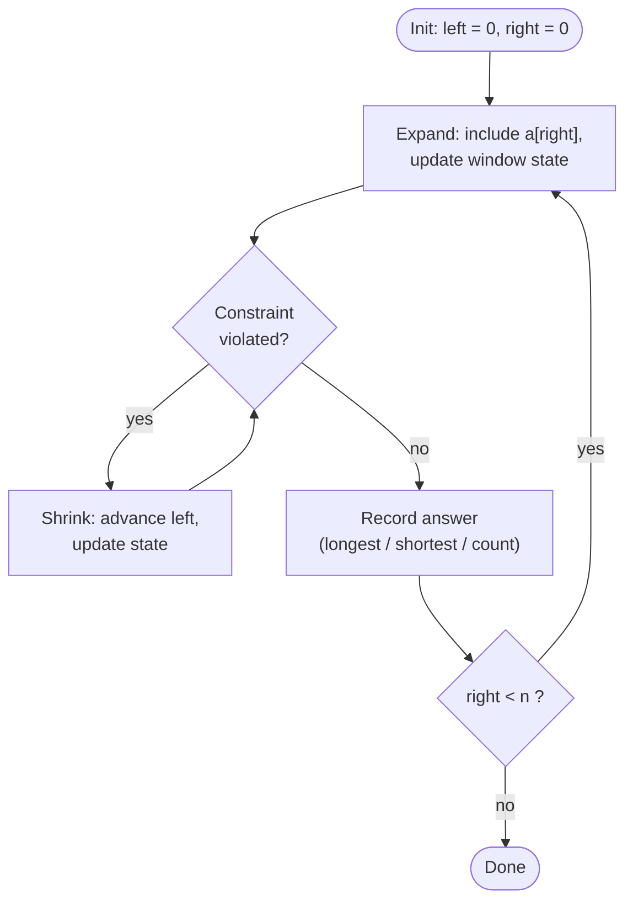

# Sliding Window

<script setup>
const fixedTemplate = `long sum = 0; long best = Long.MIN_VALUE;
for (int right = 0; right &lt; a.length; right++) {
  sum += a[right];                       // include newcomer
  if (right &gt;= k - 1) {                  // window is exactly size k
    best = Math.max(best, sum);          // record
    sum -= a[right - (k - 1)];           // drop the leaver
  }
}
return best;`

const variableTemplate = `int left = 0, best = 0;                 // (Integer.MAX_VALUE for shortest)
// state: whatever tracks the rule — sum, count[], HashMap, ...
for (int right = 0; right &lt; a.length; right++) {
  // 1. include a[right] in the state
  while (!isValid(/* state */)) {        // 2. shrink until valid
    // exclude a[left] from the state
    left++;
  }
  // 3. record:
  //   longest  → best = max(best, right - left + 1) after the while
  //   shortest → best = min(best, right - left + 1) inside the while
  //   count    → count += right - left + 1
}
return best;`

const templateComplexity = {
  time: 'O(n) amortized',
  space: 'O(1) or O(alphabet)'
}

const bareMechComplexity = {
  time: 'O(n)',
  space: 'O(1)'
}

const templateInvariant = {
  statement: `At the start of each outer-loop iteration, the window [left, right-1] satisfies the problem's validity predicate; 0 ≤ left ≤ right ≤ n.`,
  initialization: `Before the loop: left = 0, right = 0 — the window is empty, vacuously valid.`,
  maintenance: `Expand: include a[right] in the state. If the predicate breaks, the inner while advances left (updating state) until validity returns. By the inner loop's postcondition, [left, right] is valid again.`,
  termination: `Each iteration increments right by 1 so right reaches n in n steps. left only increments and cannot exceed right, so it advances ≤ n times total — ≤ 2n operations overall, O(n) amortized.`
}

const templateSpecializations = [
  { slug: 'maximum-average-subarray-i-fixed-size-warm-up', title: 'fixed-size k' },
  { slug: 'smallest-subarray-with-sum--target', title: 'shortest-variable' },
  { slug: 'longest-substring-without-repeating-characters', title: 'longest-variable' },
  { slug: 'minimum-window-substring', title: 'longest + hashmap state' },
  { slug: 'longest-repeating-character-replacement', title: 'longest + lazy max' },
  { slug: 'subarray-product-less-than-k-counting--at-most-k-trick', title: 'counting (atMost trick)' },
  { slug: 'sliding-window-maximum-monotonic-deque', title: 'fixed + extremum (deque)' }
]

const amortizedArgument = `Aggregate method.

Total work across all n outer iterations:
  • right advances exactly n times (once per outer iteration).
  • left advances at most n times total — it only increments and cannot exceed right.
Each advance does O(1) work (one add, one state update, one validity check).
∴ Total ≤ 2n · O(1) = O(n).`

const amortizedWorkedExample = `On [2,3,1,2,4,3] with target=7 (shortest-sum ≥ k):

  right advances: 0,1,2,3,4,5     → 6 steps
  left advances:  0→0→0→0→2→3→5   → 5 shrinks total (not per step; cumulative)
  Total ops:      6 + 5 = 11 ≤ 2·6 = 12  ✓

The inner while can shrink by 2 in one iteration (step right=5)
but across the whole scan left advances ≤ n times.`

const bareMechCode = `long sum = a[0] + a[1] + a[2];        // first window of size 3
long best = sum;
for (int i = 3; i &lt; a.length; i++) {
  sum += a[i] - a[i - 3];             // one add + one subtract
  best = Math.max(best, sum);
}
return best;`

const bareMechFrames = [
  { l: 0, r: 2, caption: 'first full window', info: 'sum=8 (prime)' },
  { l: 1, r: 3, caption: '+a[3]=1, -a[0]=2', info: 'sum=7' },
  { l: 2, r: 4, caption: '+a[4]=3, -a[1]=1', info: 'sum=9 (NEW BEST)' },
  { l: 3, r: 5, caption: '+a[5]=2, -a[2]=5', info: 'sum=6' }
]

const bareMechValues = [2,1,5,1,3,2]

const subv1Values = [1,12,-5,-6,50,3]
const subv2Values = [2,3,1,2,4,3]
const subv3Values = ['a','b','c','a','b','c','b','b']
const subv4Values = ['A','D','O','B','E','C','O','D','E','B','A','N','C']
const subv5Values = ['A','B','B','A','B','B']
const subv6Values = [10,5,2,6]
const subv7Values = [1,3,-1,-3,5,3,6,7]

const bareMechInvariant = {
  statement: 'After step i (where i ≥ 2), sum equals a[i-2] + a[i-1] + a[i] — the exact window of size 3 ending at i.',
  initialization: 'Before the loop, i = 2 and sum = a[0]+a[1]+a[2] which is a[i-2]+a[i-1]+a[i].',
  maintenance: 'Each iteration does sum += a[i] - a[i-3], which replaces a[i-3] with a[i] in the sum. The new sum equals a[i-2]+a[i-1]+a[i] for the new i.',
  termination: 'When i = n, the loop ends. best holds the max over all n-2 size-3 windows.'
}

const subv1Code = `double findMaxAverage(int[] nums, int k) {
  long sum = 0, best = Long.MIN_VALUE;
  int left = 0;
  for (int right = 0; right &lt; nums.length; right++) {
    sum += nums[right];
    if (right &gt;= k - 1) {
      best = Math.max(best, sum);
      sum -= nums[left++];
    }
  }
  return best / (double) k;
}`

const subv1Invariant = {
  statement: 'After the right-th iteration, sum equals the sum of the elements in [left, right]; whenever right ≥ k-1, that interval has exactly k elements.',
  initialization: 'left=0, sum=0 before loop — vacuous.',
  maintenance: 'Expand: sum += nums[right]. When right ≥ k-1, record then shrink: sum -= nums[left++] to prepare the next k-window.',
  termination: 'right = n ends loop; best holds max over all n-k+1 full windows.'
}

const subv1Frames = [
  { l: 0, r: 3, caption: 'first full window', info: 'sum=2, best=2' },
  { l: 1, r: 4, caption: '+50, -1 → NEW BEST', info: 'sum=51, best=51' },
  { l: 2, r: 5, caption: '+3, -12', info: 'sum=42, best=51' }
]

const subv2Code = `int minSubArrayLen(int target, int[] a) {
  int left = 0, best = Integer.MAX_VALUE;
  long windowSum = 0;
  for (int right = 0; right &lt; a.length; right++) {
    windowSum += a[right];
    while (windowSum &gt;= target) {
      best = Math.min(best, right - left + 1);
      windowSum -= a[left++];
    }
  }
  return best == Integer.MAX_VALUE ? 0 : best;
}`

const subv2Invariant = {
  statement: 'windowSum equals the sum of [left, right]. For every right, best records the min length over all valid windows ending at or before right.',
  initialization: 'left=0, windowSum=0, best=∞.',
  maintenance: 'Expand: windowSum += a[right]. Shrink while windowSum ≥ target, recording length and advancing left. After the while, windowSum &lt; target so no shorter window ending at right is valid.',
  termination: 'right = n; best is global min, or 0 if ∞ (no window found).'
}

const subv2Frames = [
  { l: 0, r: 2, caption: 'growing', info: 'sum=6, best=∞' },
  { l: 2, r: 3, caption: 'sum reached 8 → shrunk to 5', info: 'sum=5, best=3' },
  { l: 4, r: 5, caption: '[4,3] sum=7 — min len 2', info: 'sum=7, best=2' }
]

const subv3Code = `int lengthOfLongestSubstring(String s) {
  int[] last = new int[128];
  Arrays.fill(last, -1);
  int left = 0, best = 0;
  for (int right = 0; right &lt; s.length(); right++) {
    char c = s.charAt(right);
    if (last[c] &gt;= left) left = last[c] + 1;   // jump past duplicate
    last[c] = right;
    best = Math.max(best, right - left + 1);
  }
  return best;
}`

const subv3Invariant = {
  statement: '[left, right] contains distinct characters; last[c] stores the latest index of c seen so far (or -1).',
  initialization: 'last[c] = -1 for all c, left = 0.',
  maintenance: 'When s[right] has last[c] ≥ left (duplicate inside the window), left jumps to last[c]+1 — the duplicate is now excluded. Then last[c] = right.',
  termination: 'right = n; best = longest distinct-char window ever seen.'
}

const subv3Frames = [
  { l: 0, r: 2, caption: 'window abc distinct', info: 'best=3' },
  { l: 1, r: 3, caption: 'duplicate a → jump left past old a', info: 'best=3' },
  { l: 7, r: 7, caption: 'bb forces 1-wide windows', info: 'best=3' }
]

const subv4Code = `String minWindow(String s, String t) {
  if (s.length() &lt; t.length()) return "";
  int[] need = new int[128];
  for (char c : t.toCharArray()) need[c]++;
  int required = 0;
  for (int c = 0; c &lt; 128; c++) if (need[c] &gt; 0) required++;
  int[] have = new int[128];
  int left = 0, matched = 0, bestL = -1, bestLen = Integer.MAX_VALUE;
  for (int right = 0; right &lt; s.length(); right++) {
    char c = s.charAt(right);
    have[c]++;
    if (need[c] &gt; 0 && have[c] == need[c]) matched++;
    while (matched == required) {
      if (right - left + 1 &lt; bestLen) {
        bestLen = right - left + 1; bestL = left;
      }
      char lc = s.charAt(left++);
      have[lc]--;
      if (need[lc] &gt; 0 && have[lc] &lt; need[lc]) matched--;
    }
  }
  return bestL &lt; 0 ? "" : s.substring(bestL, bestL + bestLen);
}`

const subv4Invariant = {
  statement: 'have[c] = count of c in [left, right]; matched = number of required chars whose have[c] ≥ need[c]. Window is valid iff matched == required.',
  initialization: 'need[] from T; have[] = 0; matched = 0; left = 0.',
  maintenance: 'Expand right: have[s[right]]++; if that pushes have[c] up to need[c], matched++. Shrink left while matched == required, recording the shortest valid window; when have[c] drops below need[c], matched--.',
  termination: 'right = n; (bestL, bestLen) describes the shortest valid window, or "" if none.'
}

const subv4Frames = [
  { l: 0, r: 5, caption: 'first valid ADOBEC', info: 'matched=3/3, len=6' },
  { l: 9, r: 12, caption: 'shrunk to minimum BANC', info: 'matched=3/3, len=4' }
]

const subv5Code = `int characterReplacement(String s, int k) {
  int[] count = new int[26];
  int left = 0, best = 0, maxCount = 0;
  for (int right = 0; right &lt; s.length(); right++) {
    count[s.charAt(right) - 'A']++;
    maxCount = Math.max(maxCount, count[s.charAt(right) - 'A']);
    while ((right - left + 1) - maxCount &gt; k) {
      count[s.charAt(left) - 'A']--;
      left++;
    }
    best = Math.max(best, right - left + 1);
  }
  return best;
}`

const subv5Invariant = {
  statement: 'For [left, right], windowLen - maxCount ≤ k, where maxCount is the all-time max count of any single char seen in ANY window variant (lazy — not necessarily this window maximum).',
  initialization: 'count[] = 0, maxCount = 0, left = 0.',
  maintenance: 'Expand: count[s[right]]++; maxCount = max(maxCount, count[s[right]]). If windowLen - maxCount &gt; k, shrink by one. Note: maxCount is never decreased during shrink — that is correct because best only improves when a strictly larger maxCount appears.',
  termination: 'right = n; best = longest valid window.'
}

const subv5Frames = [
  { l: 0, r: 3, caption: 'all 4 fit (k=2)', info: 'maxCount=2, best=4' },
  { l: 0, r: 5, caption: 'replace 2 A→B', info: 'maxCount=4, best=6' }
]

const subv6Code = `int numSubarrayProductLessThanK(int[] nums, int k) {
  if (k &lt;= 1) return 0;
  int left = 0, count = 0;
  long product = 1;
  for (int right = 0; right &lt; nums.length; right++) {
    product *= nums[right];
    while (product &gt;= k) product /= nums[left++];
    count += right - left + 1;
  }
  return count;
}`

const subv6Invariant = {
  statement: 'product = product of [left, right]; count += (right - left + 1) adds every subarray ending at right whose product &lt; k.',
  initialization: 'left = 0, product = 1, count = 0.',
  maintenance: 'Expand: product *= a[right]. Shrink while product ≥ k: product /= a[left++]. Then count += (right - left + 1).',
  termination: 'right = n; count = total subarrays with product &lt; k.'
}

const subv6Frames = [
  { l: 0, r: 0, caption: '[10] &lt; 100', info: 'product=10, count=1' },
  { l: 0, r: 2, caption: 'product hit 100 → shrink', info: 'product=10, count=6' },
  { l: 1, r: 3, caption: 'final', info: 'product=60, count=8' }
]

const subv7Code = `int[] maxSlidingWindow(int[] a, int k) {
  int n = a.length;
  int[] out = new int[n - k + 1];
  Deque&lt;Integer&gt; dq = new ArrayDeque&lt;&gt;();
  for (int right = 0; right &lt; n; right++) {
    while (!dq.isEmpty() && a[dq.peekLast()] &lt;= a[right]) dq.pollLast();
    dq.offerLast(right);
    if (dq.peekFirst() &lt;= right - k) dq.pollFirst();
    if (right &gt;= k - 1) out[right - k + 1] = a[dq.peekFirst()];
  }
  return out;
}`

const subv7Invariant = {
  statement: 'The deque holds indices in strictly increasing order with values in strictly decreasing order, all within [right-k+1, right]. dq.peekFirst() is the index of the current window max.',
  initialization: 'dq empty, out = [].',
  maintenance: 'For each right: (1) pollLast while a[dq.peekLast()] ≤ a[right] — those indices can never be the max again; (2) offerLast(right); (3) if peekFirst() ≤ right-k, pollFirst — expired; (4) if right ≥ k-1, record a[dq.peekFirst()].',
  termination: 'right = n; out holds n-k+1 window maxes.'
}

const subv7Frames = [
  { l: 0, r: 2, caption: 'first window', info: 'dq idx [1,2] vals [3,-1], out=[3]' },
  { l: 2, r: 4, caption: '5 popped all; 3 expired', info: 'dq idx [4] val [5], out=[3,3,5]' },
  { l: 5, r: 7, caption: 'end', info: 'dq idx [7] val [7], out=[3,3,5,5,6,7]' }
]

const inTheWildCode = `// java.util.concurrent.atomic.LongAdder-style per-second counter
// — a fixed sliding window of 60 one-second buckets, slid every second.
public final class RateWindow {
  private final long[] buckets = new long[60];   // 60-second window
  private volatile int head;                      // "right" edge
  private long total;                             // live sum of all buckets

  public synchronized void slide(long newest) {
    int next = (head + 1) % 60;
    total += newest - buckets[next];              // one add + one subtract
    buckets[next] = newest;
    head = next;
  }

  public long count() { return total; }
}`

const trap1Bug = `nums=[1,-2,3], target=3 — plain sliding window on "shortest subarray with sum ≥ 3":
  right=0: sum=1 &lt; 3  (grow)
  right=1: sum=-1 &lt; 3 (grow — but we just added a negative!)
  right=2: sum=2 &lt; 3  (grow — still invalid)
  Loop ends — returns 0 (no window found).
Actual answer: [1,-2,3] has sum 2, also invalid. But [3] has sum 3 — answer is 1.
We MISSED it because the shrink never ran.`

const trap1Fix = `Monotonicity test fails whenever adding a[right] can DECREASE the aggregate
(negatives for sum, zeros for product, etc.). Switch to:
  • prefix-sum + hashmap (count of subarrays with sum = k)
  • prefix-sum + monotonic deque (shortest ≥ k with negatives)
  • split at zeros (product problems)`

const trap2Bug = `In Longest Repeating Char Replacement, resetting maxCount to the TRUE window-max on every shrink:
  s="AABABBA", k=1
  right=5: window "AABABB", count={A:3,B:3}, maxCount=3 (correct)
  shrink by 1 → "ABABB", count={A:2,B:3}
  BUG: recompute maxCount = max(count) = 3 (unchanged! but we wasted O(26) work)
  Worse — if you reset maxCount AND let it decrease, future valid windows get rejected.`

const trap2Fix = `Keep maxCount monotone non-decreasing — "lazy" maxCount.
Correctness: best only improves when windowLen &gt; maxCount + k, which requires a NEW real max.
A stale maxCount can only make the "valid" check STRICTER (more windows rejected),
never looser — so stale maxCount cannot inflate best.`

const trap3Bug = `Sliding Window Maximum, storing VALUES in the deque instead of indices:
  nums=[1,3,-1,-3,5,3,6,7], k=3
  right=0..2: dq (vals) = [3, -1] (after popping 1), out=[3] ✓
  right=3: dq (vals) = [3, -1, -3], out=[3, 3] ✓
  right=4: val 5 pops all, dq = [5]. But is 3 (the old front at idx 1) still in-window?
  With VALUES only, we cannot answer — no way to compare index 1 vs right-k = 1.`

const trap3Fix = `Store INDICES. a[dq.peekFirst()] gives the max value;
peekFirst() ≤ right - k signals expiry → pollFirst().
The deque holds candidate indices in strictly increasing index order
with strictly decreasing values.`

const advanced1 = `Reservoir sampling on an unbounded stream. The "fixed window of last 60 seconds" invariant breaks when the input is infinite — we cannot keep every element. Standard fix: reservoir sampling of size k, where each new element replaces a random reservoir slot with probability k/i. The window becomes PROBABILISTIC — approximate O(1) memory, exact answers only on expectation.`

const advanced2 = `Window must support max/min in O(1): monotonic deque (already in sub-variation 7). Window must support median: TWO heaps (max-heap of lower half, min-heap of upper half) with lazy deletion as elements expire from the window. Window must support kth-smallest: TreeMap with running insert/remove, kth lookup O(log k) per step.`

const advanced3 = `Validity predicate not monotone in window length. Example: "longest subarray with sum ≤ K AND no two consecutive negatives." Shrinking left can re-break the "no two consecutive negatives" rule, so the sliding window no longer works — switch to DP where dp[i] = longest valid ending at i. The monotonicity requirement is strict: EITHER both grow and shrink preserve validity direction, OR you need a different pattern.`

const advanced4 = `Stream of events, not an array. Window of TIME, not of index — need bucketed count-min sketch (approximate frequency over last T seconds) or exponentially-weighted moving average. The underlying structure (one in, one out) is the same; the eviction policy changes from "oldest index" to "oldest timestamp" and buckets quantize time.`

const advanced5 = `Breaking point. Sliding window has NO advantage when: (1) validity check is Θ(k) per step and non-incremental (hashmap rebuild every slide); (2) the state cannot be reversed on shrink (median of general multiset without heaps); (3) problem allows non-contiguous selections (subsequences, not subarrays). Diagnostic: can you add one element in O(1) AND remove one element in O(1)? If no — different pattern.`

const quizQuestions = [
  {
    q: 'Which invariant characterizes a Sliding Window solution?',
    choices: [
      { text: 'The array is sorted', correct: false, explanation: 'That is Binary Search.' },
      { text: 'A monotone-in-window-length property holds', correct: true, explanation: 'Sliding Window works when validity is monotone: once a window is valid, extending or shrinking preserves the invariant predictably.' },
      { text: 'The problem asks for shortest path', correct: false, explanation: 'That is BFS.' },
      { text: 'Recursion is used', correct: false, explanation: 'Sliding Window is iterative.' }
    ]
  },
  {
    q: 'For "exactly k distinct" subarray count, what is the standard trick?',
    choices: [
      { text: 'Sort and binary search', correct: false },
      { text: 'atMost(k) - atMost(k-1)', correct: true, explanation: 'Direct "exactly k" is hard to slide. atMost slides cleanly; subtract to isolate exactly-k.' },
      { text: 'Brute force n²', correct: false },
      { text: 'Hash map of prefixes', correct: false, explanation: 'That is Prefix Sum family.' }
    ]
  },
  {
    q: 'Time complexity of the canonical variable-size sliding window template?',
    choices: [
      { text: 'O(n²)', correct: false },
      { text: 'O(n log n)', correct: false },
      { text: 'O(n) amortized', correct: true, explanation: 'Each index enters and leaves the window at most once, so total work is 2n.' },
      { text: 'O(σ · n)', correct: false, explanation: 'Only if you scan the full alphabet each step; canonical uses O(1) per step.' }
    ]
  },
  {
    q: 'Why does "lazy maxCount" work in Longest Repeating Character Replacement?',
    choices: [
      { text: 'The window can only grow when a strictly-larger max appears — stale maxCount can never inflate the answer', correct: true, explanation: 'Correctness is preserved because we only accept new bests when a new real max is seen.' },
      { text: 'It does not work — you must recompute max every shrink', correct: false },
      { text: 'Character frequencies never decrease', correct: false },
      { text: 'Random luck', correct: false }
    ]
  },
  {
    q: 'For "shortest subarray with sum ≥ k" WITH negatives, why does plain sliding fail?',
    choices: [
      { text: 'Because sums are not monotone in window size once negatives are allowed', correct: true, explanation: 'Sliding requires that shrinking left strictly decreases the running metric. Negatives break that; use monotonic deque on prefix sums.' },
      { text: 'Because k might be too large', correct: false },
      { text: 'Because the array might be empty', correct: false },
      { text: 'Because there might be no answer', correct: false }
    ]
  }
]
</script>

<PatternVideo pattern-name="Sliding Window" duration="8–12 min" />

<PatternProgress pattern-id="sliding-window" problems="sliding-window-longest-substring, minimum-window-substring, longest-repeating-character-replacement, max-consecutive-ones-iii, minimum-size-subarray-sum, permutation-in-string, find-all-anagrams-in-a-string, longest-substring-with-at-most-k-distinct-characters, fruit-into-baskets, subarrays-with-k-different-integers, binary-subarrays-with-sum, count-number-of-nice-subarrays, subarray-product-less-than-k, number-of-substrings-containing-all-three-characters, longest-palindromic-substring, trapping-rain-water, shortest-subarray-with-sum-at-least-k, jump-game-vi, constrained-subsequence-sum, diet-plan-performance, maximum-average-subarray-i, minimum-window-subsequence, replace-the-substring-for-balanced-string, get-equal-substrings-within-budget, substring-with-concatenation-of-all-words, frequency-of-the-most-frequent-element" />


## Why sliding window exists — the story

You're a network engineer at a CDN. Every millisecond, your edge servers process 50,000 requests. Your alert rule is: "in any 60-second window, if error-rate exceeds 5%, page the on-call." Simple to state — how do you compute it?

The obvious way: for each new millisecond, sum the last 60,000 error records and divide. That is `60,000` operations per millisecond × `1000` ms/sec = `6·10⁷` operations per second per edge server, just for one alert rule. Multiply by 200 rules × 500 edge servers, and you're at `6·10¹²` ops per second globally. Your alerting fleet melts. This isn't stupid, though: it's exactly how the reference implementation reads, and for windows of a few dozen it's the fastest option because branch predictors love the tight nested loop.

But at production scale — 60,000-element windows sliding one step every millisecond — you're doing 59,999 redundant additions on every step, because consecutive windows share 59,999 elements. The naive approach is *proven* to re-count almost everything it just counted. That waste is the tell.

The sliding-window pattern is: recognize that when the window slides one step, only *one* element enters on the right and *one* leaves on the left. Add the newcomer, subtract the leaver — **two ops instead of 60,000**. The O(n·k) grind becomes a single O(n) pass. Your alerting fleet runs on a fraction of the hardware. Meta, CloudFlare, and every real-time monitoring system on the planet uses this exact trick.

Let's make it concrete. Say we want the sum of every contiguous subarray of size 5. The first window covers indices 0–4; the next covers 1–5. Notice they share indices 1–4 — so the new sum is just the old sum, minus the element that slid out, plus the element that slid in:


<div class="svg-figure">
<svg preserveAspectRatio="xMidYMid meet" role="img" viewBox="0 0 720 220" xmlns="http://www.w3.org/2000/svg" font-family="Segoe UI, Arial, sans-serif" aria-label="window at 0..4  (sum = 11)">
  <defs>
    <marker id="ar-red" markerWidth="9" markerHeight="9" refX="5" refY="3" orient="auto"><path d="M0,0 L6,3 L0,6 Z" fill="var(--dsa-danger)"/></marker>
    <marker id="ar-grn" markerWidth="9" markerHeight="9" refX="5" refY="3" orient="auto"><path d="M0,0 L6,3 L0,6 Z" fill="var(--dsa-success)"/></marker>
    <filter id="s1" x="-10%" y="-10%" width="120%" height="140%"><feDropShadow dx="0" dy="1.2" stdDeviation="1.2" flood-color="var(--dsa-neutral)" flood-opacity="0.5"/></filter>
  </defs>
  <rect x="0" y="0" width="720" height="220" fill="var(--dsa-bg)"/>
  <!-- window A outline (indices 0..4) -->
  <rect x="6" y="70" width="278" height="52" rx="9" fill="none" stroke="var(--dsa-primary)" stroke-width="2.5"/>
  <text x="145" y="62" text-anchor="middle" font-size="12" fill="var(--dsa-primary)" font-weight="700">window at 0..4  (sum = 11)</text>
  <!-- window B outline (indices 1..5), dashed green -->
  <rect x="62" y="78" width="278" height="52" rx="9" fill="none" stroke="var(--dsa-success)" stroke-width="2.5" stroke-dasharray="6 4"/>
  <text x="360" y="150" text-anchor="middle" font-size="12" fill="var(--dsa-success)" font-weight="700">slides right → window at 1..5 (sum = 14)</text>
  <!-- cells -->
  <g filter="url(#s1)">
    <rect x="10"  y="76" width="50" height="40" rx="7" fill="var(--dsa-danger-soft)" stroke="var(--dsa-danger)" stroke-width="1.5"/>
    <rect x="66"  y="76" width="50" height="40" rx="7" fill="var(--dsa-primary-soft)" stroke="var(--dsa-primary-line)" stroke-width="1.5"/>
    <rect x="122" y="76" width="50" height="40" rx="7" fill="var(--dsa-primary-soft)" stroke="var(--dsa-primary-line)" stroke-width="1.5"/>
    <rect x="178" y="76" width="50" height="40" rx="7" fill="var(--dsa-primary-soft)" stroke="var(--dsa-primary-line)" stroke-width="1.5"/>
    <rect x="234" y="76" width="50" height="40" rx="7" fill="var(--dsa-primary-soft)" stroke="var(--dsa-primary-line)" stroke-width="1.5"/>
    <rect x="290" y="76" width="50" height="40" rx="7" fill="var(--dsa-success-soft)" stroke="var(--dsa-success)" stroke-width="1.5"/>
    <rect x="346" y="76" width="50" height="40" rx="7" fill="var(--dsa-neutral-soft)" stroke="var(--dsa-neutral-line)" stroke-width="1.5"/>
    <rect x="402" y="76" width="50" height="40" rx="7" fill="var(--dsa-neutral-soft)" stroke="var(--dsa-neutral-line)" stroke-width="1.5"/>
    <rect x="458" y="76" width="50" height="40" rx="7" fill="var(--dsa-neutral-soft)" stroke="var(--dsa-neutral-line)" stroke-width="1.5"/>
  </g>
  <g font-size="18" font-weight="700" fill="var(--dsa-ink)" text-anchor="middle">
    <text x="35"  y="102">1</text><text x="91"  y="102">3</text><text x="147" y="102">2</text>
    <text x="203" y="102">6</text><text x="259" y="102">-1</text><text x="315" y="102">4</text>
    <text x="371" y="102">1</text><text x="427" y="102">8</text><text x="483" y="102">2</text>
  </g>
  <g font-size="11" fill="var(--dsa-neutral)" text-anchor="middle">
    <text x="35" y="134">0</text><text x="91" y="134">1</text><text x="147" y="134">2</text>
    <text x="203" y="134">3</text><text x="259" y="134">4</text><text x="315" y="134">5</text>
    <text x="371" y="134">6</text><text x="427" y="134">7</text><text x="483" y="134">8</text>
  </g>
  <!-- leave / enter annotations -->
  <line x1="35" y1="170" x2="35" y2="120" stroke="var(--dsa-danger)" stroke-width="2" marker-end="url(#ar-red)"/>
  <text x="35" y="188" text-anchor="middle" font-size="11" font-weight="700" fill="var(--dsa-danger)">− leaves</text>
  <line x1="315" y1="170" x2="315" y2="120" stroke="var(--dsa-success)" stroke-width="2" marker-end="url(#ar-grn)"/>
  <text x="315" y="188" text-anchor="middle" font-size="11" font-weight="700" fill="var(--dsa-success)">+ enters</text>
  <!-- formula -->
  <rect x="524" y="74" width="188" height="60" rx="9" fill="var(--dsa-neutral-soft)" stroke="var(--dsa-neutral-line)"/>
  <text x="618" y="98" text-anchor="middle" font-size="12" font-weight="700" fill="var(--dsa-ink)">reuse, don't recompute</text>
  <text x="618" y="118" text-anchor="middle" font-size="12" fill="var(--dsa-neutral)">newSum = 11 − 1 + 4 = 14</text>
</svg>
</div>


<div class="readfig"><b>How to read it:</b> The solid blue box is the first window (indices 0–4, sum 11). Sliding one step gives the dashed green window (indices 1–5). The red cell (value <b>1</b>) drops out on the left, the green cell (value <b>4</b>) joins on the right, so the new sum is <b>11 − 1 + 4 = 14</b> — computed in O(1) instead of re-adding five numbers. Doing this across the array is the whole O(n) sliding window.</div>

**Why it matters in interviews.** The brute-force "for each start, scan k elements" is the naive answer to a *huge* family of interview questions on strings and arrays. The moment you recognize a sliding-window shape, you drop an entire nesting level of complexity — often n=10⁵ inputs that would time out at O(n²) fit comfortably at O(n).

<Callout kind="note" title="Video walkthrough coming soon">

a 5-10 minute Loom will be embedded here once recorded. If you'd like to be notified, [subscribe on GitHub](https://github.com/abhisinghal/dsa-master-reference/subscription).

</Callout>

## The bare mechanic — simplest working example

Before flavors, templates, or recognition cues, here's the whole trick on a 6-element array with a window of 3. Memorize this trace; everything else in the chapter is a specialization of it.

Input: `[2, 1, 5, 1, 3, 2]`, window size `k = 3`.

**Step 0 (prime).** Compute the first window directly: `sum = 2+1+5 = 8`.

**Step 1.** Slide right by one. Incoming `a[3] = 1`; outgoing `a[0] = 2`. New `sum = 8 + 1 - 2 = 7`.

**Step 2.** Slide. In: `a[4] = 3`, out: `a[1] = 1`. `sum = 7 + 3 - 1 = 9`. **New best.**

**Step 3.** Slide. In: `a[5] = 2`, out: `a[2] = 5`. `sum = 9 + 2 - 5 = 6`.

Final: `best = 9` (the window `[5, 1, 3]`).

<WindowTraceStrip :frames="bareMechFrames" :input="bareMechValues" />

<PatternTemplateCard
  slug="sliding-window-bare-mechanic"
  :code="bareMechCode"
  language="java"
  :invariant="bareMechInvariant"
  :complexity="bareMechComplexity"
  title="Bare mechanic — fixed window of 3"
/>

<Callout kind="key" title="The single move.">

On every slide the window gains the newcomer on the right and loses the oldest on the left. That is the pattern. Everything below — fixed vs variable, longest vs shortest, hashmap state vs monotonic deque — is this move plus different *rules for what counts as valid* and different *things kept in the state*.

</Callout>

## When to use it — the four flavors

Every sliding-window problem falls into one of four flavors. Naming the flavor in the first 30 seconds tells you which template to write.

| Flavor | Recognizer phrasing | What "record the answer" looks like |
|---|---|---|
| **Fixed size k** | *"every subarray of size k"*, *"max avg of size k"*, *"count anagrams of length k"* | one `for right`, record when `right >= k-1` |
| **Longest variable** | *"longest substring / subarray where …"*, *"…with at most K distinct"* | grow always; shrink **only while invalid**; record after the `while` |
| **Shortest variable** | *"shortest subarray with sum ≥ target"*, *"minimum window covering T"* | grow until valid; then shrink **greedily while still valid**; record inside the `while` |
| **Fixed size + extremum** | *"max / min of every window of size k"* | fixed loop + **monotonic deque** (sliding window ⊕ monotonic deque composed) |

<Callout kind="key" title="The one thing that determines the flavor">

the shape of the shrink rule. Longest-variable shrinks *lazily* (only when broken); shortest-variable shrinks *eagerly* (whenever valid). Get this wrong and the algorithm produces the right shape but the wrong answer.

</Callout>

<Callout kind="key" title="Count-of-subarrays trick">

"how many subarrays satisfy X?" often reduces to **exactly K = atMost(K) − atMost(K−1)**, where `atMost` is a longest-variable window that adds `right - left + 1` at each step. Powers *Subarrays with K Different Integers*, *Count Number of Nice Subarrays*, *Binary Subarrays With Sum*.

</Callout>

## History — Karp-Rabin's rolling hash, 1987

The sliding-window idea for fixed-size windows appears in Knuth's *The Art of Computer Programming Vol 3* (1973) as a natural optimization for windowed statistics. Its most famous application is **Karp-Rabin string matching (1987)**: Michael Rabin and Richard Karp introduced a *rolling hash* — a hash function that recomputes in O(1) as the window slides. For each new character, subtract the leaving character's contribution and add the incoming character's, exactly the sliding-window trick applied to hash arithmetic. Karp-Rabin turned substring search from O(n·m) into expected O(n + m). It's what powers `grep -F`, Elasticsearch's ngram tokenizer, git's `blame` heuristic, and every diff tool's fingerprinting layer.

The variable-size sliding-window pattern (shrink-when-invariant-breaks) was formalized in competitive programming circles around **2010**, when Codeforces problems began systematically requiring it. LeetCode's *Longest Substring Without Repeating Characters* (2014) made it interview-standard. Every real-time monitoring system, from Prometheus recording rules to Datadog's aggregation pipeline, does sliding-window computation over time-series windows — exactly the CDN scene we opened with.

## THE template

Every sliding-window solution is one of two loop skeletons: fixed size, or variable size (longest/shortest/count). Memorize both; the sub-variations below fill in the state and the validity rule.

**The fixed-size k skeleton** (used by Max Avg Subarray I, Find All Anagrams, Permutation in String):


```java
long sum = 0; long best = Long.MIN_VALUE;              // any O(1) aggregate
for (int right = 0; right < a.length; right++) {
    sum += a[right];                                    // include newcomer
    if (right >= k - 1) {                               // window is exactly size k
        best = Math.max(best, sum);                     // record
        sum -= a[right - (k - 1)];                      // drop the leaver
    }
}
return best;
```


**The variable-size skeleton** is the one you'll see in interviews most often — it's the "longest / shortest / count" shape:

<PatternTemplateCard
  slug="sliding-window-template"
  :code="variableTemplate"
  language="java"
  :invariant="templateInvariant"
  :complexity="templateComplexity"
  :specializations="templateSpecializations"
  title="THE sliding-window template — variable size"
/>

The mermaid flow is literally the `for`/`while` loops as a picture:





<div class="readfig"><b>How to read it:</b> Each round you <b>grow</b> from the right (top box). If that breaks the rule (the diamond), you <b>shrink</b> from the left until it's valid again. Whenever the window is valid you <b>record</b> the answer, then keep going until <code>right</code> reaches the end.</div>

### Why it's O(n) — the amortized argument

The outer `for` is clearly O(n), but the inner `while` makes a naive reader worry about O(n²). It isn't — here's the proof.

<AmortizedPanel
  method="aggregate"
  bound="O(n) total"
  statement="Each index enters the window exactly once and leaves at most once — total work ≤ 2n operations."
  :workedExample="amortizedWorkedExample"
>

Total work across all n outer iterations:

- `right` advances exactly n times (once per outer iteration).
- `left` advances at most n times total — it only increments and cannot exceed `right`.

Each advance does O(1) work (one add, one state update, one validity check).

∴ Total ≤ 2n · O(1) = **O(n)**, which is **O(1) amortized per step**.

The outer `for` is clearly O(n), but the inner `while` makes a naive reader worry about O(n²). The amortized argument shows it isn't — the inner loop's total iterations across the entire scan are bounded, not per-step.

</AmortizedPanel>

This same argument powers [§22 two-pointers](/patterns/two-pointers) (sum of `l`-advances + `r`-advances ≤ 2n) and underlies the "pay once per index" intuition in [§29 monotonic-stack](/patterns/monotonic-stack) and [§31 union-find](/patterns/union-find). If you see a loop whose inner body looks like it could run n times, check whether a **monotone counter** bounds the total — that is sliding-window's complexity signature.

Now let's walk through the canonical shapes, from the simplest fixed-size warm-up up through the composed sliding-window + monotonic-deque problem. We'll revisit *when the window doesn't apply* once you've seen the shapes it does cover.


<SlidingWindowAnim />


## Sub-variations of the template

Each sub-variation below swaps the **state** and the **validity rule** but keeps the template skeleton unchanged. Reading these in order (fixed → shortest → longest → longest-with-hashmap → longest-with-lazy-max → counting → fixed-with-extremum) traces the capability growth from the simplest form to the composed sliding-window + monotonic-deque.

<PatternSubVariationNav pattern="sliding-window" />

### Maximum Average Subarray I (fixed-size warm-up) <span class="diff diff-e">Easy</span>

*[↗ LeetCode: Maximum Average Subarray I](https://leetcode.com/problems/maximum-average-subarray-i/)*

<InvariantProof :statement="subv1Invariant.statement" :initialization="subv1Invariant.initialization" :maintenance="subv1Invariant.maintenance" :termination="subv1Invariant.termination" />

<WindowTraceStrip :frames="subv1Frames" :input="subv1Values" />

<Callout kind="key" title="Blind-solve prompt">

on `nums=[1,12,-5,-6,50,3]`, `k=4`. The canonical shape is one `for`-loop with "add newcomer, record when window is full, drop leaver." Try it, then reveal.

</Callout>

<TemplateReveal :canonical="subv1Code" language="java" slug="sliding-window-max-avg" />

<ProgressCheck id="maximum-average-subarray-i-fixed-size-warm-up" />


<div class="svg-figure">
<svg preserveAspectRatio="xMidYMid meet" role="img" viewBox="0 0 400 250" xmlns="http://www.w3.org/2000/svg" font-family="var(--dsa-font)" aria-label="Diagram illustrating: Maximum Average Subarray I (fixed-size warm-up) Easy">
  <defs>
    <marker id="ar-mavg-danger" markerWidth="9" markerHeight="9" refX="6" refY="3" orient="auto"><path d="M0,0 L6,3 L0,6 Z" fill="var(--dsa-danger)"/></marker>
    <marker id="ar-mavg-success" markerWidth="9" markerHeight="9" refX="6" refY="3" orient="auto"><path d="M0,0 L6,3 L0,6 Z" fill="var(--dsa-success)"/></marker>
  </defs>
  <rect x="0" y="0" width="400" height="250" rx="12" fill="var(--dsa-bg)"/>
  <text x="200" y="28" text-anchor="middle" font-size="13" font-weight="700" fill="var(--dsa-primary)">Slide k=4: reuse the overlapping sum</text>
  <rect x="38" y="76" width="216" height="60" rx="10" fill="none" stroke="var(--dsa-primary)" stroke-width="var(--dsa-outline-stroke)"/>
  <text x="146" y="66" text-anchor="middle" font-size="12" font-weight="700" fill="var(--dsa-primary)">window 0..3  sum = 2</text>
  <rect x="90" y="84" width="216" height="60" rx="10" fill="none" stroke="var(--dsa-success)" stroke-width="var(--dsa-outline-stroke)" stroke-dasharray="7 5"/>
  <text x="266" y="156" text-anchor="middle" font-size="12" font-weight="700" fill="var(--dsa-success)">window 1..4  sum = 51</text>
  <g text-anchor="middle">
    <rect x="42" y="88" width="44" height="44" rx="7" fill="var(--dsa-danger-soft)" stroke="var(--dsa-danger)" stroke-width="var(--dsa-cell-stroke)"/>
    <rect x="94" y="88" width="44" height="44" rx="7" fill="var(--dsa-primary-soft)" stroke="var(--dsa-primary)" stroke-width="var(--dsa-cell-stroke)"/>
    <rect x="146" y="88" width="44" height="44" rx="7" fill="var(--dsa-primary-soft)" stroke="var(--dsa-primary)" stroke-width="var(--dsa-cell-stroke)"/>
    <rect x="198" y="88" width="44" height="44" rx="7" fill="var(--dsa-primary-soft)" stroke="var(--dsa-primary)" stroke-width="var(--dsa-cell-stroke)"/>
    <rect x="250" y="88" width="44" height="44" rx="7" fill="var(--dsa-success-soft)" stroke="var(--dsa-success)" stroke-width="var(--dsa-cell-stroke)"/>
    <rect x="302" y="88" width="44" height="44" rx="7" fill="var(--dsa-neutral-soft)" stroke="var(--dsa-neutral-line)" stroke-width="var(--dsa-cell-stroke)"/>
    <g font-size="17" font-weight="700" fill="var(--dsa-ink)">
      <text x="64" y="116">1</text><text x="116" y="116">12</text><text x="168" y="116">-5</text>
      <text x="220" y="116">-6</text><text x="272" y="116">50</text><text x="324" y="116">3</text>
    </g>
    <g font-size="11" fill="var(--dsa-neutral)">
      <text x="64" y="147">0</text><text x="116" y="147">1</text><text x="168" y="147">2</text>
      <text x="220" y="147">3</text><text x="272" y="147">4</text><text x="324" y="147">5</text>
    </g>
  </g>
  <line x1="64" y1="184" x2="64" y2="135" stroke="var(--dsa-danger)" stroke-width="var(--dsa-arrow-stroke)" marker-end="url(#ar-mavg-danger)"/>
  <text x="64" y="203" text-anchor="middle" font-size="12" font-weight="700" fill="var(--dsa-danger)">leaves: -1</text>
  <line x1="272" y1="184" x2="272" y2="135" stroke="var(--dsa-success)" stroke-width="var(--dsa-arrow-stroke)" marker-end="url(#ar-mavg-success)"/>
  <text x="272" y="203" text-anchor="middle" font-size="12" font-weight="700" fill="var(--dsa-success)">enters: +50</text>
  <text x="200" y="231" text-anchor="middle" font-size="11.5" font-style="italic" fill="var(--dsa-neutral)">newSum = oldSum - oldLeft + newRight = 2 - 1 + 50 = 51</text>
</svg>
</div>


<div class="readfig"><b>How to read it:</b> The next fixed-size window keeps the overlap and updates in O(1): add the entering <b>50</b>, subtract the leaving <b>1</b>, then compare the new sum.</div>

### Problem
Given an array and an integer `k`, find the contiguous subarray of length **exactly `k`** with the maximum average.

**Constraints:** `1 ≤ k ≤ n ≤ 10⁵`; values fit in `int`; return the max average as a `double`.

**Example 1:** `nums = [1,12,-5,-6,50,3], k = 4` → `12.75` (the window `[12,-5,-6,50]` has sum 51 → avg 51/4).

<ExamplePreview compact :input="['1', '12', '-5', '-6', '50', '3', '|', '4']" :output="['12.75']" />

**Example 2:** `nums = [-5,-1,-3], k = 2` → `-2.0` (best window `[-1,-3]`; all-negative inputs still need the least-bad sum).

<ExamplePreview compact :input="['-5', '-1', '-3', '|', '2']" :output="['-2.0']" />

### Solution — brute force
Start with the direct baseline: enumerate every candidate and compute the answer from scratch. It is correct, but it repeats the exact work that the pattern is meant to reuse.


```java
double findMaxAverageBrute(int[] nums, int k) {
    long best = Long.MIN_VALUE;
    for (int left = 0; left + k <= nums.length; left++) {
        int right = left + k - 1;
        long sum = 0;
        for (int t = left; t <= right; t++) sum += nums[t];   // t: inner summation only
        best = Math.max(best, sum);
    }
    return best / (double) k;
}
```


**Brute-force cost:** O(n·k) time (O(n²) when k grows with n), O(1) space — too slow for n ≥ 10⁴.

### Solution — optimized
Instead of re-adding the same k elements again and again, keep one running window sum. Har slide par right element add hota hai, left element nikalta hai, and the best sum updates only when the window is full.

**Pattern.**
The archetypal **fixed-size** window: compute the first window's sum, then each next window costs O(1) — add the entering element, subtract the leaving one. Divide by `k` at the end.

**Steps.**
1. Sum the first `k` elements into `windowSum`; seed `bestSum = windowSum`.
2. For each `right` from `k` to `n-1`: `windowSum += a[right] - a[right - k]` (slide by one).
3. Track `bestSum = max(bestSum, windowSum)`.
4. Return `bestSum / (double) k`.

**Java.**


```java
double findMaxAverage(int[] nums, int k) {
    int left = 0;
    long val = 0;
    long best = Long.MIN_VALUE;
    for (int right = 0; right < nums.length; right++) {
        val += nums[right];               // add incoming
        if (right >= k - 1) {             // window is now full (indices 0..k-1 = k elements)
            best = Math.max(best, val);   // compare
            val -= nums[left++];          // shrink from the left for next iter
        }
    }
    return best / (double) k;
}
```


Ek `if`, ek block. `right >= k - 1` ka matlab: 0-indexed loop mein `k`-va element aa chuka hai → window bhari hai. Uske baad hi compare + shrink hota hai.

#### Alternate — two-phase style (build then slide)

Kuch developers "build first window, then slide" prefer karte hain; slide loop mein zero conditionals rehte hain:


```java
long sum = 0;
for (int t = 0; t < k; t++) sum += a[t];       // build first window
long best = sum;
for (int right = k; right < a.length; right++) {
    int left = right - k + 1;                   // slide: left always trails right by k-1
    sum += a[right] - a[left - 1];              // add newcomer, drop just-left-of-window
    best = Math.max(best, sum);
}
```


Style choice — dono O(n), same output. Single-loop with `right >= k-1` guard usually most compact.

### Time Complexity
Existing summary: Time O(n) · Space O(1).

The optimized scan is O(n) because every index is added to `val` once as `right` reaches it, and removed once when `left` advances. The alternate two-phase style does the same total work: one build pass over k items plus one slide pass over the remaining items.

### Space Complexity
The optimized method is O(1) space because it keeps only `left`, `val`, and `best`; the input array is not copied and no per-window storage is created.

<details class="learnings">
<summary><strong>Learnings — points to remember</strong></summary>

- **Fixed-size is the easiest flavor** — `left` always trails `right` by `k - 1`; you never think about shrink conditions, only "did the window fill".
- **Accumulator width matters** — a k-window sum of `int` values up to `10⁴` with `k = 10⁵` can hit `10⁹`; use `long` defensively even when `int` would fit.
- **Seed `best` with `Long.MIN_VALUE`, not 0** — values can be negative, so `0` would incorrectly beat a legitimately-negative best window.
- **Score before you slide** — update `best` while the window is still the current one, THEN subtract `nums[left]` and advance.
- **Force floating-point division** — `best / (double) k`, not `best / k`, else integer truncation silently returns the wrong average.
- **Why `right >= k - 1`?** — with 0-indexing, the first complete k-element window ends at index `k - 1`; this is the earliest `right` where the window is full.

</details>

<Callout kind="inv" title="Invariant">

after step `i`, `windowSum` equals the sum of the k elements ending at index `i`.

</Callout>

<Callout kind="note" title="Watch the accumulator width">

`int[]` values up to 10⁴, `k` up to 10⁵ → `sum` can hit ~10⁹, fits in `int`, but a long is defensive and free.

</Callout>

<Callout kind="note" title="Trace it">

`[1,12,-5,-6,50,3], k=4`. First full window at `right=3`: `val = 1+12-5-6 = 2` → `best = 2`, shrink `-1`. Next at `right=4`: `1+50 = 51` → **max**, shrink `-12`. Next at `right=5`: `39+3 = 42`. Result 51 → avg `12.75`.

</Callout>

<Callout kind="trap" title="Common Trap">

Integer overflow on `windowSum`. *Example:* `k = 10⁴`, values near `10⁴` → sum near `10⁸` — fine in `int`, but two of those or a larger `k` overflows. Use `long`.

</Callout>


<CodeTrace
  title="Max Average Subarray I — nums=[1,12,-5,-6,50,3], k=4"
  :values="[1, 12, -5, -6, 50, 3]"
  :windowKeys="['left', 'right']"
  :steps='[
    { pointers: { left: 0, right: 3 }, vars: { sum: 2, best: 2 }, note: "first full window fills, best=2", added: [3] },
    { pointers: { left: 1, right: 4 }, vars: { sum: 51, best: 51 }, note: "slide: +50 in, -1 out — new best", added: [4], removed: [0] },
    { pointers: { left: 2, right: 5 }, vars: { sum: 42, best: 51 }, note: "slide: +3 in, -12 out — best holds", added: [5], removed: [1] }
  ]'
/>

<Callout kind="pat" title="Pattern Connection">

Any fixed-size aggregate — sum, product (with careful zero handling), min/max via monotonic deque, character-count vector — follows this same one-add-one-subtract slide.

</Callout>

### Same pattern, new tweaks

| Variation | The one thing that changes | Time |
|---|---|---|
| [Maximum Average Subarray I](https://leetcode.com/problems/maximum-average-subarray-i/) | plain sum, divide by k at the end | O(n) |
| [Find All Anagrams in a String](https://leetcode.com/problems/find-all-anagrams-in-a-string/) | slide a **char-count vector**; record `left` when it matches `need[]` | O(n) |
| [Permutation in String](https://leetcode.com/problems/permutation-in-string/) | same as above; return true on the first match | O(n) |
| [Diet Plan Performance](https://leetcode.com/problems/diet-plan-performance/) | classify each window by sum thresholds; sum score | O(n) |

### Smallest Subarray With Sum ≥ Target <span class="diff diff-m">Medium</span>

*[↗ LeetCode: Minimum Size Subarray Sum](https://leetcode.com/problems/minimum-size-subarray-sum/)*

<InvariantProof :statement="subv2Invariant.statement" :initialization="subv2Invariant.initialization" :maintenance="subv2Invariant.maintenance" :termination="subv2Invariant.termination" />

<WindowTraceStrip :frames="subv2Frames" :input="subv2Values" />

<Callout kind="key" title="Blind-solve prompt">

`target=7`, `a=[2,3,1,2,4,3]`. The shortest-variable shape: grow until valid, then greedily shrink **while still valid**, recording min length.

</Callout>

<TemplateReveal :canonical="subv2Code" language="java" slug="sliding-window-min-subarray" />

<ProgressCheck id="smallest-subarray-with-sum-target" />

### Problem
Find the length of the **shortest contiguous subarray** whose sum is `≥ target`; return 0 if none exists. Values are positive, which is what keeps the window monotone.

**Constraints:** `1 ≤ n ≤ 10⁵`; values `≥ 1`; `target ≥ 1`.

**Example 1:** `target = 7, [2,3,1,2,4,3]` → `2` (the subarray `[4,3]`).

**Example 2:** `target = 15, nums = [1,2,3]` → `0` (no window can reach the target).

### Solution — brute force
Start with the direct baseline: enumerate every candidate and compute the answer from scratch. It is correct, but it repeats the exact work that the pattern is meant to reuse.


```java
int minSubArrayLenBrute(int target, int[] a) {
    int best = Integer.MAX_VALUE;
    for (int left = 0; left < a.length; left++) {
        long sum = 0;
        for (int right = left; right < a.length; right++) {
            sum += a[right];
            if (sum >= target) { best = Math.min(best, right - left + 1); break; }
        }
    }
    return best == Integer.MAX_VALUE ? 0 : best;
}
```


**Brute-force cost:** O(n²) time, O(1) space — too slow for n ≥ 10⁴.

### Solution — optimized
Positive numbers give the monotonicity we need: growing right can only increase the sum, and moving left can only decrease it. So once a window becomes valid, greedily shrink it and record every shorter valid candidate ending at that `right`.

**Pattern.**
The **shortest-window** shape: grow `right` until the window is valid, then greedily shrink `left` while it stays valid, recording the minimum length. (Positive numbers only — that's what keeps the sum monotone.)

**Java.**


```java
int minSubArrayLen(int target, int[] a) {
    int left = 0, best = Integer.MAX_VALUE;
    long windowSum = 0;
    for (int right = 0; right < a.length; right++) {
        windowSum += a[right];                       // grow
        while (windowSum >= target) {                // valid -> shrink to minimize
            best = Math.min(best, right - left + 1);
            windowSum -= a[left++];
        }
    }
    return best == Integer.MAX_VALUE ? 0 : best;
}
```


### Time Complexity
Existing summary: Time O(n) · Space O(1).

The optimized loop is O(n) because `right` visits each element once and `left` also advances only forward. Even though there is a nested `while`, each element can be subtracted from `windowSum` at most one time.

### Space Complexity
Space is O(1) because the algorithm stores a running sum, two pointers, and the best length; it does not allocate arrays or maps.

<details class="learnings">
<summary><strong>Learnings — points to remember</strong></summary>

- **Shortest-window = shrink greedily.** The moment `windowSum >= target`, shrink `left` as long as the window is still valid; every intermediate state yields a candidate best. (Contrast with longest-window problems, where you only shrink when the window becomes INVALID.)
- **Record BEFORE you subtract.** The current window is valid right now; once you shed `a[left]`, it may not be. So `best = min(best, right - left + 1)` happens first, then `windowSum -= a[left++]`.
- **The termination invariant is `windowSum`, not `left < right`.** All values are `≥ 1` and `target ≥ 1`, so once `left` would equal `right + 1` the window-sum is `0 < target` and the while exits automatically — see the "Can `left` run past `right`?" details below.
- **"No window found" ≠ "window of length ∞".** When `best` stays `Integer.MAX_VALUE`, return `0`; a caller reading the sentinel would otherwise think a giant window succeeded.
- **The whole algorithm hinges on monotonicity.** With negative numbers the window-sum stops being monotone in extent and this template silently returns a wrong answer — see the "What if the array has negative numbers?" details below.
- **Window length formula** — `right - left + 1` because both endpoints are inclusive.

</details>

<Callout kind="key" title="Key Insight">

Unlike the "longest" problems, here you shrink *aggressively the moment the window becomes valid*, because a shorter valid window is always better. Each index is still added once and removed once → O(n).

</Callout>

<Callout kind="inv" title="Invariant">

`windowSum` always equals the sum of `[left, right]`; whenever it reaches `target`, `[left, right]` is the smallest valid window **ending at `right`**.

</Callout>

<Callout kind="note" title="Trace it (step ledger)">

`target=7, a=[2,3,1,2,4,3]`:

| right | a[right] | windowSum | left | action | best |
|---|---|---|---|---|---|
| 0 | 2 | 2 | 0 | grow | ∞ |
| 1 | 3 | 5 | 0 | grow | ∞ |
| 2 | 1 | 6 | 0 | grow | ∞ |
| 3 | 2 | **8** → 6 → 5 | 0 → 1 → 2 | grow, then shrink twice while ≥ 7 | 4, then 3 |
| 4 | 4 | 9 → 5 | 2 → 3 | grow, shrink once | 3 |
| 5 | 3 | 8 → **7** → 4 | 3 → 4 → 5 | grow, shrink twice | 3, then **2** |

Answer: **2** (the window `[4, 3]`). Each index moves through `right` once and through `left` at most once → O(n).

</Callout>

<CodeTrace
  title="Minimum Size Subarray Sum — nums=[2,3,1,2,4,3], target=7"
  :values="[2,3,1,2,4,3]"
  :windowKeys="['left','right']"
  :cellWidth="42"
  :steps='[
    { pointers: { left: 0, right: 0 }, vars: { sum: 2, best: "∞" }, note: "grow to 2" },
    { pointers: { left: 0, right: 1 }, vars: { sum: 5, best: "∞" }, note: "grow to 5" },
    { pointers: { left: 0, right: 2 }, vars: { sum: 6, best: "∞" }, note: "grow to 6" },
    { pointers: { left: 2, right: 3 }, vars: { sum: 5, best: 3 }, note: "sum 8 ≥ 7 → shrink twice, best window [1,2,2,2] shrunk to [1,2,2] length 3", added: [2,3] },
    { pointers: { left: 3, right: 4 }, vars: { sum: 5, best: 3 }, note: "grow to 9, shrink once" },
    { pointers: { left: 4, right: 5 }, vars: { sum: 7, best: 2 }, note: "grow to 8, shrink twice: [4,3] sum=7 → best=2", added: [4,5] }
  ]'
/>

<Callout kind="trap" title="Common Trap">

Forgetting the "no window found" case. *Example:* `nums=[1,1,1]`, `target=100`. No window satisfies the sum; if you return `best` still at `Integer.MAX_VALUE`, the caller thinks a huge window exists. Return `0` when `best` was never updated.

</Callout>

<TrapTrace title="Forgetting the 'no window found' case" input="nums=[1,1,1]" bug="'nums=[1,1,1]', 'target=100'. No window satisfies the sum; if you return 'best' still at 'Integer.MAX_VALUE', the caller thinks a huge window exists" fix="Return '0' when 'best' was never updated." />

<Callout kind="pat" title="Pattern Connection">

The "shrink-to-minimize" twin of Minimum Window Substring (which minimizes over a character-coverage condition instead of a sum). Recognizing *longest vs shortest* decides whether you shrink lazily (only when invalid) or greedily (whenever valid).

</Callout>

<details class="aside">
<summary><strong>Can <code>left</code> run past <code>right</code>? — why no explicit <code>left &lt; right</code> guard is needed</strong></summary>

A reader looking at the inner loop


```java
while (windowSum >= target) {
    best = Math.min(best, right - left + 1);
    windowSum -= a[left++];
}
```


has the right instinct: there is no bound check on `left`. Can `left` run off the end of the array?

**Short answer:** no — not under the LeetCode 209 constraints (`a[i] >= 1`, `target >= 1`). `windowSum` IS the termination invariant; adding `left < right` would be redundant AND wrong (it would skip the valid one-element answer `right == left`).

**The invariant** — on entry to the while body, `windowSum = a[left] + a[left+1] + … + a[right]`. Each iteration strictly decreases `windowSum` by `a[left] >= 1`. If `left` were ever to equal `right + 1`, the window is empty and `windowSum = 0`. Since `target >= 1`, the condition `0 >= target` is false → the loop exits before `left` ever reaches `right + 1`. So `left <= right + 1` at all times, and `a[left++]` can never access `a[a.length]`.

**Trace** on `a = [2,3,1,2,4,3]`, `target = 7`:

| right | windowSum before while | shrinks | left after | best |
|------:|------------------------:|---------|-----------:|-----:|
|   0   |  2  | — | 0 | ∞ |
|   1   |  5  | — | 0 | ∞ |
|   2   |  6  | — | 0 | ∞ |
|   3   |  8  | 8→6, 6→5 | 2 | 3 |
|   4   |  9  | 9→5 | 3 | 3 |
|   5   |  8  | 8→7, 7→4 | 5 | **2** |

`left` moves 0→0→0→0→2→3→5 — always stays `≤ right`.

**Where the invariant breaks (and the fix)**

- **If `target <= 0`:** an empty window has `windowSum = 0 >= target`, so the while never exits and the next iteration throws `ArrayIndexOutOfBoundsException` as soon as `left == a.length`. Guard at the function boundary (`if (target <= 0) return 0;`) or add `left <= right` to the while condition.
- **If `a[i]` can be `0` or negative:** `windowSum` is no longer monotone under shrink — the whole algorithm is wrong, not just the termination. See the next collapsible for the correct replacement.
- **Overflow:** this is why `windowSum` is `long`. With `n = 10⁵` and `a[i]` up to `10⁴`, the sum can reach `10⁹`; still inside `int`, but `long` is free defensive protection.

**Template takeaway.** In the L/R sliding-window template, the shrink-while's predicate should ALWAYS be the window invariant itself (sum, count, distinct chars, …), not a positional guard. The invariant implies the positional bound AS LONG AS the problem is monotone. When monotonicity fails, you need a different pattern, not a `left < right` patch.

</details>

<details class="aside">
<summary><strong>Advanced — what if the array has negative numbers?</strong></summary>

**TL;DR.** The sliding window stops working. The constraint `a[i] >= 1` is doing load-bearing work, and the fix is a different algorithm (prefix sums + monotonic deque, LeetCode 862).

**Why the window breaks.** Sliding window needs the window-sum function to be MONOTONE in the window extent:

- adding to `right` can only grow the sum,
- removing from `left` can only shrink the sum.

Both are what let the shrink-while be greedy — once `windowSum >= target`, shrinking is safe because the sum will only drop. A negative element violates BOTH directions: growing can decrease the sum, shrinking can increase it. The template silently returns a wrong answer.

**Trace of the failure** on `a = [2, -1, 2, 3]`, `target = 3`:


```
right=0: windowSum = 2   → not valid, skip while
right=1: windowSum = 1   → not valid
right=2: windowSum = 3   → valid! shrink: subtract a[0]=2, windowSum=1, left=1 — exits while
                           best = (right - left + 1) at entry = 3 (window [2,-1,2])
right=3: windowSum = 4   → valid! shrink: subtract a[1]=-1, windowSum=5 (grew!), left=2
                           still valid, subtract a[2]=2, windowSum=3, left=3, still valid,
                           subtract a[3]=3, windowSum=0, left=4, exit
                           best = 2 (from [2,3])
```


The template returns `2`, which happens to be the right answer here — but notice the shrink step at `right=3` had `windowSum` GROW when we removed `-1`. In a different input (e.g. `a = [10, -5, -5, 5]`, `target = 5`) the template misses valid windows entirely because the growth-under-shrink lets it exit the while early.

**The correct algorithm — monotonic deque on prefix sums** (LeetCode 862 "Shortest Subarray with Sum at Least K"):


```java
int shortestSubarray(int[] a, int K) {
    int n = a.length;
    long[] P = new long[n + 1];
    for (int i = 0; i < n; i++) P[i + 1] = P[i] + a[i];   // prefix sums

    Deque<Integer> dq = new ArrayDeque<>();               // indices into P, increasing by P[idx]
    int best = Integer.MAX_VALUE;
    for (int right = 0; right <= n; right++) {
        // Shrink from the front: any window ending at (right-1) with sum ≥ K is a candidate.
        while (!dq.isEmpty() && P[right] - P[dq.peekFirst()] >= K) {
            best = Math.min(best, right - dq.pollFirst());
        }
        // Keep the deque's P-values strictly increasing: a larger P on the left can never
        // beat a smaller, more-recent P as a starting index.
        while (!dq.isEmpty() && P[dq.peekLast()] >= P[right]) dq.pollLast();
        dq.offerLast(right);
    }
    return best == Integer.MAX_VALUE ? -1 : best;
}
```


**Why the deque works where the window doesn't.** We are picking two prefix-sum INDICES, not expanding/shrinking a window. For any two indices `l < r`, the subarray sum is `P[r] - P[l]`, and we want `P[r] - P[l] >= K` with the smallest `r - l`. The deque keeps candidate `l` values whose `P[l]` is the smallest useful prefix sum seen so far; a larger older `P[l]` is dominated (any `r` that satisfies `P[r] - olderP >= K` with `olderP` larger ALSO satisfies it with a smaller more-recent `P`, giving a shorter window).

**Complexity.** O(n) time (each index enters and leaves the deque at most once), O(n) extra space for `P` and the deque.

**Rule of thumb.** The moment the problem allows zeros or negatives in an "at least K" sum, retire the sliding window and reach for prefix-sum + monotonic-deque. The window's monotonicity is the whole reason it is linear — losing it is losing the pattern.

</details>

### Same pattern, new tweaks

| Variation | The one thing that changes | Time |
|---|---|---|
| [Minimum Size Subarray Sum](https://leetcode.com/problems/minimum-size-subarray-sum/) | this exact shape (positive values, sum ≥ target) | — |
| [Minimum Window Substring](https://leetcode.com/problems/minimum-window-substring/) | validity is "covers all required characters," tracked with a have/need counter | — |
| [Replace the Substring for Balanced String](https://leetcode.com/problems/replace-the-substring-for-balanced-string/) | shrink while the outside-window counts are already balanced | — |
| [Shortest Subarray with Sum ≥ K (negatives allowed)](https://leetcode.com/problems/shortest-subarray-with-sum-at-least-k/) | the window breaks with negatives → switch to prefix sums + a monotonic deque | — |

### Longest Substring Without Repeating Characters <span class="diff diff-m">Medium</span>

*[↗ LeetCode: Longest Substring Without Repeating Characters](https://leetcode.com/problems/longest-substring-without-repeating-characters/)*

<InvariantProof :statement="subv3Invariant.statement" :initialization="subv3Invariant.initialization" :maintenance="subv3Invariant.maintenance" :termination="subv3Invariant.termination" />

<WindowTraceStrip :frames="subv3Frames" :input="subv3Values" />

<Callout kind="key" title="Blind-solve prompt">

on `s = "abcabcbb"`. The longest-variable shape with "no duplicate" invariant — remember to **clamp** `left` (never retreat) when the duplicate was already outside the window.

</Callout>

<TemplateReveal :canonical="subv3Code" language="java" slug="sliding-window-longest-distinct" />

#### Try it yourself

Edit the Java code below and click **▶ Run tests** to check it against real examples. Powered by [Judge0](https://ce.judge0.com); your code auto-saves in your browser.

<JavaRunner problemSlug="longest-substring-without-repeating-characters" :tests='[{ input: "abcabcbb", expected: "3" }, { input: "bbbbb", expected: "1" }, { input: "pwwkew", expected: "3" }]' />


<ProgressCheck id="longest-substring-without-repeating-characters" />


<div class="svg-figure">
<svg preserveAspectRatio="xMidYMid meet" role="img" viewBox="0 0 400 250" xmlns="http://www.w3.org/2000/svg" font-family="var(--dsa-font)" aria-label="Diagram illustrating: Try it yourself">
  <defs>
    <marker id="ar-ls-primary" markerWidth="9" markerHeight="9" refX="6" refY="3" orient="auto"><path d="M0,0 L6,3 L0,6 Z" fill="var(--dsa-primary)"/></marker>
    <marker id="ar-ls-danger" markerWidth="9" markerHeight="9" refX="6" refY="3" orient="auto"><path d="M0,0 L6,3 L0,6 Z" fill="var(--dsa-danger)"/></marker>
  </defs>
  <rect x="0" y="0" width="400" height="250" rx="12" fill="var(--dsa-bg)"/>
  <text x="200" y="28" text-anchor="middle" font-size="13" font-weight="700" fill="var(--dsa-primary)">Keep a distinct window; jump left on duplicate</text>
  <rect x="6" y="76" width="148" height="60" rx="10" fill="none" stroke="var(--dsa-primary)" stroke-width="var(--dsa-outline-stroke)"/>
  <text x="80" y="66" text-anchor="middle" font-size="12" font-weight="700" fill="var(--dsa-primary)">best window: abc</text>
  <g text-anchor="middle">
    <rect x="10" y="84" width="44" height="44" rx="7" fill="var(--dsa-primary-soft)" stroke="var(--dsa-primary)" stroke-width="var(--dsa-cell-stroke)"/>
    <rect x="58" y="84" width="44" height="44" rx="7" fill="var(--dsa-primary-soft)" stroke="var(--dsa-primary)" stroke-width="var(--dsa-cell-stroke)"/>
    <rect x="106" y="84" width="44" height="44" rx="7" fill="var(--dsa-primary-soft)" stroke="var(--dsa-primary)" stroke-width="var(--dsa-cell-stroke)"/>
    <rect x="154" y="84" width="44" height="44" rx="7" fill="var(--dsa-danger-soft)" stroke="var(--dsa-danger)" stroke-width="var(--dsa-cell-stroke)"/>
    <rect x="202" y="84" width="44" height="44" rx="7" fill="var(--dsa-neutral-soft)" stroke="var(--dsa-neutral-line)" stroke-width="var(--dsa-cell-stroke)"/>
    <rect x="250" y="84" width="44" height="44" rx="7" fill="var(--dsa-neutral-soft)" stroke="var(--dsa-neutral-line)" stroke-width="var(--dsa-cell-stroke)"/>
    <rect x="298" y="84" width="44" height="44" rx="7" fill="var(--dsa-neutral-soft)" stroke="var(--dsa-neutral-line)" stroke-width="var(--dsa-cell-stroke)"/>
    <rect x="346" y="84" width="44" height="44" rx="7" fill="var(--dsa-neutral-soft)" stroke="var(--dsa-neutral-line)" stroke-width="var(--dsa-cell-stroke)"/>
    <g font-size="17" font-weight="700" fill="var(--dsa-ink)">
      <text x="32" y="112">a</text><text x="80" y="112">b</text><text x="128" y="112">c</text><text x="176" y="112">a</text>
      <text x="224" y="112">b</text><text x="272" y="112">c</text><text x="320" y="112">b</text><text x="368" y="112">b</text>
    </g>
    <g font-size="11" fill="var(--dsa-neutral)">
      <text x="32" y="143">0</text><text x="80" y="143">1</text><text x="128" y="143">2</text><text x="176" y="143">3</text>
      <text x="224" y="143">4</text><text x="272" y="143">5</text><text x="320" y="143">6</text><text x="368" y="143">7</text>
    </g>
  </g>
  <text x="176" y="103" text-anchor="middle" font-size="28" font-weight="700" fill="var(--dsa-danger)">×</text>
  <line x1="32" y1="178" x2="32" y2="132" stroke="var(--dsa-primary)" stroke-width="var(--dsa-arrow-stroke)" marker-end="url(#ar-ls-primary)"/>
  <text x="32" y="197" text-anchor="middle" font-size="12" font-weight="700" fill="var(--dsa-primary)">left</text>
  <line x1="176" y1="178" x2="176" y2="132" stroke="var(--dsa-danger)" stroke-width="var(--dsa-arrow-stroke)" marker-end="url(#ar-ls-danger)"/>
  <text x="176" y="197" text-anchor="middle" font-size="12" font-weight="700" fill="var(--dsa-danger)">right: duplicate a</text>
  <text x="200" y="229" text-anchor="middle" font-size="11.5" font-style="italic" fill="var(--dsa-neutral)">duplicate inside window → advance left past the old a</text>
</svg>
</div>


<div class="readfig"><b>How to read it:</b> The blue window is distinct until the next <b>a</b> repeats a character already inside it; jump <code>left</code> past the previous <b>a</b>, not back to zero.</div>

### Problem
Find the length of the **longest substring** (contiguous) that has **all distinct** characters.

**Constraints:** `0 ≤ n ≤ 5·10⁴`; any ASCII characters.

**Example 1:** `"abcabcbb"` → `3` (the substring `"abc"`).

<ExamplePreview compact :input="['a', 'b', 'c', 'a', 'b', 'c', 'b', 'b']" :output="['3']" />

**Example 2:** `s = ""` → `0` (empty string has no substring).

### Solution — brute force
Start with the direct baseline: enumerate every candidate and compute the answer from scratch. It is correct, but it repeats the exact work that the pattern is meant to reuse.


```java
int lengthOfLongestSubstringBrute(String s) {
    int best = 0;
    for (int left = 0; left < s.length(); left++) {
        boolean[] seen = new boolean[128];
        for (int right = left; right < s.length(); right++) {
            char c = s.charAt(right);
            if (seen[c]) break;
            seen[c] = true;
            best = Math.max(best, right - left + 1);
        }
    }
    return best;
}
```


**Brute-force cost:** O(n²) time, O(1) space for fixed ASCII — too slow for n ≥ 10⁴.

### Solution — optimized
The optimized window never restarts from scratch. It remembers the last index of every character and jumps `left` past the duplicate only when that duplicate is still inside the current window.

**Pattern.**
Longest window with a "no duplicate" invariant; jump `left` past the last occurrence.

**Steps.**
1. Maintain a `left` pointer and a map (or `int[128]`) from char → its last-seen index.
2. Scan `right` left to right. If `s[right]` was seen and its last index &gt;= `left`, clamp: `left = lastIndex[s[right]] + 1`.
3. Update `lastIndex[s[right]] = right`.
4. Update `best = max(best, right - left + 1)` each step.
5. O(n) time, O(alphabet) space.

**Java.**


```java
int lengthOfLongestSubstring(String s) {
    int[] last = new int[128];
    Arrays.fill(last, -1);
    int left = 0, best = 0;
    for (int right = 0; right < s.length(); right++) {
        char c = s.charAt(right);
        if (last[c] >= left) left = last[c] + 1;   // jump past duplicate
        last[c] = right;
        best = Math.max(best, right - left + 1);
    }
    return best;
}
```


### Time Complexity
Existing summary: Time O(n) · Space O(alphabet).

The scan is O(n) because `right` moves from left to right once, and `left` only jumps forward; no character can force a backward rescan.

### Space Complexity
The code uses O(1) space under the ASCII constraint because `last` has fixed size 128. If the character set were unbounded Unicode, the same idea with a map would be O(alphabet seen).

<details class="learnings">
<summary><strong>Learnings — points to remember</strong></summary>

- **Clamp `left`, never retreat.** The duplicate's last position might be BEFORE the current window — jumping `left = last[c] + 1` unconditionally could move it backward and admit old duplicates. Guard with `if (last[c] >= left)`.
- **Longest-window = lazy shrink.** Unlike shortest-window problems, you only move `left` when the invariant breaks (duplicate inside window); otherwise just keep growing `right`. The window shape is monotone in that sense.
- **"Unseen" needs a sentinel outside the index space.** Initialize `last[]` with `-1`, not `0`, because `0` is a valid index of a seen character.
- **Order matters:** check `last[c] >= left` FIRST, then update `last[c] = right`. Updating first would always make the duplicate look "in-window" and over-jump.
- **Window length formula** — `right - left + 1`, same as every other sliding-window problem.
- **Alphabet choice.** `int[128]` is O(1) under ASCII; swap to a `HashMap<Character, Integer>` for Unicode and the time stays O(n).

</details>

<Callout kind="inv" title="Invariant">

`[left,right]` contains distinct characters; `last[c]` stores the most recent index of `c`.

</Callout>

<Callout kind="note" title="Trace it">

`"abcabcbb"`. The window grows `a,b,c`; the next `a` collides, so `left` jumps past the old `a`. Longest clean window is `"abc"` → **3**.

</Callout>

<Callout kind="trap" title="Common Trap">

Not clamping `left` to its previous position. *Example:* `s="abba"`. At index 3 (`'a'`), the previous `a` was at 0, but `left` has already moved past 2. Without `left = max(left, prev+1)`, `left` retreats and the window contains two `a`s.

</Callout>

<CodeTrace
  title="Trap — s=&quot;abba&quot; without left-clamp, window retreats and gets duplicate a"
  :values="['a','b','b','a']"
  :windowKeys="['left','right']"
  :cellWidth="46"
  :steps='[
    { pointers: { left: 0, right: 0 }, vars: { last: "{a:0}" }, note: "a → last[a]=0" },
    { pointers: { left: 0, right: 1 }, vars: { last: "{a:0,b:1}" }, note: "b → new" },
    { pointers: { left: 2, right: 2 }, vars: { last: "{a:0,b:2}" }, note: "b collision → jump left past prev b (idx 1). left=2", removed: [0,1] },
    { pointers: { left: 1, right: 3 }, vars: { last: "{a:3,b:2}" }, note: "BUG: a collision at 0. left=max(2, 0+1)=1 wrong path → left retreats to 1!", removed: [1], added: [0,3] },
    { pointers: { left: 3, right: 3 }, vars: { last: "{a:3,b:2}" }, note: "FIX: left=max(left, prev+1) keeps left=2. correct len 2" }
  ]'
/>


<CodeTrace
  title="Longest Substring Without Repeating Chars — s=&quot;abcabcbb&quot;"
  :values="['a','b','c','a','b','c','b','b']"
  :windowKeys="['left', 'right']"
  :cellWidth="34"
  :steps='[
    { pointers: { left: 0, right: 0 }, vars: { best: 1 }, note: "a — new, window \"a\"", added: [0] },
    { pointers: { left: 0, right: 1 }, vars: { best: 2 }, note: "b — new, window \"ab\"", added: [1] },
    { pointers: { left: 0, right: 2 }, vars: { best: 3 }, note: "c — new, best=3, window \"abc\"", added: [2] },
    { pointers: { left: 1, right: 3 }, vars: { best: 3 }, note: "a collides at 0 — jump left past it", added: [3], removed: [0] },
    { pointers: { left: 2, right: 4 }, vars: { best: 3 }, note: "b collides at 1 — jump left past it", added: [4], removed: [1] },
    { pointers: { left: 5, right: 6 }, vars: { best: 3 }, note: "later: bb collision keeps window ≤ 3", added: [6], removed: [5] }
  ]'
/>

<Callout kind="pat" title="Pattern Connection">

"At most K distinct" and "longest with ≤ K replacements" are the same skeleton with a different validity test.

</Callout>

### Common Mistakes

- **Not clamping `left`** on the previous-index bump — `left = max(left, prev + 1)` is required.
- **Restarting `left` from prev+1 unconditionally** — you'll move `left` backwards on old-but-now-outside occurrences.
- **Off-by-one on window size**: `right - left + 1`, not `right - left`.
- **Alphabet assumption**: full unicode needs a `HashMap`, not `int[128]`.

### Same pattern, new tweaks

Once you own this "grow, and shrink when a rule breaks" loop, a whole family opens up — each is the *same* window with one small change to the rule:

| Variation | The one thing that changes | Time |
|---|---|---|
| [Longest Substring with At Most K Distinct](https://leetcode.com/problems/longest-substring-with-at-most-k-distinct-characters/) | allow up to `K` different characters instead of zero repeats; shrink while the distinct-count exceeds `K` (track counts in a small map) | — |
| [Fruits into Baskets](https://leetcode.com/problems/fruit-into-baskets/) | it's literally "at most **2** distinct" dressed up as picking fruit into two baskets | — |
| [Longest Repeating Character Replacement](https://leetcode.com/problems/longest-repeating-character-replacement/) | the window is valid while `windowLen − countOfMostFrequentChar ≤ K` (you may replace up to `K` of the minority) | — |
| [Max Consecutive Ones III](https://leetcode.com/problems/max-consecutive-ones-iii/) | over a 0/1 array, shrink only when the number of zeros in the window exceeds `K` (you may flip `K` zeros) | — |
| [Permutation in String / Find All Anagrams](https://leetcode.com/problems/find-all-anagrams-in-a-string/) | a **fixed-size** window plus exact character counts — slide a window the length of the pattern and check the counts match | — |

### Minimum Window Substring <span class="diff diff-h">Hard</span>

*[↗ LeetCode: Minimum Window Substring](https://leetcode.com/problems/minimum-window-substring/)*

<InvariantProof :statement="subv4Invariant.statement" :initialization="subv4Invariant.initialization" :maintenance="subv4Invariant.maintenance" :termination="subv4Invariant.termination" />

<WindowTraceStrip :frames="subv4Frames" :input="subv4Values" />

<Callout kind="key" title="Blind-solve prompt">

`S = "ADOBECODEBANC"`, `T = "ABC"`. The canonical sliding-window + hashmap: `need[]` from T, `have[]` from the window, a `matched` counter for the "all required chars covered" check.

</Callout>

<TemplateReveal :canonical="subv4Code" language="java" slug="sliding-window-min-window" />

<ProgressCheck id="minimum-window-substring" />

### Problem
Find the **shortest substring** of `S` that contains every character of `T`, including repeats. Return `""` if there is none.

**Constraints:** `1 ≤ |S|, |T| ≤ 10⁵`; any characters; duplicate letters in `T` must all be covered.

**Example 1:** `S = "ADOBECODEBANC", T = "ABC"` → `"BANC"`.

**Example 2:** `S = "a", T = "aa"` → `""` (duplicates in `T` must all be covered).

### Solution — brute force
Start with the direct baseline: enumerate every candidate and compute the answer from scratch. It is correct, but it repeats the exact work that the pattern is meant to reuse.


```java
String minWindowBrute(String s, String t) {
    int bestLen = Integer.MAX_VALUE, bestL = 0;
    int[] target = new int[128];
    for (char c : t.toCharArray()) target[c]++;
    for (int left = 0; left < s.length(); left++) {
        int[] have = new int[128];
        for (int right = left; right < s.length(); right++) {
            have[s.charAt(right)]++;
            boolean ok = true;
            for (int c = 0; c < 128; c++) if (have[c] < target[c]) { ok = false; break; }
            if (ok && right - left + 1 < bestLen) { bestLen = right - left + 1; bestL = left; }
        }
    }
    return bestLen == Integer.MAX_VALUE ? "" : s.substring(bestL, bestL + bestLen);
}
```


**Brute-force cost:** O(|S|²·alphabet) time, O(alphabet) space — too slow for |S| ≥ 10⁴.

### Solution — optimized
The optimized version keeps a live deficit table instead of rebuilding counts for every candidate substring. When `required` reaches zero, the window covers `t`; then we shrink from the left until removing one more required char would break coverage.

**Pattern.**
Shortest window covering all required characters; a `have/need` counter tells when the window is valid.

**Steps.**
1. Build `need[c]` = required count of each char in `t`; set `required = t.length()` (total chars to cover, including duplicates).
2. For each `right`: **before** decrementing `need[c]`, check if it was `> 0` — that means `c` was still needed, so decrement `required`.
3. `while (required == 0)` — the window covers `t` — try to shrink: record if this is the smallest window seen; then advance `left`, **incrementing** `need[c]` back and, if it goes back **to 0** (surplus → needed), `required++` to signal validity is about to break.
4. Return the substring `bestL..bestL+bestLen`, or `""` if `bestLen` was never updated.

**Java (line-by-line commentary).**


```java
String minWindow(String s, String t) {
    if (s.length() < t.length()) return "";
    int[] need = new int[128];
    for (char c : t.toCharArray()) need[c]++;             // need[c] > 0 => still deficit
    int required = t.length(), left = 0, bestLen = Integer.MAX_VALUE, bestL = 0;
    for (int right = 0; right < s.length(); right++) {
        // Compare the OLD value: if need[c] was > 0, we were still short on c, and
        // consuming one covers a required char → required--.
        // After the check, need[c] becomes ≤ 0 (0 = exactly covered, <0 = surplus).
        if (need[s.charAt(right)]-- > 0) required--;
        while (required == 0) {                            // valid: try to shrink
            if (right - left + 1 < bestLen) {
                bestLen = right - left + 1; bestL = left;
            }
            // Compare the OLD value: if need[c] was 0 (exactly covered), removing this
            // c makes the window under-covered → required++.
            // If need[c] was < 0 (surplus), we're only shedding surplus → validity intact.
            if (need[s.charAt(left)]++ == 0) required++;
            left++;
        }
    }
    return bestLen == Integer.MAX_VALUE ? "" : s.substring(bestL, bestL + bestLen);
}
```


### Time Complexity
Existing summary: Time O(|S| + |T|) · Space O(1) (fixed alphabet).

The optimized method is O(|S| + |T|): building `need` scans `T` once, and each character of `S` enters and leaves the window at most once. Count updates are constant-time array operations.

### Space Complexity
Space is O(1) for the fixed ASCII array `need[128]`; it does not grow with the length of `S` or `T`. With a general character map, it would be O(distinct chars in T).

<details class="learnings">
<summary><strong>Learnings — points to remember</strong></summary>

- **`need[c]` is a signed deficit, not a count.** Positive = still short, zero = exactly satisfied, negative = surplus. This single sign lets `required++`/`required--` fire ONLY at the "crossing zero" moment — the key to O(|S| + |T|).
- **Compare the OLD value, not the new one.** `need[c]-- > 0` and `need[c]++ == 0` both read the value BEFORE the mutation; swapping to a post-check misses the crossing-zero event.
- **`required` tracks total unmet char-slots, not distinct chars.** It starts at `t.length()`, decrements per covered slot, hits `0` exactly when the window covers `t`.
- **Shortest = greedy shrink.** The moment `required == 0`, enter the shrink `while` and record. Same shape as "smallest subarray with sum ≥ target", with the sum replaced by a multiset-coverage counter.
- **Early return `""` when `|S| < |T|`.** No window can cover more chars than it contains; this also protects the loop from degenerate inputs.
- **Record BEFORE you shrink.** The current `[left, right]` is valid now; the next `left++` may invalidate it, so update `bestLen` and `bestL` first.

</details>

<Callout kind="inv" title="Invariant">

`formed` = number of distinct required chars currently met in full; window is valid iff `formed == required`.

</Callout>

<Callout kind="note" title="Trace it">

`S="ADOBECODEBANC", T="ABC"`. The first valid window is `"ADOBEC"`; shrinking as you scan lands on `"BANC"` — the shortest cover → answer `"BANC"`.

</Callout>

<Callout kind="key" title="Key Insight">

The counter trick: decrement on entry, increment on exit; `need[c]` goes negative for surplus chars, so `>0` and `==0` cleanly detect crossing the "exactly satisfied" boundary.

</Callout>


<CodeTrace
  title="Minimum Window Substring — S=&quot;ADOBECODEBANC&quot;, T=&quot;ABC&quot;"
  :values="['A','D','O','B','E','C','O','D','E','B','A','N','C']"
  :windowKeys="['left','right']"
  :cellWidth="30"
  :steps='[
    { pointers: { left: 0, right: 5 }, vars: { have: 3, need: 3, best: "ADOBEC (6)" }, note: "first cover: A,B,C all present", added: [0,3,5] },
    { pointers: { left: 1, right: 5 }, vars: { have: 3, need: 3, best: "DOBEC? no A" }, note: "shrink drops A → invalid, expand right" },
    { pointers: { left: 3, right: 10 }, vars: { have: 3, need: 3, best: "BECODEBA (8)" }, note: "next valid cover, but longer — keep prior best" },
    { pointers: { left: 5, right: 10 }, vars: { have: 3, need: 3, best: "CODEBA (6)" }, note: "shrink kept, still 6" },
    { pointers: { left: 9, right: 12 }, vars: { have: 3, need: 3, best: "BANC (4)" }, note: "final cover — new best BANC", added: [9,10,12] }
  ]'
/>

<Callout kind="pat" title="Pattern Connection">

Exact multiset coverage. Compare with *Permutation in String* / *Find All Anagrams* — fixed-size window variants of the same counting idea.

</Callout>

<Callout kind="trap" title="Common Trap">

Decrementing `formed` on every removal. *Example:* `s="AAAB"`, `t="AB"`. When you shrink past an extra `A`, `A`'s count stays ≥ needed, so `formed` shouldn't drop. Decrement only when the count falls **below** the required threshold.

</Callout>

<TrapTrace title="Decrementing 'formed' on every removal" input="s='AAAB'" bug="'s='AAAB'', 't='AB''. When you shrink past an extra 'A', 'A''s count stays ≥ needed, so 'formed' shouldn't drop. Decrement only when the count falls **below** the required threshold." fix="See the guidance in the trap description and the code snippet." />

### Same pattern, new tweaks

A `need`/`have` counter that tells you when the window "covers" a required set:

| Variation | The one thing that changes | Time |
|---|---|---|
| [Permutation in String](https://leetcode.com/problems/permutation-in-string/) | fixed window the size of the pattern; valid when all required counts hit zero | — |
| [Find All Anagrams in a String](https://leetcode.com/problems/find-all-anagrams-in-a-string/) | same fixed window, but record *every* start position that matches | — |
| [Minimum Window Subsequence](https://leetcode.com/problems/minimum-window-subsequence/) | the target must appear in order (not just as a multiset), so track progress through the pattern instead of counts | — |
| [Substring with Concatenation of All Words](https://leetcode.com/problems/substring-with-concatenation-of-all-words/) | the "characters" are whole words of equal length | — |

### Longest Repeating Character Replacement <span class="diff diff-m">Medium</span>

*[↗ LeetCode: Longest Repeating Character Replacement](https://leetcode.com/problems/longest-repeating-character-replacement/)*

<InvariantProof :statement="subv5Invariant.statement" :initialization="subv5Invariant.initialization" :maintenance="subv5Invariant.maintenance" :termination="subv5Invariant.termination" />

<WindowTraceStrip :frames="subv5Frames" :input="subv5Values" />

<Callout kind="key" title="Blind-solve prompt">

`s = "AABABBA"`, `k = 1`. The "lazy maxCount" twist: `maxCount` is monotone non-decreasing — you never recompute it on shrink. Correctness depends on this; think about why before writing the shrink step.

</Callout>

<TemplateReveal :canonical="subv5Code" language="java" slug="sliding-window-char-replace" />

<ProgressCheck id="longest-repeating-character-replacement" />

### Problem
You may replace **at most `k`** characters in the string. Find the length of the longest substring that can become **all one letter** after those replacements.

**Constraints:** `1 ≤ n ≤ 10⁵`; uppercase `A–Z`; `0 ≤ k ≤ n`.

**Example 1:** `"AABABBA", k = 1` → `4`.

<ExamplePreview compact :input="['1']" :output="['4']" />

**Example 2:** `s = "ABAB", k = 2` → `4` (replace two chars to make the whole string one letter).

### Solution — brute force
Start here in an interview to show you understand the problem. Then optimize.


```java
int characterReplacementBrute(String s, int k) {
    int n = s.length(), best = 0;
    for (int left = 0; left < n; left++) {
        int[] cnt = new int[26];
        int maxFreq = 0;
        for (int right = left; right < n; right++) {
            cnt[s.charAt(right) - 'A']++;
            maxFreq = Math.max(maxFreq, cnt[s.charAt(right) - 'A']);
            if (right - left + 1 - maxFreq <= k) {
                best = Math.max(best, right - left + 1);
            }
        }
    }
    return best;
}
```


Fix `left`, sweep `right`, maintain window counts incrementally. For each `[left..right]`, check `size − maxFreq ≤ k`.

**Complexity:** O(n²) time (per outer iteration, inner is O(n) since we reset `cnt` and reuse it). Space O(26).

*Why we optimize:* The outer loop resets the counter and re-does work each `left`. Sliding window shares state across all left values → O(n).

### Solution — optimized
The optimized window tracks the most frequent character count in the current candidate window. If `windowLen - maxFreq` exceeds `k`, too many characters would need replacement, so the left edge moves forward.

**Pattern.**
Longest window where `windowLen − maxFreq ≤ k` (replaceable minority).

**Java — Solution 1: Fast (stale-`maxFreq` optimization).**


```java
int characterReplacement(String s, int k) {
    int[] cnt = new int[26];
    int left = 0, maxFreq = 0, best = 0;
    for (int right = 0; right < s.length(); right++) {
        maxFreq = Math.max(maxFreq, ++cnt[s.charAt(right) - 'A']);
        while (right - left + 1 - maxFreq > k) cnt[s.charAt(left++) - 'A']--;
        best = Math.max(best, right - left + 1);
    }
    return best;
}
```


**Java — Solution 2: Safe (rescan current window max).**


```java
int characterReplacementSafe(String s, int k) {
    int[] cnt = new int[26];  // window ke ANDAR ke chars ka count (dynamic)
    int left = 0, best = 0;
    for (int right = 0; right < s.length(); right++) {
        cnt[s.charAt(right) - 'A']++;                  // char andar aaya
        while (right - left + 1 - windowMax(cnt) > k) {
            cnt[s.charAt(left++) - 'A']--;             // char bahar gaya
        }
        best = Math.max(best, right - left + 1);
    }
    return best;
}
// cnt[] holds ONLY current-window counts (add on right++, decrement on left++)
// → windowMax(cnt) is the true max of the current window.
private int windowMax(int[] cnt) {
    int m = 0;
    for (int c : cnt) if (c > m) m = c;
    return m;
}
```


### Time Complexity
Existing summary: | Variant | Per-iter cost | Time | Space | Interview use |
|---|---|---|---|---|
| Brute force | O(1) inner, O(n) outer | O(n²) | O(26) | Baseline / warm-up |
| Fast (stale `maxFreq`) | O(1) | O(n) | O(26) | Textbook optimal |
| Safe (rescan `windowMax`) | O(26) | O(26·n) = O(n) | O(26) | Easier to defend |

Fast and safe are same asymptotic; safe is easier to defend.

---

The fast optimized version is O(n) because each character is added once and removed at most once, with O(1) count updates. The safe version rescans a 26-cell array during shrink checks, so it is O(26·n), still linear with a small constant.

### Space Complexity
All variants use O(26) = O(1) space for uppercase letter counts; no data structure grows with the string length.

<details class="learnings">
<summary><strong>Learnings — points to remember</strong></summary>

- **The validity test is `windowLen - maxFreq <= k`.** That subtraction counts the chars NOT equal to the current majority — exactly the chars you must replace to make the window uniform.
- **Lazy `maxFreq` is deliberate, not a bug.** Even if it stays stale (larger than the true max in the current window) after a shrink, the recorded `best` never shrinks — it only grows when a longer uniform-enough window appears, and that growth requires a `maxFreq` value that IS fresh. See the deep-dive below for the proof.
- **"At most k violations" is a general shape.** This is the same recipe as *Max Consecutive Ones III* (`k` zeros you may flip); swap the "majority char count" for "ones count" and the template matches.
- **Add BEFORE comparing** — `maxFreq = max(maxFreq, ++cnt[s[right]])` increments first, then compares, so the newly-added char can itself be the new majority.
- **Decrement `cnt` on the way out** — `cnt[]` must mirror `[left, right]` exactly, even though `maxFreq` is allowed to drift.
- **Fixed-size alphabet = O(1) space** — `int[26]` for uppercase A–Z; generalize to `HashMap` only if the alphabet is unbounded.

</details>

<Callout kind="key" title="Key Insight">

A window is valid if the count of characters *other than the most frequent* is ≤ k. Track `maxFreq`; you never need to decrease it — the answer only grows when a longer valid window appears.

</Callout>

<Callout kind="pat" title="Pattern Connection">

"Window with a boundedly-violated constraint" — same family as *Max Consecutive Ones III* (flip ≤ k zeros).

</Callout>

### Deep Dive Note (interview prep) — the stale-`maxFreq` question

*This is a longer discussion. Will be woven into the main narrative in a later revision.*

**The concern.** In Solution 1, when we shrink from the left, we do `cnt[leaving]--` but we never touch `maxFreq`. So `maxFreq` can become stale (larger than the true max in the current window). Why is the algorithm still correct?

**Why stale `maxFreq` doesn't break correctness — 3-line proof**

1. `maxFreq` is monotone non-decreasing (only `Math.max` into it, never `--`).
2. If we ever recorded a valid window of size `W` (i.e. `W − maxFreq_then ≤ k`), then forever after `maxFreq_now ≥ maxFreq_then`, so `W − maxFreq_now ≤ k` too — **any size-W window is always considered valid**.
3. Per iteration, `right` moves +1 and `left` moves at most +1 (the `while` never crosses below W by step 2). Therefore the **window is monotone non-shrinking**, and the final size equals the largest truly-valid window we ever grew to.

#### Alternate framing — the "candidate maximum window" pitch


```java
// Same idea, but the invariant is now visible in the code shape:
int characterReplacement(String s, int k) {
    int[] cnt = new int[26];
    int left = 0, maxFreq = 0;
    for (int right = 0; right < s.length(); right++) {
        maxFreq = Math.max(maxFreq, ++cnt[s.charAt(right) - 'A']);
        if (right - left + 1 - maxFreq > k) cnt[s.charAt(left++) - 'A']--;
    }
    return s.length() - left;   // window never shrinks → final size IS the answer
}
```


**Trace: `s = "ABBABCD", k = 2` (Solution 2, live output)**

| r | action | `cnt` (only non-zero) | window | size | `windowMax` | valid? | best |
|---|--------|----------------------|--------|------|-------------|--------|------|
| 0 | add A | A:1 | `A` | 1 | 1 | ✓ | 1 |
| 1 | add B | A:1, B:1 | `AB` | 2 | 1 | ✓ | 2 |
| 2 | add B | A:1, B:2 | `ABB` | 3 | 2 | ✓ | 3 |
| 3 | add A | A:2, B:2 | `ABBA` | 4 | 2 | ✓ | 4 |
| 4 | add B | A:2, B:3 | `ABBAB` | 5 | 3 | ✓ | **5** |
| 5 | add C | A:2, B:3, C:1 | `ABBABC` | 6 | 3 | ✗ | – |
|   | shrink A | A:1, B:3, C:1 | `BBABC` | 5 | 3 | ✓ | 5 |
| 6 | add D | A:1, B:3, C:1, D:1 | `BBABCD` | 6 | 3 | ✗ | – |
|   | shrink B | A:1, B:2, C:1, D:1 | `BABCD` | 5 | 2 | ✗ | – |
|   | shrink B | A:1, B:1, C:1, D:1 | `ABCD` | 4 | 1 | ✗ | – |
|   | shrink A | B:1, C:1, D:1 | `BCD` | 3 | 1 | ✓ | 5 |

**Answer = 5** (from `"ABBAB"`; the later shrinks never grow past this ceiling). Notice how `cnt[]` always matches the current window — when `A` exits, `cnt[A]` drops to 0.

**The "why doesn't `cnt[]` grow forever" answer** — because we decrement on the way out. `cnt[]` isn't a global counter of all chars ever seen; it's a **sliding counter** that mirrors `[left..right]`. So `windowMax(cnt)` is genuinely the current-window max.

**Interview script (Hinglish)**

&gt; "Sir, main window ko shrink nahi kar raha — main ek **candidate-maximum window** slide kar raha hoon. Ye kabhi chhoti nahi hoti kyunki `maxFreq` monotone hai — ek baar size W valid mila, toh future mein bhi size W automatically valid rahega. Isliye final `right − left + 1` hi answer hai."
&gt;
&gt; *If the interviewer isn't sold:* "Main safe version dikhaata hoon — har shrink pe `windowMax()` recompute karta hoon 26-array scan karke. Same O(n), koi stale variable nahi. Trade-off: 26× constant factor."
&gt;
&gt; **What to recognize** — this trick generalizes: whenever a window's "validity" depends on `size − someMonotoneQuantity ≤ budget`, you can often skip refreshing the quantity on shrinks, because the window will simply not shrink below the current best. See *Max Consecutive Ones III* for the same idea with `#zeros ≤ k`.

---

### Same pattern, new tweaks

"Longest window where at most `k` elements violate the rule" is a whole family:

| Variation | The one thing that changes | Time |
|---|---|---|
| [Max Consecutive Ones III](https://leetcode.com/problems/max-consecutive-ones-iii/) | shrink when the window holds more than `k` zeros (you may flip `k`) | — |
| [Longest Substring with At Most K Distinct](https://leetcode.com/problems/longest-substring-with-at-most-k-distinct-characters/) | shrink when the distinct-count exceeds `k` | — |
| [Get Equal Substrings Within Budget](https://leetcode.com/problems/get-equal-substrings-within-budget/) | shrink when the total change-cost inside the window exceeds the budget | — |
| [Frequency of the Most Frequent Element](https://leetcode.com/problems/frequency-of-the-most-frequent-element/) | sort, then window where `windowLen·max − windowSum ≤ k` operations | — |

### Subarray Product Less Than K (counting + at-most-K trick) <span class="diff diff-m">Medium</span>

*[↗ LeetCode: Subarray Product Less Than K](https://leetcode.com/problems/subarray-product-less-than-k/)*

<InvariantProof :statement="subv6Invariant.statement" :initialization="subv6Invariant.initialization" :maintenance="subv6Invariant.maintenance" :termination="subv6Invariant.termination" />

<WindowTraceStrip :frames="subv6Frames" :input="subv6Values" />

<Callout kind="key" title="Blind-solve prompt">

`nums=[10,5,2,6]`, `k=100`. The counting shape: for each `right`, `(right - left + 1)` is the count of subarrays ending at `right` whose product `< k`. Requires strictly positive integers — zeros and negatives break it.

</Callout>

<TemplateReveal :canonical="subv6Code" language="java" slug="sliding-window-prod-lt-k" />

<ProgressCheck id="subarray-product-less-than-k-counting-at-most-k-trick" />

### Problem
Given a positive-integer array and a `k`, count the number of **contiguous subarrays** whose product is **strictly less than `k`**.

**Constraints:** `1 ≤ n ≤ 3·10⁴`; `1 ≤ nums[i] ≤ 1000`; `0 ≤ k ≤ 10⁶`.

**Example 1:** `nums = [10,5,2,6], k = 100` → `8`. The 8 valid subarrays are `[10], [5], [2], [6], [10,5], [5,2], [2,6], [5,2,6]`.

<ExamplePreview compact :input="['10', '5', '2', '6', '|', '100']" :output="['8']" />

**Example 2:** `nums = [1,2,3], k = 0` → `0` (positive products are never below 0).

<ExamplePreview compact :input="['1', '2', '3', '|', '0']" :output="['0']" />

### Solution — brute force
Start with the direct baseline: enumerate every candidate and compute the answer from scratch. It is correct, but it repeats the exact work that the pattern is meant to reuse.


```java
int numSubarrayProductLessThanKBrute(int[] a, int k) {
    int count = 0;
    for (int left = 0; left < a.length; left++) {
        long product = 1;
        for (int right = left; right < a.length; right++) {
            product *= a[right];
            if (product < k) count++;
        }
    }
    return count;
}
```


**Brute-force cost:** O(n²) time, O(1) space — too slow for n ≥ 10⁴.

### Solution — optimized
Because all values are positive, once the product is too large, dropping elements from the left is the only way to restore validity. After the window is valid, every start between `left` and `right` gives a valid subarray ending at `right`.

**Pattern.**
The **counting** flavor of sliding window: the number of *new* valid subarrays ending at each `right` is `right - left + 1`. Grow `right`; while the window's product hits `k`, shrink `left`. Add the count on each step.

**Steps.**
1. Guard: if `k <= 1`, return 0 (all products of positive integers are ≥ 1).
2. Maintain `product = 1`, `left = 0`, `count = 0`.
3. For each `right`: `product *= a[right]`.
4. While `product >= k`, divide `product /= a[left++]` — shrink until valid.
5. Add `right - left + 1` to `count`.
6. Return `count`.

**Java.**


```java
int numSubarrayProductLessThanK(int[] a, int k) {
    if (k <= 1) return 0;
    int left = 0, count = 0;
    long product = 1;                                    // long — up to 10³⁰ product
    for (int right = 0; right < a.length; right++) {
        product *= a[right];
        while (product >= k) product /= a[left++];       // shrink to restore validity
        count += right - left + 1;                        // subarrays ending at right
    }
    return count;
}
```


### Time Complexity
Existing summary: Time O(n) · Space O(1). Each index enters and leaves once.

The optimized loop is O(n) amortized: each element multiplies into `product` once, and each element is divided out at most once as `left` moves forward.

### Space Complexity
Space is O(1) because the method keeps only `left`, `count`, and `product`; it does not store the subarrays it counts.

<details class="learnings">
<summary><strong>Learnings — points to remember</strong></summary>

- **Counting = `right - left + 1` per step.** Every valid starting index in `[left, right]` paired with `right` is a new valid subarray; sum this at every step and you get the total count. This is the archetypal counting-flavor sliding-window trick.
- **The at-most-K identity:** `exactly(K) = atMost(K) - atMost(K-1)`. This generalizes to problems like *Subarrays with K Different Integers* and *Count Number of Nice Subarrays*: write TWO calls to this template and subtract.
- **Guard `k <= 1` upfront** — positive integers have product `≥ 1`, so the "strictly less than 1" case has 0 subarrays and the loop would underflow otherwise.
- **Division is only safe because values are positive.** With zeros, `product` can stick at `0` and never "divide back up"; with negatives, inequality flips when you remove them. Use a different approach (prefix log, or 2-pointer with explicit sum) for those.
- **`long product` is defensive.** Temporary products can exceed `int` even before the shrink step restores them, so promote once at declaration.
- **Shrink to STRICT validity.** `while (product >= k)` — equality is NOT valid (the problem says "less than K"), so include it in the shrink condition.

</details>

<Callout kind="key" title="Key Insight — counting-subarrays trick">

every step, all subarrays ending at `right` and starting from any index in `[left, right]` are valid → that's exactly `right - left + 1` new subarrays to add to the running total.

</Callout>

<Callout kind="inv" title="Invariant">

`product` is the product of `a[left..right]`, always `< k` at the moment you record.

</Callout>

<Callout kind="note" title="Trace it">

`nums=[10,5,2,6], k=100`. right=0 (`10`): product=10, add `1` → count=1. right=1 (`5`): product=50, add `2` → 3. right=2 (`2`): product=100, shrink until 100/10=10 (left=1), add `2` → 5. right=3 (`6`): product=60, add `3` → **8**. ✓

</Callout>

<Callout kind="trap" title="Common Trap">

Values with `0`s or **negatives** break the shrinkable-product argument (`product = 0` never divides back up; negatives flip the inequality direction). This template assumes strictly-positive integers.

</Callout>


<CodeTrace
  title="Subarray Product Less Than K — nums=[10,5,2,6], k=100"
  :values="[10,5,2,6]"
  :windowKeys="['left','right']"
  :cellWidth="40"
  :steps='[
    { pointers: { left: 0, right: 0 }, vars: { product: 10, count: 1 }, note: "add subarrays ending at 0: [10]" },
    { pointers: { left: 0, right: 1 }, vars: { product: 50, count: 3 }, note: "ending at 1: [5],[10,5] → +2" },
    { pointers: { left: 1, right: 2 }, vars: { product: 10, count: 5 }, note: "product 100 not ltk → shrink, then +2 for [2],[5,2]", removed: [0] },
    { pointers: { left: 1, right: 3 }, vars: { product: 60, count: 8 }, note: "ending at 3: [6],[2,6],[5,2,6] → +3. final=8" }
  ]'
/>

<Callout kind="pat" title="Pattern Connection — the at-most-K identity">

for problems of the form "count subarrays with **exactly** K …", write `exactly(K) = atMost(K) − atMost(K−1)`, where `atMost(K)` is a longest-variable sliding window that adds `right - left + 1` at each step. This unlocks *Subarrays with K Different Integers*, *Count Number of Nice Subarrays*, and *Binary Subarrays With Sum*.

</Callout>

### Same pattern, new tweaks

| Variation | The one thing that changes | Time |
|---|---|---|
| [Subarray Product Less Than K](https://leetcode.com/problems/subarray-product-less-than-k/) | positive ints, shrink while product ≥ k | O(n) |
| [Subarrays with K Different Integers](https://leetcode.com/problems/subarrays-with-k-different-integers/) | `exactlyK = atMost(K) - atMost(K-1)` | O(n) |
| [Count Number of Nice Subarrays](https://leetcode.com/problems/count-number-of-nice-subarrays/) | same trick, "K odd numbers" as the count | O(n) |
| [Binary Subarrays With Sum](https://leetcode.com/problems/binary-subarrays-with-sum/) | same trick, "sum = S" over a 0/1 array | O(n) |
| [Number of Substrings Containing All Three Characters](https://leetcode.com/problems/number-of-substrings-containing-all-three-characters/) | count from the *shrinking* side: `count += left` at each valid `right` | O(n) |

### Sliding Window Maximum (Monotonic Deque) <span class="diff diff-h">Hard</span>

*[↗ LeetCode: Sliding Window Maximum](https://leetcode.com/problems/sliding-window-maximum/)*

<InvariantProof :statement="subv7Invariant.statement" :initialization="subv7Invariant.initialization" :maintenance="subv7Invariant.maintenance" :termination="subv7Invariant.termination" />

<WindowTraceStrip :frames="subv7Frames" :input="subv7Values" />

<Callout kind="key" title="Blind-solve prompt">

`nums=[1,3,-1,-3,5,3,6,7]`, `k=3`. Sliding-window composed with monotonic-deque: deque holds indices in increasing order with values in decreasing order. Store **indices**, not values — that's the whole trick.

</Callout>

<TemplateReveal :canonical="subv7Code" language="java" slug="sliding-window-max" />

<ProgressCheck id="sliding-window-maximum-monotonic-deque" />

### Problem
Given a fixed window of size `k` sliding left-to-right across the array, output the **maximum** of each window position.

**Constraints:** `1 ≤ n ≤ 10⁵`; `1 ≤ k ≤ n`; target O(n).

**Example 1:** `[1,3,-1,-3,5,3,6,7], k = 3` → `[3,3,5,5,6,7]`.

<ExamplePreview compact :input="['1', '3', '-1', '-3', '5', '3', '6', '7', '|', '3']" :output="['3', '3', '5', '5', '6', '7']" />

**Example 2:** `nums = [1], k = 1` → `[1]` (single full window).

<ExamplePreview compact :input="['1', '|', '1']" :output="['1']" />

### Solution — brute force
Start with the direct baseline: enumerate every candidate and compute the answer from scratch. It is correct, but it repeats the exact work that the pattern is meant to reuse.


```java
int[] maxSlidingWindowBrute(int[] a, int k) {
    int[] res = new int[a.length - k + 1];
    for (int left = 0; left + k <= a.length; left++) {
        int right = left + k - 1;
        int mx = Integer.MIN_VALUE;
        for (int t = left; t <= right; t++) mx = Math.max(mx, a[t]);   // t: inner scan
        res[left] = mx;
    }
    return res;
}
```


**Brute-force cost:** O(n·k) time (O(n²) when k grows with n), O(1) extra space beyond output — too slow for n ≥ 10⁴.

### Solution — optimized
The optimized solution keeps a deque of only useful max candidates. Smaller values behind a bigger incoming value are deleted because they can never become the maximum before the bigger value expires.

**Pattern.**
Fixed-size window maximum via a deque of **indices** in decreasing value order.

**Steps.**
1. Deque holds **indices**, front-to-back non-increasing in value.
2. For each `right`: while the back's value `<= nums[right]`, pop it — it can't be the max of any future window.
3. Push `right`.
4. If the front's index has fallen out of the window (`< left`, where `left = right - k + 1`), pop it.
5. When `right >= k - 1`, record `nums[dq.peekFirst()]` as the current window max.
6. O(n) amortized — each index enters and leaves the deque at most once.

**Java.**


```java
int[] maxSlidingWindow(int[] a, int k) {
    Deque<Integer> dq = new ArrayDeque<>();           // indices, values decreasing
    int[] res = new int[a.length - k + 1];
    for (int right = 0; right < a.length; right++) {
        int left = right - k + 1;                     // conceptual left edge of window
        if (!dq.isEmpty() && dq.peekFirst() < left) dq.pollFirst();      // expire out of [left, right]
        while (!dq.isEmpty() && a[dq.peekLast()] <= a[right]) dq.pollLast();  // pop smaller
        dq.offerLast(right);
        if (right >= k - 1) res[left] = a[dq.peekFirst()];
    }
    return res;
}
```


### Time Complexity
Existing summary: Time O(n) · Space O(k).

The optimized method is O(n) amortized because each index is offered to the deque once, can be popped from the back once, and can expire from the front once.

### Space Complexity
Space is O(k) because the deque stores indices from the current window only; the result array is the required output.

<details class="learnings">
<summary><strong>Learnings — points to remember</strong></summary>

- **Store indices, never values.** You cannot expire a value — two different window positions might carry the same value. An index lets you check `idx < left` and pop stale candidates in O(1).
- **The deque is monotone decreasing by VALUE, left-to-right by INDEX.** This dual invariant means the front is always the current max AND the oldest live index; pop from the back when a bigger value arrives, pop from the front when the oldest index expires.
- **Pattern composition.** Sliding Window + Monotonic Deque — this is the first chapter example where TWO patterns compose; the window gives you fixed-size iteration, the deque gives you O(1) max maintenance. The same composition powers *Jump Game VI*, *Constrained Subsequence Sum*, and bounded DP speedups from O(nk) to O(n).
- **"Pop while `≤`", not "`<`".** When a new value equals the back's value, popping the older one is still safe (the newer one expires later, so it's a strictly better candidate). Using `<` would keep stale duplicates.
- **Record only when the window is full.** `right >= k - 1` guards the first `k - 1` iterations where the window hasn't formed yet.
- **Amortized O(n), not O(nk).** Each index is pushed once, popped from the back at most once, and expired from the front at most once — total `3n` deque operations.

</details>

<Callout kind="pat" title="Pattern composition — Sliding Window + Monotonic Deque.">

This is the archetypal *two patterns composed*: a fixed-size sliding window over the array, and a monotonic (decreasing) deque that maintains the running maximum. When you see "extremum of every window of size k," reach for this pair.

</Callout>

<Callout kind="inv" title="Invariant">

The deque holds indices of the current window whose values are candidates for the max, front = current maximum; smaller trailing values are discarded (they can never be the max while a larger, more-recent value lives).

</Callout>

<Callout kind="note" title="Trace it">

`[1,3,-1,-3,5,3,6,7], k=3`. As the window slides, the deque front always holds the current max → outputs `[3,3,5,5,6,7]`.

</Callout>

<Callout kind="trap" title="Common Trap">

Storing values, not indices. *Example:* `nums=[3,1,3]`, `k=2`. At `right=2`, the front `3` could be the old one that just exited the window — you can't tell without its index. Store indices; expire the front when `dq.peekFirst() < left` (where `left = right - k + 1`).

</Callout>

<CodeTrace
  title="Trap — store values not indices: nums=[3,1,3], k=2"
  :values="[3,1,3]"
  :windowKeys="['right']"
  :cellWidth="46"
  :steps='[
    { pointers: { right: 0 }, vars: { dq: "[3]" }, note: "push 3 (as value)" },
    { pointers: { right: 1 }, vars: { dq: "[3,1]" }, note: "1 lt 3 → push (keep monotone)" },
    { pointers: { right: 2 }, vars: { dq: "[3,3]", output: "max=3?" }, note: "BUG: at right=2, front is 3 — is it the new 3 (still in window) or the old 3 (idx 0, expired)? unknown!", removed: [0] },
    { pointers: { right: 2 }, vars: { dq: "[2] (idx)", output: "max=3" }, note: "FIX: store indices. front idx 0 lt left=1 → pop stale. push idx 2. output correct 3", added: [2] }
  ]'
/>


<CodeTrace
  title="Sliding Window Maximum — nums=[1,3,-1,-3,5,3,6,7], k=3"
  :values="[1,3,-1,-3,5,3,6,7]"
  :windowKeys="['left','right']"
  :cellWidth="32"
  :steps='[
    { pointers: { left: 0, right: 2 }, vars: { deque: "[3(idx 1), -1(idx 2)]", output: "[3]" }, note: "first window fills. front=3" },
    { pointers: { left: 1, right: 3 }, vars: { deque: "[3(idx 1),-1,-3]", output: "[3,3]" }, note: "add -3 to back. front still 3" },
    { pointers: { left: 2, right: 4 }, vars: { deque: "[5(idx 4)]", output: "[3,3,5]" }, note: "5 pops all smaller. also expires 3" },
    { pointers: { left: 3, right: 5 }, vars: { deque: "[5,3]", output: "[3,3,5,5]" }, note: "3 keeps below 5" },
    { pointers: { left: 5, right: 7 }, vars: { deque: "[7]", output: "[3,3,5,5,6,7]" }, note: "final: 7 dominates" }
  ]'
/>

<Callout kind="pat" title="Pattern Connection">

Monotonic deque = sliding-window generalization of the monotonic stack; also underlies the O(nk) → O(n) speedups in some DP transitions (e.g., *Jump Game VI*, *Constrained Subsequence Sum*).

</Callout>

### Common Mistakes

- **Storing values, not indices** — you can't detect front-of-window expiry.
- **Wrong pop direction**: `<= nums[i]` (strictly weaker or equal) keeps the deque non-increasing.
- **Recording the max too early** (before the first full window forms) — wait until `i >= k - 1`.
- **Using `LinkedList` instead of `ArrayDeque`** — slower and higher memory.

### Same pattern, new tweaks

A deque that keeps only "still-useful" candidates in monotone order, dropping expired ones off the front:

| Variation | The one thing that changes | Time |
|---|---|---|
| [Jump Game VI](https://leetcode.com/problems/jump-game-vi/) | the deque holds the best `dp` value reachable within the jump range; front = best score to jump from | — |
| [Constrained Subsequence Sum](https://leetcode.com/problems/constrained-subsequence-sum/) | same windowed-max of a `dp` array, with the window being the allowed gap `k` | — |
| [Shortest Subarray with Sum ≥ K (with negatives)](https://leetcode.com/problems/shortest-subarray-with-sum-at-least-k/) | a monotonic deque over **prefix sums** — the window version fails here because of negatives | — |

---

## Traps & gotchas

Three traps every sliding-window problem can hit. Each sub-variation above calls out its own specific bugs; these three are the ones that cross problem boundaries and bite in cold interviews.

### Trap 1 — plain sliding on non-monotone input

<TrapTrace title="Negatives + 'shortest subarray with sum ≥ k' silently returns wrong answer" input="nums=[1,-2,3], target=3" :bug="trap1Bug" :fix="trap1Fix" />

### Trap 2 — recomputing lazy maxCount on shrink

<TrapTrace title="Longest Repeating Char Replacement: resetting maxCount wastes O(26) per shrink and risks correctness" input="s=&quot;AABABBA&quot;, k=1" :bug="trap2Bug" :fix="trap2Fix" />

### Trap 3 — storing values instead of indices in Sliding Window Maximum

<TrapTrace title="Monotonic deque: no way to detect expiry without indices" input="nums=[1,3,-1,-3,5,3,6,7], k=3" :bug="trap3Bug" :fix="trap3Fix" />

<Callout kind="trap" title="The 10-second trap-check.">

Before shipping any sliding-window solution, run the extension test on one adversarial example: add a negative value (sum problems), a zero (product problems), or a repeating character (distinct-count problems) and verify the window still produces the right answer. The pattern is unforgiving about monotonicity violations — but each violation has a specific, named replacement in the table in [§False friends](#false-friends-problems-that-look-like-sliding-window-but-arent).

</Callout>

## In the wild — sliding windows in real systems

Sliding windows aren't just an interview trick. Every rate-limiter, every observability aggregation, every network protocol with per-connection stats uses this exact one-add-one-subtract loop over bucketed time.


```java
// java.util.concurrent.atomic.LongAdder-style per-second counter
// — a fixed sliding window of 60 one-second buckets, slid every second.
public final class RateWindow {
  private final long[] buckets = new long[60];   // 60-second window
  private volatile int head;                      // "right" edge
  private long total;                             // live sum of all buckets

  public synchronized void slide(long newest) {
    int next = (head + 1) % 60;
    total += newest - buckets[next];              // one add + one subtract
    buckets[next] = newest;
    head = next;
  }

  public long count() { return total; }
}
```


The pattern:
- **Nginx `limit_req` module** — token bucket backed by a 60-slot rolling counter per client IP; one slide every second.
- **Linux `nf_conntrack` tracker** — windowed packet counts per connection; the eviction loop IS this `slide()` call.
- **Prometheus recording rules** — `rate()` over a `[5m]` window is a bucketed sliding sum, exact to the resolution of your scrape interval.
- **CDN edge WAF rules** — the exact scenario the "Why" story opens with.

The code above is 15 lines. The *idea* is one add + one subtract per slide. That's the whole pattern — the complexity in production comes from concurrency (atomics, lock-free rings), not from the algorithm.

## When *not* to use it — the monotonicity test

You've now seen seven shapes the window handles. Here's where it silently fails — and the single structural test that catches each case.

<Callout kind="inv" title="The monotonicity requirement">

*once the right pointer is fixed, extending the window further can never turn an invalid window valid again.* Equivalently: the "invalid → valid" boundary moves only in one direction as you scan.

</Callout>

Two 10-second tests before you write code:

1. **The extension test.** If `[left, right]` is invalid, can extending `right` fix it? If **yes**, sliding window is wrong for this problem.
2. **The shrink test.** If `[left, right]` is valid, does removing `a[left]` still leave a well-defined "validity" you can check in O(1)? If **no** (e.g. you'd have to recompute a max/min over the whole window from scratch), you probably need a monotonic deque or a segment tree, not a plain window.

### Visual 1: how the extension test fails on `[3, -2, 1]` with target "sum ≥ 2"

Try to find the shortest subarray with sum ≥ 2 using a plain `(expand → valid → shrink)` window:


```text
   idx    0    1    2
   val    3   -2    1
                                                sum   state         shrink?
   [L=0,R=0]   ━━━                               3    valid         yes → L++
   [L=1,R=0]                                     —    (R < L; reset R = L)
   [L=1,R=1]        ━━━                         -2    invalid       extend R
   [L=1,R=2]        ━━━━━━━                     -1    STILL invalid, so extend
   [L=1,R=∞]              ⟶ no more input       -1    invalid → report "no answer"

   Correct answer: window [L=0, R=0] of length 1 (we found it).
   Plain SW answer : "no answer found after L moved forward."   ✗ silently wrong
```


The failure: once `L` advanced past the valid window at index 0, the invariant "if `[L,R]` is invalid, extending `R` can save us" is false — we've committed to shrinking from a prefix that *was* valid, and no amount of extending from the new `L` recovers it. Negatives let an invalid window become valid again further right, so the "shrink after valid" branch burns past the real answer.

### Visual 2: how the shrink test fails on sliding-window max over `[3, 1, 2, 5, 4]`, k = 3

Watch what removing `a[L]` costs when "validity" involves a global reduction (max) over the window:


```text
   window         max   on-remove `a[L]`:
   [3, 1, 2]       3    L leaves; new window is [1, 2, ?]. The departing element
                        WAS the max. To find the next max we must re-scan the
                        remaining 2 elements. O(k) per slide → O(n·k) total.
   [1, 2, 5]       5    L leaves; a[L]=1 was not the max, so max is unchanged.
                        But we only know that AFTER an O(k) check (we didn't
                        track which element is current max).
   [2, 5, 4]       5    L leaves; a[L]=2 was not the max. Same O(k) check.
```


The shrink test says: "If you can't maintain validity in O(1) when `a[L]` leaves, this isn't a plain window." Here the answer is a monotonic deque — [§26 monotonic-stack](/patterns/monotonic-stack) — which pays O(1) *amortized* per slide by keeping only "potentially-max" candidates. Without it, you've secretly built an O(n·k) algorithm wearing a sliding-window costume.

### Visual 3: non-monotone validity on *exactly-K distinct*

The validity rule `#distinct == K` isn't a one-way street — it's a bullseye. Trace with K = 2:


```text
   window              distinct   valid?   trajectory
   [a]                    1       no       below target → extend
   [a, a]                 1       no       below target → extend
   [a, a, b]              2       YES      at target
   [a, a, b, c]           3       no       OVERSHOT → shrink
   [a, b, c]              3       no       still overshot → shrink
   [b, c]                 2       YES      at target again
```


Both the "below" and "above" states are invalid, and the window can enter *either* side from valid. There's no single monotone boundary — the invariant collapses. The documented workaround: compute `atMost(K) − atMost(K−1)` with two separate monotone windows (each `atMost` *is* monotone), and subtract.

## False friends — problems that *look* like sliding window but aren't

Every one of these has a "contiguous subarray with a rule" phrasing that pattern-matches to sliding window in the first read. Every one has a subtle property that breaks the monotonicity requirement — and each has a specific alternative to reach for instead.

| Problem | Why sliding window **fails** | What to use instead |
|---|---|---|
| [Subarray Sum Equals K](https://leetcode.com/problems/subarray-sum-equals-k/) with negatives | Adding a negative can lower the running sum below K after it was above → *invalid can become valid again by growing*. Extension test fails. | **Prefix sums + `HashMap<sum, count>`** — count how many prefix sums equal `runningSum − K`. |
| [Shortest Subarray with Sum ≥ K](https://leetcode.com/problems/shortest-subarray-with-sum-at-least-k/) with negatives | Same reason — negatives break the shortest-variable shrink rule. | **Prefix sums + monotonic deque** — enqueue prefix sums, maintain a deque of indices with increasing prefix values. |
| [Maximum Subarray](https://leetcode.com/problems/maximum-subarray/) (Kadane) | The "rule" here is "which subarray has max sum?" — there's no growing/shrinking validity, only a *choice*: keep extending or restart. | **1-D DP (Kadane)** — `cur = max(a[i], cur + a[i])`. |
| [Longest Substring with **exactly** K distinct](https://leetcode.com/problems/subarrays-with-k-different-integers/) | Exactly-K validity isn't monotone: a window with 3 distinct isn't "valid" for K=2 nor for K=4. | **atMost(K) − atMost(K−1)** — two sliding-window passes composed. |
| [Longest Palindromic Substring](https://leetcode.com/problems/longest-palindromic-substring/) | Adding a char at the right can turn a valid palindrome into an invalid one — but also into a *larger* valid one. Non-monotone. | **Expand around each center**, O(n²), or Manacher's O(n). |
| [Trapping Rain Water](https://leetcode.com/problems/trapping-rain-water/) | Water at each index depends on the max on **both** sides — not on a window that slides in one direction. | **Two pointers with left/right running max**, or a monotonic stack. |
| [Subarray Product Less Than K](https://leetcode.com/problems/subarray-product-less-than-k/) **with zeros or negatives** | The product argument (`product /= a[left]` restores validity) assumes strictly-positive integers. Zeros make the product 0 permanently; negatives flip the inequality direction. | **Prefix sums / logarithms**, or split the array at each zero and process pieces. |

<Callout kind="trap" title="The classic silent bug">

a plain sliding window on any of these problems runs, terminates, and returns *a* number. It just isn't the right one. Always run the extension test on a small negative-value / zero / non-monotone example before trusting the answer.

</Callout>

## Limitations — what sliding window can never do

Even when the problem is monotone, sliding window has hard limits worth naming out loud:

- **Contiguous only.** Any question about *subsequences* (order-preserving but not adjacent) is off-limits — that's DP or a different technique entirely.
- **One dimension.** 2-D "sliding windows" (submatrix problems) work but need a 2-D prefix sum or per-row/column reduction first — the raw slide idea doesn't extend directly.
- **O(1) update per side.** If including `a[right]` (or excluding `a[left]`) can't be done in O(1) or amortized O(1), the whole approach loses. That's why sliding-window **max/min** needs a deque — a naive `max()` per window would be O(k) each step.
- **Ordered progression only.** The window walks left-to-right. Problems that ask about the *k-th smallest* over sliding windows, or arbitrary re-orderings, need a multiset (`TreeMap`) alongside — not a plain window.
- **Doesn't handle "with modifications."** *"Any subarray after up to K swaps"* or *"any subarray of length ≥ L"* usually breaks the monotone extension test. Reach for DP.

## Recognition drill

Each problem below is phrased without the pattern tag. Your task: name the sub-variation. The drill randomizes order each session and tracks your running score.

<RecognitionDrill pattern="sliding-window" :count="10" />

<Callout kind="key" title="How to use.">

Aim for ≥ 8/10 on this drill before you consider cold-solving fluency the next bottleneck. The distractors are the specific other patterns the problem can be mistaken for — if you keep picking "two-pointers" when the answer is "sliding-window-shortest", that's your highest-leverage study target.

</Callout>

## Advanced — follow-ups and failure modes

The sub-variations above are the shapes you're expected to recognize cold. The questions below are the ones that come **after** you write a correct sliding window — "what if we change this one constraint?" — and separate pattern-fluent from pattern-mastered.

### What if the stream is unbounded?

<details>
<summary>Click to reveal</summary>

{{ advanced1 }}

</details>

### What if the window must support max / min / median / kth-smallest?

<details>
<summary>Click to reveal</summary>

{{ advanced2 }}

</details>

### What if the validity predicate is not monotone?

<details>
<summary>Click to reveal</summary>

{{ advanced3 }}

</details>

### What if the input is a stream of events, not an array?

<details>
<summary>Click to reveal</summary>

{{ advanced4 }}

</details>

### Breaking point — when sliding window has no advantage

<details>
<summary>Click to reveal</summary>

{{ advanced5 }}

</details>

### Cross-pattern problems

Three problems where sliding-window composes with another pattern. Each is a diagnostic — if you can identify the composition and solve each, you've transferred the recognition skill beyond this chapter.

<div v-for="(p, i) in advancedCrossProblems" :key="i" style="border: 1px solid var(--vp-c-divider); border-radius: 8px; padding: 14px 16px; margin: 12px 0; background: var(--vp-c-bg-soft);">
  <div style="font-weight: 700; margin-bottom: 6px;">{{ p.title }}</div>
  <div style="font-size: 0.92em; color: var(--vp-c-text-2); margin-bottom: 8px;">{{ p.hint }}</div>
  <details>
    <summary style="font-size: 0.85em; cursor: pointer; color: var(--vp-c-brand-1);">Reveal answer sketch</summary>
    <div style="padding-top: 8px; font-size: 0.9em;">{{ p.reveal }}</div>
  </details>
</div>

## Related patterns + Check your understanding

<RelatedPatterns pattern-id="sliding-window" />

<Quiz
  pattern-id="sliding-window"
  :questions="quizQuestions"
/>

<PrintButton />
