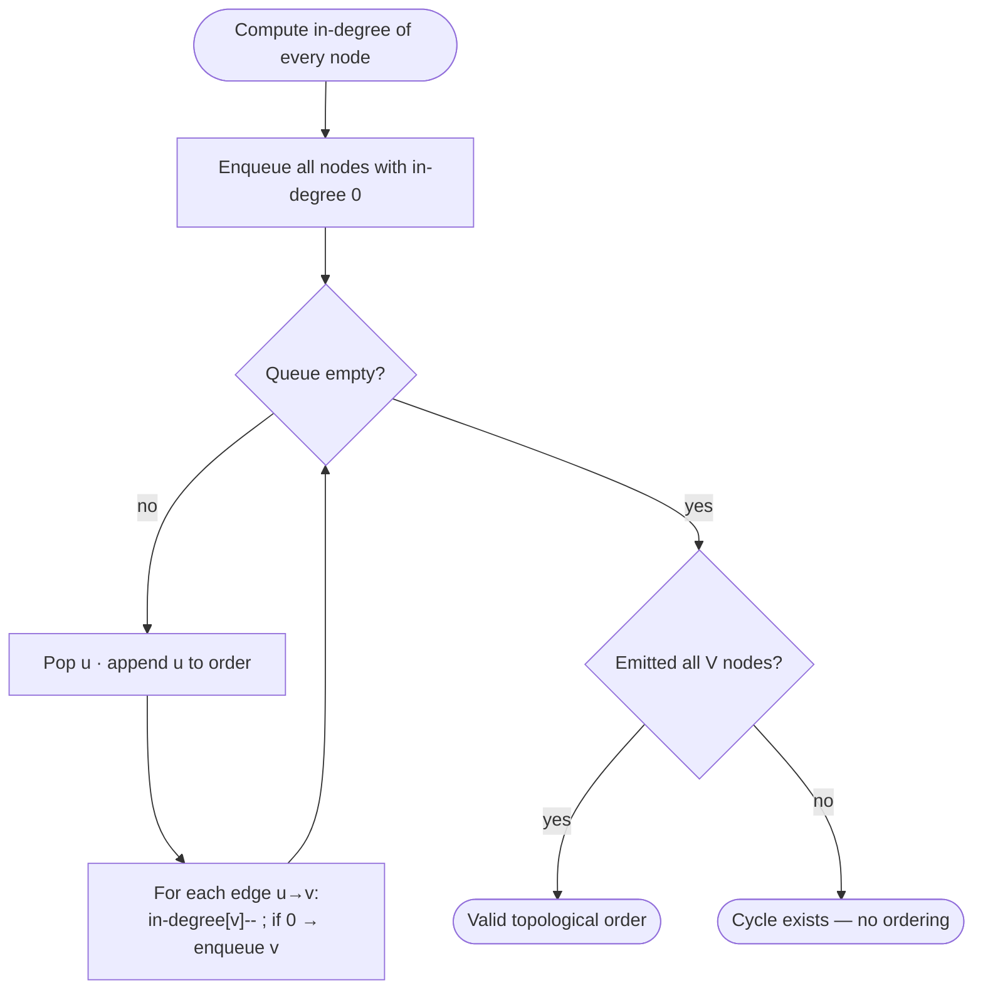

# Topological Sort


<PatternVideo pattern-name="Topological Sort" duration="8–12 min" />

<PatternProgress pattern-id="topological-sort" problems="course-schedule, alien-dictionary, minimum-height-trees, parallel-courses, sequence-reconstruction" />

<script setup>
const theTemplateSpecializations = [
  { slug: `course-schedule-i-cycle-detect-medium`, title: `Course Schedule I (cycle detect)` },
  { slug: `course-schedule-ii-one-topo-order-medium`, title: `Course Schedule II (one topo order)` },
  { slug: `alien-dictionary-graph-from-string-order-hard`, title: `Alien Dictionary` },
  { slug: `minimum-height-trees-iterative-leaf-trim-medium`, title: `Minimum Height Trees (leaf-trim)` },
  { slug: `parallel-courses-level-wise-bfs-gives-min-semesters-medium`, title: `Parallel Courses (wave count)` },
  { slug: `sequence-reconstruction-unique-topo-order-check-medium`, title: `Sequence Reconstruction (unique order)` },
]

const theTemplateCode = `// Kahn's algorithm — THE topological-sort template.
// Returns a valid topo order, or empty if a cycle exists.
int[] topoSort(int n, int[][] edges) {
    List&lt;List&lt;Integer&gt;&gt; adj = new ArrayList&lt;&gt;();
    for (int i = 0; i &lt; n; i++) adj.add(new ArrayList&lt;&gt;());
    int[] indeg = new int[n];
    for (int[] e : edges) {                              // e = {u, v} means u -&gt; v
        adj.get(e[0]).add(e[1]);
        indeg[e[1]]++;
    }
    Queue&lt;Integer&gt; q = new ArrayDeque&lt;&gt;();
    for (int i = 0; i &lt; n; i++) if (indeg[i] == 0) q.offer(i);
    int[] order = new int[n];
    int k = 0;
    while (!q.isEmpty()) {
        int u = q.poll();
        order[k++] = u;
        for (int v : adj.get(u)) {
            if (--indeg[v] == 0) q.offer(v);             // v becomes ready
        }
    }
    return k == n ? order : new int[0];                  // k &lt; n -&gt; cycle
}`

const dfsTopoCode = `// DFS post-order variant — same O(V+E), compact cycle detection via 3-coloring.
int[] topoDFS(int n, int[][] edges) {
    List&lt;List&lt;Integer&gt;&gt; adj = new ArrayList&lt;&gt;();
    for (int i = 0; i &lt; n; i++) adj.add(new ArrayList&lt;&gt;());
    for (int[] e : edges) adj.get(e[0]).add(e[1]);
    int[] color = new int[n];                            // 0=white, 1=gray, 2=black
    Deque&lt;Integer&gt; stack = new ArrayDeque&lt;&gt;();
    for (int i = 0; i &lt; n; i++) {
        if (color[i] == 0 && !dfs(adj, color, stack, i)) return new int[0];
    }
    int[] order = new int[n];
    int k = 0;
    while (!stack.isEmpty()) order[k++] = stack.pop();
    return order;
}

boolean dfs(List&lt;List&lt;Integer&gt;&gt; adj, int[] color, Deque&lt;Integer&gt; stack, int u) {
    color[u] = 1;                                        // gray: in current DFS stack
    for (int v : adj.get(u)) {
        if (color[v] == 1) return false;                 // back-edge -&gt; cycle
        if (color[v] == 0 && !dfs(adj, color, stack, v)) return false;
    }
    color[u] = 2;
    stack.push(u);                                        // post-order
    return true;
}`

const alienDictionaryCode = `// Alien Dictionary — build the precedence graph from first-differing char
// of adjacent words, then topo-sort the alphabet.
String alienOrder(String[] words) {
    Map&lt;Character, Set&lt;Character&gt;&gt; adj = new HashMap&lt;&gt;();
    Map&lt;Character, Integer&gt; indeg = new HashMap&lt;&gt;();
    for (String w : words) {
        for (char c : w.toCharArray()) {
            indeg.putIfAbsent(c, 0);
            adj.putIfAbsent(c, new HashSet&lt;&gt;());
        }
    }
    for (int i = 0; i &lt; words.length - 1; i++) {
        String a = words[i], b = words[i + 1];
        if (a.length() &gt; b.length() && a.startsWith(b)) return "";  // invalid: "abc" before "ab"
        for (int j = 0; j &lt; Math.min(a.length(), b.length()); j++) {
            char x = a.charAt(j), y = b.charAt(j);
            if (x != y) {
                if (adj.get(x).add(y)) indeg.merge(y, 1, Integer::sum);
                break;                                   // only first differing char matters
            }
        }
    }
    Queue&lt;Character&gt; q = new ArrayDeque&lt;&gt;();
    for (var e : indeg.entrySet()) if (e.getValue() == 0) q.offer(e.getKey());
    StringBuilder sb = new StringBuilder();
    while (!q.isEmpty()) {
        char u = q.poll();
        sb.append(u);
        for (char v : adj.get(u)) {
            if (indeg.merge(v, -1, Integer::sum) == 0) q.offer(v);
        }
    }
    return sb.length() == indeg.size() ? sb.toString() : "";
}`

const mhtCode = `// Minimum Height Trees — iterative leaf-trim on an UNDIRECTED tree.
// At most 2 nodes remain; those are the roots of a min-height tree.
List&lt;Integer&gt; findMinHeightTrees(int n, int[][] edges) {
    if (n == 1) return Arrays.asList(0);
    List&lt;Set&lt;Integer&gt;&gt; adj = new ArrayList&lt;&gt;();
    for (int i = 0; i &lt; n; i++) adj.add(new HashSet&lt;&gt;());
    for (int[] e : edges) { adj.get(e[0]).add(e[1]); adj.get(e[1]).add(e[0]); }
    List&lt;Integer&gt; leaves = new ArrayList&lt;&gt;();
    for (int i = 0; i &lt; n; i++) if (adj.get(i).size() == 1) leaves.add(i);
    int remaining = n;
    while (remaining &gt; 2) {
        remaining -= leaves.size();
        List&lt;Integer&gt; next = new ArrayList&lt;&gt;();
        for (int leaf : leaves) {
            int neighbor = adj.get(leaf).iterator().next();
            adj.get(neighbor).remove(leaf);
            if (adj.get(neighbor).size() == 1) next.add(neighbor);
        }
        leaves = next;
    }
    return leaves;
}`

const parallelCoursesCode = `// Parallel Courses — Kahn's with LEVEL-WISE processing.
// Each wave can take all currently-ready courses simultaneously; count waves.
int minimumSemesters(int n, int[][] relations) {
    List&lt;List&lt;Integer&gt;&gt; adj = new ArrayList&lt;&gt;();
    for (int i = 0; i &lt;= n; i++) adj.add(new ArrayList&lt;&gt;());
    int[] indeg = new int[n + 1];
    for (int[] r : relations) { adj.get(r[0]).add(r[1]); indeg[r[1]]++; }
    Queue&lt;Integer&gt; q = new ArrayDeque&lt;&gt;();
    for (int i = 1; i &lt;= n; i++) if (indeg[i] == 0) q.offer(i);
    int semesters = 0, taken = 0;
    while (!q.isEmpty()) {
        int size = q.size();                             // whole wave size
        semesters++;
        for (int i = 0; i &lt; size; i++) {
            int u = q.poll();
            taken++;
            for (int v : adj.get(u)) if (--indeg[v] == 0) q.offer(v);
        }
    }
    return taken == n ? semesters : -1;                  // -1 if cycle
}`

const sequenceReconstructionCode = `// Sequence Reconstruction — the queue must have EXACTLY ONE node at every
// step for the topo order to be unique and match the given target.
boolean sequenceReconstruction(int[] org, List&lt;List&lt;Integer&gt;&gt; seqs) {
    int n = org.length;
    Map&lt;Integer, Set&lt;Integer&gt;&gt; adj = new HashMap&lt;&gt;();
    int[] indeg = new int[n + 1];
    boolean[] seen = new boolean[n + 1];
    for (List&lt;Integer&gt; seq : seqs) {
        for (int x : seq) seen[x] = true;
        for (int i = 1; i &lt; seq.size(); i++) {
            int u = seq.get(i - 1), v = seq.get(i);
            if (adj.computeIfAbsent(u, k -&gt; new HashSet&lt;&gt;()).add(v)) indeg[v]++;
        }
    }
    for (int i = 1; i &lt;= n; i++) if (!seen[i]) return false;
    Queue&lt;Integer&gt; q = new ArrayDeque&lt;&gt;();
    for (int i = 1; i &lt;= n; i++) if (indeg[i] == 0) q.offer(i);
    int k = 0;
    while (!q.isEmpty()) {
        if (q.size() &gt; 1) return false;                   // ambiguous choice -&gt; not unique
        int u = q.poll();
        if (u != org[k++]) return false;
        for (int v : adj.getOrDefault(u, Set.of())) {
            if (--indeg[v] == 0) q.offer(v);
        }
    }
    return k == n;
}`

const topoInvariant = {
  statement: `At any point, every node already appended to the order has all its predecessors appended earlier. If the loop ends with k < V, the remaining nodes form a directed cycle.`,
  initialization: `Before the loop: the queue holds exactly the nodes with indeg == 0 and the order is empty. The invariant holds vacuously — no node is appended yet.`,
  maintenance: `Each pop appends u to the order. u is popped only when indeg[u] == 0, meaning all predecessors of u have already been popped (and thus appended) in prior iterations. For each outgoing edge u -> v, we decrement indeg[v]; v is enqueued only when its own indeg reaches 0, preserving the invariant that queued nodes are ready.`,
  termination: `When the queue empties: if k == V, every node was appended after its predecessors — a valid topo order. If k < V, the remaining V - k nodes have positive indeg, meaning each has a predecessor that's also unprocessed. This chain of predecessors in a finite graph must contain a cycle.`,
}

const topoComplexity = { time: `O(V + E) — each node pushed/popped once; each edge decrements indeg once`, space: `O(V + E) for adjacency list, indegree array, and queue` }

const mastery5 = [
  {
    q: `Kahn's algorithm starts by enqueueing which nodes?`,
    choices: [
      { text: `Those with indegree == 0`, correct: true, explanation: `No incoming edges = no prerequisites, so they can be emitted immediately.` },
      { text: `Those with outdegree == 0`, correct: false, explanation: `Those are the sinks; they get emitted LAST.` },
      { text: `All nodes`, correct: false, explanation: `Nodes with prerequisites must wait.` },
      { text: `A random node`, correct: false },
    ],
  },
  {
    q: `How does Kahn's detect a cycle?`,
    choices: [
      { text: `The emitted count is less than V — some nodes never reached indeg 0`, correct: true, explanation: `Nodes in a cycle each have a predecessor also in the cycle, so none ever becomes ready.` },
      { text: `A timeout`, correct: false },
      { text: `Finds a back-edge during traversal`, correct: false, explanation: `That's DFS-based cycle detection.` },
      { text: `Impossible in linear time`, correct: false, explanation: `Both Kahn and DFS detect in O(V+E).` },
    ],
  },
  {
    q: `For a UNIQUE topological order check (Sequence Reconstruction), what invariant must hold at every BFS step?`,
    choices: [
      { text: `The queue holds exactly ONE node — any choice would mean two valid orders exist`, correct: true, explanation: `A queue of size ≥ 2 means independent nodes could be swapped, so the order isn't unique.` },
      { text: `The queue holds ≥ 1 node`, correct: false, explanation: `That's just "a valid order exists", not uniqueness.` },
      { text: `The queue holds V nodes`, correct: false, explanation: `Only possible with 0 edges.` },
      { text: `No invariant needed`, correct: false },
    ],
  },
  {
    q: `For Minimum Height Trees, why does iterative leaf-trimming find the tree center(s)?`,
    choices: [
      { text: `Leaves are the tree's "edges"; peeling them layer-by-layer converges on the median(s) of the longest path`, correct: true, explanation: `A tree has at most 2 centers (both are the middle of some longest path). Trimming leaves is equivalent to finding this center.` },
      { text: `Random`, correct: false },
      { text: `Via eccentricity computation`, correct: false, explanation: `Works but is O(V²), much slower.` },
      { text: `Via BFS from any root`, correct: false, explanation: `That gives distances, not necessarily the center.` },
    ],
  },
  {
    q: `Alien Dictionary: given adjacent sorted words 'wrt' and 'wrf', which edge do you add?`,
    choices: [
      { text: `t -> f (first differing char: 't' at index 2 in both words, with 't' < 'f' in alien order)`, correct: true, explanation: `Only the FIRST differing char between adjacent words gives an ordering signal. All later chars reveal nothing.` },
      { text: `w -> r, r -> t, t -> f`, correct: false, explanation: `Over-constrains; only the first differing pair is informative.` },
      { text: `No edges — the words are sorted so no signal`, correct: false },
      { text: `f -> t`, correct: false, explanation: `Direction wrong; 'wrt' before 'wrf' means t < f.` },
    ],
  },
]
</script>

## Why topological sort exists — the story

You're a build engineer at Google, maintaining Bazel. Every codebase has thousands of source files, each declaring its dependencies. A user runs `bazel build //frontend/app`. The build system must compile files **in an order** that respects: *nothing gets compiled before its dependencies*.

The naive approach: for every file, check if all its dependencies are ready; if yes, compile it; repeat until done. With 100,000 source files in the average monorepo, that's a **quadratic scan** — `10¹⁰` checks per full build. At 10ns per check, that's **100 seconds** of pure scheduling overhead, before a single compile actually runs. On Google's monorepo (2 billion lines of code), naive scheduling would cost hours.

Worse, the naive approach silently loops forever if there's a **cycle** — file A depends on B which depends on A. Not paranoia: every experienced C++ engineer has hit a circular include exactly once, and remembers where they were.

The pattern is **topological sort**: use graph structure to schedule the traversal in **O(V + E)** — linear in the size of the dependency graph, regardless of quadratic worst-case. Kahn's algorithm (1962) does it with a queue: start with all files that have zero unresolved dependencies, emit them, decrement each dependent's remaining count, and enqueue any that just hit zero. **Detects cycles as a side effect** — if the queue empties before every file is emitted, the remaining files form a cycle. That's how Bazel, Make, npm, Cargo, and every other build system on Earth schedules parallel work.

Some tasks are not about shortest paths or reachability. They are about **order**. You cannot take Algorithms before Data Structures, cannot deploy before tests pass, and cannot compile a file before its dependencies compile. When the rules are directed prerequisites — "B must happen before A" — you are looking for a topological ordering.

Take four courses: `0` has no prerequisites, `1` needs `0`, `2` needs `0`, and `3` needs both `1` and `2`. One valid order is `0,1,2,3`; another is `0,2,1,3`. The exact order is not unique, but every valid answer respects the arrows. If you add one more rule, `0` needs `3`, the graph becomes a cycle: `0 → 1 → 3 → 0` or `0 → 2 → 3 → 0`. Now no course can be first, because each course in the loop waits for another.

<Callout kind="key" title="Key Insight">

Topological sort exists iff the graph is a DAG. If Kahn's queue empties before you've emitted all V nodes, the remaining nodes form a cycle.

</Callout>

There are two standard algorithms, and they feel mechanically different. **Kahn's BFS** repeatedly removes nodes with zero remaining prerequisites; it is like saying, "what can I do right now?" **DFS post-order** dives down prerequisites and appends a node after all of its descendants are done; reversing that finish order gives a valid topo order. Both are O(V+E), both detect cycles as a side-effect, and interviewers often accept either if you explain the invariant clearly.

<TopoSortAnim />

<Callout kind="key">

**Key Insight — Kahn's algorithm is BFS on the *indegree=0 frontier*.** The queue holds nodes ready-to-emit; each pop removes one from the graph and decrements neighbours' indegrees. It's a BFS in structure, but on the *dependency* graph rather than a raw graph.

</Callout>

<Callout kind="key">

**Key Insight — DFS-based topo emits in *post-order*.** After visiting all descendants of `u`, push `u` onto a stack. Reverse the stack at the end. The invariant: `u` is pushed only after everything reachable from `u` is pushed, so `u` appears later in the reversed stack. Equally valid, equally O(V+E), preferred when you want to reuse the DFS bookkeeping for cycle detection.

</Callout>

<Callout kind="inv" title="Invariant — Kahn's queue is exactly the set of nodes with indegree 0 given the current graph.">

Every pop reduces the graph by one node; every enqueue reflects a neighbour whose last dependency just left. If the queue empties while unemitted nodes remain, those nodes form a **cycle** — every node in the cycle depends on another node in the cycle, so no one hits indegree 0.

</Callout>

<Callout kind="inv" title="Invariant — emitted order respects every edge.">

For every edge `u → v` in the original graph, `u` appears before `v` in the output. Verify by walking the output and checking each edge; this is the constant-factor way to sanity-check your implementation without believing your correctness proof.

</Callout>

## When to use it — and when not to

### Recognize by
- *directed graph with prerequisites* — "course schedule", "build order", "task dependencies".
- "return any valid ordering" subject to constraints.
- "detect whether all tasks can be completed" where impossibility means a dependency cycle.
- "alien dictionary" — infer letter order from sorted words, then topologically sort.
- "some items have zero prerequisites first, then unlock others" — Kahn's algorithm language.
- "DAG dynamic programming" — process nodes only after their predecessors are ready.

### When NOT to use it
The graph is *undirected* — topological sort is undefined. For "reach everything from x" use BFS/DFS. For "is this graph a DAG?" use DFS with a 3-colour visitor. If dependencies come with weights (build times, delays), reach for critical-path DP instead.

<Callout kind="trap" title="Trap — using DFS three-coloring wrong.">

Cycle detection with DFS needs *three* states: white (unvisited), gray (in current DFS stack), black (finished). Encountering a gray node is a back-edge = cycle. Using just visited/unvisited (two states) fails on graphs like `A → B, A → C, B → D, C → D` — you'd flag the second visit to `D` as a cycle, but it isn't.

</Callout>

<Callout kind="trap" title="Trap — building the reverse graph when you meant the forward graph.">

Kahn's needs `outEdges[u]` for "when I emit u, decrement all its dependents' indegrees." Some candidates build `inEdges[u]` (the wrong direction) and get infinite loops. **Rule: `outEdges[u] = list of v such that u → v`.**

</Callout>

<Callout kind="trap" title="Trap — assuming unique output.">

Topo order is generally *not* unique — for parallel-independent tasks, any ordering that respects edges is valid. If the problem says "return *the* topological order" it's usually a tell that only one valid order exists (given tie-breaks like lexicographic). If your submission fails a "wrong answer" test but your order respects edges, check whether the grader wants a specific tie-break.

</Callout>

Also avoid it when:
- edges do not represent precedence; shortest path, connected components, and MSTs are different problems.
- the graph can contain cycles but you still need a best effort ordering; use SCC condensation first.
- you need a unique order; topo sort may return many valid orders unless extra rules are added.
- prerequisites change online after every query; maintaining a topo order dynamically is a separate problem.
- the input is really a tree parent relationship; a simple traversal may be enough.

## THE template

Every topological-sort problem is a specialization of **"maintain the indeg-zero frontier; pop one, decrement its outgoing edges' indegs, enqueue any that just hit zero."** The DFS variant is a mirror form; both are O(V+E). The sub-variations differ in *how* you build the graph (prerequisite pairs, char-order from adjacent words, undirected tree edges) and *what* you record (the order, a count of waves, uniqueness).

<PatternTemplateCard
  slug="topo-sort-kahn-template"
  title="Kahn's BFS — THE topological-sort template"
  language="java"
  :code="theTemplateCode"
  :invariant="topoInvariant"
  :complexity="topoComplexity"
  :specializations="theTemplateSpecializations"
/>

**DFS post-order variant** (same O(V+E), compact cycle detection via 3-coloring):

<TemplateReveal
  slug="topo-dfs"
  language="java"
  :canonical="dfsTopoCode"
/>

Prefer **Kahn** when the problem naturally talks about prerequisites, semesters, waves, or "available now" nodes. Prefer **DFS** when you are already doing graph recursion, need a compact cycle detector, or want post-order for DAG DP. The in-degree array makes Kahn's invariant visible (easier to debug); DFS gives a tight 3-color cycle detector.

## Kahn vs DFS — same answer, different proof

Kahn's algorithm proves validity from the front of the order. When a node leaves the queue, every prerequisite has already been emitted, because its in-degree has dropped to zero. DFS proves validity from the back of the order. A DFS call appends `u` only after every node reachable from `u` has already been appended, so reversing the post-order places `u` before its dependents.

Cycle detection also appears differently. In Kahn, a cycle shows up as "no node has zero remaining prerequisites," so the emitted count is too small. In DFS, a cycle shows up as a back-edge to a node currently in the recursion stack, which is why the three states are `0 = unvisited`, `1 = visiting`, and `2 = done`. If you only use a boolean visited set in DFS, you can miss the difference between "already safely processed" and "currently on my path," and cycle detection becomes wrong.

A tiny cycle trace makes this concrete: prerequisites `[0,1]` and `[1,0]` create edges `1→0` and `0→1`. Kahn starts with no zero-in-degree node, so it emits nothing. DFS starts at `0`, marks it visiting, goes to `1`, marks it visiting, and then sees edge `1→0` into a visiting node. Both algorithms report impossible, but they discover the problem through different mechanical signals.


## Building the graph is often the real problem

In Course Schedule, the graph is handed to you as pairs. In Alien Dictionary, you must infer it. Compare adjacent words in the sorted dictionary and find the first differing character; if word `w1` has `x` and word `w2` has `y` at that position, add edge `x → y`. Then stop comparing that pair, because later characters tell you nothing once the first difference explains the order. If no differing character exists and the first word is longer, like `"abc"` before `"ab"`, the dictionary is invalid immediately; topo sort cannot fix a bad prefix rule.

This is a common interview twist: topological sort is only half the solution. The other half is translating the domain into nodes and directed edges without inventing edges that the input does not prove. When in doubt, say what a node represents, what an edge means, and why each edge is justified by the problem statement.

## History — Kahn 1962 and every build system on Earth

Topological sort was formalized by **Arthur B. Kahn in 1962** in his paper *"Topological sorting of large networks"* (Communications of the ACM 5(11):558-562). Kahn's algorithm — repeatedly remove nodes with zero indegree — is the same one you'd write today. His motivation was **program dependency analysis**: given a set of tasks with precedence constraints, find a valid execution order. His paper is unusually readable for 1962 and is worth reading if you want to see the pattern in its original form.

The DFS-based topological sort was popularized by **Robert Tarjan** in the 1970s as a byproduct of his strongly-connected-components work. Cormen-Leiserson-Rivest-Stein's *Introduction to Algorithms* (CLRS, 1990) presents both flavors side by side.

**Real-world adoption is universal.** Every build system on Earth is a topological sort:

- **`make`** (1976) topologically sorts source files by `#include` dependencies.
- **`npm install`** topologically sorts npm packages by `dependencies`.
- **`pip install -r requirements.txt`** does the same for Python.
- **Cargo** (Rust), **Bazel** (Google's monorepo build), **Buck** (Meta), **Gradle** (Android) — all topological sort under the hood.
- **Excel's formula recalculation**: cells depend on other cells; topo sort determines evaluation order.
- **Terraform's plan** topologically sorts resource-creation order (VPCs before subnets, subnets before EC2 instances).
- **Airflow / Dagster / Prefect** DAG-based workflow schedulers are literally named after topological sort's precondition (Directed Acyclic Graph).
- **CI/CD pipelines** (GitHub Actions, CircleCI, Jenkins) topologically sort job dependencies.

When you tell an interviewer *"Kahn's algorithm, O(V+E), cycle detection as a side effect,"* you're citing the algorithm that powers essentially every build tool your company uses.

## Sub-variations of the template

<PatternSubVariationNav pattern="topological-sort" />

The sub-variations walk the template through six canonical uses — cycle-only check, emit one order, infer the graph from strings, undirected leaf-trim, count waves (parallel semesters), and uniqueness check. Each uses the Kahn's BFS kernel; what changes is edge construction and what you record.

### Course Schedule I (cycle detect) <span class="diff diff-m">Medium</span>

*[↗ LeetCode: Course Schedule](https://leetcode.com/problems/course-schedule/)*

The simplest form: return `true` iff all courses can be finished (no cycle). You don't emit the order — just count successful pops. Same Kahn kernel; the result is `k == n`.


```java
boolean canFinish(int n, int[][] prereqs) {
    List<List<Integer>> adj = new ArrayList<>();
    for (int i = 0; i < n; i++) adj.add(new ArrayList<>());
    int[] indeg = new int[n];
    for (int[] p : prereqs) { adj.get(p[1]).add(p[0]); indeg[p[0]]++; }
    Queue<Integer> q = new ArrayDeque<>();
    for (int i = 0; i < n; i++) if (indeg[i] == 0) q.offer(i);
    int k = 0;
    while (!q.isEmpty()) {
        int u = q.poll();
        k++;
        for (int v : adj.get(u)) if (--indeg[v] == 0) q.offer(v);
    }
    return k == n;
}
```


### Course Schedule II (one topo order) <span class="diff diff-m">Medium</span>

Return a valid topological order (the actual sequence of courses to take), or `[]` if impossible. This is the canonical form of the template — the pedagogical walkthrough below treats it in full.

<details>
<summary><strong>Pedagogical: the 3-approach ladder for Course Schedule II (naive scan → Kahn → DFS post-order)</strong></summary>

#### Canonical problem walkthrough — Course Schedule II

**Problem** ([↗ LeetCode](https://leetcode.com/problems/course-schedule-ii/)): There are `numCourses` courses labeled `0..numCourses-1`. Some courses have prerequisites — `prerequisites[i] = [a, b]` means "to take course `a`, you must first finish course `b`." Return **any valid ordering** in which you can take all courses. If it's impossible (cycle), return an empty array.

### Approach 1 — Brute force: try every permutation

Generate all `n!` permutations of courses. For each, verify it respects every prerequisite. Return the first valid one.


```java
int[] findOrderBrute(int n, int[][] prereqs) {
    int[] perm = new int[n];
    for (int i = 0; i < n; i++) perm[i] = i;
    return permute(perm, 0, prereqs);
}

int[] permute(int[] perm, int start, int[][] prereqs) {
    if (start == perm.length) {
        return isValid(perm, prereqs) ? perm.clone() : null;
    }
    for (int i = start; i < perm.length; i++) {
        swap(perm, start, i);
        int[] result = permute(perm, start + 1, prereqs);
        if (result != null) return result;
        swap(perm, start, i);
    }
    return null;
}

boolean isValid(int[] perm, int[][] prereqs) {
    int[] pos = new int[perm.length];
    for (int i = 0; i < perm.length; i++) pos[perm[i]] = i;
    for (int[] p : prereqs) {
        if (pos[p[1]] > pos[p[0]]) return false;    // prereq must come first
    }
    return true;
}
```


**Complexity:** O(n! · n · m) where m = # prerequisites. For `n = 20`, that's `2.4·10¹⁸` operations — heat death of universe. Useful only as a mental reference: "brute force is n!; we can do way better."

### Approach 2 — Kahn's BFS (indegree queue) — the interview answer

Build the graph: `outEdges[u] = list of v such that u→v` (i.e., "u must be done before v"). Compute `indegree[v]` for every v. Start with a queue of all zero-indegree nodes (no prerequisites). Pop, emit, decrement each neighbour's indegree; enqueue any that hit zero. If the emitted count equals `numCourses`, return the order. Otherwise, a cycle exists — return empty.


```java
int[] findOrder(int numCourses, int[][] prereqs) {
    List<List<Integer>> out = new ArrayList<>();
    for (int i = 0; i < numCourses; i++) out.add(new ArrayList<>());
    int[] indeg = new int[numCourses];
    for (int[] p : prereqs) {
        out.get(p[1]).add(p[0]);                    // p[1] -> p[0]  (p[1] must be first)
        indeg[p[0]]++;
    }

    Queue<Integer> queue = new ArrayDeque<>();
    for (int i = 0; i < numCourses; i++)
        if (indeg[i] == 0) queue.offer(i);

    int[] order = new int[numCourses];
    int idx = 0;
    while (!queue.isEmpty()) {
        int u = queue.poll();
        order[idx++] = u;
        for (int v : out.get(u)) {
            if (--indeg[v] == 0) queue.offer(v);
        }
    }
    return idx == numCourses ? order : new int[0];   // cycle detected
}
```


**Complexity:** O(V + E) time, O(V + E) space. For `n = 10⁴, m = 10⁴`, ~2·10⁴ ops — a fraction of a millisecond.

**Interview commentary:**
- *"Brute force is O(n!) — dies past n=20."*
- *"Kahn's algorithm: start with courses having zero prereqs. Emit one, decrement its dependents. Enqueue any that just hit zero."*
- *"O(V+E). Cycle detection is free — if the emitted count is less than numCourses, a cycle exists (some courses never had all their prereqs satisfied)."*
- *"Edge direction: `prereqs[i] = [a, b]` means b→a. Build the graph with that direction so out-edges represent 'nodes that must come after me.'"*

### Approach 3 — DFS post-order

Alternative: DFS from every unvisited node, using 3-coloring (white/gray/black) for cycle detection. Push nodes onto a stack in post-order. Reverse the stack.


```java
int[] findOrderDFS(int numCourses, int[][] prereqs) {
    List<List<Integer>> out = new ArrayList<>();
    for (int i = 0; i < numCourses; i++) out.add(new ArrayList<>());
    for (int[] p : prereqs) out.get(p[1]).add(p[0]);

    int[] color = new int[numCourses];                // 0=white, 1=gray, 2=black
    Deque<Integer> stack = new ArrayDeque<>();
    for (int i = 0; i < numCourses; i++) {
        if (color[i] == 0 && !dfs(out, color, stack, i)) {
            return new int[0];                        // cycle
        }
    }
    int[] order = new int[numCourses];
    int idx = 0;
    while (!stack.isEmpty()) order[idx++] = stack.pop();
    return order;
}

boolean dfs(List<List<Integer>> out, int[] color, Deque<Integer> stack, int u) {
    color[u] = 1;                                     // gray
    for (int v : out.get(u)) {
        if (color[v] == 1) return false;              // back-edge = cycle
        if (color[v] == 0 && !dfs(out, color, stack, v)) return false;
    }
    color[u] = 2;                                     // black
    stack.push(u);                                    // post-order
    return true;
}
```


**Same complexity: O(V+E).** Choose DFS when the same traversal also does cycle detection, SCC decomposition, or timestamped exit analysis. Choose Kahn when the natural mental model is "process nodes as they become ready."

#### Complexity ladder

| Approach | Time | Space | When |
|---|---|---|---|
| Brute permutations | O(n! · m) | O(n) | Reference / n ≤ 8 |
| **Kahn's BFS** | **O(V + E)** | **O(V + E)** | **Interview default** |
| DFS post-order (3-color) | O(V + E) | O(V + E) | If you also need cycle-edge details |

</details>

### Course Schedule II — walkthrough deep dive <span class="diff diff-m">Medium</span>

*[↗ LeetCode: Course Schedule II](https://leetcode.com/problems/course-schedule-ii/)*

<ProgressCheck id="course-schedule-topological-sort" />


<div class="svg-figure">
<svg preserveAspectRatio="xMidYMid meet" role="img" viewBox="0 0 400 250" xmlns="http://www.w3.org/2000/svg" font-family="var(--dsa-font)" aria-label="Diagram illustrating: Course Schedule (Topological Sort) Medium">
  <defs>
    <marker id="ar-topo-primary" markerWidth="9" markerHeight="9" refX="6" refY="3" orient="auto">
      <path d="M0,0 L6,3 L0,6 Z" fill="var(--dsa-primary)"/>
    </marker>
  </defs>
  <rect x="0" y="0" width="400" height="250" rx="12" fill="var(--dsa-bg)"/>
  <text x="200" y="27" text-anchor="middle" font-size="12" font-weight="700" fill="var(--dsa-primary)">Kahn's algorithm emits zero-in-degree courses</text>
  <g stroke="var(--dsa-primary)" stroke-width="2" fill="none" marker-end="url(#ar-topo-primary)">
    <line x1="116" y1="80" x2="178" y2="80"/>
    <line x1="116" y1="96" x2="178" y2="150"/>
    <line x1="222" y1="80" x2="284" y2="96"/>
    <line x1="222" y1="150" x2="284" y2="112"/>
  </g>
  <g text-anchor="middle">
    <circle cx="90" cy="88" r="22" fill="var(--dsa-success-soft)" stroke="var(--dsa-success)" stroke-width="1.6"/>
    <circle cx="200" cy="80" r="22" fill="var(--dsa-primary-soft)" stroke="var(--dsa-primary)" stroke-width="1.6"/>
    <circle cx="200" cy="158" r="22" fill="var(--dsa-primary-soft)" stroke="var(--dsa-primary)" stroke-width="1.6"/>
    <circle cx="310" cy="104" r="22" fill="var(--dsa-neutral-soft)" stroke="var(--dsa-neutral-line)" stroke-width="1.6"/>
    <g font-size="17" font-weight="700" fill="var(--dsa-ink)">
      <text x="90" y="94">A</text><text x="200" y="86">B</text><text x="200" y="164">C</text><text x="310" y="110">D</text>
    </g>
    <g font-size="11" fill="var(--dsa-neutral)">
      <text x="90" y="122">in=0</text><text x="200" y="114">in=1</text><text x="200" y="192">in=1</text><text x="310" y="138">in=2</text>
    </g>
  </g>
  <text x="67" y="211" font-size="12" font-weight="700" fill="var(--dsa-success)">queue</text>
  <rect x="116" y="193" width="44" height="44" rx="7" fill="var(--dsa-success-soft)" stroke="var(--dsa-success)" stroke-width="1.6"/>
  <text x="138" y="221" text-anchor="middle" font-size="17" font-weight="700" fill="var(--dsa-ink)">A</text>
  <text x="246" y="212" text-anchor="middle" font-size="11.5" font-style="italic" fill="var(--dsa-neutral)">DAG ⇔ can emit all n</text>
</svg>
</div>


<div class="readfig"><b>How to read it:</b> Start with the zero-in-degree queue, emit those courses, remove their outgoing edges, and repeat; if every course is emitted, there is no cycle.</div>

### Problem
Given `numCourses` and prerequisite pairs `[a,b]` (finish `b` before `a`), return a **valid order** to take all courses, or an empty array if impossible (a cycle exists).

**Constraints:** `1 ≤ numCourses ≤ 2000`; up to `5000` prerequisite pairs.

**Example 1:** 4 courses, prereqs `1→0, 2→0, 3→1, 3→2` → `[0,1,2,3]`.

**Example 2:** `numCourses = 2`, prerequisites `[[1,0],[0,1]]` → `[]` because the cycle makes an order impossible.

### Solution — brute force
A simple but slow approach repeatedly scans all courses looking for one whose prerequisites are already completed.


```java
// Pseudocode baseline:
// while order has fewer than numCourses:
//     find an uncompleted course whose every prerequisite is completed
//     if none exists, return [] because a cycle blocks progress
//     mark it completed and append it to order
```


This is conceptually Kahn's algorithm without the in-degree bookkeeping. Each round may scan every course and every prerequisite again, so it can degrade toward O(VE). Kahn optimizes the same idea by storing "remaining prerequisite count" and updating only neighbours of the course you just completed.

### Solution — optimized
Kahn's algorithm: repeatedly remove in-degree-0 nodes. If you can't emit all nodes, a cycle exists.

<Callout kind="inv" title="Invariant">

A node enters the queue only when every prerequisite is already emitted; the emission order is a valid topological order.

</Callout>





<div class="figcap">Kahn's algorithm — repeatedly remove in-degree-0 nodes; incompleteness proves a cycle.</div>
<div class="readfig"><b>How to read it:</b> "In-degree" is how many prerequisites a task still has. Start by queueing every task with zero prerequisites — those are safe to do now. Each time you finish one (pop it), you remove it as a prerequisite from its dependents, and any dependent that drops to zero becomes free, so it joins the queue. Follow the loop and you emit a valid order. If you get stuck before finishing everything, the leftover tasks depend on each other in a circle — a cycle — so no order exists.</div>

#### Steps
1. Build the adjacency list `graph[prereq] → [course]` and an `inDegree[]` counter.
2. Enqueue every node with `inDegree == 0` — they can start immediately.
3. Repeatedly pop, add to the order, and decrement each neighbour's in-degree. Enqueue neighbours whose in-degree hits 0.
4. After the loop, if `order.size() < V` — there was a cycle → return `[]` (or `false` for the boolean variant).
5. Otherwise return the order. O(V + E) time.

#### Java


```java
int[] findOrder(int numCourses, int[][] prereqs) {
    List<List<Integer>> adj = new ArrayList<>();
    for (int i = 0; i < numCourses; i++) adj.add(new ArrayList<>());
    int[] indeg = new int[numCourses];
    for (int[] p : prereqs) { adj.get(p[1]).add(p[0]); indeg[p[0]]++; }
    Queue<Integer> q = new ArrayDeque<>();
    for (int i = 0; i < numCourses; i++) if (indeg[i] == 0) q.offer(i);
    int[] order = new int[numCourses]; int k = 0;
    while (!q.isEmpty()) {
        int u = q.poll(); order[k++] = u;
        for (int v : adj.get(u)) if (--indeg[v] == 0) q.offer(v);
    }
    return k == numCourses ? order : new int[0];    // incomplete => cycle
}
```


<Callout kind="note" title="Trace it">

`numCourses=4`, prerequisites `[1,0], [2,0], [3,1], [3,2]`.

</Callout>

<CodeTrace
  title="Course Schedule II — 4 courses, edges 0→1, 0→2, 1→3, 2→3"
  :values="[0,1,2,3]"
  :windowKeys="['i']"
  :cellWidth="42"
  :steps='[
    { pointers: { i: 0 }, vars: { indeg: "[0,1,1,2]", queue: "[0]" }, note: "seed queue with indegree-0 nodes" },
    { pointers: { i: 0 }, vars: { indeg: "[_,0,0,2]", queue: "[1,2]", out: "[0]" }, note: "pop 0, drop edges → 1 and 2 free", added: [0] },
    { pointers: { i: 1 }, vars: { indeg: "[_,_,0,1]", queue: "[2]", out: "[0,1]" }, note: "pop 1, drop 1→3", added: [1] },
    { pointers: { i: 2 }, vars: { indeg: "[_,_,_,0]", queue: "[3]", out: "[0,1,2]" }, note: "pop 2, drop 2→3 → 3 free", added: [2] },
    { pointers: { i: 3 }, vars: { indeg: "[_,_,_,_]", queue: "[]", out: "[0,1,2,3]" }, note: "pop 3. all courses ordered", added: [3] }
  ]'
/>

#### Edge-building intuition
The most common Course Schedule bug is direction. Pair `[a,b]` means "to take `a`, first take `b`." So the unlock direction is `b → a`: completing `b` reduces the remaining prerequisite count of `a`. If you reverse it, your graph still has the same nodes and the code still runs, which makes the bug feel sneaky, but the queue now represents courses unlocked by their dependents instead of by their prerequisites.

Isolated courses matter too. If `numCourses = 4` and only course `3` appears in prerequisites, courses `0`, `1`, and `2` are still valid zero-in-degree courses. Initialize adjacency for every course from `0` to `numCourses-1`, not just for keys seen in the edge list. A topo order must include all vertices, including the boring ones.

#### What if multiple nodes are available?
When the queue contains `[1,2]`, either order is valid unless the problem asks for lexicographically smallest order. For standard Course Schedule II, returning `[0,1,2,3]` or `[0,2,1,3]` is fine. If a problem wants the smallest valid order, replace the FIFO queue with a min-heap. The pattern is unchanged: remove a zero-in-degree node, emit it, and unlock neighbours. Only the policy for choosing among currently-free nodes changes.

### Time Complexity
Time O(V + E). Building adjacency touches each prerequisite once, and Kahn processes every node and edge once.

### Space Complexity
Space O(V + E) for the adjacency list, in-degree array, queue, and output order.

<details class="learnings">
<summary><strong>Learnings — points to remember</strong></summary>

- Why add edge `p[1] → p[0]`? — finishing the prerequisite unlocks the dependent course.
- Why maintain `indeg[]`? — it is the remaining prerequisite count for each node.
- Why enqueue only `indeg == 0`? — those courses are safe to take immediately.
- Why `--indeg[v] == 0`? — a neighbour becomes available exactly when its last prerequisite is removed.
- Why compare `k == numCourses`? — emitting fewer nodes means a cycle blocked the queue.
- Why Kahn over DFS here? — the BFS queue makes cycle detection and “available now” reasoning visible.

</details>

Additional notes:

Time O(V+E) · Space O(V+E). Building the graph touches each edge once, and the queue loop removes each node and edge once.

<Callout kind="trap" title="Common Trap">

Not detecting cycles. *Example:* prerequisites `0→1` and `1→0`. Kahn's queue starts empty (no in-degree-0 node); if `order.size() < V` at the end, report "impossible" rather than a partial order.

</Callout>

<TrapTrace title="Not detecting cycles" input="0→1" bug="prerequisites '0→1' and '1→0'. Kahn's queue starts empty (no in-degree-0 node); if 'order.size() lt V' at the end, report 'impossible' rather than a partial order." fix="See the guidance in the trap description and the code snippet." />

<Callout kind="note" title="Interview script">

First, I'd restate the edge direction: pair `[a,b]` means `b` must come before `a`, so I add edge `b → a`. The brute force is to repeatedly scan for a course whose prerequisites are all done, but that repeats work. I optimize with Kahn's algorithm: maintain in-degrees, queue all zero-in-degree courses, and decrement neighbours as I emit courses. If I emit fewer than `numCourses`, I know a cycle prevented completion; otherwise the order is valid in O(V+E).

</Callout>

#### Common Mistakes
- **Edge direction reversed**: `prereq → course`, not `course → prereq`. Reverse it and cycle detection breaks.
- **Not detecting the cycle**: if `order.size() < V` at the end, report impossible — don't return a partial order.
- **Building the graph off `numCourses` instead of the max node index**: initialize adjacency for all `numCourses` even if some are isolated.
- **DFS variant needs 3-state marking**: unvisited / in-progress / done — a back-edge into an in-progress node is the cycle.

<Callout kind="pat" title="Pattern Connection">

DFS post-order (reversed) is the alternative; three-color DFS detects the cycle. *Alien Dictionary* builds the graph from adjacent-word char differences, then topo-sorts.

</Callout>


#### Layered Kahn for semesters
Sometimes the question is not "what is one order?" but "how many rounds are needed if all currently-free tasks can run together?" Use the same queue, but process it level by level. At the start of a semester, the queue contains every course whose prerequisites were finished in earlier semesters. Pop exactly that many nodes, unlock neighbours, then increment the semester count. This is still Kahn's algorithm; the answer you record changes from a flat list to a number of waves.

#### Uniqueness check
If a problem asks whether a proposed sequence is the only possible reconstruction, watch the queue size. In Kahn's algorithm, a queue with two or more nodes means you have a choice, so multiple valid orders exist. A unique topo order requires exactly one available node at every step, and that node must match the proposed sequence. This is a small tweak, but it shows how much information the "available now" frontier gives you.

#### DFS variant in interview words
If I choose DFS instead, I would say: "I mark a node as visiting when it enters the recursion stack. If I ever reach a visiting node again, that is a directed cycle. After all neighbours are safely processed, I mark the node done and append it to post-order. At the end I reverse post-order to get prerequisites before dependents." This version uses the call stack instead of an explicit queue, but the output contract and O(V+E) complexity are the same.

#### Same pattern, new tweaks

"Repeatedly remove what has no remaining prerequisites" (Kahn) adapts by changing what the nodes/edges mean:

| Variation | The one thing that changes |
|---|---|
| [Course Schedule II](https://leetcode.com/problems/course-schedule-ii/) | Emit the actual order, not just "is it possible?" |
| [Alien Dictionary](https://leetcode.com/problems/alien-dictionary/) | Build edges by comparing adjacent words' first differing character, then topo-sort the alphabet. |
| [Minimum Height Trees](https://leetcode.com/problems/minimum-height-trees/) | Peel leaves layer by layer on an undirected tree; this is Kahn-shaped but not true directed topo sort. |
| [Parallel Courses](https://leetcode.com/problems/parallel-courses/) | Count Kahn "waves"; each wave is one semester of courses that can run together. |
| [Sequence Reconstruction](https://leetcode.com/problems/sequence-reconstruction/) | Require the queue to have exactly one choice at every step to prove the order is unique. |

### Alien Dictionary (graph from string order) <span class="diff diff-h">Hard</span>

*[↗ LeetCode: Alien Dictionary](https://leetcode.com/problems/alien-dictionary/)*

Given a list of words sorted by an unknown alien alphabet, return the alphabet. The **graph is implicit**: for each pair of adjacent words, the first differing character gives one edge; everything after that difference is uninformative. Then topo-sort the chars.

<Callout kind="key" title="Invalid input signal">

If word `a` is longer than word `b`, `a` starts with `b`, but `a` appears first (e.g., `"abc"` before `"ab"`), no valid alphabet exists. Return `""`.

</Callout>

<Callout kind="inv" title="Invariant">

The precedence graph edges are *exactly* the ordering constraints justified by adjacent-word comparisons; no edge is invented, none is missed.

</Callout>

<TemplateReveal
  slug="alien-dictionary"
  language="java"
  :canonical="alienDictionaryCode"
/>

**Trace** on `["wrt", "wrf", "er", "ett", "rftt"]`:

| Adjacent pair | First differing char | Edge added |
|---|---|---|
| wrt / wrf | t vs f | `t → f` |
| wrf / er | w vs e | `w → e` |
| er / ett | r vs t | `r → t` |
| ett / rftt | e vs r | `e → r` |

Alphabet: {w, r, t, f, e}. Indegrees: w=0, r=1, t=1, f=1, e=1. Kahn starts with `w`, then `e`, then `r`, then `t`, then `f`. Result: `"wertf"`.

### Minimum Height Trees (iterative leaf-trim) <span class="diff diff-m">Medium</span>

*[↗ LeetCode: Minimum Height Trees](https://leetcode.com/problems/minimum-height-trees/)*

Given an undirected tree with `n` nodes, find all root choices that minimize the resulting tree's height. The key insight: **the roots must be the tree's center(s)** — at most 2 nodes, both at the middle of some longest path. Find them by **peeling leaves layer-by-layer** until 1 or 2 remain. This is Kahn's algorithm on an undirected graph with the degree-1 frontier.

<Callout kind="key" title="Why at most 2 centers?">

A tree has a longest path (diameter). Its middle is a single node (odd-length path) or two adjacent nodes (even-length). Any other root choice would produce a taller tree.

</Callout>

<Callout kind="inv" title="Invariant">

At the start of each layer, the remaining subtree is the subgraph induced by nodes not yet trimmed. Leaves of this subgraph are degree-1 under the remaining edges.

</Callout>

<TemplateReveal
  slug="min-height-trees"
  language="java"
  :canonical="mhtCode"
/>

**Complexity:** O(V + E) — each node enters `leaves` exactly once, each edge is removed exactly once.

### Parallel Courses (level-wise BFS gives min semesters) <span class="diff diff-m">Medium</span>

*[↗ LeetCode: Parallel Courses](https://leetcode.com/problems/parallel-courses/)*

Return the minimum number of semesters to finish all courses, if **all currently-ready courses can run in parallel**. The twist: process the queue in **level-by-level waves** — each wave's size is the number of courses runnable this semester. The answer is the wave count.

<Callout kind="inv" title="Invariant">

At the start of semester `s`, the queue holds exactly the courses whose prerequisites were all finished by semester `s - 1`.

</Callout>

<TemplateReveal
  slug="parallel-courses"
  language="java"
  :canonical="parallelCoursesCode"
/>

**Why `size = q.size()` is critical:** draining the queue in a plain loop would still work for the order, but you'd lose the wave boundary. Snapshotting `size` at the start of each wave ensures newly-enqueued nodes join the *next* wave, not the current one.

### Sequence Reconstruction (unique topo order check) <span class="diff diff-m">Medium</span>

*[↗ LeetCode: Sequence Reconstruction](https://leetcode.com/problems/sequence-reconstruction/)*

Given a target permutation `org` and a list of sub-sequences `seqs`, verify that `org` is the **unique** valid topological order of the implicit DAG built from `seqs`. The uniqueness check uses one subtle rule: **at every BFS step, the queue must hold exactly one node**.

<Callout kind="key" title="Why `q.size() == 1` always?">

If at any step the queue has ≥ 2 nodes, their indegrees are both 0 — meaning either could legally come next. That's two distinct valid topo orders, so the order is not unique.

</Callout>

<TemplateReveal
  slug="sequence-reconstruction"
  language="java"
  :canonical="sequenceReconstructionCode"
/>

**Three failure modes:**

| Check | Failure means |
|---|---|
| Every number 1..n appears in some seq | Target has an element not in the DAG |
| `q.size() == 1` every step | Multiple valid orders exist |
| Popped node matches `org[k++]` | Target doesn't match the (unique) order |

## Traps & gotchas

<TrapTrace
  title="Trap 1 — Edge direction reversed"
  bug="Course Schedule pair [a, b] means 'to take a, first finish b.' A buggy implementation adds edge a -> b (course points to prerequisite), builds a wrong indegree array, and finds a 'cycle' where none exists (or vice versa)."
  fix="The unlock direction is b -> a: finishing b decrements the remaining prerequisite count of a. Mnemonic: 'prereq points to dependent.' Draw edges as arrows that flow in the compile order."
/>

<TrapTrace
  title="Trap 2 — Not detecting cycles"
  bug="prerequisites 0 -> 1 and 1 -> 0 form a cycle. Kahn starts with an empty queue (no indeg-0 node). A buggy implementation returns the partial order emitted so far (empty, or part), not reporting 'impossible.'"
  fix="At the end of Kahn's loop, check k == V (or order.size() == n). If less, a cycle existed; return [] (or false for the boolean variant). Add this check even when you 'trust' the input to be a DAG."
/>

<TrapTrace
  title="Trap 3 — DFS 2-state cycle detection missing back-edge/forward-edge distinction"
  bug="DFS variant with just visited/unvisited (two states) flags re-visits as cycles. On the diamond A -> B, A -> C, B -> D, C -> D, the second visit to D looks like a 'cycle' but isn't — it's a forward edge from C."
  fix="Use THREE states: 0=white (unvisited), 1=gray (in current DFS stack), 2=black (finished). A back-edge is a transition to a gray node. Transitions to black nodes are forward/cross edges — ignore them."
/>

## In the wild — Make, Bazel, and npm's dependency scheduler

**`make`'s build engine** topologically sorts targets by their declared `#include` or explicit prerequisite dependencies. The Kahn-style scheduler is in `read.c`:


```c
/* make/read.c — paraphrased */
struct file *topological_sort(struct file *targets) {
    /* Build indeg per target; start from targets with no prerequisites.
       Each ready target is emitted; its "dependents" (reverse of prerequisites)
       get their indeg decremented. The order is the compile order.
       The CYCLE check — "Error: circular dependency detected in Makefile" —
       is the k != V check at the end. */
    for (f = targets; f; f = f->next) {
        if (f->indeg == 0) enqueue(f);
    }
    while (!queue_empty()) {
        f = dequeue();
        emit_target(f);
        for (d = f->dependents; d; d = d->next) {
            if (--d->indeg == 0) enqueue(d);
        }
    }
}
```


**Four more real-world topological-sort sightings:**

1. **Bazel's build DAG scheduler** processes 500k+ target DAGs in Google's monorepo; each worker emits a batch of indeg-0 targets, decrements their outgoing edges, repeats. Massively parallelized Kahn's.
2. **npm's `arborist` package manager** topologically sorts npm-package dependencies before `install`, running package-lifecycle scripts in dependency order.
3. **Apache Airflow DAG scheduler** picks the next task to run by maintaining the indeg-0 frontier of task dependencies. The DAG in "DAG scheduler" is literally this pattern.
4. **Spreadsheet formula recalculation (Excel, Google Sheets)** builds a cell-dependency graph; when input changes, cells are recomputed in topological order to avoid re-evaluating stale values.

## False friends — not every DAG problem is topological sort

A "directed-graph" problem phrasing draws problems to topo sort, but what topo sort delivers is just the **order**. Many graph problems need more.

- **Shortest path in a DAG** uses topo order as the ITERATION order for the DP, but the structural answer is DP, not just the order. Mentioning "topo sort" alone misses the DP layer.
- **Strongly Connected Components** (Tarjan, Kosaraju) is for *directed graphs that may have cycles*. Topo sort refuses to run on a cyclic graph; SCC decomposes it into DAG components first.
- **Minimum Spanning Tree** is for undirected weighted graphs; precedence doesn't apply. Use Kruskal/Prim.
- **Transitive closure** needs reachability from every node; topo sort gives an order but no reachability info. Use Floyd-Warshall or iterated BFS.
- **Finding the longest path in a DAG** is tractable (unlike general graphs) BUT needs DP on topological order, not just the order itself.

### Visual 1: topo sort gives order, not shortest path

Shortest path in a DAG needs DP that *iterates* in topo order — the order alone is useless:


```text
   DAG with weighted edges:

         (2)
     A ─────► B
     │        │
   (5)      (1)
     ▼        ▼
     C ─────► D
         (3)

   Topological order: A, B, C, D   or   A, C, B, D  (either valid)

   What topo sort tells you:
     "You can safely visit vertices in that order; by the time you touch B,
      A is done."

   What topo sort does NOT tell you:
     "The shortest path A → D is 3 (via B)."

   To get the answer:
     dp[A] = 0
     for v in topoOrder:
       for each edge v → u with weight w:
         dp[u] = min(dp[u], dp[v] + w)
     answer: dp[D] = min(5 + 3, 2 + 1) = 3
```


Topo sort is the **scaffolding** that makes the DP O(V + E). But the DP is where the shortest-path answer actually appears. Without the DP step, topo sort gives you a list of vertices in no particular numeric relation to each other. The warning: if the problem asks for a path cost, length, or count, topo sort is Phase 1, not the whole algorithm.

### Visual 2: topo sort refuses to run on a cyclic graph

Kahn's algorithm fails the moment the graph has a cycle. SCC decomposition is needed first:


```text
   Graph with a cycle:
         A ──► B
         ▲     │
         │     ▼
         D ◄── C

   Kahn's algorithm:
     in-degrees: A=1, B=1, C=1, D=1   (every node has an in-degree)
     frontier (indeg 0 nodes): empty
     result: [] with 4 nodes undiscovered   → "cycle detected", no order

   For problems that genuinely want an order over a cyclic graph:
     Step 1: compute SCCs (Tarjan or Kosaraju, O(V+E))
     Step 2: contract each SCC into a single super-node
     Step 3: the super-nodes form a DAG, topo sort THAT

   Example: compile 4 modules {A, B, C, D} where {A, B} co-reference and {C, D} co-reference.
            SCCs: {A, B} and {C, D}.
            Build order within each SCC: handled by cycle-aware linker (not topo sort).
            Build order across SCCs: topo sort of the condensation.
```


Topo sort cannot invent an order where none exists. If your directed graph has cycles and you need some notion of order, you need to **first** collapse the cycles (SCCs) and **then** topo sort the resulting DAG. The absence of an output order from Kahn's algorithm (fewer nodes emitted than V) is also the standard cycle-detection trick.

## Recognition drill

<RecognitionDrill pattern="topological-sort" :count="10" />

## Advanced — follow-ups and failure modes

<details>
<summary><strong>What if the graph has cycles but you still need an ordering?</strong></summary>

**SCC condensation.** Compute Strongly Connected Components (Tarjan or Kosaraju in O(V+E)), collapse each SCC into a single meta-node, and topo-sort the resulting DAG of meta-nodes. The output is an order where every SCC appears before all SCCs reachable from it. Inside each SCC, there's no inherent order — the meta-node is a "simultaneous" block.

Used in: dataflow analyses on cyclic programs, deadlock resolution (process groups), feedback-arc-set approximation.
</details>

<details>
<summary><strong>What if you need shortest/longest path in the DAG?</strong></summary>

**Topological sort gives the iteration order for DP.** Compute topo order first, then process nodes in that order: `dist[v] = min/max(dist[u] + w(u,v))` for all incoming edges `u -> v`. This is O(V+E), beating Dijkstra for the DAG case (Dijkstra is O((V+E) log V)).

Example: longest path in a DAG is NP-hard in general graphs, but O(V+E) in DAGs via topo-DP.
</details>

<details>
<summary><strong>What if edges have deadlines or weights (critical path method)?</strong></summary>

**Critical Path Method (CPM):** topo-order the DAG, then compute `earliestStart[v] = max(earliestStart[u] + duration(u))` for all `u -> v`. The *critical path* is the longest path from any source to any sink; it determines the project's minimum completion time. Any edge on the critical path has zero slack — delaying it delays the project.

Used in: project management (MS Project, Jira), build-system optimization (which target should we parallelize first?).
</details>

<details>
<summary><strong>What if the DAG is streaming — edges arrive online?</strong></summary>

**Online topological sort** is a research topic (Bender, Fineman, Gilbert, Tarjan 2016). The naive approach — recompute from scratch — is O(V+E) per edge, O((V+E)²) amortized. Better schemes maintain the topo order incrementally in O(V^{1/2}) per edge, but the data structure is nontrivial. For interview problems, assume the graph is batch; mention online topo sort as a research direction.
</details>

<details>
<summary><strong>What if the problem has multiple "goals" or "sources"?</strong></summary>

The template handles this naturally: enqueue ALL indeg-0 nodes initially. Order between sources is arbitrary. If you need "find the shortest path from any source to a specific sink," use multi-source BFS on the DAG — same O(V+E).

A twist: "find a topo order that MAXIMIZES some property per layer" (e.g., minimize the max-size wave). This is scheduling theory — NP-hard in general, but admits greedy approximations.
</details>

### Breaking point

Topological sort **stops being optimal** when:
- The graph has cycles (use SCC first).
- You need shortest/longest paths with specific weights (topo-DP, not just topo order).
- The graph is undirected (leaf-trimming for tree centers works, but Kahn on arbitrary undirected graphs is ill-defined).
- Edge additions and queries interleave (online topo sort is required).
- You need to count the number of distinct topo orders (NP-hard in general; #P-complete).

### Three cross-pattern problems

- [Course Schedule IV (1462)](https://leetcode.com/problems/course-schedule-iv/) — topo sort + transitive closure DP. Each node accumulates the set of its ancestors.
- [Longest Path in a DAG](https://leetcode.com/problems/longest-increasing-path-in-a-matrix/) — grid variant: cells form a DAG by value-strict-less; longest path via topo-DP.
- [Reconstruct Itinerary (332)](https://leetcode.com/problems/reconstruct-itinerary/) — Eulerian path on a directed graph; related to topo via Hierholzer's algorithm. Not pure topo, but shares the "post-order on a graph" intuition.

---

## Check your understanding

<Quiz pattern-id="topological-sort" :questions="mastery5" />

<PrintButton />

<RelatedPatterns pattern-id="topo-sort" />
