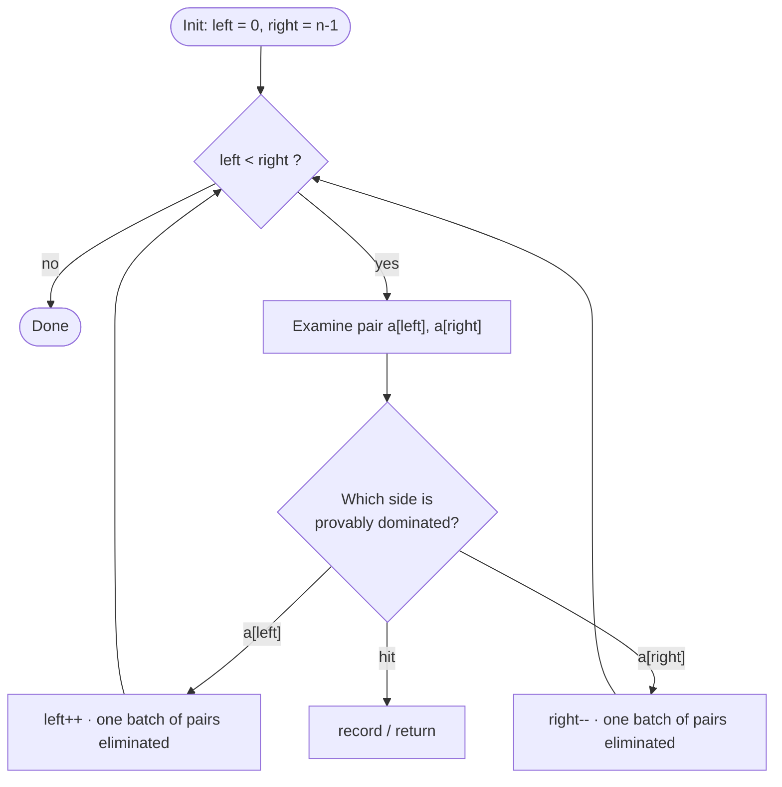

# Two Pointers


<PatternVideo pattern-name="Two Pointers" duration="8–12 min" />

<PatternProgress pattern-id="two-pointers" problems="container-with-most-water, 3sum-closest, 3sum-smaller, 4sum, valid-palindrome-ii, boats-to-save-people, merge-sorted-array, move-zeroes, sort-array-by-parity, squares-of-a-sorted-array, trapping-rain-water-ii, largest-rectangle-in-histogram, intersection-of-two-arrays-ii, wiggle-sort-ii, remove-duplicates-from-sorted-array" />

<script setup>
const bareTemplateCode = `// java — opposite-end sweep on a sorted array
int[] twoSumSorted(int[] a, int target) {
    int left = 0, right = a.length - 1;
    while (left &lt; right) {
        int sum = a[left] + a[right];
        if (sum == target) return new int[]{left, right};
        if (sum &lt; target) left++;            // a[left] too small to pair → discard it
        else              right--;           // a[right] too big → discard it
    }
    return new int[]{-1, -1};
}`

const bareInvariant = {
  statement: `At every iteration, if a valid pair exists in \`a\`, both indices lie within \`[left, right]\`.`,
  initialization: `Before the loop, \`left = 0\` and \`right = n - 1\`. Every index of \`a\` is in \`[0, n-1]\`, so if a valid pair exists its indices are in that range.`,
  maintenance: `Case A — \`sum &lt; target\`: \`a[left]\` is the smallest value in \`[left, right]\` (array is sorted). Even paired with the largest, \`a[right]\`, the sum falls short — so \`a[left]\` cannot be in any valid pair with another index in \`[left+1, right]\`. Discarding \`left\` (incrementing) preserves the invariant. Case B — \`sum &gt; target\`: symmetric; \`a[right]\` cannot be in any valid pair with an index in \`[left, right-1]\`. Case C — \`sum == target\`: valid pair found.`,
  termination: `\`right - left\` strictly decreases every iteration. The loop ends when \`left &gt;= right\`, meaning no range remains to search, so no pair exists.`
}

const bareComplexity = {
  time: `O(n) — each iteration advances exactly one pointer, and the gap \`right - left\` shrinks by 1 each step.`,
  space: `O(1) — two integer indices.`
}

const amortizedExplanation = `**Aggregate analysis.** Define the *potential* \`Φ = right - left\`. At start, \`Φ_0 = n - 1\`. Every iteration either increments \`left\` or decrements \`right\`, so \`Φ\` strictly decreases by 1 per iteration. The loop ends when \`Φ = 0\`. Thus **total iterations ≤ n − 1** — the sum of all per-iteration work is bounded by n, independent of the trace. This is the simplest form of amortization: a monotone-decreasing *bank account* bounds total work.

The same argument covers:
- **Dutch National Flag** — \`Φ = high - mid + 1\`, strictly decreasing except on the 1-branch (which still advances mid), so total swaps + branches ≤ n.
- **Trapping Rain Water (2-pointer variant)** — \`Φ = right - left\`, same argument. Each bar is \`inspected\` exactly once; no bar is re-visited.
- **Merge Sorted Array** / **Squaring Sorted Array** — \`Φ = (n - pos)\`, strictly decreasing; the fill-from-the-back pass visits each output slot once.

**Why name it in interviews:** when the interviewer asks "why is this O(n), not O(n²)?", the shortest honest answer is: "the pointer gap is a decreasing potential; each iteration spends 1 potential, so total iterations are bounded by the initial gap, which is n."`

const templateSpecializations = [
  { slug: `pair-sum-on-a-sorted-array-easy`, title: `Pair Sum (bare mechanic)` },
  { slug: `_3sum-medium`, title: `3Sum` },
  { slug: `container-with-most-water-medium`, title: `Container Most Water` },
  { slug: `squaring-a-sorted-array-easy`, title: `Squaring Sorted Array` },
  { slug: `remove-duplicates-in-place-easy`, title: `Remove Duplicates` },
  { slug: `sort-colors-dutch-national-flag-medium`, title: `Dutch Flag` },
  { slug: `trapping-rain-water-hard`, title: `Trapping Rain Water` }
]

const pairSumInvariant = bareInvariant

const removeDuplicatesCode = `// java — same-end (fast/slow write-vs-read) pointer pair
int removeDuplicates(int[] a) {
    if (a.length == 0) return 0;
    int write = 1;                            // slow: next slot to write a unique value
    for (int read = 1; read &lt; a.length; read++) {   // fast: scans input left to right
        if (a[read] != a[read - 1]) {         // found a new value
            a[write] = a[read];
            write++;
        }
        // else: duplicate — skip, write stays put, slot will be overwritten later
    }
    return write;                             // length of deduped prefix
}`

const removeDuplicatesInvariant = {
  statement: `At every iteration, \`a[0:write]\` is a sorted deduped prefix of the input seen so far (\`a[0:read]\`).`,
  initialization: `Before the loop, \`write = 1\` and \`read = 1\`. The one-element prefix \`a[0:1]\` is trivially a sorted deduped prefix.`,
  maintenance: `Case A — \`a[read] != a[read-1]\`: this is a new value in sorted order (input is sorted), so appending it extends the deduped prefix by one. Case B — \`a[read] == a[read-1]\`: duplicate; \`write\` stays put, the slot at index \`write\` will be overwritten by a later unique value or truncated.`,
  termination: `When \`read = n\`, every element has been examined. \`a[0:write]\` is the fully deduped sorted prefix. Return \`write\` as the new length.`
}

const threeSumCode = `List&lt;List&lt;Integer&gt;&gt; threeSum(int[] a) {
    Arrays.sort(a);
    List&lt;List&lt;Integer&gt;&gt; res = new ArrayList&lt;&gt;();
    for (int i = 0; i &lt; a.length - 2; i++) {
        if (i &gt; 0 && a[i] == a[i-1]) continue;           // skip dup pivot
        if (a[i] &gt; 0) break;                              // smallest already positive
        int lo = i + 1, hi = a.length - 1;
        while (lo &lt; hi) {
            int s = a[i] + a[lo] + a[hi];
            if (s == 0) {
                res.add(List.of(a[i], a[lo], a[hi]));
                while (lo &lt; hi && a[lo] == a[lo+1]) lo++;  // skip dup
                while (lo &lt; hi && a[hi] == a[hi-1]) hi--;
                lo++; hi--;
            } else if (s &lt; 0) lo++;
            else hi--;
        }
    }
    return res;
}`

const threeSumInvariant = {
  statement: `For each fixed pivot \`i\`, the range \`[lo, hi]\` brackets all pairs whose sum could still complete the triple to \`-a[i]\`; the result list contains all unique triplets found with pivots \`&lt;= i\`.`,
  initialization: `Before the inner loop, \`lo = i + 1\` and \`hi = n - 1\`. All later pairs with first index > i are in \`[lo, hi]\`. No triplets with pivot \`i\` have been found yet.`,
  maintenance: `By the sorted-array pair-sum invariant: if sum < target, discard \`lo\`; if sum > target, discard \`hi\`; if sum == target, record and skip duplicates on both sides. Outer-loop duplicate-pivot skip prevents re-emitting the same triplet with a different pivot that has the same value.`,
  termination: `When \`lo &gt;= hi\`, no further pairs can complete triple with pivot \`i\`. Outer loop ends when all pivots exhausted or \`a[i] &gt; 0\` early-exit fires.`
}

const containerCode = `int maxArea(int[] h) {
    int left = 0, right = h.length - 1, best = 0;
    while (left &lt; right) {
        best = Math.max(best, Math.min(h[left], h[right]) * (right - left));
        if (h[left] &lt; h[right]) left++; else right--;    // discard the shorter wall
    }
    return best;
}`

const containerInvariant = {
  statement: `The optimal pair \`(i*, j*)\` with \`i* &lt; j*\` either has both indices in \`[left, right]\`, OR has already been considered (its area is \`&lt;= best\`).`,
  initialization: `Before the loop, \`left = 0\`, \`right = n - 1\`. Every pair is in \`[left, right]\`; \`best = 0\` so nothing has been "already considered" yet.`,
  maintenance: `Suppose \`h[left] &lt; h[right]\`. The current area is \`h[left] * (right - left)\`. For any pair \`(left, k)\` with \`k &lt; right\`: width \`k - left &lt; right - left\` and height \`&lt;= h[left]\` (the limiting wall is still \`h[left]\`), so area \`&lt;= best\`. Those pairs are safely considered. Discarding \`left\` (incrementing) means every uncomputed pair has both indices in \`[left+1, right]\`, so the invariant holds. Symmetric when \`h[right] &lt;= h[left]\`.`,
  termination: `\`right - left\` strictly decreases. When \`left &gt;= right\`, all optimal pairs have been considered, and \`best\` is the answer.`
}

const squaringCode = `int[] sortedSquares(int[] a) {
    int n = a.length, left = 0, right = n - 1;
    int[] res = new int[n];
    for (int pos = n - 1; pos &gt;= 0; pos--) {       // fill largest-first, back to front
        int ls = a[left] * a[left], rs = a[right] * a[right];
        if (ls &gt; rs) { res[pos] = ls; left++; }
        else         { res[pos] = rs; right--; }
    }
    return res;
}`

const squaringInvariant = {
  statement: `\`a[left:right+1]\` holds every value whose square has not yet been placed; \`res[pos+1:]\` is a descending list of the largest squares seen so far.`,
  initialization: `Before the loop, \`left = 0\`, \`right = n - 1\`, \`pos = n - 1\`. All values unplaced; \`res\` empty.`,
  maintenance: `The largest square in a sorted array must come from one of its ends (post-squaring, the extremes dominate). Compare \`ls\` and \`rs\`, place the larger at \`res[pos]\`, and shrink the side used. The order of placements is strictly decreasing — so \`res[pos:]\` is sorted ascending.`,
  termination: `When \`pos &lt; 0\`, every slot is filled with the largest-first fill order, giving a sorted-ascending output.`
}

const dutchCode = `void sortColors(int[] a) {                       // values ∈ {0, 1, 2}
    int lo = 0, mid = 0, hi = a.length - 1;
    while (mid &lt;= hi) {
        if      (a[mid] == 0) swap(a, lo++, mid++);   // 0 → low region
        else if (a[mid] == 2) swap(a, mid, hi--);     // 2 → high region (don't advance mid)
        else                  mid++;                   // 1 → already in middle
    }
}
static void swap(int[] a, int i, int j) { int t = a[i]; a[i] = a[j]; a[j] = t; }`

const dutchInvariant = {
  statement: `At every iteration: \`a[0:lo]\` are all 0s; \`a[lo:mid]\` are all 1s; \`a[mid:hi+1]\` are unknown; \`a[hi+1:n]\` are all 2s.`,
  initialization: `Before the loop, \`lo = 0\`, \`mid = 0\`, \`hi = n - 1\`. All three "known" regions are empty; the "unknown" region is the whole array. Vacuously true.`,
  maintenance: `Case 0: swap \`a[lo]\` with \`a[mid]\` and increment both. The swapped-in value at \`lo\` was in \`[lo..mid]\` so it's 1 or 0 (never 2, by invariant), and now \`a[lo]\` is 0 — the \`a[0:lo+1]\` region grows. The swapped-out value (whatever was at \`a[lo]\`) is now at \`a[mid]\` — it was 1, so \`a[lo+1:mid+1]\` is all 1s. Case 2: swap \`a[mid]\` with \`a[hi]\` and decrement \`hi\`. \`a[hi+1:n]\` is now all 2s. Mid is NOT advanced because the value swapped IN is from the unknown region. Case 1: \`a[mid]\` is 1 — already in position; just advance mid.`,
  termination: `When \`mid &gt; hi\`, the unknown region is empty: \`a[0:lo]\` 0s, \`a[lo:mid]\` 1s, \`a[hi+1:n] = a[mid:n]\` 2s — sorted.`
}

const trapCode = `int trap(int[] h) {
    int left = 0, right = h.length - 1, lMax = 0, rMax = 0, water = 0;
    while (left &lt; right) {
        if (h[left] &lt; h[right]) {
            lMax = Math.max(lMax, h[left]);
            water += lMax - h[left];           // 0 if h[left] is the new max
            left++;
        } else {
            rMax = Math.max(rMax, h[right]);
            water += rMax - h[right];
            right--;
        }
    }
    return water;
}`

const trapInvariant = {
  statement: `At every iteration: (a) \`lMax = max(h[0..left])\`, (b) \`rMax = max(h[right..n-1])\`, (c) the water above every bar in \`[0, left) ∪ (right, n-1]\` has been added to \`water\`.`,
  initialization: `Before the loop, \`left = 0\`, \`right = n - 1\`, \`lMax = rMax = water = 0\`. Both sides are empty "already-processed" ranges; both running maxes are correct for empty prefixes.`,
  maintenance: `When \`h[left] &lt; h[right]\`: \`rMax &gt;= h[right] &gt; h[left]\`, so \`h[left]\` is bounded on the right by some wall \`&gt;= h[right] &gt; h[left]\`. Water above \`left\` equals \`lMax - h[left]\` (because the eventual \`min(lMax', rMax')\` of final processing will be at least \`lMax\`, since lMax only grows and the right wall exists). After update, bar \`left\` is accounted for; advance. Symmetric for the right side.`,
  termination: `When \`left &gt;= right\`, every bar has been processed exactly once. \`water\` is the total trapped water.`
}

const trapAcode = {
  statement: `Duplicate answers in k-Sum (3Sum / 4Sum).`,
  bug: `On \`[-1, -1, 2]\` fixing the first \`-1\` as pivot then the second \`-1\` as pivot emits \`[-1, -1, 2]\` twice. Also on \`[0, 0, 0, 0]\` without lo/hi dedup, \`[0,0,0]\` appears many times.`,
  fix: `Three independent dedup checks: (1) outer loop skips duplicate pivot via \`if (i &gt; 0 && a[i] == a[i-1]) continue;\`; (2) after a hit, \`while (lo &lt; hi && a[lo] == a[lo+1]) lo++;\`; (3) same for \`hi\`. Only then \`lo++; hi--;\`.`
}

const trapBcode = {
  statement: `Two pointers on an unsorted array.`,
  bug: `Applying \`left++\` / \`right--\` discard logic to \`[3, 1, 4, 1, 5, 9, 2, 6]\` for pair-sum with target 7: \`3 + 6 = 9 &gt; 7\` → discard \`6\`, but \`6\` would form a valid pair with \`1\` at index 1. Silently returns wrong answer.`,
  fix: `The template's correctness proof depends on sorted order. ALWAYS verify input is sorted (ask the interviewer) or sort explicitly: \`Arrays.sort(a)\` costs O(n log n) up front and preserves correctness. If sorting destroys needed information (e.g. you need original indices), pair \`(value, originalIndex)\` before sorting — or use a HashMap instead.`
}

const trapCcode = {
  statement: `Overflow on sum comparison.`,
  bug: `For \`a = [INT_MAX - 1, 2]\` and \`target = INT_MAX\`, computing \`a[0] + a[1]\` overflows to a negative number — the comparison \`sum &lt; target\` picks the wrong branch, so left advances when it should return a hit.`,
  fix: `Use \`long\` accumulation: \`long sum = (long) a[left] + a[right];\`. Alternatively, write the comparison as \`a[left] &lt; target - a[right]\` when both sides are known to fit in int. This is the same class as the \`low + high / 2 \` → \`low + (high - low) / 2\` fix in binary search.`
}

const quizQuestions = [
  {q: "What pre-condition is usually required before applying Two Pointers?", choices: [{text: "The array must be sorted (or have a monotone metric)", correct: true, explanation: "Movements rely on knowing which side is provably suboptimal."}, {text: "The array must be a permutation of 1..n", correct: false}, {text: "The array must contain only positive integers", correct: false}, {text: "The array size must be a power of 2", correct: false}]},
  {q: "In 3Sum, how do you enforce uniqueness of triplets?", choices: [{text: "Use a HashSet of sorted triplets", correct: false, explanation: "Works but wasteful."}, {text: "Skip duplicates at all three levels of pointer movement", correct: true, explanation: "Sort + skip at i, l, r ensures each triplet is emitted once."}, {text: "Emit only the first found triplet", correct: false}, {text: "Duplicates are impossible after sorting", correct: false}]},
  {q: "For Trapping Rain Water, why does the opposing two-pointer work with O(1) extra space?", choices: [{text: "The water at pointer p is bounded by the shorter of the two 'walls seen so far'", correct: true, explanation: "Moving the shorter side is safe because the other side's known max bounds it."}, {text: "Because heights are integers", correct: false}, {text: "Because there is always a global maximum", correct: false}, {text: "It doesn't — you need O(n) leftMax/rightMax arrays", correct: false, explanation: "Those work too, but 2p achieves O(1)."}]},
  {q: "What is the complexity of the sort + two-pointer solution for 3Sum?", choices: [{text: "O(n)", correct: false}, {text: "O(n log n)", correct: false}, {text: "O(n²)", correct: true, explanation: "Sort is O(n log n), then outer loop × inner two-pointer = O(n²), which dominates."}, {text: "O(n³)", correct: false, explanation: "That is the brute-force triple loop."}]},
  {q: "For Valid Palindrome II (delete ≤ 1 char), what is the two-pointer strategy on mismatch?", choices: [{text: "Skip the character with the higher ASCII value", correct: false}, {text: "Try skipping left OR skipping right; return true iff either remainder is a palindrome", correct: true, explanation: "Two choices at the mismatch; test each; each is O(n) but only tried once."}, {text: "Give up immediately", correct: false}, {text: "Recurse with k-1 deletion budget", correct: false, explanation: "That is the k-deletion generalization."}]}
]

const pairSumSolvePrompt = `Given a sorted array \`a\` and \`target\`, return the 0-indexed indices of two numbers that sum to \`target\`, or \`[-1, -1]\` if none. O(n) time, O(1) space.`
const threeSumSolvePrompt = `Find all unique triplets \`(a, b, c)\` in the array with \`a + b + c = 0\`.`
const containerSolvePrompt = `Pick two of \`n\` vertical lines that form a container holding the maximum amount of water with the x-axis.`
const squaringSolvePrompt = `Given a sorted array (possibly with negatives), return the squares in sorted order — in O(n).`
const removeDupSolvePrompt = `Given a sorted array, remove duplicates in place and return the new length. Values beyond the new length can be anything.`
const dutchSolvePrompt = `Sort an array containing only 0, 1, 2 in a single pass in place — no library sort.`
const trapSolvePrompt = `Compute how much rain water is trapped between the bars of an elevation map, in O(n) time and O(1) space.`
</script>

## Why two pointers exists — the story

You've been asked a version of Two Sum on a **sorted** array: return the pair of indices whose values add up to a target. It sounds trivial. Your first idea is the honest one — try every pair, keep the winners.

The obvious way: two nested loops. For every index `i`, walk every index `j > i` and check if `a[i] + a[j] == target`. Correct. Simple. Roughly `n·(n-1)/2` comparisons.

For a 1,000-element array that's about 500,000 comparisons — a millisecond. Nobody complains. And it's not a stupid approach: the O(n²) loop is what almost every textbook writes first, and for `n < 500` you'd need a stopwatch to notice a difference. If interviews stopped at `n = 1,000`, we could all go home.

But the interviewer says `n = 10⁶`. Now the naive scan is 5 × 10¹¹ comparisons — roughly **8 minutes** on a modern CPU. Your interviewer will not wait 8 minutes. And here's what stings: the array is **sorted**, and you're using none of that order. Every one of those 500 billion comparisons is throwing information away.

The pattern is the fix. Two pointers walk the array from opposite ends (or the same end, at different speeds). Every step, one of them moves — and each move eliminates *all* pairs involving the value you just left behind. You never revisit. You never backtrack. **One sweep. O(n).**

<Callout kind="key" title="Key Insight — the pointer gap is a decreasing potential.">

Every iteration advances one pointer; the gap \`right - left\` shrinks by 1. Total iterations ≤ n − 1. Say this out loud in interviews: "the pointer gap is a potential that strictly decreases per step, so total work is bounded by its initial value." Interviewers who care about analysis light up.

</Callout>

## The bare mechanic — simplest working example

Pair Sum on sorted `[1, 3, 5, 7, 9, 11]`, target `12`:

| step | left | right | a[l]+a[r] | action |
|---|---|---|---|---|
| 0 | 0 (val 1) | 5 (val 11) | 12 | hit → return [0, 5] |

Target `10` instead:

| step | left | right | a[l]+a[r] | action |
|---|---|---|---|---|
| 0 | 0 (val 1) | 5 (val 11) | 12 | too big → right-- |
| 1 | 0 (val 1) | 4 (val 9) | 10 | hit → return [0, 4] |

Target `25` (no pair exists — max is `9 + 11 = 20`):

| step | left | right | a[l]+a[r] | action |
|---|---|---|---|---|
| 0 | 0 (val 1) | 5 (val 11) | 12 | too small → left++ |
| 1 | 1 (val 3) | 5 (val 11) | 14 | too small → left++ |
| 2 | 2 (val 5) | 5 (val 11) | 16 | too small → left++ |
| 3 | 3 (val 7) | 5 (val 11) | 18 | too small → left++ |
| 4 | 4 (val 9) | 5 (val 11) | 20 | too small → left++ |
| 5 | 5 | 5 | — | left == right → return [-1, -1] |


<div class="svg-figure">
<svg preserveAspectRatio="xMidYMid meet" role="img" viewBox="0 0 400 160" xmlns="http://www.w3.org/2000/svg" font-family="var(--dsa-font)" aria-label="Bare mechanic two-pointer sweep">
  <rect x="0" y="0" width="400" height="160" rx="12" fill="var(--dsa-bg)"/>
  <text x="200" y="22" text-anchor="middle" font-size="12" font-weight="700" fill="var(--dsa-primary)">left++ or right--, never both; discard whole batches</text>
  <g text-anchor="middle" font-size="14" font-weight="700" fill="var(--dsa-ink)">
    <rect x="30" y="60" width="52" height="32" rx="6" fill="var(--dsa-success-soft)" stroke="var(--dsa-success)" stroke-width="2"/><text x="56" y="81">1</text>
    <rect x="88" y="60" width="52" height="32" rx="6" fill="var(--dsa-neutral-soft)" stroke="var(--dsa-neutral)"/><text x="114" y="81">3</text>
    <rect x="146" y="60" width="52" height="32" rx="6" fill="var(--dsa-neutral-soft)" stroke="var(--dsa-neutral)"/><text x="172" y="81">5</text>
    <rect x="204" y="60" width="52" height="32" rx="6" fill="var(--dsa-neutral-soft)" stroke="var(--dsa-neutral)"/><text x="230" y="81">7</text>
    <rect x="262" y="60" width="52" height="32" rx="6" fill="var(--dsa-success-soft)" stroke="var(--dsa-success)" stroke-width="2"/><text x="288" y="81">9</text>
    <rect x="320" y="60" width="52" height="32" rx="6" fill="var(--dsa-neutral-soft)" stroke="var(--dsa-neutral)"/><text x="346" y="81">11</text>
  </g>
  <text x="56" y="118" font-size="10" font-weight="700" text-anchor="middle" fill="var(--dsa-success)">left</text>
  <text x="288" y="118" font-size="10" font-weight="700" text-anchor="middle" fill="var(--dsa-success)">right</text>
  <text x="200" y="145" text-anchor="middle" font-size="11" font-style="italic" fill="var(--dsa-neutral)">target=10 → 1+9=10 ✓ (first hit after 1 discard of right)</text>
</svg>
</div>


<PatternTemplateCard
  slug="two-pointers-bare"
  language="java"
  :code="bareTemplateCode"
  :invariant="bareInvariant"
  :complexity="bareComplexity"
  problemShape="sorted array; find pair with sum property; discard one side per iteration"
  defaultRevealed />

<TwoPointersAnim />

## When to use it — recognition signals

Reach for two pointers when the problem has any of the following shapes:

- **A sorted array** (or something you can sort cheaply — usually `n log n` sort + `n` sweep still beats `n²`) and you're looking for a pair, triple, or quadruple with a sum / difference / product property.
- **A palindrome check** — compare `left` and `right`, move inward until they meet.
- **Partitioning in place** — move all zeros to the end, sort by parity, Dutch National Flag (three-way partition using three pointers).
- **Merging two sorted sequences** without allocating a new array (`merge-sorted-array`, "merge intervals" preparation).
- **Container / area / volume** problems where the answer depends on two boundary indices — Container With Most Water, Trapping Rain Water.
- **"Remove duplicates in place"** patterns — one pointer reads, the other writes.
- **"Squared / absolute value" transformations** on a sorted array — the extremes are the largest, so you fill the answer from the back.

If you catch yourself writing `for i in range(n): for j in range(i+1, n):` on a sorted or sortable input, stop. Two pointers is almost certainly the O(n) fix.

## History — Dijkstra's flag, 1976

The three-way partition variant of two pointers has a name: **Dutch National Flag**. Edsger Dijkstra published it in 1976 as a teaching example — three regions (red, white, blue, in Dutch flag order), swap items until the flag is sorted. It became the canonical pivot step of every modern quicksort implementation, including Java's `Arrays.sort` on primitive types. The two-index opposite-end pattern is older still, appearing informally in Knuth's *Sorting and Searching* (1973) as a merge subroutine.

Why does an obscure teaching example matter? Because when you tell an interviewer "I'll use two pointers, specifically the Dutch National Flag partition," you are not just naming a technique — you are quoting a lineage. It signals depth. Nobody with a year of experience knows the name; every staff engineer does.

## THE template

Two pointers has **four** canonical shapes. Each sub-variation below is a specialization of exactly one of them — name the shape in the first 30 seconds of the problem and you're already most of the way to the implementation.


<div class="svg-figure">
<svg preserveAspectRatio="xMidYMid meet" role="img" viewBox="0 0 720 160" xmlns="http://www.w3.org/2000/svg" font-family="var(--dsa-font)" aria-label="Four shapes: opposite-end, same-end, three-pointer partition, back-fill">
  <defs>
    <marker id="ar-sh-primary" markerWidth="9" markerHeight="9" refX="6" refY="3" orient="auto"><path d="M0,0 L6,3 L0,6 Z" fill="var(--dsa-primary)"/></marker>
    <marker id="ar-sh-success" markerWidth="9" markerHeight="9" refX="6" refY="3" orient="auto"><path d="M0,0 L6,3 L0,6 Z" fill="var(--dsa-success)"/></marker>
    <marker id="ar-sh-danger" markerWidth="9" markerHeight="9" refX="6" refY="3" orient="auto"><path d="M0,0 L6,3 L0,6 Z" fill="var(--dsa-danger)"/></marker>
  </defs>
  <rect x="0" y="0" width="720" height="160" rx="12" fill="var(--dsa-bg)"/>
  <!-- Shape 1: opposite-end -->
  <text x="90" y="22" text-anchor="middle" font-size="11" font-weight="700" fill="var(--dsa-primary)">1. Opposite-end</text>
  <g text-anchor="middle" font-size="11" fill="var(--dsa-ink)">
    <rect x="30"  y="42" width="24" height="26" rx="4" fill="var(--dsa-primary-soft)" stroke="var(--dsa-primary)"/>
    <rect x="54"  y="42" width="24" height="26" rx="4" fill="var(--dsa-neutral-soft)" stroke="var(--dsa-neutral)"/>
    <rect x="78"  y="42" width="24" height="26" rx="4" fill="var(--dsa-neutral-soft)" stroke="var(--dsa-neutral)"/>
    <rect x="102" y="42" width="24" height="26" rx="4" fill="var(--dsa-neutral-soft)" stroke="var(--dsa-neutral)"/>
    <rect x="126" y="42" width="24" height="26" rx="4" fill="var(--dsa-primary-soft)" stroke="var(--dsa-primary)"/>
  </g>
  <line x1="42" y1="92" x2="42" y2="72" stroke="var(--dsa-primary)" stroke-width="2" marker-end="url(#ar-sh-primary)"/>
  <text x="42" y="105" text-anchor="middle" font-size="10" font-weight="700" fill="var(--dsa-primary)">left</text>
  <line x1="138" y1="92" x2="138" y2="72" stroke="var(--dsa-primary)" stroke-width="2" marker-end="url(#ar-sh-primary)"/>
  <text x="138" y="105" text-anchor="middle" font-size="10" font-weight="700" fill="var(--dsa-primary)">right</text>
  <text x="90" y="130" text-anchor="middle" font-size="10" fill="var(--dsa-neutral)">converge inward</text>
  <text x="90" y="146" text-anchor="middle" font-size="10" fill="var(--dsa-neutral)">Pair-Sum · Container · Trap</text>
  <!-- Shape 2: same-end -->
  <text x="270" y="22" text-anchor="middle" font-size="11" font-weight="700" fill="var(--dsa-success)">2. Same-end two-speed</text>
  <g text-anchor="middle" font-size="11" fill="var(--dsa-ink)">
    <rect x="210" y="42" width="24" height="26" rx="4" fill="var(--dsa-success-soft)" stroke="var(--dsa-success)"/>
    <rect x="234" y="42" width="24" height="26" rx="4" fill="var(--dsa-success-soft)" stroke="var(--dsa-success)"/>
    <rect x="258" y="42" width="24" height="26" rx="4" fill="var(--dsa-neutral-soft)" stroke="var(--dsa-neutral)"/>
    <rect x="282" y="42" width="24" height="26" rx="4" fill="var(--dsa-primary-soft)" stroke="var(--dsa-primary)"/>
    <rect x="306" y="42" width="24" height="26" rx="4" fill="var(--dsa-neutral-soft)" stroke="var(--dsa-neutral)"/>
  </g>
  <line x1="270" y1="92" x2="270" y2="72" stroke="var(--dsa-success)" stroke-width="2" marker-end="url(#ar-sh-success)"/>
  <text x="270" y="105" text-anchor="middle" font-size="10" font-weight="700" fill="var(--dsa-success)">write</text>
  <line x1="294" y1="92" x2="294" y2="72" stroke="var(--dsa-primary)" stroke-width="2" marker-end="url(#ar-sh-primary)"/>
  <text x="294" y="105" text-anchor="middle" font-size="10" font-weight="700" fill="var(--dsa-primary)">read</text>
  <text x="270" y="130" text-anchor="middle" font-size="10" fill="var(--dsa-neutral)">slow places, fast scans</text>
  <text x="270" y="146" text-anchor="middle" font-size="10" fill="var(--dsa-neutral)">Dedup · Move Zeros · Parity</text>
  <!-- Shape 3: three-pointer -->
  <text x="450" y="22" text-anchor="middle" font-size="11" font-weight="700" fill="var(--dsa-danger)">3. Three-pointer partition</text>
  <g text-anchor="middle" font-size="11" fill="var(--dsa-ink)">
    <rect x="390" y="42" width="24" height="26" rx="4" fill="var(--dsa-success-soft)" stroke="var(--dsa-success)"/>
    <rect x="414" y="42" width="24" height="26" rx="4" fill="var(--dsa-primary-soft)" stroke="var(--dsa-primary)"/>
    <rect x="438" y="42" width="24" height="26" rx="4" fill="var(--dsa-neutral-soft)" stroke="var(--dsa-neutral)" stroke-dasharray="3 2"/>
    <rect x="462" y="42" width="24" height="26" rx="4" fill="var(--dsa-neutral-soft)" stroke="var(--dsa-neutral)" stroke-dasharray="3 2"/>
    <rect x="486" y="42" width="24" height="26" rx="4" fill="var(--dsa-danger-soft)" stroke="var(--dsa-danger)"/>
  </g>
  <line x1="414" y1="92" x2="414" y2="72" stroke="var(--dsa-success)" stroke-width="2" marker-end="url(#ar-sh-success)"/>
  <text x="414" y="105" text-anchor="middle" font-size="10" font-weight="700" fill="var(--dsa-success)">lo</text>
  <line x1="450" y1="92" x2="450" y2="72" stroke="var(--dsa-primary)" stroke-width="2" marker-end="url(#ar-sh-primary)"/>
  <text x="450" y="105" text-anchor="middle" font-size="10" font-weight="700" fill="var(--dsa-primary)">mid</text>
  <line x1="486" y1="92" x2="486" y2="72" stroke="var(--dsa-danger)" stroke-width="2" marker-end="url(#ar-sh-danger)"/>
  <text x="486" y="105" text-anchor="middle" font-size="10" font-weight="700" fill="var(--dsa-danger)">hi</text>
  <text x="450" y="130" text-anchor="middle" font-size="10" fill="var(--dsa-neutral)">three regions in one pass</text>
  <text x="450" y="146" text-anchor="middle" font-size="10" fill="var(--dsa-neutral)">Dutch Flag · 3-way quicksort</text>
  <!-- Shape 4: back-fill -->
  <text x="630" y="22" text-anchor="middle" font-size="11" font-weight="700" fill="var(--dsa-primary)">4. Back-fill from the end</text>
  <g text-anchor="middle" font-size="11" fill="var(--dsa-ink)">
    <rect x="570" y="42" width="24" height="26" rx="4" fill="var(--dsa-primary-soft)" stroke="var(--dsa-primary)"/>
    <rect x="594" y="42" width="24" height="26" rx="4" fill="var(--dsa-neutral-soft)" stroke="var(--dsa-neutral)"/>
    <rect x="618" y="42" width="24" height="26" rx="4" fill="var(--dsa-neutral-soft)" stroke="var(--dsa-neutral)"/>
    <rect x="642" y="42" width="24" height="26" rx="4" fill="var(--dsa-neutral-soft)" stroke="var(--dsa-neutral)"/>
    <rect x="666" y="42" width="24" height="26" rx="4" fill="var(--dsa-primary-soft)" stroke="var(--dsa-primary)"/>
  </g>
  <line x1="582" y1="92" x2="582" y2="72" stroke="var(--dsa-primary)" stroke-width="2" marker-end="url(#ar-sh-primary)"/>
  <text x="582" y="105" text-anchor="middle" font-size="10" font-weight="700" fill="var(--dsa-primary)">left</text>
  <line x1="678" y1="92" x2="678" y2="72" stroke="var(--dsa-primary)" stroke-width="2" marker-end="url(#ar-sh-primary)"/>
  <text x="678" y="105" text-anchor="middle" font-size="10" font-weight="700" fill="var(--dsa-primary)">right</text>
  <line x1="690" y1="60" x2="705" y2="60" stroke="var(--dsa-success)" stroke-width="2" marker-end="url(#ar-sh-success)"/>
  <text x="630" y="130" text-anchor="middle" font-size="10" fill="var(--dsa-neutral)">converge, write pos n-1 → 0</text>
  <text x="630" y="146" text-anchor="middle" font-size="10" fill="var(--dsa-neutral)">Squaring · Merge Sorted</text>
</svg>
</div>


**(1) Opposite-end sweep** — pointers start at both ends, converge inward. The pointer gap `right − left` is a decreasing potential, so total iterations ≤ n.


```java
int left = 0, right = a.length - 1;
while (left < right) {
    // examine the pair (a[left], a[right])
    if (/* a[left] is provably dominated */) left++;
    else                                     right--;
}
```


Specializations: **Pair Sum · Container With Most Water · Trapping Rain Water · Valid Palindrome · 3Sum** (uses this inside a fixed-pivot outer loop).

**(2) Same-end two-speed** — `write` moves slowly (next placement slot), `read` scans the input. The gap between them absorbs the discarded elements.


```java
int write = 0;
for (int read = 0; read < a.length; read++) {
    if (/* keep a[read] */) {
        a[write] = a[read];
        write++;
    }
}
return write;  // length of the valid prefix
```


Specializations: **Remove Duplicates · Remove Element · Move Zeros · Sort Array by Parity**.

**(3) Three-pointer partition** — three regions in a single pass; the Dutch National Flag.


```java
int lo = 0, mid = 0, hi = a.length - 1;
while (mid <= hi) {
    if      (/* value belongs in low region */)  swap(a, lo++, mid++);
    else if (/* value belongs in high region */) swap(a, mid, hi--);  // do NOT advance mid
    else                                         mid++;               // middle region
}
```


Specializations: **Sort Colors (Dutch Flag) · 3-way quicksort partition · Wiggle Sort II**.

**(4) Back-fill from the end** — converge inward but write the result descending so you never overwrite unread input.


```java
int left = 0, right = a.length - 1;
for (int pos = res.length - 1; pos >= 0; pos--) {
    if (/* a[right] dominates */) res[pos] = a[right--];
    else                           res[pos] = a[left++];
}
```


Specializations: **Squaring a Sorted Array · Merge Sorted Array (in-place) · Intersection of Two Arrays II**.

Shape (1) is the canonical skeleton. The chip row on the card below jumps straight to each specialization:

<PatternTemplateCard
  slug="two-pointers-canonical"
  title="Two-pointers canonical sweep (shape 1 of 4)"
  language="java"
  :code="bareTemplateCode"
  :invariant="bareInvariant"
  :complexity="bareComplexity"
  :specializations="templateSpecializations"
  problemShape="sorted/structured array → monotone sweep with 2 (or 3) pointers → each step eliminates whole batches">
  <template #amortized>

<AmortizedPanel method="aggregate" bound="O(n) total work; each element touched by O(1) pointer-moves">

{{ amortizedExplanation }}

</AmortizedPanel>

  </template>
</PatternTemplateCard>





<div class="readfig"><b>How to read it:</b> At each step you look at the pair under the two pointers. One side is <i>provably dominated</i> by the problem's monotonicity (sorted order, shorter wall, running max), so you discard it by advancing that pointer. Each discard eliminates <i>a whole batch</i> of pairs, not just one — this is why the sweep is O(n), not O(n²).</div>

## Sub-variations of the template

<PatternSubVariationNav pattern="two-pointers" />

### Pair Sum on a Sorted Array <span class="diff diff-e">Easy</span>

The **bare mechanic** written as its own problem: `Two Sum II - Input Array Is Sorted` (LC 167).

<InvariantProof
  :statement="pairSumInvariant.statement"
  :initialization="pairSumInvariant.initialization"
  :maintenance="pairSumInvariant.maintenance"
  :termination="pairSumInvariant.termination" />

<Callout kind="key" title="Blind-solve first:">

{{ pairSumSolvePrompt }}

</Callout>

<TemplateReveal
  slug="pair-sum-sorted"
  language="java"
  :canonical="bareTemplateCode"
  problemShape="sorted array + target → opposite-end sweep" />

**Trace** on `[2, 7, 11, 15]`, target `9`:
- left=0 (val 2), right=3 (val 15). sum=17 &gt; 9 → right--.
- left=0, right=2 (val 11). sum=13 &gt; 9 → right--.
- left=0, right=1 (val 7). sum=9 ✓. Return [0, 1].

**Related sibling: Valid Palindrome.** Same opposite-end sweep, different comparison: `a[left] == a[right]` (character equality), early-exit false on mismatch, loop until `left >= right`. One O(n) pass. **Valid Palindrome II** (allow ≤ 1 deletion): on first mismatch, try skipping left OR skipping right and recurse (each at most O(n)) — total still O(n).

<details class="learnings">
<summary><strong>Learnings — points to remember</strong></summary>

- **Sorted-input + target → opposite-end two-pointer** is THE canonical shape; one pass, O(n) time, O(1) space, no hash map needed.
- **Direction rule: `sum < target` → `left++`, `sum > target` → `right--`.** Each move strictly discards one candidate — this is why the sweep is O(n), not O(n²).
- **Returns INDICES, not values** on LeetCode Two Sum II because the problem specifies 1-based output; be careful about the off-by-one if you have been testing with 0-based indices locally.
- **Does NOT generalize to unsorted** without O(n log n) sort first — if the problem forbids sorting (original-index requirement), reach for a hash map instead (LC-1 Two Sum).
- **Siblings use the same two-pointer skeleton with a different comparator:** Valid Palindrome (equality + skip non-alphanumeric), Reverse String (swap at ends), Valid Palindrome II (one-deletion fork at first mismatch).
- **Early termination is free:** if `a[left] + a[right]` crosses target and both pointers have moved all they can, return — don't finish the loop needlessly.

</details>

---

### 3Sum <span class="diff diff-m">Medium</span>

*[↗ LeetCode: 3Sum](https://leetcode.com/problems/3sum/)*

<ProgressCheck id="3sum" />

<Callout kind="key" title="The twist:">

fix one pivot, then **two-pointer the remaining pair** against target `-a[i]`. Three independent dedup checks (pivot, lo-side, hi-side) are required to emit each triplet exactly once. Generalizes to k-Sum by nesting: 4Sum is `O(n³)`, 5Sum is `O(n⁴)`, etc.

</Callout>

<InvariantProof
  :statement="threeSumInvariant.statement"
  :initialization="threeSumInvariant.initialization"
  :maintenance="threeSumInvariant.maintenance"
  :termination="threeSumInvariant.termination" />


<div class="svg-figure">
<svg preserveAspectRatio="xMidYMid meet" role="img" viewBox="0 0 400 220" xmlns="http://www.w3.org/2000/svg" font-family="var(--dsa-font)" aria-label="3Sum pivot + two-pointer">
  <defs>
    <marker id="ar-3sum-primary" markerWidth="9" markerHeight="9" refX="6" refY="3" orient="auto"><path d="M0,0 L6,3 L0,6 Z" fill="var(--dsa-primary)"/></marker>
    <marker id="ar-3sum-success" markerWidth="9" markerHeight="9" refX="6" refY="3" orient="auto"><path d="M0,0 L6,3 L0,6 Z" fill="var(--dsa-success)"/></marker>
    <marker id="ar-3sum-danger" markerWidth="9" markerHeight="9" refX="6" refY="3" orient="auto"><path d="M0,0 L6,3 L0,6 Z" fill="var(--dsa-danger)"/></marker>
  </defs>
  <rect x="0" y="0" width="400" height="220" rx="12" fill="var(--dsa-bg)"/>
  <text x="200" y="28" text-anchor="middle" font-size="13" font-weight="700" fill="var(--dsa-primary)">Sort, fix one value, two-pointer the rest</text>
  <g text-anchor="middle">
    <rect x="44" y="82" width="44" height="44" rx="7" fill="var(--dsa-neutral-soft)" stroke="var(--dsa-neutral-line)"/>
    <rect x="96" y="82" width="44" height="44" rx="7" fill="var(--dsa-primary-soft)" stroke="var(--dsa-primary)"/>
    <rect x="148" y="82" width="44" height="44" rx="7" fill="var(--dsa-success-soft)" stroke="var(--dsa-success)"/>
    <rect x="200" y="82" width="44" height="44" rx="7" fill="var(--dsa-neutral-soft)" stroke="var(--dsa-neutral-line)"/>
    <rect x="252" y="82" width="44" height="44" rx="7" fill="var(--dsa-neutral-soft)" stroke="var(--dsa-neutral-line)"/>
    <rect x="304" y="82" width="44" height="44" rx="7" fill="var(--dsa-danger-soft)" stroke="var(--dsa-danger)"/>
    <g font-size="17" font-weight="700" fill="var(--dsa-ink)">
      <text x="66" y="110">-4</text><text x="118" y="110">-1</text><text x="170" y="110">-1</text>
      <text x="222" y="110">0</text><text x="274" y="110">1</text><text x="326" y="110">2</text>
    </g>
  </g>
  <line x1="118" y1="54" x2="118" y2="79" stroke="var(--dsa-primary)" stroke-width="2" marker-end="url(#ar-3sum-primary)"/>
  <text x="118" y="48" text-anchor="middle" font-size="12" font-weight="700" fill="var(--dsa-primary)">i fixed</text>
  <line x1="170" y1="174" x2="170" y2="130" stroke="var(--dsa-success)" stroke-width="2" marker-end="url(#ar-3sum-success)"/>
  <text x="170" y="193" text-anchor="middle" font-size="12" font-weight="700" fill="var(--dsa-success)">left</text>
  <line x1="326" y1="174" x2="326" y2="130" stroke="var(--dsa-danger)" stroke-width="2" marker-end="url(#ar-3sum-danger)"/>
  <text x="326" y="193" text-anchor="middle" font-size="12" font-weight="700" fill="var(--dsa-danger)">right</text>
  <rect x="62" y="196" width="276" height="18" rx="7" fill="var(--dsa-success-soft)" stroke="var(--dsa-success)"/>
  <text x="200" y="210" text-anchor="middle" font-size="11" font-weight="700" fill="var(--dsa-success)">sum = -1 + -1 + 2 = 0 → hit!</text>
</svg>
</div>


<Callout kind="key" title="Blind-solve first:">

{{ threeSumSolvePrompt }}

</Callout>

<TemplateReveal
  slug="three-sum"
  language="java"
  :canonical="threeSumCode"
  problemShape="sort → fix pivot → two-pointer remaining pair → skip dupes on all 3 levels" />

<CodeTrace
  title="3Sum — sorted=[-4,-1,-1,0,1,2], target=0"
  :values="[-4,-1,-1,0,1,2]"
  :windowKeys="['lo','hi']"
  :cellWidth="38"
  :steps='[
    { pointers: { i: 0, lo: 1, hi: 5 }, vars: { need: 4 }, note: "fix -4. no valid pair sums to 4 within these" },
    { pointers: { i: 1, lo: 2, hi: 5 }, vars: { need: 1, sum: 1 }, note: "-1+2=1 ✓ → [-1,-1,2]", added: [1,2,5] },
    { pointers: { i: 1, lo: 3, hi: 4 }, vars: { need: 1, sum: 1 }, note: "0+1=1 ✓ → [-1,0,1]", added: [1,3,4] },
    { pointers: { i: 2, lo: 3, hi: 5 }, vars: { need: 1 }, note: "skip i=2 (dup -1). no new triplets" }
  ]'
/>

**Complexity:** O(n²) time, O(1) extra space excluding output/sort. Sorting is O(n log n), inner two-pointer sweep is O(n), outer loop O(n).

**Related siblings:** [3Sum Closest](https://leetcode.com/problems/3sum-closest/) tracks the sum closest to target; [3Sum Smaller](https://leetcode.com/problems/3sum-smaller/) counts triplets with sum `< target` (when `a[lo]+a[hi] < target`, all `hi - lo` pairs qualify at once — batch counting); [4Sum](https://leetcode.com/problems/4sum/) adds one more outer loop → O(n³).

<details class="learnings">
<summary><strong>Learnings — points to remember</strong></summary>

- **Sort → fix outer → two-pointer inner** is the reduction. Fixing `a[i]`, you need `a[lo] + a[hi] = -a[i]`, which is Two Sum on `a[i+1..n-1]`. Outer O(n) × inner O(n) = O(n²).
- **Dedup at THREE places**, not one. Skip `i` if `a[i] == a[i-1]`; after a hit, skip `lo` while `a[lo] == a[lo-1]` and `hi` while `a[hi] == a[hi+1]`. Missing any of the three admits duplicate triplets.
- **Sort cost is dominated** — O(n log n) sort &lt; O(n²) sweep; the sort buys you dedup + two-pointer directionality in one move.
- **Early exit after `a[i] > 0`** — once the fixed value is positive, any lo + hi it reads will be larger too (sorted), so no triplet can sum to zero. Shaves most of the back half on scattered-positive inputs.
- **`3Sum Smaller` has a batch-counting trick** — when `a[lo] + a[hi] < target`, ALL pairs `(lo, lo+1), (lo, lo+2), ..., (lo, hi)` qualify → add `hi - lo` to the counter in one step. Converts a seemingly O(n²) counter into one O(n) sweep per fixed `i`.
- **4Sum generalizes to kSum:** recursive outer loops reduce the k-SUM problem to 2SUM at the base case; `k`-SUM is O(n^(k-1)).

</details>

---

### Container With Most Water <span class="diff diff-m">Medium</span>

*[↗ LeetCode: Container With Most Water](https://leetcode.com/problems/container-with-most-water/)*

<ProgressCheck id="container-with-most-water" />

<Callout kind="key" title="The twist:">

instead of discarding the pointer that overshoots a target, discard the **shorter wall** — the one that caps the current area. The exchange argument is subtle: moving the taller wall inward can never improve area (width shrinks, cap is still the shorter wall).

</Callout>

<InvariantProof
  :statement="containerInvariant.statement"
  :initialization="containerInvariant.initialization"
  :maintenance="containerInvariant.maintenance"
  :termination="containerInvariant.termination" />


<div class="svg-figure">
<svg preserveAspectRatio="xMidYMid meet" role="img" viewBox="0 0 400 230" xmlns="http://www.w3.org/2000/svg" font-family="var(--dsa-font)" aria-label="Container With Most Water">
  <defs>
    <marker id="ar-cwm-primary" markerWidth="9" markerHeight="9" refX="6" refY="3" orient="auto"><path d="M0,0 L6,3 L0,6 Z" fill="var(--dsa-primary)"/></marker>
  </defs>
  <rect x="0" y="0" width="400" height="230" rx="12" fill="var(--dsa-bg)"/>
  <text x="200" y="26" text-anchor="middle" font-size="13" font-weight="700" fill="var(--dsa-primary)">Start widest; move the shorter wall</text>
  <rect x="46" y="151" width="304" height="11" rx="4" fill="var(--dsa-primary-soft)" opacity="0.85"/>
  <line x1="46" y1="162" x2="350" y2="162" stroke="var(--dsa-neutral-line)" stroke-width="1.6"/>
  <g text-anchor="middle">
    <rect x="35" y="151" width="22" height="11" rx="4" fill="var(--dsa-primary-soft)" stroke="var(--dsa-primary)"/>
    <rect x="73" y="74" width="22" height="88" rx="4" fill="var(--dsa-neutral-soft)" stroke="var(--dsa-neutral)"/>
    <rect x="111" y="96" width="22" height="66" rx="4" fill="var(--dsa-neutral-soft)" stroke="var(--dsa-neutral)"/>
    <rect x="149" y="140" width="22" height="22" rx="4" fill="var(--dsa-neutral-soft)" stroke="var(--dsa-neutral)"/>
    <rect x="187" y="107" width="22" height="55" rx="4" fill="var(--dsa-neutral-soft)" stroke="var(--dsa-neutral)"/>
    <rect x="225" y="118" width="22" height="44" rx="4" fill="var(--dsa-neutral-soft)" stroke="var(--dsa-neutral)"/>
    <rect x="263" y="74" width="22" height="88" rx="4" fill="var(--dsa-neutral-soft)" stroke="var(--dsa-neutral)"/>
    <rect x="301" y="129" width="22" height="33" rx="4" fill="var(--dsa-neutral-soft)" stroke="var(--dsa-neutral)"/>
    <rect x="339" y="85" width="22" height="77" rx="4" fill="var(--dsa-primary-soft)" stroke="var(--dsa-primary)"/>
    <g font-size="11" font-weight="700" fill="var(--dsa-ink)">
      <text x="46" y="181">1</text><text x="84" y="181">8</text><text x="122" y="181">6</text><text x="160" y="181">2</text><text x="198" y="181">5</text>
      <text x="236" y="181">4</text><text x="274" y="181">8</text><text x="312" y="181">3</text><text x="350" y="181">7</text>
    </g>
  </g>
  <line x1="46" y1="212" x2="46" y2="166" stroke="var(--dsa-primary)" stroke-width="2" marker-end="url(#ar-cwm-primary)"/>
  <text x="46" y="222" text-anchor="middle" font-size="11" font-weight="700" fill="var(--dsa-primary)">left</text>
  <line x1="350" y1="212" x2="350" y2="166" stroke="var(--dsa-primary)" stroke-width="2" marker-end="url(#ar-cwm-primary)"/>
  <text x="350" y="222" text-anchor="middle" font-size="11" font-weight="700" fill="var(--dsa-primary)">right</text>
</svg>
</div>


<Callout kind="key" title="Blind-solve first:">

{{ containerSolvePrompt }}

</Callout>

<TemplateReveal
  slug="container-most-water"
  language="java"
  :canonical="containerCode"
  problemShape="opposite-end sweep; discard the shorter wall each step" />

<CodeTrace
  title="Container With Most Water — heights=[1,8,6,2,5,4,8,3,7]"
  :values="[1,8,6,2,5,4,8,3,7]"
  :windowKeys="['left', 'right']"
  :cellWidth="34"
  :steps='[
    { pointers: { left: 0, right: 8 }, vars: { area: 8, best: 8 }, note: "min(1,7)*8=8. left shorter → left++" },
    { pointers: { left: 1, right: 8 }, vars: { area: 49, best: 49 }, note: "min(8,7)*7=49. best updates. right shorter → right--" },
    { pointers: { left: 1, right: 7 }, vars: { area: 18, best: 49 }, note: "min(8,3)*6=18. right shorter → right--" },
    { pointers: { left: 1, right: 6 }, vars: { area: 40, best: 49 }, note: "min(8,8)*5=40. tie → shrink either" },
    { pointers: { left: 1, right: 5 }, vars: { area: 16, best: 49 }, note: "min(8,4)*4=16. right shorter → right--" }
  ]'
/>

**Why moving the taller wall never helps:** suppose `h[left] < h[right]`. For any `k > left`, the pair `(left, k)` has width `k - left < right - left` AND height `min(h[left], h[k]) <= h[left]`. Area `<= h[left] * (right - left) = currentArea`. So all pairs with `left` fixed are now accounted for; safe to advance `left`.

<details class="learnings">
<summary><strong>Learnings — points to remember</strong></summary>

- **Discard the SHORTER wall, not the overshoot direction.** This is the key departure from the Pair-Sum template — the area is capped by the shorter wall, so moving the taller one only loses width without gaining height.
- **Start widest and shrink.** Width = `right - left` is maximal at the start; every move strictly decreases width, so each step MUST compensate with more height to improve area.
- **The exchange argument is subtle:** moving the taller wall inward is PROVABLY DOMINATED (width shrinks, cap stays the same) — so skipping those pairs costs nothing. This proof is the whole correctness story.
- **O(n) time, O(1) space** — one pass, two pointers, running `best`. The brute-force O(n²) all-pairs is a reasonable interview warm-up but never the final answer.
- **Different from Trapping Rain Water** — Container asks for the LARGEST single container; Trapping Rain Water asks for the TOTAL water across all troughs. Same opposite-end sweep template, different accumulation and advancement rules.
- **Tie-break (`h[left] == h[right]`) can advance EITHER pointer** — correctness holds; shift either. Code aesthetics usually pick `left++` for consistency.

</details>

---

### Squaring a Sorted Array <span class="diff diff-e">Easy</span>

*[↗ LeetCode: Squares of a Sorted Array](https://leetcode.com/problems/squares-of-a-sorted-array/)*

<Callout kind="key" title="The twist:">

after squaring, the array is no longer sorted — but the largest square still lives at one of the ends. Fill the output *back to front* with two pointers converging.

</Callout>

<InvariantProof
  :statement="squaringInvariant.statement"
  :initialization="squaringInvariant.initialization"
  :maintenance="squaringInvariant.maintenance"
  :termination="squaringInvariant.termination" />

<Callout kind="key" title="Blind-solve first:">

{{ squaringSolvePrompt }}

</Callout>

<TemplateReveal
  slug="squaring-sorted"
  language="java"
  :canonical="squaringCode"
  problemShape="opposite-end sweep → fill output from back to front with the larger square" />


<div class="svg-figure">
<svg preserveAspectRatio="xMidYMid meet" role="img" viewBox="0 0 420 240" xmlns="http://www.w3.org/2000/svg" font-family="var(--dsa-font)" aria-label="Squaring Sorted Array — largest |value| at an end; fill res back to front">
  <defs>
    <marker id="ar-sq-success" markerWidth="9" markerHeight="9" refX="6" refY="3" orient="auto"><path d="M0,0 L6,3 L0,6 Z" fill="var(--dsa-success)"/></marker>
    <marker id="ar-sq-primary" markerWidth="9" markerHeight="9" refX="6" refY="3" orient="auto"><path d="M0,0 L6,3 L0,6 Z" fill="var(--dsa-primary)"/></marker>
  </defs>
  <rect x="0" y="0" width="420" height="240" rx="12" fill="var(--dsa-bg)"/>
  <text x="210" y="22" text-anchor="middle" font-size="12" font-weight="700" fill="var(--dsa-primary)">Largest |value| sits at an END → fill res[pos] back-to-front</text>
  <!-- Input row -->
  <text x="40" y="78" font-size="11" font-weight="700" fill="var(--dsa-neutral)">input</text>
  <g text-anchor="middle">
    <rect x="80"  y="55" width="55" height="38" rx="7" fill="var(--dsa-primary-soft)" stroke="var(--dsa-primary)" stroke-width="2"/>
    <rect x="135" y="55" width="55" height="38" rx="7" fill="var(--dsa-neutral-soft)" stroke="var(--dsa-neutral)"/>
    <rect x="190" y="55" width="55" height="38" rx="7" fill="var(--dsa-neutral-soft)" stroke="var(--dsa-neutral)"/>
    <rect x="245" y="55" width="55" height="38" rx="7" fill="var(--dsa-neutral-soft)" stroke="var(--dsa-neutral)"/>
    <rect x="300" y="55" width="55" height="38" rx="7" fill="var(--dsa-success-soft)" stroke="var(--dsa-success)" stroke-width="2"/>
    <g font-size="15" font-weight="700" fill="var(--dsa-ink)">
      <text x="107" y="80">-4</text>
      <text x="162" y="80">-1</text>
      <text x="217" y="80">0</text>
      <text x="272" y="80">3</text>
      <text x="327" y="80">10</text>
    </g>
  </g>
  <!-- Pointer labels on input -->
  <text x="107" y="107" text-anchor="middle" font-size="10" font-weight="700" fill="var(--dsa-primary)">left</text>
  <text x="107" y="120" text-anchor="middle" font-size="10" fill="var(--dsa-primary)">|−4|²=16</text>
  <text x="327" y="107" text-anchor="middle" font-size="10" font-weight="700" fill="var(--dsa-success)">right</text>
  <text x="327" y="120" text-anchor="middle" font-size="10" fill="var(--dsa-success)">|10|²=100</text>
  <!-- Arrow from right down to res[4] -->
  <line x1="327" y1="138" x2="327" y2="172" stroke="var(--dsa-success)" stroke-width="2" marker-end="url(#ar-sq-success)"/>
  <text x="213" y="150" text-anchor="middle" font-size="11" font-style="italic" fill="var(--dsa-neutral)">100 &gt; 16 → place 100 at pos=4, right--</text>
  <!-- Output row -->
  <text x="40" y="200" font-size="11" font-weight="700" fill="var(--dsa-neutral)">res</text>
  <g text-anchor="middle">
    <rect x="80"  y="178" width="55" height="38" rx="7" fill="var(--dsa-bg)" stroke="var(--dsa-neutral)" stroke-dasharray="3 3"/>
    <rect x="135" y="178" width="55" height="38" rx="7" fill="var(--dsa-bg)" stroke="var(--dsa-neutral)" stroke-dasharray="3 3"/>
    <rect x="190" y="178" width="55" height="38" rx="7" fill="var(--dsa-bg)" stroke="var(--dsa-neutral)" stroke-dasharray="3 3"/>
    <rect x="245" y="178" width="55" height="38" rx="7" fill="var(--dsa-bg)" stroke="var(--dsa-neutral)" stroke-dasharray="3 3"/>
    <rect x="300" y="178" width="55" height="38" rx="7" fill="var(--dsa-success-soft)" stroke="var(--dsa-success)" stroke-width="2"/>
    <g font-size="15" font-weight="700" fill="var(--dsa-ink)">
      <text x="327" y="202">100</text>
    </g>
    <g font-size="11" fill="var(--dsa-neutral)" text-anchor="middle">
      <text x="107" y="230">pos=0</text>
      <text x="162" y="230">pos=1</text>
      <text x="217" y="230">pos=2</text>
      <text x="272" y="230">pos=3</text>
      <text x="327" y="230">pos=4 ←</text>
    </g>
  </g>
</svg>
</div>


<CodeTrace
  title="Squares of Sorted Array — nums=[-4,-1,0,3,10]"
  :values="[-4,-1,0,3,10]"
  :windowKeys="['left','right']"
  :cellWidth="42"
  :steps='[
    { pointers: { left: 0, right: 4, pos: 4 }, vars: { pick: "10^2=100", output: "[_,_,_,_,100]" }, note: "|10| beats |-4|, place 100 at pos=4", added: [4] },
    { pointers: { left: 0, right: 3, pos: 3 }, vars: { pick: "-4^2=16", output: "[_,_,_,16,100]" }, note: "|-4| beats |3|, place 16", added: [0] },
    { pointers: { left: 1, right: 3, pos: 2 }, vars: { pick: "3^2=9", output: "[_,_,9,16,100]" }, note: "|3| beats |-1|, place 9", added: [3] },
    { pointers: { left: 1, right: 2, pos: 1 }, vars: { pick: "-1^2=1", output: "[_,1,9,16,100]" }, note: "|-1| beats |0|, place 1", added: [1] },
    { pointers: { left: 2, right: 2, pos: 0 }, vars: { pick: "0^2=0", output: "[0,1,9,16,100]" }, note: "final: place 0" }
  ]'
/>

**Related siblings:** [Merge Sorted Array (in place, from the back)](https://leetcode.com/problems/merge-sorted-array/) — same back-fill pattern; by filling from the largest end you never overwrite unmerged values. [Intersection of Two Arrays II](https://leetcode.com/problems/intersection-of-two-arrays-ii/) — sort both, advance the smaller side.

<details class="learnings">
<summary><strong>Learnings — points to remember</strong></summary>

- **The largest square sits at ONE of the ends** after squaring a sorted-by-value array — because the sort was by original value, extremes in `|value|` end up at the extremes of the array (left for large-negative, right for large-positive).
- **Fill the output BACK TO FRONT** with a converging two-pointer sweep — this avoids an O(n log n) sort post-square and keeps the pass linear.
- **O(n) time, O(n) space** (new output array). An in-place version is possible but requires moving values around — the back-fill into a fresh array is cleaner for interviews.
- **Compare `|a[lo]|` vs `|a[hi]|`** NOT the raw values — the point of the pattern is squaring, so magnitudes matter.
- **Sibling: Merge Sorted Array (in-place from back).** Same back-fill rule, same reason — writing from the LARGEST end never overwrites unmerged values that still live on the LEFT.
- **Sibling: Intersection of Two Arrays II** — sort both, advance the smaller side on inequality, record on equality. Different sweep rule but same two-pointer family.

</details>

---

### Remove Duplicates In-place <span class="diff diff-e">Easy</span>

*[↗ LeetCode: Remove Duplicates from Sorted Array](https://leetcode.com/problems/remove-duplicates-from-sorted-array/)*

<Callout kind="key" title="The twist:">

both pointers move **same-end, same direction** at different speeds. `write` is slow (next slot to place a unique value); `read` is fast (scanning input). The gap between them absorbs duplicates.

</Callout>

<InvariantProof
  :statement="removeDuplicatesInvariant.statement"
  :initialization="removeDuplicatesInvariant.initialization"
  :maintenance="removeDuplicatesInvariant.maintenance"
  :termination="removeDuplicatesInvariant.termination" />


<div class="svg-figure">
<svg preserveAspectRatio="xMidYMid meet" role="img" viewBox="0 0 400 180" xmlns="http://www.w3.org/2000/svg" font-family="var(--dsa-font)" aria-label="Remove Duplicates — slow write, fast read">
  <rect x="0" y="0" width="400" height="180" rx="12" fill="var(--dsa-bg)"/>
  <text x="200" y="22" text-anchor="middle" font-size="12" font-weight="700" fill="var(--dsa-primary)">After the sweep (input was [1,1,2,3,3]) — slow write, fast read</text>
  <g text-anchor="middle" font-size="13" font-weight="700" fill="var(--dsa-ink)">
    <rect x="60" y="56" width="50" height="30" rx="6" fill="var(--dsa-success-soft)" stroke="var(--dsa-success)"/><text x="85" y="76">1</text>
    <rect x="115" y="56" width="50" height="30" rx="6" fill="var(--dsa-success-soft)" stroke="var(--dsa-success)"/><text x="140" y="76">2</text>
    <rect x="170" y="56" width="50" height="30" rx="6" fill="var(--dsa-success-soft)" stroke="var(--dsa-success)"/><text x="195" y="76">3</text>
    <rect x="225" y="56" width="50" height="30" rx="6" fill="var(--dsa-neutral-soft)" stroke="var(--dsa-neutral)" stroke-dasharray="4 3"/><text x="250" y="76">3</text>
    <rect x="280" y="56" width="50" height="30" rx="6" fill="var(--dsa-neutral-soft)" stroke="var(--dsa-neutral)" stroke-dasharray="4 3"/><text x="305" y="76">3</text>
  </g>
  <text x="140" y="48" font-size="10" text-anchor="middle" font-weight="700" fill="var(--dsa-success)">valid prefix a[0..write-1]</text>
  <text x="280" y="48" font-size="10" text-anchor="middle" font-weight="700" fill="var(--dsa-neutral)">garbage (ignored by caller)</text>
  <text x="225" y="110" font-size="10" text-anchor="middle" fill="var(--dsa-success)">↑ write = 3 (next-slot semantics)</text>
  <text x="330" y="110" font-size="10" text-anchor="middle" fill="var(--dsa-neutral)">↑ read reached end</text>
  <text x="200" y="140" text-anchor="middle" font-size="11" font-style="italic" fill="var(--dsa-neutral)">return write=3; the caller only sees a[0:3] = [1,2,3]</text>
  <text x="200" y="160" text-anchor="middle" font-size="10" fill="var(--dsa-neutral)">(cells 3,4 retain the duplicates in place — unreachable by the API)</text>
</svg>
</div>


<Callout kind="key" title="Blind-solve first:">

{{ removeDupSolvePrompt }}

</Callout>

<TemplateReveal
  slug="remove-duplicates"
  language="java"
  :canonical="removeDuplicatesCode"
  problemShape="same-end slow write + fast read; gap absorbs duplicates" />

**Trace** on `[1, 1, 2, 3, 3]`:
- read=1, a[1]=1 == a[0]=1 → skip. write stays 1.
- read=2, a[2]=2 != a[1]=1 → `a[1] = 2`. write=2. Array: `[1, 2, 2, 3, 3]`.
- read=3, a[3]=3 != a[2]=2 → `a[2] = 3`. write=3. Array: `[1, 2, 3, 3, 3]`.
- read=4, a[4]=3 == a[3]=3 → skip. write stays 3.
- Return 3. First 3 elements of array are `[1, 2, 3]`.

**Related siblings:** [Remove Element](https://leetcode.com/problems/remove-element/) (remove a specific target value, no sort required); [Move Zeroes](https://leetcode.com/problems/move-zeroes/) (two-category partition, non-zeros to front); [Sort Array By Parity](https://leetcode.com/problems/sort-array-by-parity/) (evens-first); [Remove Duplicates II](https://leetcode.com/problems/remove-duplicates-from-sorted-array-ii/) (allow up to 2 of each).

<details class="learnings">
<summary><strong>Learnings — points to remember</strong></summary>

- **Same-end, different-speed is a different two-pointer family** from opposite-end. `write` is slow (next slot to place a unique value); `read` is fast (scanning input); the gap between them absorbs the discarded elements.
- **The invariant: `a[0..write-1]` is the valid prefix, `a[write..read-1]` is garbage** — never read from the garbage region, and the caller only sees up to the returned `write` length.
- **The template generalizes beyond dedup:** Remove Element (specific target), Move Zeroes (two-category partition), Sort Array By Parity (evens-first) — the comparator in the "keep this?" test is the only thing that changes.
- **Return `write`, not `write - 1`.** `write` is the LENGTH of the valid prefix (next-slot semantics), not the last valid index. Off-by-one here is the #1 bug on this problem.
- **In-place, O(1) extra space, O(n) time** — exactly what the problem asks for. A copy-to-new-array solution misses the point of the "in place" constraint.
- **Remove Duplicates II (allow up to 2):** change the keep test from "different from `a[write-1]`" to "different from `a[write-2]`". Same template, one-char diff.

</details>

---

### Sort Colors (Dutch National Flag) <span class="diff diff-m">Medium</span>

*[↗ LeetCode: Sort Colors](https://leetcode.com/problems/sort-colors/)*

<ProgressCheck id="sort-colors-dutch-national-flag" />

<Callout kind="key" title="The twist:">

three pointers partition into three regions in one pass. The subtle bit is **not advancing `mid`** after swapping with `high` — the incoming value is from the unknown region and must be re-examined.

</Callout>

<InvariantProof
  :statement="dutchInvariant.statement"
  :initialization="dutchInvariant.initialization"
  :maintenance="dutchInvariant.maintenance"
  :termination="dutchInvariant.termination" />

<Callout kind="key" title="Blind-solve first:">

{{ dutchSolvePrompt }}

</Callout>

<TemplateReveal
  slug="dutch-flag"
  language="java"
  :canonical="dutchCode"
  problemShape="three pointers lo/mid/hi; one-pass partition into three regions" />


<div class="svg-figure">
<svg preserveAspectRatio="xMidYMid meet" role="img" viewBox="0 0 420 230" xmlns="http://www.w3.org/2000/svg" font-family="var(--dsa-font)" aria-label="Dutch Flag — four regions: 0s, 1s, unknown, 2s">
  <defs>
    <marker id="ar-df-success" markerWidth="9" markerHeight="9" refX="6" refY="3" orient="auto"><path d="M0,0 L6,3 L0,6 Z" fill="var(--dsa-success)"/></marker>
    <marker id="ar-df-primary" markerWidth="9" markerHeight="9" refX="6" refY="3" orient="auto"><path d="M0,0 L6,3 L0,6 Z" fill="var(--dsa-primary)"/></marker>
    <marker id="ar-df-danger" markerWidth="9" markerHeight="9" refX="6" refY="3" orient="auto"><path d="M0,0 L6,3 L0,6 Z" fill="var(--dsa-danger)"/></marker>
  </defs>
  <rect x="0" y="0" width="420" height="230" rx="12" fill="var(--dsa-bg)"/>
  <text x="210" y="22" text-anchor="middle" font-size="12" font-weight="700" fill="var(--dsa-primary)">Four regions, always: [ 0s | 1s | ? | 2s ]</text>
  <!-- Region header labels above cells -->
  <text x="90"  y="50" text-anchor="middle" font-size="11" font-weight="700" fill="var(--dsa-success)">0s (sorted)</text>
  <text x="190" y="50" text-anchor="middle" font-size="11" font-weight="700" fill="var(--dsa-primary)">1s</text>
  <text x="270" y="50" text-anchor="middle" font-size="11" font-weight="700" fill="var(--dsa-neutral)">? unknown</text>
  <text x="355" y="50" text-anchor="middle" font-size="11" font-weight="700" fill="var(--dsa-danger)">2s (sorted)</text>
  <!-- 6 cells, 55 wide, starting at x=60 -->
  <g text-anchor="middle">
    <rect x="60"  y="68" width="55" height="48" rx="7" fill="var(--dsa-success-soft)" stroke="var(--dsa-success)" stroke-width="2"/>
    <rect x="115" y="68" width="55" height="48" rx="7" fill="var(--dsa-success-soft)" stroke="var(--dsa-success)" stroke-width="2"/>
    <rect x="170" y="68" width="55" height="48" rx="7" fill="var(--dsa-primary-soft)" stroke="var(--dsa-primary)" stroke-width="2"/>
    <rect x="225" y="68" width="55" height="48" rx="7" fill="var(--dsa-neutral-soft)" stroke="var(--dsa-neutral)" stroke-width="2" stroke-dasharray="4 3"/>
    <rect x="280" y="68" width="55" height="48" rx="7" fill="var(--dsa-neutral-soft)" stroke="var(--dsa-neutral)" stroke-width="2" stroke-dasharray="4 3"/>
    <rect x="335" y="68" width="55" height="48" rx="7" fill="var(--dsa-danger-soft)" stroke="var(--dsa-danger)" stroke-width="2"/>
    <g font-size="17" font-weight="700" fill="var(--dsa-ink)">
      <text x="87"  y="98">0</text>
      <text x="142" y="98">0</text>
      <text x="197" y="98">1</text>
      <text x="252" y="98">?</text>
      <text x="307" y="98">?</text>
      <text x="362" y="98">2</text>
    </g>
  </g>
  <!-- Pointer arrows below cells -->
  <line x1="170" y1="150" x2="170" y2="120" stroke="var(--dsa-success)" stroke-width="2" marker-end="url(#ar-df-success)"/>
  <text x="170" y="166" text-anchor="middle" font-size="10" font-weight="700" fill="var(--dsa-success)">lo</text>
  <line x1="225" y1="150" x2="225" y2="120" stroke="var(--dsa-primary)" stroke-width="2" marker-end="url(#ar-df-primary)"/>
  <text x="225" y="166" text-anchor="middle" font-size="10" font-weight="700" fill="var(--dsa-primary)">mid</text>
  <line x1="335" y1="150" x2="335" y2="120" stroke="var(--dsa-danger)" stroke-width="2" marker-end="url(#ar-df-danger)"/>
  <text x="335" y="166" text-anchor="middle" font-size="10" font-weight="700" fill="var(--dsa-danger)">hi</text>
  <!-- Caption with transitions -->
  <text x="210" y="190" text-anchor="middle" font-size="10" fill="var(--dsa-neutral)">a[mid]=0 → swap(lo,mid), lo++, mid++ · a[mid]=1 → mid++</text>
  <text x="210" y="206" text-anchor="middle" font-size="10" fill="var(--dsa-neutral)">a[mid]=2 → swap(mid,hi), hi-- (do NOT advance mid — new value is from the unknown region)</text>
</svg>
</div>


<CodeTrace
  title="Sort Colors (Dutch National Flag) — array evolves in place"
  :values="[2,0,2,1,1,0]"
  :windowKeys="['mid']"
  :cellWidth="36"
  :steps='[
    { pointers: { low: 0, mid: 0, high: 5 }, vars: { a: "[2,0,2,1,1,0]" }, note: "start: mid=2 → swap mid,high; high--" },
    { pointers: { low: 0, mid: 0, high: 4 }, vars: { a: "[0,0,2,1,1,2]" }, note: "mid=0 → swap low,mid; low++, mid++" },
    { pointers: { low: 1, mid: 1, high: 4 }, vars: { a: "[0,0,2,1,1,2]" }, note: "mid=0 → swap low,mid; low++, mid++" },
    { pointers: { low: 2, mid: 2, high: 4 }, vars: { a: "[0,0,2,1,1,2]" }, note: "mid=2 → swap mid,high; high--" },
    { pointers: { low: 2, mid: 2, high: 3 }, vars: { a: "[0,0,1,1,2,2]" }, note: "a[mid]=1 → mid++ (middle region)" },
    { pointers: { low: 2, mid: 3, high: 3 }, vars: { a: "[0,0,1,1,2,2]" }, note: "a[mid]=1 → mid++ (middle region)" },
    { pointers: { low: 2, mid: 4, high: 3 }, vars: { a: "[0,0,1,1,2,2]" }, note: "mid past high → done" }
  ]'
/>

**Also same engine (3-way quicksort partition):** [Kth Largest Element](https://leetcode.com/problems/kth-largest-element-in-an-array/) when the array has many duplicates — a Dutch Flag partition around the pivot runs faster than Lomuto because equal-to-pivot values go to the middle region and are not re-partitioned. Related: [Wiggle Sort II](https://leetcode.com/problems/wiggle-sort-ii/) uses Dutch Flag to partition around the median before interleaving.

<details class="learnings">
<summary><strong>Learnings — points to remember</strong></summary>

- **Three pointers partition into three regions in ONE pass** — `low` is the next slot for 0s, `high` is the next slot for 2s, `mid` is the scanner. The invariant: `[0, low)` is 0s, `[low, mid)` is 1s, `[mid, high]` is unknown, `(high, n)` is 2s.
- **Do NOT advance `mid` after swapping with `high`.** The incoming value is from the UNKNOWN region and must be re-examined. Advancing mid skips a value that might be 0 or 1.
- **Advance BOTH `low` and `mid` after swapping with `low`.** The incoming value from `[low, mid)` is a 1 (invariant), so it belongs where it is and `mid` can safely move past it.
- **One-pass, O(n) time, O(1) space** — the whole point of this algorithm over a two-pass counting sort (which also works but double-reads the array).
- **The engine for 3-way quicksort partition.** When the input has heavy duplicates, Dutch Flag partition around a pivot runs faster than Lomuto because equal-to-pivot values go to the middle region and are NOT re-partitioned in recursive calls.
- **Wiggle Sort II composes with this** — partition around the median first, then interleave; the Dutch Flag partition handles the duplicates-at-median case correctly.

</details>

---

### Trapping Rain Water <span class="diff diff-h">Hard</span>

*[↗ LeetCode: Trapping Rain Water](https://leetcode.com/problems/trapping-rain-water/)*

<ProgressCheck id="trapping-rain-water" />

<Callout kind="key" title="The twist:">

at each step, the shorter side is "safe" to resolve because the taller side guarantees a bounding wall exists. Carry `lMax` and `rMax` as running maxes; the water above the current bar is `(sideMax - h[bar])`. Linear scan, O(1) space — beats the O(n)-space precomputed-max-arrays version.

</Callout>

<InvariantProof
  :statement="trapInvariant.statement"
  :initialization="trapInvariant.initialization"
  :maintenance="trapInvariant.maintenance"
  :termination="trapInvariant.termination" />

<Callout kind="key" title="Blind-solve first:">

{{ trapSolvePrompt }}

</Callout>

<TemplateReveal
  slug="trapping-rain-water"
  language="java"
  :canonical="trapCode"
  problemShape="opposite-end sweep carrying lMax/rMax; advance the shorter side" />


<div class="svg-figure">
<svg preserveAspectRatio="xMidYMid meet" role="img" viewBox="0 0 420 260" xmlns="http://www.w3.org/2000/svg" font-family="var(--dsa-font)" aria-label="Trapping Rain Water — water above each bar bounded by min(lMax, rMax)">
  <defs>
    <marker id="ar-trw-primary" markerWidth="9" markerHeight="9" refX="6" refY="3" orient="auto"><path d="M0,0 L6,3 L0,6 Z" fill="var(--dsa-primary)"/></marker>
  </defs>
  <rect x="0" y="0" width="420" height="260" rx="12" fill="var(--dsa-bg)"/>
  <text x="210" y="22" text-anchor="middle" font-size="12" font-weight="700" fill="var(--dsa-primary)">Water above idx i = min(lMax, rMax) − h[i]</text>
  <!-- Ground baseline y=190; 12 cols of 24 wide starting at x=48 -->
  <line x1="48" y1="190" x2="336" y2="190" stroke="var(--dsa-neutral-line)" stroke-width="1.6"/>
  <!-- Water cells (shaded, dashed) -->
  <g fill="var(--dsa-primary-soft)" fill-opacity="0.55" stroke="var(--dsa-primary)" stroke-dasharray="3 3">
    <rect x="96"  y="165" width="24" height="25"/>  <!-- idx 2, water 1 -->
    <rect x="144" y="140" width="24" height="25"/>  <!-- idx 4, water 1 -->
    <rect x="168" y="140" width="24" height="50"/>  <!-- idx 5, water 2 -->
    <rect x="192" y="140" width="24" height="25"/>  <!-- idx 6, water 1 -->
    <rect x="264" y="165" width="24" height="25"/>  <!-- idx 9, water 1 -->
  </g>
  <!-- Bars -->
  <g fill="var(--dsa-neutral-soft)" stroke="var(--dsa-neutral)" stroke-width="1.3">
    <rect x="72"  y="165" width="24" height="25"/>  <!-- idx 1 h=1 -->
    <rect x="120" y="140" width="24" height="50"/>  <!-- idx 3 h=2 -->
    <rect x="144" y="165" width="24" height="25"/>  <!-- idx 4 h=1 -->
    <rect x="192" y="165" width="24" height="25"/>  <!-- idx 6 h=1 -->
    <rect x="216" y="115" width="24" height="75"/>  <!-- idx 7 h=3 -->
    <rect x="240" y="140" width="24" height="50"/>  <!-- idx 8 h=2 -->
    <rect x="264" y="165" width="24" height="25"/>  <!-- idx 9 h=1 -->
    <rect x="288" y="140" width="24" height="50"/>  <!-- idx 10 h=2 -->
    <rect x="312" y="165" width="24" height="25"/>  <!-- idx 11 h=1 -->
  </g>
  <!-- Height labels under bars -->
  <g font-size="10" fill="var(--dsa-neutral)" text-anchor="middle">
    <text x="60"  y="205">0</text>
    <text x="84"  y="205">1</text>
    <text x="108" y="205">0</text>
    <text x="132" y="205">2</text>
    <text x="156" y="205">1</text>
    <text x="180" y="205">0</text>
    <text x="204" y="205">1</text>
    <text x="228" y="205">3</text>
    <text x="252" y="205">2</text>
    <text x="276" y="205">1</text>
    <text x="300" y="205">2</text>
    <text x="324" y="205">1</text>
  </g>
  <!-- Pointer markers -->
  <line x1="60" y1="238" x2="60" y2="192" stroke="var(--dsa-primary)" stroke-width="2" marker-end="url(#ar-trw-primary)"/>
  <text x="60" y="251" text-anchor="middle" font-size="10" font-weight="700" fill="var(--dsa-primary)">left</text>
  <line x1="324" y1="238" x2="324" y2="192" stroke="var(--dsa-primary)" stroke-width="2" marker-end="url(#ar-trw-primary)"/>
  <text x="324" y="251" text-anchor="middle" font-size="10" font-weight="700" fill="var(--dsa-primary)">right</text>
  <text x="192" y="245" text-anchor="middle" font-size="11" font-weight="700" fill="var(--dsa-primary)">6 units trapped total</text>
  <text x="192" y="229" text-anchor="middle" font-size="10" font-style="italic" fill="var(--dsa-neutral)">advance whichever side is shorter — its running max is the safe cap</text>
</svg>
</div>


<CodeTrace
  title="Trapping Rain Water — heights=[0,1,0,2,1,0,1,3,2,1,2,1]"
  :values="[0,1,0,2,1,0,1,3,2,1,2,1]"
  :windowKeys="['left','right']"
  :cellWidth="26"
  :steps='[
    { pointers: { left: 0, right: 11, leftMax: 0, rightMax: 0 }, vars: { water: 0 }, note: "init. h[0]=0 < h[11]=1 → shorter side (left) is safe; lMax→0, no water, left++" },
    { pointers: { left: 2, right: 10, leftMax: 1, rightMax: 1 }, vars: { water: 0 }, note: "iters 2–3: boundary bars match running maxes, no water yet" },
    { pointers: { left: 3, right: 10, leftMax: 1, rightMax: 1 }, vars: { water: 1 }, note: "idx 2 (h=0) < lMax=1 → trap +1", added: [2] },
    { pointers: { left: 3, right: 8, leftMax: 1, rightMax: 2 }, vars: { water: 2 }, note: "h[3]≥h[right]; right sweeps 10→8; idx 9 (h=1) < rMax=2 → trap +1", added: [9] },
    { pointers: { left: 7, right: 7, leftMax: 2, rightMax: 2 }, vars: { water: 6 }, note: "left sweeps 3→7; idx 4,5,6 trapped by lMax=2 → +1,+2,+1. Loop ends. Total = 6.", added: [4,5,6] }
  ]'
/>

**Alternative solutions and when to prefer each:**
- **Monotonic decreasing stack** — also O(n), but O(n) space; "resolves" trapped basins between popped bars. Different mental model, equally valid. Prefer the stack version if the follow-up problem is Largest Rectangle in Histogram, which also uses a monotonic stack.
- **Precomputed `leftMax[]` and `rightMax[]` arrays** — O(n) time, O(n) space. Simpler to prove correct; useful as a step toward the two-pointer version.
- **Two-pointer version (shown above)** — O(n) time, O(1) space. The go-to for interviews when "optimize space" is asked as a follow-up.

**Trapping Rain Water II (2D):** the "walls" are the entire grid boundary. Use a min-heap over the current boundary, pop the lowest wall, raise water inside its row/col accordingly, and insert neighbors.

<details class="learnings">
<summary><strong>Learnings — points to remember</strong></summary>

- **The SHORTER side is "safe" to resolve** at every step — because a taller wall exists on the other side, water above the current short bar is bounded by `(leftMax or rightMax) - h[cur]`.
- **Carry `lMax` and `rMax` as running maxima.** Update BEFORE comparing to h[cur] on each step; the water contribution is `sideMax - h[cur]`, which is zero when the current bar equals or exceeds its side-max.
- **Advance the shorter side.** Opposite-end sweep, but advancement is driven by `h[left] < h[right]`, not by sum/target. This is the direct generalization of the Container-With-Most-Water advancement rule.
- **O(n) time, O(1) space** — the two-pointer version beats the precomputed `leftMax[]`/`rightMax[]` arrays (O(n) space) and the monotonic-stack version (O(n) space + different mental model).
- **Three valid approaches, know all three:** two-pointer (O(1) space, interview favorite), precomputed max-arrays (easier to prove, teaching tool), monotonic decreasing stack (resolves troughs between popped bars — same stack family as Largest Rectangle in Histogram).
- **Trapping Rain Water II (2D)** is a different pattern: min-heap on the current grid boundary; pop the lowest wall and raise water inside — the direct 2D generalization no longer fits the two-pointer frame.

</details>

---

## Traps & gotchas

<TrapTrace
  :title="trapAcode.statement"
  :bug="trapAcode.bug"
  :fix="trapAcode.fix" />

<TrapTrace
  :title="trapBcode.statement"
  :bug="trapBcode.bug"
  :fix="trapBcode.fix" />

<TrapTrace
  :title="trapCcode.statement"
  :bug="trapCcode.bug"
  :fix="trapCcode.fix" />

## In the wild — PostgreSQL's merge-join operator (`nodeMergejoin.c`)

When a Postgres query plans a join on two large tables with sort-friendly keys, the planner may pick **merge join** over hash join if both inputs are already sorted (or cheap to sort). The implementation in `src/backend/executor/nodeMergejoin.c` is a two-pointer sweep:

1. Pull a tuple from the **outer** input (`lOuter`); pull a tuple from the **inner** input (`lInner`).
2. Compare join keys. If equal → emit the match; advance the inner (and buffer equals for N-to-M mark/restore). If outer &lt; inner → advance outer. If outer &gt; inner → advance inner.
3. Each tuple is read **once** (amortized); the pointer gap in sorted-key space is a decreasing potential, same argument as 2Sum on sorted arrays.

The reason this matters at scale: a merge join on two 100M-row tables that are already clustered by the join key costs O(n + m) I/O, vs. O(n·m) for nested-loop join or O(n + m + hash-build-cost) for hash join when the hash table doesn't fit in memory. The commit log of `nodeMergejoin.c` cites Knuth TAOCP Vol 3 §5.4 as the implementation reference — same lineage as k-way merge (chapter 30).

Other named production uses of two pointers:
- **Linux kernel `qsort`** / glibc `qsort_r`: Dutch Flag partition for the three-way variant on duplicate-heavy inputs.
- **Java `Arrays.sort(int[])`**: dual-pivot quicksort, which uses two-pointer partition inside each recursive step.
- **Rust `slice::partition`**: direct two-pointer scheme, used by `select_nth_unstable` and `sort_unstable`.
- **Chrome V8 `Array.prototype.sort` (for small arrays)**: insertion sort with a two-pointer write-vs-shift inner loop.
- **grep / ripgrep**: when scanning two sorted file-offset lists (match positions and `--include` filter positions), two-pointer intersection runs linearly.

## When NOT to use it

Having worked the full set of sub-variations above, here's where the two-pointer frontier fails to apply — and what each failure looks like in practice.

- **Unsorted input where sorting destroys needed information** (e.g. original-index outputs). Pair with index first, or switch to hashing.
- **"Count all pairs"** rather than "find one." Two pointers finds the frontier; counting may need combining with range-counting tricks or a different tool.
- **Contiguous-subarray** problems with size/sum constraints — that's **Sliding Window** (chapter 21), not two pointers.
- **Streams and singly-linked lists without random access** — only the fast/slow variant (chapter 23) applies; opposite-end pointers require O(1) index access.
- **Lookups by value while pointing** — a HashMap is the right tool; two pointers only compares the values *under* the pointers.

### Visual 1: sorting destroys original indices on Two Sum (indexed version)

The classic Two Sum asks for the **indices** of the two numbers that sum to the target. A naive sort-then-two-pointer loses them:


```text
   Input:  nums = [3, 2, 4],  target = 6
   Expected answer: indices [1, 2]  (since nums[1] + nums[2] = 2 + 4 = 6)

   After sort: nums = [2, 3, 4]        indices now meaningless
   Two pointers find 2 + 4 = 6         ✓ values correct
   But what original indices?          ✗ we destroyed them

   Fix: pair-with-index first.
     pairs = [(3,0), (2,1), (4,2)]
     sort by value: [(2,1), (3,0), (4,2)]
     two pointers find (2,1) + (4,2) → report indices [1, 2]
```


Any time the problem asks for *where* the answer lives (indices, segment ids, timestamps), you can't throw away the identity by sorting. Pair with the identifier, OR skip two pointers and use a hashmap — the hashmap preserves indices by construction.

### Visual 2: "count all pairs" requires more than the frontier

Two pointers finds **one** pair at a time. Counting all pairs summing ≤ K needs you to count skipped positions, not just advance:


```text
   nums = [1, 2, 3, 4, 5],  target K = 6, count all (i,j) with i<j and nums[i]+nums[j] ≤ 6

   left=0 (1), right=4 (5):  1+5=6 ≤ 6, valid frontier
                             ... but ALSO (left=0,3), (left=0,2), (left=0,1) are valid pairs
                             count += (right - left) = 4,  then left++

   left=1 (2), right=4 (5):  2+5=7 > 6, right--
   left=1 (2), right=3 (4):  2+4=6 ≤ 6, valid
                             also (left=1, right-1=2) is valid
                             count += (right - left) = 2,  then left++

   left=2 (3), right=3 (4):  3+4=7 > 6, right--, loop ends.

   Total pairs: 4 + 2 = 6.
```


A naive two-pointer loop would walk `left` and `right` and count each `left < right` pair as 1, giving only 2 pairs — wrong. The amortized O(n) scan works, but you have to *know* that each frontier contributes `(right − left)` pairs, not 1. Many interview candidates miss this and move to O(n²), losing the pattern's advantage.

### Visual 3: singly-linked list has no O(1) left pointer

Opposite-end pointers assume `arr[left]` and `arr[right]` are both O(1) reads. On a singly-linked list they aren't:


```text
   list = 1 → 2 → 3 → 4 → 5 → null

   Standard two-pointer initial state on an array: left=0, right=n-1 — both O(1).
   On a singly-linked list: left = head (O(1))
                            right = ?  There's no "end" pointer; you must walk n-1 steps to find it.

   To move `right` one step LEFT, you'd restart from head and walk n-2 steps.
   Each shrink costs O(n) → the whole loop becomes O(n²).
```


The two-pointer idea still works for singly-linked lists *in one direction* — that's exactly the Fast/Slow pattern (chapter 23). Reach for Floyd's cycle detection, two-pass midpoint finding, or dummy-head reversal, not opposite-end two pointers.

## False friends

Four patterns look like two pointers at first glance but want a different tool. Name the actual signal in the problem before writing the loop.

| Looks like 2P because… | Actually… | Signal to switch |
|---|---|---|
| **Sliding Window** — both pointers scan same direction, `left` chases `right` | both pointers lie **inside** a contiguous subarray/substring and you ask about its sum / length / count — not a placement question | problem phrasing talks about a **contiguous window** ("longest substring with…", "max of every window of size k", "shortest subarray with sum ≥ T") → chapter 21 |
| **Fast/Slow pointers** — two pointers at different speeds | the data is a **singly-linked list**, so you can't go backward; the trick is Floyd cycle / midpoint-in-one-pass / reversal — not pair-finding | input is a `ListNode`; you need cycle detection, middle, or k-th-from-end → chapter 23 |
| **Binary Search** — `left` and `right` bracket a sorted array | you need **one** position (not a pair) and a **monotone predicate** holds across the search space; each step halves the range | find one index / value / boundary where `f` flips; `mid = left + (right-left)/2`; O(log n), not O(n) → chapter 24 |
| **Monotonic Stack** — scanning once with two indices | the answer at each `i` depends on the **nearest smaller/greater** value, not on a pair property | "next greater element", "span", "largest rectangle", "trapping rain water (variant)" → chapter 26 |


<div class="svg-figure">
<svg preserveAspectRatio="xMidYMid meet" role="img" viewBox="0 0 720 200" xmlns="http://www.w3.org/2000/svg" font-family="var(--dsa-font)" aria-label="Two pointers vs its false friends — pick the right tool">
  <rect x="0" y="0" width="720" height="200" rx="12" fill="var(--dsa-bg)"/>
  <text x="360" y="22" text-anchor="middle" font-size="12" font-weight="700" fill="var(--dsa-primary)">Two pointers vs its look-alikes</text>
  <!-- Two Pointers -->
  <g transform="translate(20,40)">
    <text x="80" y="12" text-anchor="middle" font-size="11" font-weight="700" fill="var(--dsa-primary)">Two Pointers</text>
    <rect x="10"  y="26" width="24" height="24" rx="4" fill="var(--dsa-primary-soft)" stroke="var(--dsa-primary)"/>
    <rect x="34"  y="26" width="24" height="24" rx="4" fill="var(--dsa-neutral-soft)" stroke="var(--dsa-neutral)"/>
    <rect x="58"  y="26" width="24" height="24" rx="4" fill="var(--dsa-neutral-soft)" stroke="var(--dsa-neutral)"/>
    <rect x="82"  y="26" width="24" height="24" rx="4" fill="var(--dsa-neutral-soft)" stroke="var(--dsa-neutral)"/>
    <rect x="106" y="26" width="24" height="24" rx="4" fill="var(--dsa-primary-soft)" stroke="var(--dsa-primary)"/>
    <text x="22"  y="68" text-anchor="middle" font-size="9" font-weight="700" fill="var(--dsa-primary)">L→</text>
    <text x="118" y="68" text-anchor="middle" font-size="9" font-weight="700" fill="var(--dsa-primary)">←R</text>
    <text x="70" y="92" text-anchor="middle" font-size="10" fill="var(--dsa-neutral)">PAIR with a property</text>
    <text x="70" y="106" text-anchor="middle" font-size="9" fill="var(--dsa-neutral)">O(n) · each step eliminates a batch</text>
  </g>
  <!-- Sliding Window -->
  <g transform="translate(180,40)">
    <text x="80" y="12" text-anchor="middle" font-size="11" font-weight="700" fill="var(--dsa-success)">Sliding Window</text>
    <rect x="10" y="22" width="130" height="32" rx="7" fill="none" stroke="var(--dsa-success)" stroke-width="2" stroke-dasharray="4 3"/>
    <rect x="10"  y="26" width="24" height="24" rx="4" fill="var(--dsa-success-soft)" stroke="var(--dsa-success)"/>
    <rect x="34"  y="26" width="24" height="24" rx="4" fill="var(--dsa-success-soft)" stroke="var(--dsa-success)"/>
    <rect x="58"  y="26" width="24" height="24" rx="4" fill="var(--dsa-success-soft)" stroke="var(--dsa-success)"/>
    <rect x="82"  y="26" width="24" height="24" rx="4" fill="var(--dsa-neutral-soft)" stroke="var(--dsa-neutral)"/>
    <rect x="106" y="26" width="24" height="24" rx="4" fill="var(--dsa-neutral-soft)" stroke="var(--dsa-neutral)"/>
    <text x="22" y="68" text-anchor="middle" font-size="9" font-weight="700" fill="var(--dsa-success)">L</text>
    <text x="70" y="68" text-anchor="middle" font-size="9" font-weight="700" fill="var(--dsa-success)">R→</text>
    <text x="70" y="92" text-anchor="middle" font-size="10" fill="var(--dsa-neutral)">CONTIGUOUS window</text>
    <text x="70" y="106" text-anchor="middle" font-size="9" fill="var(--dsa-neutral)">sum/len/count on [L..R]</text>
  </g>
  <!-- Fast/Slow -->
  <g transform="translate(340,40)">
    <text x="80" y="12" text-anchor="middle" font-size="11" font-weight="700" fill="var(--dsa-danger)">Fast / Slow</text>
    <circle cx="18"  cy="38" r="10" fill="var(--dsa-danger-soft)" stroke="var(--dsa-danger)"/>
    <circle cx="48"  cy="38" r="10" fill="var(--dsa-neutral-soft)" stroke="var(--dsa-neutral)"/>
    <circle cx="78"  cy="38" r="10" fill="var(--dsa-neutral-soft)" stroke="var(--dsa-neutral)"/>
    <circle cx="108" cy="38" r="10" fill="var(--dsa-danger-soft)" stroke="var(--dsa-danger)"/>
    <line x1="28" y1="38" x2="38" y2="38" stroke="var(--dsa-neutral)"/>
    <line x1="58" y1="38" x2="68" y2="38" stroke="var(--dsa-neutral)"/>
    <line x1="88" y1="38" x2="98" y2="38" stroke="var(--dsa-neutral)"/>
    <text x="18"  y="68" text-anchor="middle" font-size="9" font-weight="700" fill="var(--dsa-danger)">slow</text>
    <text x="108" y="68" text-anchor="middle" font-size="9" font-weight="700" fill="var(--dsa-danger)">fast</text>
    <text x="70" y="92" text-anchor="middle" font-size="10" fill="var(--dsa-neutral)">LINKED LIST — no index</text>
    <text x="70" y="106" text-anchor="middle" font-size="9" fill="var(--dsa-neutral)">Floyd cycle · midpoint</text>
  </g>
  <!-- Binary Search -->
  <g transform="translate(500,40)">
    <text x="80" y="12" text-anchor="middle" font-size="11" font-weight="700" fill="#9e38d2">Binary Search</text>
    <rect x="10"  y="26" width="24" height="24" rx="4" fill="var(--dsa-neutral-soft)" stroke="var(--dsa-neutral)"/>
    <rect x="34"  y="26" width="24" height="24" rx="4" fill="var(--dsa-neutral-soft)" stroke="var(--dsa-neutral)"/>
    <rect x="58"  y="26" width="24" height="24" rx="4" fill="#eadcff" stroke="#9e38d2" stroke-width="2"/>
    <rect x="82"  y="26" width="24" height="24" rx="4" fill="var(--dsa-neutral-soft)" stroke="var(--dsa-neutral)"/>
    <rect x="106" y="26" width="24" height="24" rx="4" fill="var(--dsa-neutral-soft)" stroke="var(--dsa-neutral)"/>
    <text x="70" y="68" text-anchor="middle" font-size="9" font-weight="700" fill="#9e38d2">mid (jumps)</text>
    <text x="70" y="92" text-anchor="middle" font-size="10" fill="var(--dsa-neutral)">ONE value / boundary</text>
    <text x="70" y="106" text-anchor="middle" font-size="9" fill="var(--dsa-neutral)">O(log n) · halves per step</text>
  </g>
</svg>
</div>


<Callout kind="key" title="The 30-second recognition test.">

Does the problem want (a) a **pair** or **batch of pairs**, (b) a property of a **contiguous window**, (c) something **inside a linked list**, (d) **one position** in a monotone space, or (e) the **nearest-smaller / nearest-greater** of each element? That maps 1:1 to the five patterns above — pick the tool before writing the loop.

</Callout>

## Recognition drill

<RecognitionDrill pattern="two-pointers" :count="10" />

## Advanced — follow-ups and failure modes

<details>
<summary><b>What if the input is unsorted — can two pointers still work?</b></summary>

Not directly. Either sort first (O(n log n) + O(n)) or use a HashMap (O(n) for pair-sum, but O(n) space). Decide from the follow-up: if the interviewer says "O(1) extra space," you must sort; if they say "preserve input," use HashMap.

Edge case: when the problem requires **original indices**, sort pairs `(value, originalIndex)` before applying two pointers. The sort is still O(n log n); the sweep logic is unchanged; the output uses the original indices from each selected pair.
</details>

<details>
<summary><b>What if the problem is "find all pairs with sum ≤ target," not "find any pair"?</b></summary>

**Batch counting.** When `a[lo] + a[hi] <= target`, every pair `(lo, k)` for `k ∈ [lo+1, hi]` also qualifies (sorted array → smaller `a[k]`). Add `(hi - lo)` to the count in one step, then `lo++`. Still O(n) total.

Problems: 3Sum Smaller, 4Sum Smaller, Count Pairs with Sum ≤ K.
</details>

<details>
<summary><b>What if the array is on a stream (one-pass, no index access)?</b></summary>

Opposite-end two pointers requires random access, which streams don't give. Use a **running two-pointer on a bounded buffer** (sliding window) or **a running two-heap** (median of stream). The fast-slow variant (chapter 23) works on linked lists because it only needs sequential access.
</details>

<details>
<summary><b>What if you need to find K-Sum in general (k variable)?</b></summary>

Recursive reduction: `kSum = fix one, recurse into (k-1)-Sum`. Base case `k = 2` is the sorted-array two-pointer sweep. Complexity: `O(n^(k-1))` — polynomial in n with the exponent decided by k.

For `k = 10` on `n = 100`, that's `10^18` ops — infeasible. Switch to **meet in the middle**: enumerate all `(k/2)`-sized sums and hash them; look up the complement. `O(n^(k/2))` time, same space. Used in cryptographic key-collision attacks.
</details>

<details>
<summary><b>Breaking point — when two pointers stops being enough.</b></summary>

- **State that depends on all seen values** (e.g. median, running variance): switch to two heaps or balanced BST.
- **Multiple query support** (asked many times with different targets): precompute an index structure like a sorted array + binary search.
- **2D variants** (Trapping Rain Water II, 2D containers): switch to BFS from the boundary with a heap, or sweep + segment tree.
- **Online updates between queries**: switch to a `TreeMap` or indexed tree supporting insert/delete/range query.
</details>

### Cross-pattern problems

| Problem | Primary pattern | What two pointers contributes |
|---|---|---|
| [Kth Largest Element in an Array](https://leetcode.com/problems/kth-largest-element-in-an-array/) | quickselect | the Dutch-flag 3-way partition handles duplicate-heavy pivots in O(n) |
| [Boats to Save People](https://leetcode.com/problems/boats-to-save-people/) | greedy | sort then opposite-end-sweep: pair lightest with heaviest that fits |
| [Partition Labels](https://leetcode.com/problems/partition-labels/) | greedy | one-pass right-max of last-occurrence + a running write pointer |

## Related patterns + Check your understanding

<RelatedPatterns pattern-id="two-pointers" />

<Quiz
  pattern-id="two-pointers"
  :questions="quizQuestions" />

<PrintButton />
