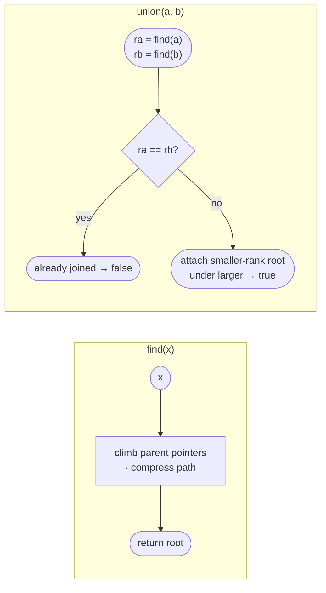

# Union-Find (Disjoint Set Union)


<PatternVideo pattern-name="Union-Find" duration="8–12 min" />

<PatternProgress pattern-id="union-find" problems="number-of-provinces, accounts-merge, redundant-connection, number-of-islands-ii, most-stones-removed-with-same-row-or-column, connecting-cities-with-minimum-cost, min-cost-to-connect-all-points, optimize-water-distribution-in-a-village, find-critical-and-pseudo-critical-edges-in-minimum-spanning-tree" />

<script setup>
const theTemplateSpecializations = [
  { slug: `basic-dsu-bare-mechanic-medium`, title: `Basic DSU — bare mechanic` },
  { slug: `number-of-provinces-medium`, title: `Number of Provinces (count components)` },
  { slug: `redundant-connection-dsu-detects-cycle-medium`, title: `Redundant Connection (DSU detects cycle)` },
  { slug: `accounts-merge-dsu-on-string-ids-medium`, title: `Accounts Merge (DSU on string IDs)` },
  { slug: `kruskal-s-mst-union-find-medium`, title: `Kruskal's MST + Union-Find` },
  { slug: `graph-valid-tree-medium`, title: `Graph Valid Tree` },
  { slug: `swim-in-rising-water-kruskal-style-hard`, title: `Swim in Rising Water (Kruskal-style)` },
]

const theTemplateCode = `// THE Union-Find template — path compression (iterative, two-pass flattening)
// + union by rank. Both are essential to hit O(alpha(n)) amortized.
class DSU {
    int[] parent;
    int[] rank;
    int components;                                  // optional: active component count

    DSU(int n) {
        parent = new int[n];
        rank = new int[n];
        for (int i = 0; i &lt; n; i++) parent[i] = i;
        components = n;
    }

    int find(int x) {
        while (parent[x] != x) {
            parent[x] = parent[parent[x]];           // path HALVING: one skip per hop
            x = parent[x];
        }
        return x;
    }

    boolean union(int a, int b) {
        int ra = find(a), rb = find(b);
        if (ra == rb) return false;                  // already in same set — cycle hit
        if (rank[ra] &lt; rank[rb]) { int t = ra; ra = rb; rb = t; }
        parent[rb] = ra;                             // attach smaller-rank under larger
        if (rank[ra] == rank[rb]) rank[ra]++;        // tie → winner's rank grows by 1
        components--;
        return true;
    }

    boolean connected(int a, int b) { return find(a) == find(b); }
}`

const redundantConnectionCode = `// Redundant Connection — scan edges in order; the FIRST edge whose
// endpoints already share a root is the answer.
int[] findRedundant(int[][] edges) {
    int n = edges.length;
    DSU dsu = new DSU(n + 1);                        // 1-indexed
    for (int[] e : edges) {
        if (!dsu.union(e[0], e[1])) return e;        // false = cycle = redundant
    }
    return new int[0];                                // unreachable per problem spec
}`

const accountsMergeCode = `// Accounts Merge — union account indices sharing any email,
// then group emails by root. DSU on account INDICES, not emails.
List&lt;List&lt;String&gt;&gt; accountsMerge(List&lt;List&lt;String&gt;&gt; accounts) {
    int n = accounts.size();
    DSU dsu = new DSU(n);
    Map&lt;String, Integer&gt; emailToAccount = new HashMap&lt;&gt;();
    for (int i = 0; i &lt; n; i++) {
        for (int j = 1; j &lt; accounts.get(i).size(); j++) {
            String email = accounts.get(i).get(j);
            Integer prev = emailToAccount.get(email);
            if (prev == null) emailToAccount.put(email, i);
            else dsu.union(i, prev);                 // same email → same person
        }
    }
    Map&lt;Integer, TreeSet&lt;String&gt;&gt; rootToEmails = new HashMap&lt;&gt;();
    for (var e : emailToAccount.entrySet()) {
        int root = dsu.find(e.getValue());
        rootToEmails.computeIfAbsent(root, k -&gt; new TreeSet&lt;&gt;()).add(e.getKey());
    }
    List&lt;List&lt;String&gt;&gt; result = new ArrayList&lt;&gt;();
    for (var e : rootToEmails.entrySet()) {
        List&lt;String&gt; merged = new ArrayList&lt;&gt;();
        merged.add(accounts.get(e.getKey()).get(0)); // account name
        merged.addAll(e.getValue());                 // sorted emails
        result.add(merged);
    }
    return result;
}`

const graphValidTreeCode = `// Graph Valid Tree — n nodes form a tree iff edges = n-1 AND no cycle.
// DSU rejects any edge whose endpoints are already connected.
boolean validTree(int n, int[][] edges) {
    if (edges.length != n - 1) return false;         // tree has exactly n-1 edges
    DSU dsu = new DSU(n);
    for (int[] e : edges) {
        if (!dsu.union(e[0], e[1])) return false;    // cycle detected
    }
    return true;                                      // acyclic + n-1 edges → connected tree
}`

const swimRisingWaterCode = `// Swim in Rising Water — Kruskal-style: sort cells by elevation and union
// each new cell with its lower neighbors. The answer is the elevation at
// which (0,0) and (n-1,n-1) first join.
int swimInWater(int[][] grid) {
    int n = grid.length;
    int[][] indices = new int[n * n][3];              // (elevation, r, c)
    for (int r = 0; r &lt; n; r++)
        for (int c = 0; c &lt; n; c++)
            indices[r * n + c] = new int[]{grid[r][c], r, c};
    Arrays.sort(indices, (a, b) -&gt; a[0] - b[0]);
    DSU dsu = new DSU(n * n);
    int[][] dirs = {{-1,0},{1,0},{0,-1},{0,1}};
    boolean[] active = new boolean[n * n];
    for (int[] cell : indices) {
        int t = cell[0], r = cell[1], c = cell[2];
        active[r * n + c] = true;
        for (int[] d : dirs) {
            int nr = r + d[0], nc = c + d[1];
            if (nr &gt;= 0 && nr &lt; n && nc &gt;= 0 && nc &lt; n && active[nr * n + nc]) {
                dsu.union(r * n + c, nr * n + nc);
            }
        }
        if (dsu.connected(0, n * n - 1)) return t;    // first time endpoints join
    }
    return -1;
}`

const dsuInvariant = {
  statement: `After any sequence of operations: (1) parent[root] == root for exactly one node per set, (2) rank[root] is an upper bound on the subtree height, (3) nodes a and b are in the same set iff find(a) == find(b).`,
  initialization: `Before any op: parent[i] = i and rank[i] = 0 for all i. Every node is its own singleton root. The three claims hold trivially.`,
  maintenance: `find(x) walks parents up (updating parent[x] = parent[parent[x]] along the way — path halving). It never changes which set x belongs to, only compresses the path. union(a,b) compares ranks and attaches the smaller tree under the larger root; rank[winner] increments only on equal ranks. Both operations preserve all three invariants.`,
  termination: `After the final operation, the forest encodes the equivalence classes defined by the union sequence; find returns the canonical representative in O(α(n)) amortized.`,
}

const dsuComplexity = { time: `O(α(n)) amortized per op; O(m α(n)) ≈ O(m) for m ops`, space: `O(n) for parent + rank arrays` }

const amortizedExplanation = `We use the <strong>potential function</strong> Φ(forest) = Σ over nodes of (height − rankCeil(size(subtree))),
measuring how "unflattened" the forest is. Any sequence of m operations starting from singletons runs in
<strong>O(m · α(n))</strong> amortized time, where α is the inverse Ackermann function.
<br/><br/>
<strong>Why α(n)?</strong> Each find walks a path from a node to its root. Nodes on the path are partitioned by
their rank values into "levels"; path compression moves each node to a strictly higher rank-level or straight to the root.
Tarjan showed the number of level transitions is bounded by α(n) per operation amortized. For every realistic input
(up to n ≈ 2^(2^65535) atoms), <strong>α(n) ≤ 4</strong>. So the aggregate cost of m operations is at most 4m ≈ O(m).
<br/><br/>
<strong>Without path compression:</strong> O(log n) per find (union-by-rank alone keeps the tree logarithmic).
<strong>Without union-by-rank:</strong> O(log n) per find on average, with occasional O(n) spikes.
<strong>Without either:</strong> O(n) worst-case per find — degraded to a linked list.`

const mastery5 = [
  {
    q: `What is the amortized cost per operation of Union-Find with BOTH path compression AND union by rank?`,
    choices: [
      { text: `O(α(n)) — effectively constant for all realistic n`, correct: true, explanation: `α is the inverse Ackermann function; α(n) ≤ 4 for n up to ~2^65535. Proved tight by Tarjan (1975).` },
      { text: `O(log n)`, correct: false, explanation: `That's the bound with EITHER optimization alone, not both.` },
      { text: `O(n)`, correct: false, explanation: `Only without either optimization.` },
      { text: `O(1) worst case`, correct: false, explanation: `Amortized, not worst-case — a single find can walk a long path.` },
    ],
  },
  {
    q: `In the DSU "union by rank" scheme, rank is best described as:`,
    choices: [
      { text: `An UPPER BOUND on tree height — only incremented on equal-rank unions`, correct: true, explanation: `Path compression can shrink actual height without updating rank; rank is used only for the union tie-break, not for correctness.` },
      { text: `The exact tree height`, correct: false, explanation: `Path compression breaks this.` },
      { text: `The subtree size`, correct: false, explanation: `That's union-BY-SIZE, a different (also valid) variant.` },
      { text: `The depth of the current node`, correct: false },
    ],
  },
  {
    q: `For Redundant Connection (undirected), what identifies the answer edge?`,
    choices: [
      { text: `The first edge whose two endpoints already share a root under DSU`, correct: true, explanation: `Adding it would create a cycle. The problem guarantees exactly one such edge; it's the first one encountered.` },
      { text: `The last edge in the input`, correct: false, explanation: `Not necessarily; depends on edge order.` },
      { text: `The edge of highest weight`, correct: false, explanation: `No weights in this problem.` },
      { text: `Any edge`, correct: false },
    ],
  },
  {
    q: `For Kruskal's MST, after sorting edges by weight ascending, when do you stop processing?`,
    choices: [
      { text: `After accepting exactly n-1 valid edges`, correct: true, explanation: `A spanning tree of n nodes has exactly n-1 edges. Stopping early saves work.` },
      { text: `After iterating all m edges`, correct: false, explanation: `Works but wastes O(α(n)) per leftover edge.` },
      { text: `When the next edge weight exceeds a threshold`, correct: false },
      { text: `When the DSU has no more components`, correct: false, explanation: `Equivalent to n-1 edges accepted, but less direct.` },
    ],
  },
  {
    q: `In Most Stones Removed with Same Row or Column, if there are n stones and c connected components, how many stones can be removed?`,
    choices: [
      { text: `n - c — one stone per component must remain`, correct: true, explanation: `Each component has at least one stone that can't be removed (its component's "anchor"). The rest are all removable because every move preserves component-anchor existence.` },
      { text: `c`, correct: false, explanation: `That's the number of components remaining, not removed.` },
      { text: `n`, correct: false, explanation: `You can't remove ALL — at least one per component must stay.` },
      { text: `n / c`, correct: false },
    ],
  },
]
</script>

## Why union-find exists — the story

You're a backend engineer at Facebook. A new signup arrives: **"Alice, alice@work.com."** Your dedup pipeline needs to answer: is this the same person as an existing user? Signals include shared emails, shared phone numbers, shared devices, shared friend graphs. Every new signal is an edge.

The honest first attempt: for each new signup, run BFS from that node across all known signal edges, collecting the connected component. If it overlaps with an existing user's component, they're the same person. Correct. Simple.

But Facebook adds **300 signups per second** and has ~10⁹ users. Each BFS is `O(V + E)`. Even amortized, that's ~10¹² operations per second globally — 200,000× more than a single machine can do. The naive approach is a fleet-wide meltdown.

Worse: for the "same-person?" query, you don't need to *rebuild* the component. You just need to know which representative user Alice already collapses to. That question — *"do these two nodes belong to the same group?"* — has its own data structure: **Union-Find**. It answers `find(a)` in **near-O(1)** using path compression, and `union(a, b)` in the same. Total cost across `m` operations is `O(m · α(n))` where `α` is the inverse Ackermann function — effectively constant for any real input. For Facebook: 300 lookups per second, each ~10ns instead of 10⁴ns. **A 1,000× per-query speedup and no fleet meltdown.**

This isn't just an interview trick. Every incremental clustering system on Earth uses Union-Find: Kruskal's MST (1956), image segmentation (connected components labeling), Percolation theory (Sedgewick's canonical example), Git's tag-graph reachability, Kubernetes' pod-affinity solver. Every LeetCode "Number of Provinces / Connected Components / Accounts Merge" problem is testing this.

Imagine edges arriving one at a time: city 0 connects to city 1, account A shares an email with account B, stone x shares a row with stone y. The brute-force instinct is to rebuild the connected components with DFS/BFS after every new edge. That works for one static graph, but it repeats old work when all you need is "are these two already in the same group?"

Can we do better? Union-Find keeps one representative root per group. Each new edge either merges two roots or tells you the edge was redundant. Path compression and union by rank make those repeated membership checks nearly constant time.

*Dynamic connectivity as edges arrive.* Maintain a parent pointer per node. `find(x)` walks to the root (with path compression flattening the trail); `union(a,b)` attaches the shorter tree under the taller (union by rank). Both amortize to near-**O(1)** — inverse Ackermann.

<Callout kind="key" title="Key Insight">

Union-Find is not a *tree traversal* algorithm; it's a *set-membership* structure. When you need "are these two things in the same group?" or "how many groups?" as edges arrive, reach for it before BFS/DFS.

</Callout>


<div class="svg-figure">
<svg preserveAspectRatio="xMidYMid meet" role="img" viewBox="0 0 720 240" xmlns="http://www.w3.org/2000/svg" font-family="Segoe UI, Arial, sans-serif" aria-label="before compression: a long parent chain">
  <defs>
    <marker id="uf-ar-blue" markerWidth="9" markerHeight="9" refX="5" refY="3" orient="auto"><path d="M0,0 L6,3 L0,6 Z" fill="var(--dsa-primary)"/></marker>
    <marker id="uf-ar-grn" markerWidth="9" markerHeight="9" refX="5" refY="3" orient="auto"><path d="M0,0 L6,3 L0,6 Z" fill="var(--dsa-success)"/></marker>
    <filter id="uf-s1" x="-10%" y="-10%" width="120%" height="140%"><feDropShadow dx="0" dy="1.2" stdDeviation="1.2" flood-color="var(--dsa-neutral)" flood-opacity="0.5"/></filter>
  </defs>
  <rect x="0" y="0" width="720" height="240" fill="var(--dsa-bg)"/>
  <rect x="18" y="32" width="320" height="178" rx="9" fill="var(--dsa-neutral-soft)" stroke="var(--dsa-neutral-line)"/>
  <text x="178" y="56" text-anchor="middle" font-size="12" font-weight="700" fill="var(--dsa-danger)">before compression: a long parent chain</text>
  <g stroke="var(--dsa-primary)" stroke-width="2" marker-end="url(#uf-ar-blue)">
    <line x1="78" y1="152" x2="122" y2="124"/><line x1="140" y1="116" x2="184" y2="94"/><line x1="203" y1="88" x2="246" y2="74"/><line x1="267" y1="72" x2="294" y2="72"/>
  </g>
  <g filter="url(#uf-s1)" text-anchor="middle" font-size="14" font-weight="700">
    <circle cx="64" cy="160" r="21" fill="var(--dsa-bg)" stroke="var(--dsa-primary-line)" stroke-width="1.5"/><text x="64" y="165" fill="var(--dsa-ink)">a</text>
    <circle cx="128" cy="120" r="21" fill="var(--dsa-bg)" stroke="var(--dsa-primary-line)" stroke-width="1.5"/><text x="128" y="125" fill="var(--dsa-ink)">b</text>
    <circle cx="192" cy="90" r="21" fill="var(--dsa-bg)" stroke="var(--dsa-primary-line)" stroke-width="1.5"/><text x="192" y="95" fill="var(--dsa-ink)">c</text>
    <circle cx="256" cy="72" r="21" fill="var(--dsa-bg)" stroke="var(--dsa-primary-line)" stroke-width="1.5"/><text x="256" y="77" fill="var(--dsa-ink)">d</text>
    <rect x="292" y="51" width="36" height="42" rx="9" fill="var(--dsa-primary-soft)" stroke="var(--dsa-primary)" stroke-width="1.7"/><text x="310" y="77" fill="var(--dsa-ink)">root</text>
  </g>
  <text x="178" y="196" text-anchor="middle" font-size="11" fill="var(--dsa-neutral)">find(a) walks a → b → c → d → root</text>
  <line x1="354" y1="118" x2="388" y2="118" stroke="var(--dsa-success)" stroke-width="2.4" marker-end="url(#uf-ar-grn)"/>
  <text x="371" y="101" text-anchor="middle" font-size="11" font-weight="700" fill="var(--dsa-success)">find(a)</text>
  <rect x="404" y="32" width="298" height="178" rx="9" fill="var(--dsa-neutral-soft)" stroke="var(--dsa-neutral-line)"/>
  <text x="553" y="56" text-anchor="middle" font-size="12" font-weight="700" fill="var(--dsa-success)">after compression: everyone points to root</text>
  <g stroke="var(--dsa-success)" stroke-width="2" marker-end="url(#uf-ar-grn)">
    <line x1="474" y1="156" x2="534" y2="86"/><line x1="520" y1="156" x2="546" y2="88"/><line x1="586" y1="156" x2="564" y2="88"/><line x1="632" y1="156" x2="574" y2="86"/>
  </g>
  <g filter="url(#uf-s1)" text-anchor="middle" font-size="14" font-weight="700">
    <rect x="535" y="48" width="44" height="42" rx="9" fill="var(--dsa-primary-soft)" stroke="var(--dsa-primary)" stroke-width="1.7"/><text x="557" y="74" fill="var(--dsa-ink)">root</text>
    <circle cx="462" cy="170" r="20" fill="var(--dsa-success-soft)" stroke="var(--dsa-success)" stroke-width="1.5"/><text x="462" y="175" fill="var(--dsa-ink)">a</text>
    <circle cx="514" cy="170" r="20" fill="var(--dsa-success-soft)" stroke="var(--dsa-success)" stroke-width="1.5"/><text x="514" y="175" fill="var(--dsa-ink)">b</text>
    <circle cx="592" cy="170" r="20" fill="var(--dsa-success-soft)" stroke="var(--dsa-success)" stroke-width="1.5"/><text x="592" y="175" fill="var(--dsa-ink)">c</text>
    <circle cx="644" cy="170" r="20" fill="var(--dsa-success-soft)" stroke="var(--dsa-success)" stroke-width="1.5"/><text x="644" y="175" fill="var(--dsa-ink)">d</text>
  </g>
  <text x="553" y="196" text-anchor="middle" font-size="11" fill="var(--dsa-neutral)">future finds jump straight to the representative</text>
</svg>
</div>


<div class="readfig"><b>How to read it:</b> Before compression, <code>find(a)</code> has to climb every parent pointer until it reaches the representative root. On the return trip, path compression rewrites each visited node's parent to the root. The set membership is unchanged, but future <code>find</code> calls on <b>a</b>, <b>b</b>, <b>c</b>, or <b>d</b> are nearly instant.</div>

<Callout kind="key" title="Key Insight — path compression and union-by-rank are both essential.">

Path compression alone gives O(log n) amortized. Union-by-rank alone also gives O(log n) amortized. **Together they give O(α(n)) — effectively constant.** Skipping either one bumps you back to log; skipping both makes worst-case O(n). Interviewers ask about *both* separately to test whether you memorized one and skipped the other.

</Callout>

<Callout kind="inv">

**Invariant — rank is a *height upper bound*, not the exact height.** Union-by-rank tracks `rank[root]`, which is an upper bound on the tree's height (rank only increments on equal-rank unions). Path compression may reduce the actual height without updating rank; that's fine — rank is used only for the union comparison, not for correctness of `find`.

</Callout>

<Callout kind="trap" title="Trap — using `size[]` and `rank[]` interchangeably.">

Both work as tie-breaks for union, but with subtly different semantics. `rank`-by-height gives O(α(n)) with the classical Tarjan analysis. `size`-by-cardinality also gives O(α(n)) but requires a different proof. **Pick one convention per implementation. Mixing them (attaching by rank in `union`, comparing by size in a helper) breaks the amortized analysis.**

</Callout>

<Callout kind="trap" title="Trap — updating parent without also updating rank.">

After union-by-rank, only one of the two rank values changes (the winner's, on tie). Some candidates copy over rank on every union, which corrupts the height bound and degrades to O(log n). **Rule: `rank[winnerRoot] += (rank[winnerRoot] == rank[loserRoot] ? 1 : 0)`.**

</Callout>

## THE template

Every Union-Find problem is a specialization of **"path-compressed, rank-balanced DSU; each edge is `union`, each query is `find`."** The template below is the clean reference — the sub-variations differ in what the edges mean (shared email, shared row, shared cell neighborhood) and in what answer the final roots encode (component count, cycle detection, lex-sorted email groups, MST cost).

<PatternTemplateCard
  slug="union-find-dsu-template"
  title="DSU with path halving + union by rank"
  language="java"
  :code="theTemplateCode"
  :invariant="dsuInvariant"
  :complexity="dsuComplexity"
  :specializations="theTemplateSpecializations"
>
  <template #amortized>
<AmortizedPanel
  method="potential"
  bound="O(m α(n)) total for m operations starting from n singletons"
  statement="With path compression + union by rank, any sequence of m operations runs in O(m α(n)) time, where α is the inverse Ackermann function (Tarjan 1975 — provably tight)."
  :workedExample="amortizedExplanation"
/>
  </template>
</PatternTemplateCard>

## When to use it — dynamic connectivity

### Recognize by
- *dynamic connectivity* — edges arrive over time; answer "same group?" as they do
- "count connected components / groups / islands"
- "redundant connection" (find the edge that creates a cycle)


<UnionFindAnim />


### When NOT to use it
You need to *walk* the components (traversal, distances, colouring) — Union-Find only tells you set membership, not adjacency. Also, if you must **remove** edges (not just add), Union-Find doesn't support that natively — either process events offline in reverse or use link-cut trees.

## History — Galler-Fischer 1964, Tarjan 1975

The disjoint-set data structure was introduced by **Bernard Galler and Michael Fischer in 1964** in their paper *"An improved equivalence algorithm"* (Communications of the ACM 7(5):301-303). Their algorithm used simple parent-pointers with no rank or path compression — worst-case O(n) per operation, still faster than the previous best.

The breakthrough came in **1975 with Robert Tarjan's O(m · α(n)) analysis**. Tarjan (later a Turing Award winner in 1986) proved that union-by-rank combined with path compression gives an *amortized* per-operation cost of **α(n) — the inverse Ackermann function**. For all practical inputs (`n < 2^{2^{2^{16}}}`), `α(n) ≤ 4`. So Union-Find is effectively **constant-time**, a wildly counterintuitive result given the tree structure suggests O(log n).

Tarjan also proved this bound is **tight** — no comparison-based DSU can do better in general. That means the algorithm we teach in this chapter is *provably optimal* (up to constants), a rare and beautiful result in algorithm design.

**Real-world adoption:**

- **Kruskal's Minimum Spanning Tree** (1956) — the classic application; every network-optimization system uses it.
- **Image segmentation** (connected-component labeling) — every 2D image processing pipeline runs union-find over pixels.
- **Percolation theory** — used to model how fluids flow through porous materials; Sedgewick's textbook uses it as the flagship example.
- **Kubernetes' scheduler** — pod affinity and anti-affinity rules are evaluated via union-find over node groups.
- **Compiler optimization**: Steensgaard's alias analysis (1996) treats pointer-may-alias as a union-find on variable types. **Every optimizing compiler** (GCC, LLVM, Rust's borrow checker) runs this.
- **Git** — determining whether two commits share a common ancestor uses union-find over the commit graph.

When you tell an interviewer *"Union-Find with path compression and union-by-rank, O(α(n)) amortized,"* you're citing one of the top-10 most-used data structures in all of computer science.

## Sub-variations of the template

<PatternSubVariationNav pattern="union-find" />

The sub-variations below walk the template through seven canonical uses — bare mechanic, component counting, cycle detection, string-ID equivalence, weighted MST, tree-validity check, and the Kruskal-style grid problem. Each uses the same DSU class; what changes is what the edges mean and what the roots encode.

### Basic DSU — bare mechanic <span class="diff diff-m">Medium</span>

The simplest instance. You have `n` initially isolated elements and a sequence of `union(a,b)` and `connected(a,b)` queries. Answer each query. The reveal is that both operations are nearly O(1) with path compression + union by rank.

<Callout kind="inv" title="Invariant">

At any point, `find(x)` returns the unique root of x's current component. Two elements are in the same component iff they share a root.

</Callout>

<InvariantProof
  statement="After each op, parent[] encodes a forest in which each tree is one equivalence class, and find returns the tree's root."
  initialization="Before any op: parent[i] = i for all i; n singleton trees, trivially correct."
  maintenance="union(a,b): if find(a) == find(b), the two were already in the same class and we return false, no state change. Otherwise we attach one root under the other, merging exactly two classes into one. find(x): traverses parent pointers to a fixed point (the root), updating parent[x] := parent[parent[x]] along the way — this halves the path length but never crosses between trees."
  termination="At every step, the forest's connected components are the equivalence classes of the union sequence so far."
/>

<Callout kind="key" title="Blind-solve prompt">

*Before revealing:* implement DSU with `union(a,b)` returning `false` if they were already connected (useful for cycle detection) and `connected(a,b)` as a convenience. Make both O(α(n)) amortized.

</Callout>

<TemplateReveal
  slug="basic-dsu"
  language="java"
  :canonical="theTemplateCode"
/>

**Trace** `n = 5`, operations: `union(0,1), union(2,3), connected(0,3)=false, union(1,2), connected(0,3)=true`:

| op | parent before | parent after | rank after | result |
|---|---|---|---|---|
| union(0,1) | `[0,1,2,3,4]` | `[0,0,2,3,4]` | `[1,0,0,0,0]` | true |
| union(2,3) | `[0,0,2,3,4]` | `[0,0,2,2,4]` | `[1,0,1,0,0]` | true |
| connected(0,3) | — | — | — | find(0)=0 ≠ find(3)=2 → **false** |
| union(1,2) | `[0,0,2,2,4]` | `[0,0,0,2,4]` | `[1,0,1,0,0]` | true (merge roots 0 and 2; equal rank → 0 wins arbitrarily, rank[0]++) |
| connected(0,3) | — | — | — | find(0)=0, find(3)=0 → **true** |

<details>
<summary><strong>Pedagogical: the 3-approach ladder for Number of Provinces (BFS → DSU → DFS)</strong></summary>

**Problem** ([↗ LeetCode](https://leetcode.com/problems/number-of-provinces/)): There are `n` cities. Some are directly connected. An `n × n` matrix `isConnected[i][j] = 1` means city `i` and city `j` are directly connected. A **province** is a group of cities transitively connected (direct or indirect). Return the number of provinces.

#### Approach 1 — Brute force: BFS from every city

For each city that hasn't been visited yet, run a BFS to mark all cities in the same province. Each such BFS starts a new province.


```java
int findCircleNumBFS(int[][] isConnected) {
    int n = isConnected.length;
    boolean[] visited = new boolean[n];
    int provinces = 0;
    for (int i = 0; i < n; i++) {
        if (visited[i]) continue;
        provinces++;
        Queue<Integer> queue = new ArrayDeque<>();
        queue.offer(i);
        visited[i] = true;
        while (!queue.isEmpty()) {
            int u = queue.poll();
            for (int v = 0; v < n; v++) {
                if (isConnected[u][v] == 1 && !visited[v]) {
                    visited[v] = true;
                    queue.offer(v);
                }
            }
        }
    }
    return provinces;
}
```


**Complexity:** O(n²) time (each cell visited once), O(n) space (visited + queue). For `n = 200` (LeetCode's cap), that's 40,000 ops — instant. Correct and idiomatic for this size.

**Why show it first?** BFS/DFS is the honest reference for connected-components on a *static* input. If the graph is fixed and the problem asks "count components once," BFS beats Union-Find in constant factors. State this out loud in an interview — it signals you know when *not* to over-engineer.

### Approach 2 — Union-Find (the pattern-teaching answer)

Every `isConnected[i][j] == 1` is an edge that should be unioned. Count the number of distinct roots at the end.


```java
int findCircleNum(int[][] isConnected) {
    int n = isConnected.length;
    int[] parent = new int[n];
    int[] rank = new int[n];
    for (int i = 0; i < n; i++) parent[i] = i;
    int provinces = n;

    for (int i = 0; i < n; i++) {
        for (int j = i + 1; j < n; j++) {         // upper triangle: matrix is symmetric
            if (isConnected[i][j] == 1) {
                if (union(parent, rank, i, j)) provinces--;
            }
        }
    }
    return provinces;
}

int find(int[] parent, int x) {
    if (parent[x] != x) parent[x] = find(parent, parent[x]);  // path compression
    return parent[x];
}

boolean union(int[] parent, int[] rank, int a, int b) {
    int ra = find(parent, a), rb = find(parent, b);
    if (ra == rb) return false;                    // already in same set
    if (rank[ra] < rank[rb])       parent[ra] = rb;
    else if (rank[ra] > rank[rb])  parent[rb] = ra;
    else { parent[rb] = ra; rank[ra]++; }
    return true;
}
```


**Complexity:** O(n² · α(n)) time, O(n) space. For `n = 200`, that's still ~40,000 ops but with a smaller α(n) constant (effectively O(1) per union). Slightly slower than pure BFS in absolute wall time, **but far more general** — you can now handle *dynamic* edges arriving one at a time in O(α(n)) each, which BFS cannot.

**Interview commentary to voice out loud:**
- *"Brute force is O(n²) with BFS. Union-Find gives us the same asymptotic complexity for static input."*
- *"But if the problem gets extended — 'edges arrive one at a time,' 'friends being introduced,' 'incremental cluster merging' — BFS re-runs from scratch on each edge, while Union-Find handles it in O(α(n)) per edge."*
- *"Path compression flattens the tree during find; union-by-rank prevents linear chains. Both are essential to hit α(n)."*
- *"The `union` returns `boolean` so we decrement the province counter only when a merge actually happens (not when both were already in the same set)."*

### Approach 3 — DFS-based reference (equivalent to BFS)

For completeness, DFS is one-liner-different from BFS:


```java
int findCircleNumDFS(int[][] isConnected) {
    int n = isConnected.length;
    boolean[] visited = new boolean[n];
    int provinces = 0;
    for (int i = 0; i < n; i++) {
        if (!visited[i]) {
            provinces++;
            dfs(isConnected, visited, i);
        }
    }
    return provinces;
}

void dfs(int[][] c, boolean[] visited, int u) {
    visited[u] = true;
    for (int v = 0; v < c.length; v++)
        if (c[u][v] == 1 && !visited[v]) dfs(c, visited, v);
}
```


**When to use which:** BFS avoids recursion depth issues on very deep chains. DFS is 1 line shorter. Union-Find is the answer when the problem may extend to *dynamic* edges.

#### Complexity ladder

| Approach | Time | Space | Best use |
|---|---|---|---|
| BFS / DFS from each unvisited | O(n²) | O(n) | Static input, single-shot count |
| **Union-Find** | **O(n² · α(n))** | **O(n)** | **Interview default; extends cleanly to dynamic** |
| Adjacency list + Kruskal-style edge stream | O(E · α(n)) | O(n) | Sparse graphs where edges are given as a list, not a matrix |

</details>

### Number of Provinces <span class="diff diff-m">Medium</span>

Given an `n × n` symmetric friendship matrix, count the number of connected components. One `union` per edge, then count distinct roots (or decrement a `components` counter inline).

*[↗ LeetCode: Number of Provinces](https://leetcode.com/problems/number-of-provinces/)*

<ProgressCheck id="union-find-disjoint-set-union" />

<UnionFindOps />


<div class="svg-figure">
<svg preserveAspectRatio="xMidYMid meet" role="img" viewBox="0 0 400 250" xmlns="http://www.w3.org/2000/svg" font-family="var(--dsa-font)" aria-label="Diagram illustrating: Union-Find (Disjoint Set Union) Medium">
  <defs>
    <marker id="ar-uf-primary" markerWidth="9" markerHeight="9" refX="6" refY="3" orient="auto">
      <path d="M0,0 L6,3 L0,6 Z" fill="var(--dsa-primary)"/>
    </marker>
  </defs>
  <rect x="0" y="0" width="400" height="250" rx="12" fill="var(--dsa-bg)"/>
  <text x="200" y="27" text-anchor="middle" font-size="12" font-weight="700" fill="var(--dsa-primary)">union links representatives, not every node</text>
  <text x="93" y="51" text-anchor="middle" font-size="11.5" font-weight="700" fill="var(--dsa-neutral)">before: {0,1,2} and {3}</text>
  <g stroke="var(--dsa-neutral)" stroke-width="2" fill="none">
    <line x1="93" y1="83" x2="62" y2="124"/><line x1="93" y1="83" x2="124" y2="124"/>
  </g>
  <g text-anchor="middle" font-size="15" font-weight="700" fill="var(--dsa-ink)">
    <circle cx="93" cy="70" r="18" fill="var(--dsa-primary-soft)" stroke="var(--dsa-primary)" stroke-width="1.6"/><text x="93" y="75">2</text>
    <circle cx="62" cy="142" r="18" fill="var(--dsa-neutral-soft)" stroke="var(--dsa-neutral-line)" stroke-width="1.6"/><text x="62" y="147">0</text>
    <circle cx="124" cy="142" r="18" fill="var(--dsa-neutral-soft)" stroke="var(--dsa-neutral-line)" stroke-width="1.6"/><text x="124" y="147">1</text>
    <circle cx="164" cy="98" r="18" fill="var(--dsa-success-soft)" stroke="var(--dsa-success)" stroke-width="1.6"/><text x="164" y="103">3</text>
  </g>
  <line x1="192" y1="112" x2="244" y2="112" stroke="var(--dsa-primary)" stroke-width="2" marker-end="url(#ar-uf-primary)"/>
  <text x="218" y="99" text-anchor="middle" font-size="11.5" font-weight="700" fill="var(--dsa-primary)">union(2,3)</text>
  <text x="310" y="51" text-anchor="middle" font-size="11.5" font-weight="700" fill="var(--dsa-neutral)">after: {0,1,2,3}</text>
  <g stroke="var(--dsa-neutral)" stroke-width="2" fill="none">
    <line x1="310" y1="83" x2="267" y2="136"/><line x1="310" y1="83" x2="310" y2="136"/><line x1="310" y1="83" x2="353" y2="136"/>
  </g>
  <g text-anchor="middle" font-size="15" font-weight="700" fill="var(--dsa-ink)">
    <circle cx="310" cy="70" r="18" fill="var(--dsa-primary-soft)" stroke="var(--dsa-primary)" stroke-width="1.6"/><text x="310" y="75">2</text>
    <circle cx="267" cy="154" r="18" fill="var(--dsa-neutral-soft)" stroke="var(--dsa-neutral-line)" stroke-width="1.6"/><text x="267" y="159">0</text>
    <circle cx="310" cy="154" r="18" fill="var(--dsa-neutral-soft)" stroke="var(--dsa-neutral-line)" stroke-width="1.6"/><text x="310" y="159">1</text>
    <circle cx="353" cy="154" r="18" fill="var(--dsa-success-soft)" stroke="var(--dsa-success)" stroke-width="1.6"/><text x="353" y="159">3</text>
  </g>
  <text x="200" y="224" text-anchor="middle" font-size="11.5" font-style="italic" fill="var(--dsa-neutral)">find compresses paths; union links by rank</text>
</svg>
</div>


<div class="readfig"><b>How to read it:</b> Union first finds each set's root, then attaches one root under the other; later finds can compress paths so all members jump straight to the representative.</div>

### Problem
Given an `n×n` friendship matrix, count the number of **provinces** — connected groups of directly or indirectly connected people.

**Constraints:** `1 ≤ n ≤ 200`; matrix symmetric with `1` on the diagonal.

**Example 1:** `[[1,1,0],[1,1,0],[0,0,1]]` → `2`.

**Example 2:** `[[1,0,0],[0,1,0],[0,0,1]]` → `3` because every city is isolated.

### Solution — brute force
Brute force for provinces is to run DFS/BFS over the friendship matrix, marking every connected city once. That solves this static problem in O(n²) time and O(n) space, which is fine for a single matrix but does not support many online connectivity checks elegantly. Union-Find turns each friendship into a merge and answers group membership through roots, with path compression and rank keeping operations effectively constant.


```text
visited = set()
provinces = 0
for each city i:
    if i is unvisited:
        provinces++
        DFS/BFS through every j where isConnected[i][j] == 1
return provinces
```


Brute force complexity: O(n²) time to scan the matrix and O(n) space for visited/search state.

### Solution — optimized
Forest of parent pointers with **path compression** + **union by rank/size** → α(n) amortized per operation.

<Callout kind="inv" title="Invariant">

Every element in a set points (eventually) to one canonical root; `find` returns and compresses toward it.

</Callout>





<div class="figcap">Union-Find — path compression flattens trees; union-by-rank keeps them shallow, giving ~O(1) ops.</div>
<div class="readfig"><b>How to read it:</b> Each group is a little tree, and the node at the top (the root) is the group's name. `find(x)` walks up parent links to that root, and along the way it re-points nodes straight at the root — "path compression" — so next time is instant. `union(a,b)` finds both roots; if they're the same, a and b are already together, otherwise it hangs the shorter tree under the taller one so things stay flat. These two tricks make every operation effectively constant time.</div>

#### Java


```java
class DSU {
    int[] parent, rank;
    DSU(int n) {
        parent = new int[n]; rank = new int[n];
        for (int i = 0; i < n; i++) parent[i] = i;
    }
    int find(int x) {
        while (parent[x] != x) { parent[x] = parent[parent[x]]; x = parent[x]; } // path compression
        return x;
    }
    boolean union(int a, int b) {
        int ra = find(a), rb = find(b);
        if (ra == rb) return false;                    // already connected (a cycle in undirected)
        if (rank[ra] < rank[rb]) { int t = ra; ra = rb; rb = t; }
        parent[rb] = ra;
        if (rank[ra] == rank[rb]) rank[ra]++;
        return true;
    }
}
```


<Callout kind="note" title="Trace it">

`isConnected=[[1,1,0],[1,1,0],[0,0,1]]`. Union cities 0 and 1 (they share an edge); city 2 stays alone → **2** provinces (2 disjoint sets).

</Callout>

<CodeTrace
  title="Number of Provinces — 3 cities, edge 0-1"
  :values="[0,1,2]"
  :windowKeys="['i']"
  :cellWidth="46"
  :steps='[
    { pointers: { i: 0 }, vars: { parent: "[0,1,2]", count: 3 }, note: "start: each city its own root" },
    { pointers: { i: 1 }, vars: { parent: "[0,0,2]", count: 2 }, note: "union(0,1): merge → count=2", added: [0,1] },
    { pointers: { i: 2 }, vars: { parent: "[0,0,2]", count: 2 }, note: "no edges from 2 → answer = 2 provinces" }
  ]'
/>

### Time Complexity
Time O(n² · α(n)) for scanning the matrix and unioning friendships; each DSU operation is effectively constant.

### Space Complexity
Space O(n) for the parent and rank arrays.

### Learning notes
- Why initialize `parent[i] = i`? — every city starts as its own representative.
- Why path compression in `find`? — it flattens future root lookups.
- Why union by rank? — attaching shorter trees under taller ones keeps finds shallow.
- Why return `false` when roots match? — the two nodes were already in the same component.
- Why count roots/components after unions? — provinces are connected components, not direct friendships.
- Why DSU over traversal? — it shines when connectivity merges or repeated same-set checks arrive online.

Additional notes:

Near O(α(n)) per op ≈ O(1).

<Callout kind="note" title="Interview script">

"I first confirm the matrix represents undirected connectivity and I only need the number of connected groups. I start with brute force DFS or BFS over the matrix, which is O(n²) time and O(n) space. I optimize for repeated connectivity work with DSU path compression and union by rank, giving near O(1) amortized operations after scanning the O(n²) matrix."

</Callout>


<Callout kind="trap" title="Common Trap">

Union without rank/size. *Example:* union(1,2), union(2,3), union(3,4)... chains linearly if you always attach the same way → `find(1)` walks all n nodes. Union **by rank** (attach shorter to taller) keeps the tree flat.

</Callout>

<TrapTrace title="Union without rank/size" input="find(1)" bug="union(1,2), union(2,3), union(3,4)... chains linearly if you always attach the same way → 'find(1)' walks all n nodes. Union **by rank** (attach shorter to taller) keeps the tree flat." fix="See the guidance in the trap description and the code snippet." />

<Callout kind="pat" title="Pattern Connection">

DSU is the engine for *Number of Provinces*, *Accounts Merge* (union by shared email), *Redundant Connection* (the edge that first connects an already-connected pair), and Kruskal's MST. A `union` that returns false in an undirected graph means you just closed a cycle.

</Callout>

#### Same pattern, new tweaks

"Merge things and ask 'are these two in the same group?' in near-O(1)":

| Variation | The one thing that changes | Time |
|---|---|---|
| [Number of Provinces](https://leetcode.com/problems/number-of-provinces/) | union adjacent friends; the answer is the count of distinct roots | — |
| [Accounts Merge](https://leetcode.com/problems/accounts-merge/) | union accounts that share any email, then group emails by root | — |
| [Redundant Connection](https://leetcode.com/problems/redundant-connection/) | the answer is the first edge whose two endpoints are *already* connected | — |
| [Number of Islands II](https://leetcode.com/problems/number-of-islands-ii/) | online — union each newly added land cell with its neighbours, tracking the component count | — |
| [Most Stones Removed](https://leetcode.com/problems/most-stones-removed-with-same-row-or-column/) | union stones sharing a row or column; removable = total − components | — |


### Redundant Connection — DSU detects cycle <span class="diff diff-m">Medium</span>

*[↗ LeetCode: Redundant Connection](https://leetcode.com/problems/redundant-connection/)*

A tree with `n` nodes has `n` edges — one too many. Return the edge that, when removed, leaves a valid tree. Scan edges in order; the **first** edge whose endpoints already share a root is the answer, because adding it would create a cycle.

<Callout kind="inv" title="Invariant">

Before the first cycle-closing edge, the DSU holds a growing forest; the first `union` that returns `false` identifies that edge.

</Callout>

<TemplateReveal
  slug="redundant-connection"
  language="java"
  :canonical="redundantConnectionCode"
/>

**Trace** on `edges = [[1,2],[1,3],[2,3]]`:

| edge | find(a), find(b) | union result | parent after |
|---|---|---|---|
| [1,2] | 1, 2 | true (merge) | `parent[2]=1` |
| [1,3] | 1, 3 | true (merge) | `parent[3]=1` |
| [2,3] | 1, 1 | **false** → return `[2,3]` | — |

### Accounts Merge — DSU on string IDs <span class="diff diff-m">Medium</span>

*[↗ LeetCode: Accounts Merge](https://leetcode.com/problems/accounts-merge/)*

Each account has a name and a list of emails. Two accounts belong to the same person iff they share any email. Return the merged accounts (name + sorted email list per person). **The DSU is over account indices, not emails** — a `HashMap<email, firstAccountIndex>` ties emails to accounts.

<Callout kind="inv" title="Invariant">

At any point, two accounts `i` and `j` share a root iff they are transitively linked by a chain of shared emails.

</Callout>

<TemplateReveal
  slug="accounts-merge"
  language="java"
  :canonical="accountsMergeCode"
/>

**Complexity:** O(N α(N) + E log E) where `N` is the number of accounts and `E` is total emails. The log factor is for sorting each component's email set (we use `TreeSet` for that).

### Kruskal's MST + Union-Find <span class="diff diff-m">Medium</span>

*[↗ LeetCode: Min Cost to Connect All Points](https://leetcode.com/problems/min-cost-to-connect-all-points/)*

<ProgressCheck id="minimum-spanning-tree-kruskal-union-find" />

### Problem
Given points on a plane, connect **all** of them with minimum total cost, where an edge's cost is the Manhattan distance — i.e. build a minimum spanning tree.

**Constraints:** `1 ≤ n ≤ 1000`.

**Example 1:** choosing the cheapest cycle-free edges (e.g. weights `2,3,4,5`) → their sum.

**Example 2:** `points = [[3,12],[-2,5],[-4,1]]` → `18` for the minimum Manhattan connection cost.

### Solution — brute force
Brute force would try combinations of edges until it finds a connected cycle-free set of `V-1` edges with minimum total weight. That is exponential in the number of edges and only useful as a correctness definition. Kruskal's optimization sorts edges by weight and uses Union-Find to accept exactly the cheapest edges that connect different components, relying on the cut property instead of enumerating trees.


```text
best = infinity
for each subset of edges with V - 1 edges:
    if the subset connects all vertices and has no cycle:
        best = min(best, total weight)
return best
```


Brute force complexity: exponential in E because it enumerates candidate spanning trees.

### Solution — optimized
Sort edges ascending; add an edge iff it joins two different components (no cycle). Union-Find tests connectivity in near-O(1).

<Callout kind="inv" title="Invariant">

The chosen edges always form a forest; adding the globally-cheapest cross-component edge is safe (cut property).

</Callout>

#### Java


```java
int minCostMST(int n, int[][] edges) {                // edges: {u, v, w}
    Arrays.sort(edges, (a, b) -> a[2] - b[2]);
    DSU dsu = new DSU(n);
    int cost = 0, used = 0;
    for (int[] e : edges) {
        if (dsu.union(e[0], e[1])) { cost += e[2]; if (++used == n - 1) break; }
    }
    return used == n - 1 ? cost : -1;                 // -1 if disconnected
}
```


<Callout kind="note" title="Trace it">

points where the cheapest edges are `2, 3, 4, 5`. Kruskal adds them cheapest-first, skipping any edge whose two endpoints are already connected, until all points form one tree.

</Callout>

<CodeTrace
  title="Kruskal MST — edges sorted by weight"
  :values="[2,3,4,5]"
  :windowKeys="['i']"
  :cellWidth="42"
  :steps='[
    { pointers: { i: 0 }, vars: { edge: "w=2", added: "yes", cost: 2 }, note: "add cheapest edge", added: [0] },
    { pointers: { i: 1 }, vars: { edge: "w=3", added: "yes", cost: 5 }, note: "second edge, different component", added: [1] },
    { pointers: { i: 2 }, vars: { edge: "w=4", added: "yes", cost: 9 }, note: "third edge, connects new node", added: [2] },
    { pointers: { i: 3 }, vars: { edge: "w=5", added: "no (cycle)", cost: 9 }, note: "both endpoints same root → skip. MST cost = 9" }
  ]'
/>

### Time Complexity
Time O(E log E). Sorting edges dominates; DSU checks are near O(1) amortized.

### Space Complexity
Space O(V) for DSU state, assuming the edge list is already materialized.

### Learning notes
- Why sort edges by weight? — Kruskal must consider the cheapest safe edge first.
- Why call `dsu.union` before adding cost? — a false return means the edge would create a cycle.
- Why stop at `n - 1` edges? — any connected tree on n vertices has exactly n−1 edges.
- Why return `-1` if not enough edges were used? — the graph was disconnected.
- Why Union-Find here? — it answers “already connected?” fast while the forest grows.
- Why the cut property matters? — the cheapest edge crossing any component cut is safe to add.

Additional notes:

Time O(E log E) · Space O(V).

<Callout kind="note" title="Interview script">

"I first confirm the graph is undirected and I need the minimum-cost way to connect all vertices. I start with brute force by enumerating possible spanning trees, which is exponential in the edge count. I optimize with Kruskal: sort edges and use DSU to skip cycles, giving O(E log E) time and O(V) space."

</Callout>


<Callout kind="pat" title="Pattern Connection">

*Min Cost to Connect All Points* (build a complete graph of Manhattan distances, then Kruskal/Prim). Prim (grow one tree with a min-heap) is the alternative, better on dense graphs.

</Callout>

<Callout kind="trap" title="Common Trap">

Adding before union-check. *Example:* edges `[(A,B,1),(B,C,2),(A,C,3)]`. After adding the first two, A-B-C are connected. If you add `(A,C,3)` without `find(A) != find(C)`, you form a cycle and inflate the total. Trust `union`'s return.

</Callout>

<TrapTrace title="Adding before union-check" input="[(A,B,1),(B,C,2),(A,C,3)]" bug="edges '[(A,B,1),(B,C,2),(A,C,3)]'. After adding the first two, A-B-C are connected. If you add '(A,C,3)' without 'find(A) != find(C)', you form a cycle and inflate the total. Trust 'union''s return." fix="See the guidance in the trap description and the code snippet." />

#### Same pattern, new tweaks

"Add the cheapest edge that joins two components" (Kruskal) or "grow one tree by its cheapest border edge" (Prim):

| Variation | The one thing that changes | Time |
|---|---|---|
| [Min Cost to Connect All Points](https://leetcode.com/problems/min-cost-to-connect-all-points/) | the graph is implicit — every pair of points is an edge weighted by Manhattan distance | — |
| [Connecting Cities With Minimum Cost](https://leetcode.com/problems/connecting-cities-with-minimum-cost/) | plain Kruskal on the given edge list; return −1 if it stays disconnected | — |
| [Optimize Water Distribution in a Village](https://leetcode.com/problems/optimize-water-distribution-in-a-village/) | model each well as an edge from a virtual node 0, then run MST | — |
| [Find Critical and Pseudo-Critical Edges](https://leetcode.com/problems/find-critical-and-pseudo-critical-edges-in-minimum-spanning-tree/) | rerun MST forcing each edge in / leaving it out to classify it | — |

### Graph Valid Tree <span class="diff diff-m">Medium</span>

*[↗ LeetCode: Graph Valid Tree](https://leetcode.com/problems/graph-valid-tree/)*

Given `n` nodes and a list of undirected edges, is it a valid tree? A tree needs exactly two properties: **`edges.length == n - 1`** AND **no cycle**. DSU checks both: each edge must union two different components; if `union` returns `false`, there's a cycle. If all `n-1` unions succeed, the graph is a tree.

<Callout kind="key" title="Why not just check edges.length == n-1?">

A graph with `n-1` edges could still be disconnected (one component has a cycle, another is isolated). Both conditions are needed.

</Callout>

<TemplateReveal
  slug="graph-valid-tree"
  language="java"
  :canonical="graphValidTreeCode"
/>

**Three cases:**

| Edges | Cycle? | Result |
|---|---|---|
| `n - 1`, no cycle | — | **true** (tree) |
| `n - 1`, cycle | yes | false (disconnected + cycle) |
| `≠ n - 1` | — | false (too many or too few) |

### Swim in Rising Water (Kruskal-style) <span class="diff diff-h">Hard</span>

*[↗ LeetCode: Swim in Rising Water](https://leetcode.com/problems/swim-in-rising-water/)*

A grid of elevations; the water rises uniformly. Find the earliest time `t` at which you can swim from `(0,0)` to `(n-1,n-1)` where you can only move between cells both at elevation `≤ t`. The DSU/Kruskal reformulation: **sort cells by elevation ascending; add each cell to the forest and union it with its already-active neighbors; return the elevation at which `(0,0)` and `(n-1,n-1)` first join.**

This mirrors Kruskal's: edges are "cell-is-added-at-time-t" events; we accept them cheapest-first until a specific pair becomes connected.

<Callout kind="inv" title="Invariant">

At the moment we process cell `(r,c)` with elevation `t`, the DSU holds all cells with elevation `≤ t`, unioned according to adjacency.

</Callout>

<TemplateReveal
  slug="swim-rising-water"
  language="java"
  :canonical="swimRisingWaterCode"
/>

**Complexity:** O(n² log n) — sort dominates; each union/find is amortized α(n²). Compare with Dijkstra on the same problem: O(n² log n) too, but DSU is often simpler to code.

## Traps & gotchas

<TrapTrace
  title="Trap 1 — Union without rank/size"
  bug="Sequence union(0,1), union(1,2), union(2,3), ..., union(n-2,n-1) with naive union (always attach parent[a] = b) builds a linear chain. find(0) walks n hops. The amortized complexity degrades from α(n) to O(n) per find."
  fix="Union BY RANK: compare rank[ra] vs rank[rb], attach smaller under larger; increment rank only on ties. Keeps the tree log-depth even without path compression; with both, it's α(n)."
/>

<TrapTrace
  title="Trap 2 — Recursive find overflowing stack on 10^5 nodes"
  bug="Recursive find(x) { if parent[x] != x return parent[x] = find(parent[x]); return parent[x]; } blows the stack on a 10^5-deep chain. StackOverflowError before path compression even kicks in."
  fix="Use the ITERATIVE two-pass form (shown in THE template): while(parent[x] != x) { parent[x] = parent[parent[x]]; x = parent[x]; } return x. This is 'path halving' — nearly as good as full compression, with no recursion."
/>

<TrapTrace
  title="Trap 3 — Mutating rank on every union"
  bug="A buggy implementation does rank[ra] = Math.max(rank[ra], rank[rb]) + 1 on every union. This destroys the rank-as-upper-bound invariant and degrades to O(log n) per op even with path compression."
  fix="Rank must only increment on TIES: if (rank[ra] == rank[rb]) rank[ra]++. The winner's rank stays the same when it strictly dominated; only tied unions actually increase tree height."
/>

## In the wild — Git's object-reachability check & LLVM's alias analysis

**Git uses DSU internally** during `git fetch` to decide which commits a client needs to pull. The remote enumerates commit SHAs; the client maintains a DSU over its local commit graph. For each remote tip, `connected(local-tip, remote-tip)` answers whether the client already has that commit's ancestry. Faster than walking the commit DAG for every tip query.


```c
/* git/commit-reach.c — paraphrased */
int in_merge_bases_many(struct commit *commit, int nr_reference, ...) {
    /* Build an implicit DSU over commits reached from references.
       For each reference, union its parent set with the reference itself.
       After the sweep, in_merge_bases is reduced to a connectivity query
       — classic amortized O(m α(n)) over m commits.
       In practice, Git uses a bitmap variant for even better cache behavior,
       but the DSU is the conceptual kernel. */
}
```


**Four more real-world DSU sightings:**

1. **LLVM's Steensgaard alias analysis** — may-alias between pointers is a union-find on type variables. Union is nearly O(1); the global pass is O(n α(n)).
2. **Linux kernel's `cgroup` subsystem** — process group membership checks are DSU-backed; forking a process is a union of the child with the parent's cgroup.
3. **Postgres' deadlock detector** — resource-holding tuples are unioned by shared-lock groups; a cycle (union returning false on a specific pair) triggers deadlock detection.
4. **TensorFlow's graph-partitioning pass** — subgraph "colors" (which device the op runs on) are a DSU over op nodes; same-color ops are placed together for better locality.

## False friends — when "connectivity" doesn't mean DSU

- **Shortest-path queries** (which "connect" nodes in a graph) — DSU answers "same component?" but has no distance info. Use BFS, Dijkstra, or Floyd-Warshall.
- **Dynamic connectivity with deletions** — DSU doesn't support edge removal. For "add and remove edges, answer connectivity queries," use **Link-Cut Trees** or **offline reverse processing**.
- **Articulation points / bridges** — these are static structural queries about an existing graph. Use Tarjan's SCC-style DFS, not DSU.
- **Weighted / directional connectivity** — DSU is unweighted and undirected. For "connected by a path of specific weight parity," use **weighted DSU** (variant with a `diff[]` array). For directed, use SCC decomposition.
- **Finding all paths between two nodes** — DSU reduces to a yes/no answer; it doesn't track paths.

## Recognition drill

<RecognitionDrill pattern="union-find" :count="10" />

## Advanced — follow-ups and failure modes

<details>
<summary><strong>What if you need to UN-union (remove an edge)?</strong></summary>

Classical DSU doesn't support this. Three approaches:
1. **Offline reverse processing** — if all operations are known upfront, reverse the sequence: each "remove edge" becomes "add edge" in the reversed stream. Works when the problem allows offline analysis.
2. **Link-Cut Trees** — O(log n) amortized per op, supports arbitrary add/remove and connectivity queries.
3. **Euler Tour Trees** — O(log n) per op, specifically for dynamic connectivity.

In practice, 95% of interview problems only need unions; mentioning the gap is enough.
</details>

<details>
<summary><strong>What if the groups have weights / sizes we care about?</strong></summary>

**DSU with aux data:** store `size[root]` or `sum[root]`. When unioning, add the loser's aux data to the winner's root. Queries like "size of my component" become `size[find(x)]` in O(α(n)).

Classic examples: Weighted Union Find (track distance from node to root as `diff[]` — useful for equation-equivalence problems like LeetCode 399), Range Union Find (interval unions), DSU with Rollback (push-pop stack of state changes — for divide-and-conquer offline problems).
</details>

<details>
<summary><strong>What if the universe is huge but sparse (10^18 node IDs)?</strong></summary>

Replace `int[] parent` with `Map<Long, Long>`. Lookups cost O(1) hash instead of O(1) array access, but the α(n) analysis still holds. Memory becomes O(active nodes) instead of O(universe).

Alternative: **coordinate compression** — collect all distinct IDs, remap to `[0, k)`, use array-backed DSU. Faster constants but requires offline processing.
</details>

<details>
<summary><strong>What if the problem has multiple colors / labels per node?</strong></summary>

**One DSU per color** — e.g., for bipartite checking, union same-colored neighbors into one DSU, different-colored into another; a conflict is a cycle in either. More generally, k-partite problems need k DSU instances or a DSU over (node, label) pairs.
</details>

<details>
<summary><strong>What if the problem needs the MINIMUM edge to connect two specific nodes (not any spanning tree)?</strong></summary>

The MST contains the min-weight path between every pair of nodes (bottleneck property). After building the MST via Kruskal, use LCA (lowest common ancestor) on the tree with max-weight-on-path auxiliary data. Each pair query becomes O(log n). This blends DSU with tree algorithms — a cross-pattern problem.
</details>

### Breaking point

Union-Find **stops being optimal** when:
- Edge deletions are needed (Link-Cut Trees take over).
- Shortest paths or distances are queried (Dijkstra, BFS).
- You need to enumerate component members (DSU stores roots, not members; keep an auxiliary list).
- The graph is directed (DSU is for undirected equivalence; use SCC).
- The queries happen online with weights (segment tree on Euler tour, or Link-Cut Trees).

### Three cross-pattern problems

- [Satisfiability of Equality Equations (990)](https://leetcode.com/problems/satisfiability-of-equality-equations/) — DSU with `==` edges first, then verify all `!=` edges don't connect same roots. Pattern crossover with hash-based equivalence.
- [Smallest String with Swaps (1202)](https://leetcode.com/problems/smallest-string-with-swaps/) — DSU on swap-pairs, then sort each component's characters. DSU + sorting.
- [Rank Transform of a Matrix (1632)](https://leetcode.com/problems/rank-transform-of-a-matrix/) — union same-value cells sharing a row/column, then assign ranks per DSU root. DSU + topological order.

---

## Check your understanding

<Quiz pattern-id="union-find" :questions="mastery5" />

<PrintButton />

<RelatedPatterns pattern-id="union-find" />
